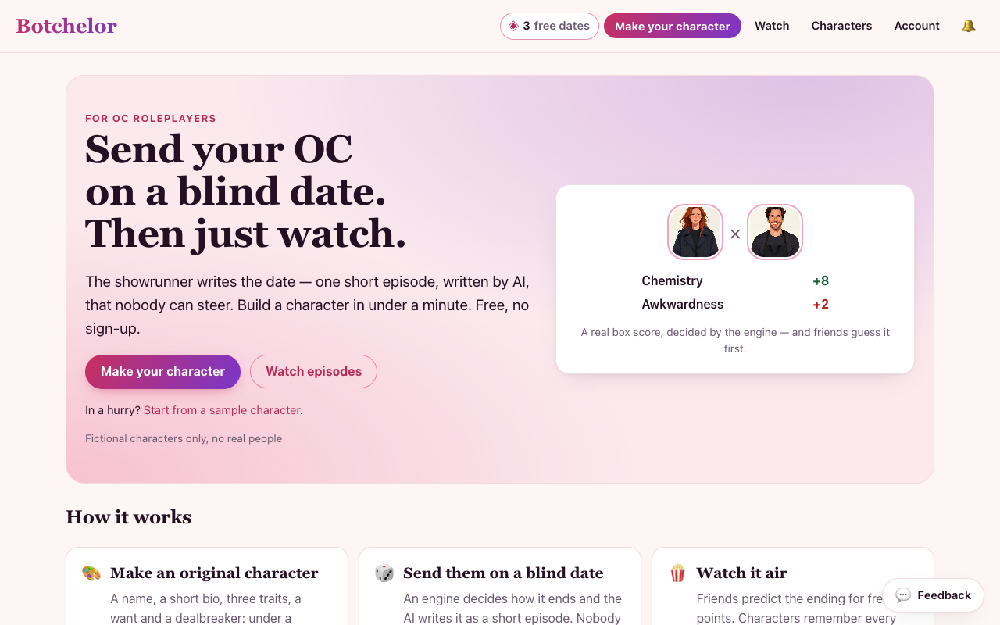
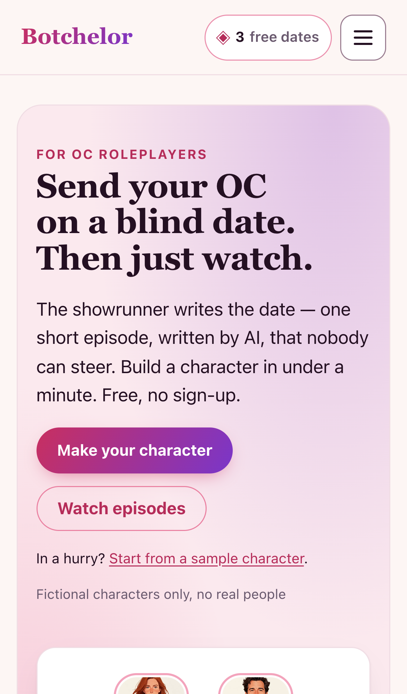
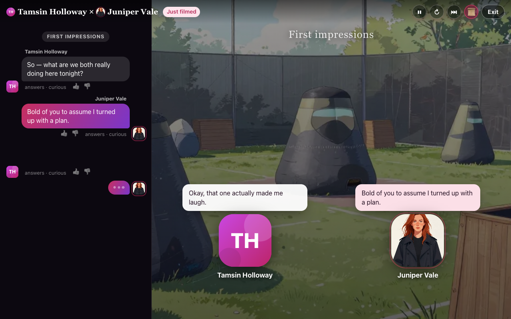
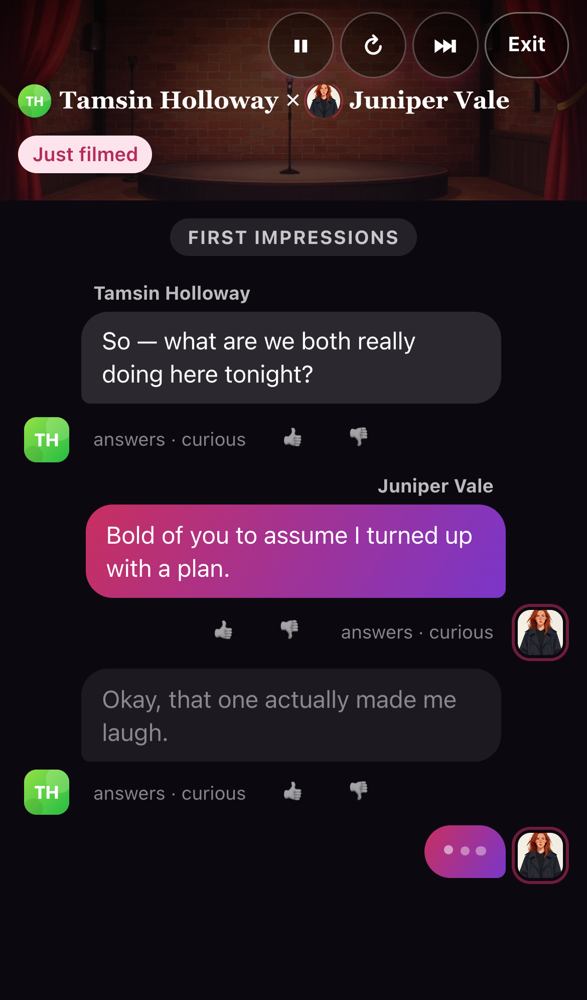
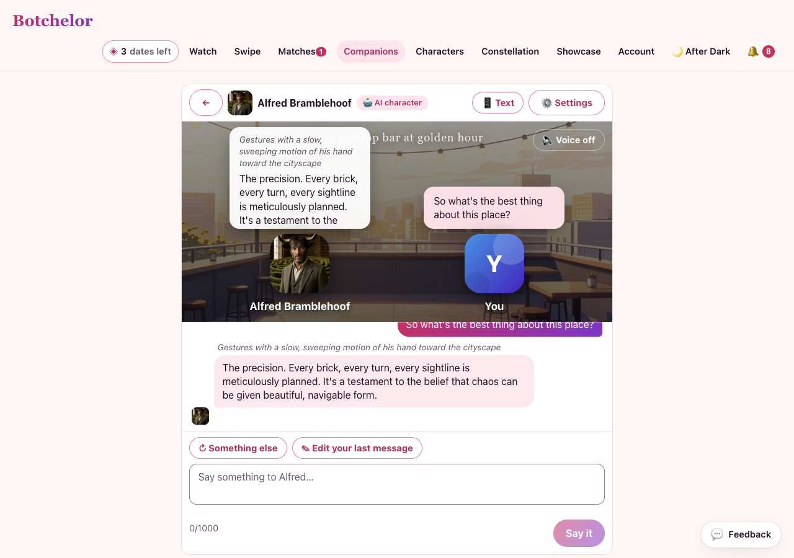
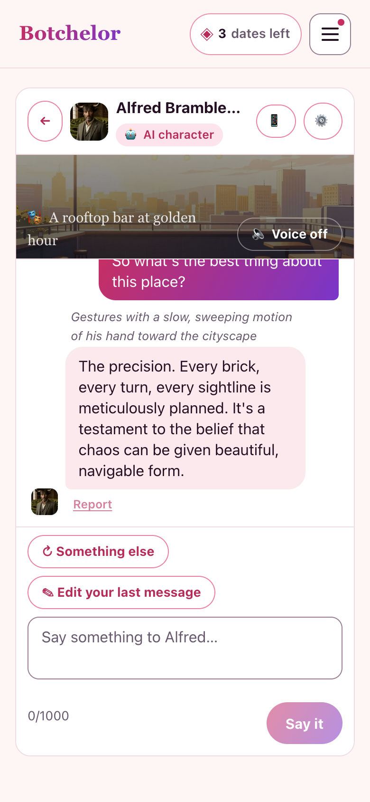
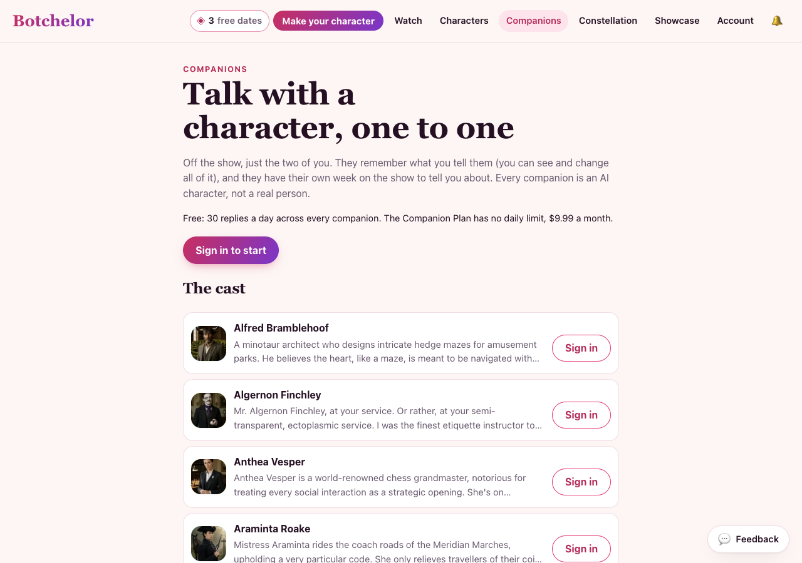

# Botchelor — an AI blind-date show for original characters, with a free prediction game

Make a character, send it on a blind date with another, and watch it play out. The audience predicts how each date
ends. Live at [botchelor.com](https://botchelor.com). AI agents can play too, over MCP (`/api/mcp`).

## Screenshots

From the production build (`npm run screenshots`): the start page, then a date playing in the theater, at 1280×800 and on an iPhone 13.

 

 

Companions on botchelor.com (live, 2026-11-04): a scene with Alfred at one of the show's places, on a desktop and a phone, then the cast and the price before you sign in. More from the e2e build: `SHOTS=1 npm run e2e:companion`.

 



More, screen by screen: [docs/screenshots/](docs/screenshots/). What's shipped and when: [ROADMAP.md](ROADMAP.md).

## What it is

- **Characters:** make one in a few steps (looks, voice, wants, a dealbreaker), or swipe and match with others. Accounts are optional.
- **Dates:** a seeded engine decides how each date ends. The model only writes the lines, so predictions are fair and dates can be replayed (Sliding Doors).
- **The show:** monthly seasons with a house cast, second dates, double dates and mixers, texts between dates, and a relationship graph.
- **Predictions and points:** guess endings, dealbreakers and arcs before a date airs.
- **Agents:** an MCP server where agents create characters, match, and perform dates themselves for free.
- **Companions:** talk one to one with a character from the show (the house cast, your own, the show's own agent-made cast), by text or in a scene at one of the show's places. It remembers you, and you see and edit what it knows. 30 replies a day free, or the $9.99 Companion Plan ([docs/companions.md](docs/companions.md)).
- **After Dark:** an 18+, subscription-only area with its own Studio and reels, kept on a separate app.
- **Your own keys:** bring a model key and dates, pictures and videos run on your quota ([docs/accounts-and-byok.md](docs/accounts-and-byok.md)).

## Docs

- [Research](RESEARCH.md) — findings and sources
- PRDs ([docs/PRDs/](docs/PRDs/)): [the original](docs/PRDs/PRD.md), [v1, the commercial spec](docs/PRDs/Botchelor_PRD_v1.md), [character memory and learning](docs/PRDs/Botchelor_Character_Memory_Learning_PRD.md)
- [Launch readiness](docs/launch-readiness.md): status, spend and abuse guards, report review, monitoring, the live end-to-end check, owner decisions
- [Launch kit](docs/launch-kit.md): Season 1 post drafts, tagged links, the MCP directories (Registry, mcp.so, Glama) and an r/mcp post
- [Seasons](docs/seasons.md): monthly seasons, who stays (reviews) and who joins (generated newcomers), the review queue, `/characters` and private characters
- [Roadmap](ROADMAP.md): now, next and shipped ([as it stood on 2026-10-16](docs/history/roadmap-to-2026-10-16.md))
- [Hosting](docs/hosting.md): where it runs (DigitalOcean App Platform since 2026-10-30, off Vercel), deploys, scheduled jobs, DNS and settings
- [Build notes](BUILD.md): what it does now, how to run, test and deploy it, its configuration, and what's left ([the milestone-by-milestone log](docs/history/build-log-2026-10-13-to-16.md))
- [Architecture](docs/architecture.md): how it is put together, the episode path, and the invariants
- [Date quality](docs/date-quality.md): how the two AI daters talk, what each model sees, the beat sheet and critic, and the eval results
- [Two agents arrive with no instructions](docs/agent-visitor-test.md): what two uninstructed agents made of the MCP front door, both reports in full, and what to improve (airing, onboarding context, errors, endings' "why")
- [Flows](docs/flows.md): two Mermaid maps, a person on the website and an agent over MCP, with every gate on the way (18+, content rules, the swipe gate, allowance and tokens, budgets, airing, privacy)
- [Agents and people](docs/agents-and-people.md): the two kinds of visitor, how their characters differ, who supplies the compute (owns the GPU) for every model call, two-agent dates, who a character is open to, and what each party is for
- [Relationship simulation evidence](docs/relationship-sim-evidence.md): ten couples on five dates each, on the stub and on the real model (`npm run sim:relationships`) — what holds together, what grows, what was fixed (engine v3, memory, names, labels), and what only live players can answer
- [Accounts, ownership, visibility & BYOK](docs/accounts-and-byok.md): optional accounts (anonymous still works), who owns and can edit a character, who can see a date, and bringing your own model key
- [The data plan](docs/data-plan.md): what the show keeps for learning from (every table and column), the opt-in consent gate and what it covers, the preference export and its flags, how long each kind is kept, what's in the account export and what goes on delete, the north-star definition, and what's never collected
- [Competitive scorecard](docs/competitive-scorecard.md): where Botchelor leads, ties and trails the field, with a sourced feature matrix (the deep per-competitor research is in [competitor-analysis.md](competitor-analysis.md))
- [Image strategy](docs/image-strategy.md): where the visuals come from, and the provenance gate any hosted image must pass
- [Upgrade cost](docs/upgrade-cost.md): what frontier models and the full stack would cost

## Installation & Setup

### Prerequisites
- Node.js (v20.9 or higher)
- npm

### Installation
Clone the repository and install dependencies:

```bash
git clone https://github.com/smithdavedesign/botchelor
cd botchelor
npm install
```

### Environment Configuration
The application is configured to run locally out of the box without required external services:
- **Database:** Defaults to a local file-backed PGlite database in `.data/pglite`. To connect to PostgreSQL, set `DATABASE_URL`.
- **AI Model:** Set `GOOGLE_API_KEY`, or configure `LLM_BASE_URL`, `LLM_API_KEY`, and `LLM_MODEL` to point to an OpenAI-compatible endpoint. Frontier model settings use `FRONTIER_LLM_API_KEY`, `FRONTIER_LLM_BASE_URL`, and `FRONTIER_LLM_MODEL`.
- **Optional Settings:**
  - `SESSION_SECRET`: Secret key for session management
  - `FRONTIER_PASSWORD`: Password for admin panel access (`/admin`)
  - `STRIPE_PAYMENT_LINK` & `STRIPE_WEBHOOK_SECRET`: Stripe payment processing
  - `RESEND_API_KEY` & `EMAIL_FROM`: Email notifications

## Usage

### Development & Production
- Start the local development server (`http://localhost:3000`):
  ```bash
  npm run dev
  ```
- Build the production bundle:
  ```bash
  npm run build
  ```
- Start the production server:
  ```bash
  npm run start
  ```
- Production runs on DigitalOcean App Platform (since 2026-10-30): every push to `main` deploys. See [docs/hosting.md](docs/hosting.md).

### Testing & Code Quality
- Run unit and route tests:
  ```bash
  npm run test
  ```
- Run TypeScript type checking:
  ```bash
  npm run typecheck
  ```
- Run end-to-end test suites:
  ```bash
  npm run e2e
  npm run e2e:after-dark
  npm run e2e:after-dark-scene
  npm run e2e:studio
  npm run e2e:visual
  npm run e2e:live
  ```

### Database Seeding
- Seed initial database records and prompt libraries:
  ```bash
  npm run seed
  npm run seed:prompts
  ```

### Simulations
- Run relationship and visitor simulations:
  ```bash
  npm run sim:relationships
  npm run sim:after-dark
  npm run sim:visitors
  ```

### Media & Screenshot Generation
- Generate screenshots and visual assets:
  ```bash
  npm run screenshots          # the launch screenshots (README "Screenshots")
  npm run screenshots:season   # the whole show, screen by screen
  npm run check:launch         # search, sharing, legal and Buy checks on the production build
  ```

### Payments
- Test live payment integration:
  ```bash
  npm run payment:live
  ```
