# PRD: Connections (bring your own key, organised by what it's for)

_2026-10-23. David's request, from his phone: "thoughts on improving the ux of self service keys like a keys panel that allows
the user to select a model for a purpose (images, text, free tier, ect) then they select the model and we encript the key and
then add a icon and nice ui saying its set. Maybe even allowing to change tempature, set limits, ect. What do best in class
other products do…", then "yes /goal creat prd and docs do 1 2 and 3 unit test everything and then dont expose my keys in the
process". He approved the design below the same day._

Three milestones, one PR each: **M1** connections and per-job cards (with the key-encryption secret and the admin's status
view), **M2** the model picker and presets, **M3** caps, usage, fallback and alerts. The accounts and privacy rules this builds
on are in [accounts-and-byok.md](../accounts-and-byok.md).

## Problem

Bring-your-own-key (M16) works, but it's organised around keys, not around what a person wants done:

- **Three unrelated forms.** The account page had a "model key", an "image key" and a "clip key" folded one under another,
  plus a separate `/account/keys` page with a fourth form. Nothing said which job each key did, or that a Google key for dates
  also made clips.
- **No sign it works.** A saved key showed `····1234` and nothing else: not whether it was ever checked, when it was last
  used, or that it had run out of credit. A dead key failed silently inside a date.
- **Testing cost money.** The Test button made a real model call on the person's key.
- **Raw errors.** A failed test showed the provider's own text ("401 Unauthorized: Incorrect API key provided: sk-…"), which
  can carry part of the key and never says what to do.
- **One secret for everything.** Keys were sealed with a key derived from `SESSION_SECRET`. Rotating that secret (after a
  leak, say) would have made every stored key unreadable at once.
- **No limits.** Nothing stopped a key from spending more than its owner meant it to, and nothing told them it was close.

## Who it's for, and what they want

- **A creator who wants better dates.** "I have an OpenRouter key. I want my characters' dates on DeepSeek, not to spend more
  than $10 a month on it, and to know when it's running out."
- **A creator who wants portraits and clips.** "I'll pay OpenAI for portraits and Google for clips. Tell me which key does
  what, and don't make me paste the same Google key twice."
- **An agent's operator.** Agents keep `set_model` / `my_model` / `clear_model` over MCP; their keys land in the same store.
- **David, the admin.** "Is After Dark working right now? Which provider is paused, and until when?" And: "Can I rotate
  `SESSION_SECRET` without losing everyone's keys?"

**Stories:**

1. As a creator, I see one card per job ("Dates & texts", "Portraits & pictures", "Intro clips") that says what it runs on
   right now, so I know what my key does.
2. I tap Connect, pick a provider, paste a key and press Test; it's checked live, for free, and I'm told in a sentence if it
   works. Only then can I pick a model and save.
3. After saving I never see the key again: only "•••• abcd ✓ checked 2 min ago". I can replace it or remove it.
4. When something goes wrong I read what happened and the one thing to do: "OpenRouter: out of credit → Top up".
5. One key can do several jobs: my Google key runs my dates and makes my clips.
6. (M2) I pick a model from the ones my key can actually use, tagged free, fast or vision, with a price hint and a
   Recommended default, and a feel ("Steady", "Lively", "Wild") instead of raw numbers.
7. (M3) I set a monthly cap per job, see a meter on the card, get a heads-up at 80%, and at the cap my dates carry on, on
   Botchelor's free model (or wait, if I chose that).
8. As the admin, I see After Dark's providers as the same cards, with Hive's daily limit or Venice cooling down and when it
   ends; and I can see how many stored keys still depend on `SESSION_SECRET`.

## What the best products do (and what we take from each)

| Pattern | Who does it | What we do |
|---|---|---|
| **Connections, not settings**: a logo, a green "Connected" pill, when it was last used, Reconnect | Zapier, Make, Raycast | One card per job with the provider's mark, a state pill, "last used", and Check (test the stored key again) |
| **Paste once, verify live, store encrypted, show the last four forever** | Stripe (restricted keys), OpenRouter, Cursor | Test before Save, sealed at rest, "•••• abcd ✓ checked 2 min ago"; Replace or Remove, never reveal |
| **Model pickers filtered by the key**: tags (free, fast, vision), a price hint, a recommended default | OpenRouter, Cursor, SillyTavern | M2: the key's own model list, tagged, priced, Recommended first, a curated list when the provider has none |
| **Presets, raw sliders under Advanced** | SillyTavern, JanitorAI | M2: Steady / Lively / Wild; temperature and penalties under Advanced, clamped to safe bounds |
| **Spend caps with a meter, a warning, and a fallback** | OpenRouter key limits, Vercel spend management | M3: a monthly cap per job, the meter on the card, a notice at 80%, the free model (or a pause) at the cap or on a credit error |
| **Errors in plain words, with the fix** | Stripe's dashboard, Vercel | Every refusal sorted into what you can do, with a link to the provider's own keys or billing page |

## The design

### Jobs, not keys

`/account/keys` is **Connections**. It has one card per **job**:

| Job | What it does | With no key of yours | Providers that can do it |
|---|---|---|---|
| **Dates & texts** (text) | Your characters' lines on dates, and texting between dates whenever you like | Botchelor's free model | OpenRouter, OpenAI, Google (Gemini), Anthropic, DeepSeek, Groq |
| **Portraits & pictures** (image) | A portrait of your own character, when you ask | Not set up (portraits need a key) | OpenAI (it moderates its own images) |
| **Intro clips** (video) | A 4-second clip from a character's portrait, when you ask | Not set up (Veo has no free tier) | Google (Veo, billing on) |
| **🌙 After Dark** (admins only, read-only) | Text, pictures, video and voice | Always the house's providers | none: nobody's own key reaches After Dark |

- **Voice** is left out: no voice path in the show takes a person's key (After Dark's voices run on the house's Venice or
  Replicate key, `lib/adult/voice.ts`). It becomes a card the day one does.
- **After Dark** is admin-only today and no user key reaches it (`lib/adult/settings.ts`: its keys are the house's, set on
  its settings page). So its card shows only to a signed-in admin, never on a device that hasn't entered the After Dark PIN,
  and it's read-only: the house providers' status, with a link to the providers view.
- **One key, several jobs.** A key is stored once per provider. Connecting Google for dates offers "Also use this key for
  Intro clips (only when you make a clip)"; connecting a job whose provider already has a key offers "Use your Google key
  (•••• abcd)" without pasting again.

### A card, and its states

Each card: the provider's mark, the job's name and what it does, a pill with its state, one status line, a meta line, an
error in plain words with its fix, and its actions. The same component (`app/account/keys/ConnectionCard.tsx`) draws the
admin's provider cards.

| State | Pill | Status line | Meta | Actions |
|---|---|---|---|---|
| **unset** | "Free model" (dates) or "Not set up" | "Using: Botchelor's free model" / "Not set up: portraits need your own OpenAI key." | none | Connect |
| **connected** | "✓ Connected" (green) | "Your OpenRouter key ✓ · deepseek/deepseek-chat" (M3 adds " · $1.20 of $10 this month") | "•••• abcd · checked 2 min ago · last used 1 hour ago" | Change, Check, Use Botchelor's free model / Stop using it |
| **verifying** | "Checking…" | as before | as before | (while a Check runs) |
| **error** | "Needs attention" (red) | "Your OpenRouter key · deepseek/deepseek-chat" | "•••• abcd · failed 5 min ago · …" | as connected; the error line says what to do |
| **over cap** (M3) | "Cap reached" (amber) | "…· $10.00 of $10 this month" and "Using Botchelor's free model until Nov 1" (or "Paused until Nov 1") | as connected | Raise the cap |
| **fallback active** (M3) | "On the free model" (amber) | "Your key failed, so Botchelor's free model is standing in" | as error | as error |

Errors are sorted into what the person can act on (`lib/connections-shared.ts plainError`), never the provider's own text,
which can carry part of a key:

| Kind | Example | Fix |
|---|---|---|
| invalid_key | "OpenRouter didn't accept this key." | "Check you copied all of it, or make a new key" → the provider's keys page |
| no_credit | "OpenRouter: out of credit." | "Top up" → the provider's billing page |
| rate_limited | "Google is limiting this key for now (too many requests, or a free tier's quota)." | "Wait a few minutes, or raise the key's limits" |
| model_unavailable | "OpenAI doesn't offer gpt-x on this key." | "Pick another model" |
| provider_down | "Groq is having trouble right now." | "Try again in a few minutes" |
| unreachable | "Couldn't reach OpenAI." | "Try again in a minute" |
| unreadable | "This key can't be read here any more (the server's key secret changed)." | "Paste it again" |
| over_cap (M3) | "This month's cap is reached." | "Raise the cap" |

### The connect flow

Under the card, in one panel (no modal, so it works on a phone and with a keyboard):

1. **Provider**: the providers that can do this job, each a tile with its mark and one line ("One key for hundreds of
   models, with a spend limit you set on the key"). A provider with a stored key says "Your key •••• abcd ✓".
2. **Key**: a password field (`autocomplete=off`, no spellcheck), the key's shape ("Starts with sk-or-"), a link to make one
   ("and set a spend limit on it there"), and **Test**: the provider's own free key-info or model-list endpoint, so testing
   spends nothing. "✓ OpenRouter accepted it · 214 models on this key. Nothing is stored until you save." With a stored key,
   "Use your OpenRouter key (•••• abcd)" skips this step.
3. **Model**: the models the key can use (OpenRouter's live list; the others' lists from the check), Recommended first,
   each tagged free, fast or vision with a price hint ("≈ 1¢ a date"); a long list has a filter and tag toggles. The
   curated list stands in when a provider lists nothing.
4. **Feel** (Dates & texts): Steady / Lively (the default: the show's own) / Wild, and Advanced (temperature, penalties).
5. (M3) **Monthly cap**: an amount, or none; and "When the key can't be used: Botchelor's free model / Wait".
6. **Also use this key for…** the other jobs it can do that have no key yet.
7. **Save**: the server checks the key again before storing it (a key that fails is never stored), seals it, and points the
   job at it. The page refreshes to the card, and the key is gone from the page.

**Your keys**, under the cards (Stripe's key list): each stored key on a line with its mark, "•••• abcd", when it was
checked and last used, and what it's used for; **Replace** (paste, checked live, saved in place, every job keeps it) and
**Remove** (deleted for good; its jobs go back to no key).

### Mockups

Desktop (the page's column is one card wide; real screenshots below):

```
YOUR ACCOUNT · CONNECTIONS
Connections
Bring your own model key for any of the jobs below. Your key runs only your own characters' lines ...

┌────────────────────────────────────────────────────────────────────┐ ← green top edge
│ [OR] Dates & texts                                    ( ✓ Connected ) │
│      Your characters' lines on their dates, and texting ...          │
│ Your OpenRouter key ✓ · deepseek/deepseek-chat · $1.20 of $10 (M3)  │
│ •••• 9f2c · checked 2 min ago · last used 1 hour ago                 │
│ ▕██████████░░░░░░░░░░░░░▏ 12% of this month's cap (M3)              │
│ ( Change ) ( Check )  Use Botchelor's free model                     │
└────────────────────────────────────────────────────────────────────┘
┌────────────────────────────────────────────────────────────────────┐ ← red top edge
│ [AI] Portraits & pictures                         ( Needs attention ) │
│ Your OpenAI key · gpt-image-2                                        │
│ •••• 4b1e · failed 5 min ago · last used yesterday                   │
│ OpenAI: out of credit. → Top up                                      │
│ ( Change ) ( Check )  Stop using it                                  │
└────────────────────────────────────────────────────────────────────┘
┌────────────────────────────────────────────────────────────────────┐
│ [ + ] Intro clips                                     ( Not set up )  │
│ Not set up: clips need your own Google key, with billing on.         │
│ ( Connect )                                                           │
│ ┌ 1. Key ─────────────────────────────────────────────────────────┐ │
│ │ Google API key  [ •••••••••••••••••••••• ]                       │ │
│ │ From AI Studio, starts with AIza. Make a key on Google, and set  │ │
│ │ a spend limit on it there.   ( Test )  ✓ Google accepted it.     │ │
│ │ 2. Model   [ veo-3.1-lite-generate-preview (Recommended) ▾ ]     │ │
│ │ ( Save )  Cancel                                                 │ │
│ └──────────────────────────────────────────────────────────────────┘ │
└────────────────────────────────────────────────────────────────────┘
┌──────────────────────── admins only ───────────────────────────────┐
│ [AD] 🌙 After Dark                               ( Something's paused ) │
│ Runs on the house's providers: your own keys are never used there.  │
│ OpenRouter ✓ · Venice ⏸ until 4:08 PM · Replicate standby · fal ✓ ·  │
│ Hive ⏸ until 5:43 PM                                                 │
│ Provider status →                                                    │
└────────────────────────────────────────────────────────────────────┘
Your keys
 [OR] OpenRouter  •••• 9f2c   checked 2 min ago · used for Dates & texts       ( Replace ) Remove
 [AI] OpenAI      •••• 4b1e   failed 5 min ago · used for Portraits & pictures ( Replace ) Remove
```

Phone (390 px): the same cards, full width; the pill wraps under the title; actions wrap; the connect flow stacks; the key
list puts Replace and Remove under each key. No page scrolls sideways (the screenshot script checks).

```
┌──────────────────────────────┐
│ [OR] Dates & texts            │
│      Your characters' lines … │
│ ( Needs attention )           │
│ Your OpenRouter key ·         │
│ deepseek/deepseek-chat        │
│ •••• 9f2c · failed just now   │
│ OpenRouter: out of credit.    │
│ → Top up                      │
│ ( Change ) ( Check )          │
│ Use Botchelor's free model    │
└──────────────────────────────┘
```

### The account page

The three folded key forms are gone. A **Connections** card sums up each job in a line ("Dates & texts: Your OpenRouter key
✓ · deepseek/deepseek-chat") and links to Connections. Every "add a key" link and message in the app (the phone's "Want more
than the daily text?", Marathon, portraits, clips) now points to its card: `/account/keys#dates`, `#portraits`, `#clips`.

### The admin's view

- **`/admin/after-dark/providers`**: After Dark's five house providers as the same cards, read-only: OpenRouter (writes the
  scenes), Venice (pictures, keyframes, videos and voices), Replicate (the backup), fal.ai, Hive (the safety check). Each:
  its key's last four, its model, whether it's in use, standing by or has no key, and its live status from
  `adult_media_cooldowns`: "Hive · Daily limit reached: back around 5:43 PM" (in the viewer's own time), "Venice · Out of
  credit: skipped until 4:08 PM; Replicate makes its jobs meanwhile", plus when each last made something. Signed-in admins
  only, behind the After Dark PIN, a 404 for anyone else. Linked from `/admin` and the settings page.
- **Stored keys** on `/admin`: how many people's keys and house keys are sealed under `KEY_ENCRYPTION_SECRET` (v2) and how
  many still under `SESSION_SECRET` (legacy), and a button that seals the legacy ones again now. When legacy is 0,
  `SESSION_SECRET` can be rotated without losing a key.

## Data model

```sql
-- M1. One stored key per provider; never read back. Status kept with it, in plain words.
user_connections (
  user_id text references accounts on delete cascade, provider text,
  ciphertext text, nonce text, last4 text,              -- sealed by lib/key-crypto.ts ("v2:…" or legacy)
  verified_at, last_used_at, last_error, last_error_kind, last_error_at, created_at, updated_at,
  primary key (user_id, provider))
-- M1. What each job runs on: at most one key per job, and its model (null: the provider's recommended one).
user_connection_jobs (
  user_id, job text check (job in ('text','image','video')), provider, model text,
  -- M2: preset text, temperature real, frequency_penalty real, presence_penalty real
  -- M3: cap_usd numeric, on_cap text check (on_cap in ('fallback','pause'))
  primary key (user_id, job), foreign key (user_id, provider) references user_connections on delete cascade)
-- M2. The models a key can use, cached with it on every check: user_connections.models jsonb, models_at.
-- M3. What each job spent this month, and whether it has been warned or capped.
user_connection_usage (user_id, job, month text 'YYYY-MM', cost_usd numeric, calls int, input_tokens, output_tokens,
  estimated_calls int, warned_at, capped_at, primary key (user_id, job, month))
```

**The move from M16** (`lib/db.ts`, once, inside the idempotent schema): every `user_keys` row becomes a connection (the same
ciphertext: the sealing didn't change), with the jobs it did before (a text key runs dates; OpenAI's image-kind key,
portraits; any Google key, clips, as `userVideoKey` used to fall back to the dates key). A model nobody chose is pinned to the
default it ran on then, so a later default never changes someone's model silently. Moved rows are deleted, so a key removed
later can't come back on a later schema change. It never fails the schema: an error leaves `user_keys` as it was. Production
had 6 rows for 3 accounts (2026-10-23, read-only count); the one provider with both kinds had the same last four in both.

## API

All signed-in accounts only (401 signed out or anonymous; 503 where keys can't be sealed). No response ever carries a key,
a ciphertext, or a provider's own error text.

| Route | What it does |
|---|---|
| `GET /api/me/connections` | `{ cards: JobCard[], connections: [{ provider, last4, verified_at, last_used_at, last_error, last_error_at, created_at, jobs }] }` |
| `PUT /api/me/connections` | `{ provider, job?, key?, model?, also? }`. With `key`: checked live (refused 422 `key_check_failed` with `{ message, kind, fix }`, nothing stored), sealed, stored. Without: uses the stored key (422 `needs_key` if there's none). With `job`: points the job at it; `also` points other jobs too. With `key` and no `job`: replaces the key in place. 422 `unknown_provider`, `wrong_provider` (a provider that can't do the job), `invalid_connection` (a key with spaces, too short or long, a bad model id). |
| `DELETE /api/me/connections` | `{ job }` stops a job using its key; `{ provider }` deletes the key and stops every job using it. |
| `POST /api/me/connections/check` | `{ provider, key? }`. With a pasted key: tried, never stored. Without: the stored key checked again; its card updated (checked now, or the error). `{ ok, checked_at, models_count, account?, can }` or `{ ok: false, error }`. At most 12 checks per person per 10 minutes (429), so the show can't be used to test keys that aren't yours. |
| `GET /api/admin/keys` | Admin: `{ secret: on|off|too_short, writes: v2|legacy, people: {v2, legacy}, house: {v2, legacy} }`. Counts only. |
| `POST /api/admin/keys` | Admin: seals every legacy key again under `KEY_ENCRYPTION_SECRET` (409 until it's set). |
| `/api/me/keys` (M16) | Kept, on the new store, for anything that still calls it. MCP `set_model` / `my_model` / `clear_model` keep working (`clear_model` deletes the key). |

The live check per provider (free, never a model call): OpenRouter `GET /api/v1/key` (which also gives the key's usage and
limit), OpenAI `GET /v1/models`, Google `GET /v1beta/models` (the key in `x-goog-api-key`, never the URL), Anthropic
`GET /v1/models` (`x-api-key`), DeepSeek `GET /models`, Groq `GET /openai/v1/models`.

## Security model

- **Sealed at rest, under a secret of its own.** AES-256-GCM (`lib/key-crypto.ts`). `KEY_ENCRYPTION_SECRET` (32+ characters)
  derives the v2 key with HKDF-SHA256; a v2 ciphertext starts `v2:` and is bound to where it's stored (the row's context, as
  GCM associated data), so a sealed key copied onto another row or another person doesn't open. Legacy (M16) keys were
  derived from `SESSION_SECRET` and carry no prefix.
- **Versioned, and nothing breaks before the secret exists.** New writes are v2 when `KEY_ENCRYPTION_SECRET` is set (a
  shorter one is ignored, and the admin panel says so), else legacy. Reads open either. A legacy key is sealed again as v2
  the next time it's read (`jobKey`, `adultKeys`) or saved, only if nobody replaced it meanwhile, or all at once from the
  admin's Stored keys panel. After Dark's house keys follow the same rules (each bound to its column).
- **Write-only.** A key is pasted once and goes only to its provider (in a header, never a URL) and into the sealed column.
  Every page and route shows its last four at most. Replaced or removed, never revealed.
- **Never logged, never in an error.** Errors are sorted into plain words before they leave the server; the provider's text is
  only read to sort it. A failing call on a person's key is rethrown with the key scrubbed. Tests assert that no response,
  log line or stored value carries a key.
- **Only real providers.** Known providers at their real addresses: a key can't be pointed at someone else's server. The one
  exception is `BYOK_STUB_ORIGIN`, a stub for screenshot and e2e runs: honoured only for `http://127.0.0.1` or `localhost`,
  and never when `VERCEL` is set.
- **Accounts only, signed in.** A key belongs to a signed-in account (an anonymous cookie naming an account's id gets 401).
  The live check is rate limited per person.
- **The privacy rule is unchanged.** A key only ever runs prompts that carry its owner's own soul or none
  (`buildKeyForSide`); the plan and the recap run on the show's model.
- **Discreet.** The After Dark card and the providers view show only to a signed-in admin on a device that has entered the
  After Dark PIN.
- **Rotation.** To rotate `SESSION_SECRET`: set `KEY_ENCRYPTION_SECRET`, redeploy, press "Seal the legacy keys again now" on
  `/admin`, check legacy is 0, then rotate. (Rotating `SESSION_SECRET` still signs everyone out and resets After Dark PINs,
  which are peppered with it; that's separate.)

## Milestones and acceptance criteria

### M1: connections and per-job cards

**Shipped** in #743 (2026-10-23). `KEY_ENCRYPTION_SECRET` was added the same day, and every stored key (5 people's, 4 of
the house's) was sealed again as v2.

- `/account/keys` is Connections: a card per job in every state above that M1 produces (unset, connected, verifying, error),
  provider marks drawn inline, the connect flow (provider, key, Test, model, also, Save), Check, stop using, the key list
  with Replace and Remove; the account page sums it up and links there.
- A key is checked live for free before it's stored; a failing key is never stored; every refusal reads in plain words with
  its fix.
- Keys are sealed v2 under `KEY_ENCRYPTION_SECRET` when it's set, legacy otherwise; legacy keys open and are sealed again as
  v2 on read or save; a key copied to another row doesn't open; everything works with the secret unset.
- M16's `user_keys` rows move in once, keeping what each key did; MCP's key tools keep working.
- The admin sees After Dark's providers as cards with their live status, and the Stored keys panel.
- Tests: the sealing (round trip, v2 and legacy, re-encryption, wrong secret, a moved ciphertext, tampering, no plaintext
  anywhere), the store and the move, the check against every provider stubbed (each error mapped to plain words, the key
  never in a URL, a response or a log), the routes (auth, validation, write-only, the rate limit), the admin routes and the
  status view, and the pages rendering in each state.

### M2: the model picker and presets

**Shipped** in #744 (2026-10-23). What it built, in short: `lib/connections.ts` `openRouterModels` (OpenRouter's public list, no key
sent, kept an hour per instance) and `modelsFor`; each key's own list kept with it at every check
(`user_connections.models`); `GET /api/me/connections/models`; the check returns the job's models; the step is
`app/account/keys/ModelPicker.tsx` (a filter and Free / Fast / Vision toggles past 8 models, at most 40 rows) and
`FeelPicker.tsx`; `lib/keys.ts withSampling` puts the feel on every call; the card says the feel ("· Lively",
"· Custom (1.1)").

- The model step lists the models the key can use: from the provider's list (OpenRouter's public `/models` with prices,
  modalities and context; the others' model lists from the check), cached with the connection and refreshed by Check, with a
  curated fallback when there's no list. Filtered to the job (chat models for dates, image models for portraits, Veo for
  clips).
- Tags: **free** (OpenRouter's `:free` or a zero price), **fast** (Groq; flash, mini, haiku, instant, lite), **vision** (takes
  images), **Recommended** (the curated default, first). A price hint per model: "≈ 0.3¢ a date", from its per-token prices
  and a typical date's tokens for one side.
- "Uncensored" isn't a tag on the show: it's PG and every line is filtered whatever the model, so the tag would promise
  something the show won't do. (It belongs on After Dark's picker if After Dark ever takes people's keys.)
- Presets for Dates & texts: **Steady** (temperature 0.7, frequency 0.1), **Lively** (the show's own: 1.0, no penalties; the
  default), **Wild** (1.25, frequency 0.3, presence 0.3). **Advanced**: temperature 0 to 1.5 (Anthropic at most 1), frequency
  and presence penalties 0 to 1, clamped on the server; penalties sent only to providers that take them (OpenAI, DeepSeek,
  Groq, OpenRouter).
- Wired where a person's key runs (`lib/keys.ts userTextModel`: dates, afterglow, reflections, own texts): the chosen model
  and the preset. The preset's temperature is what date lines run at; a call the show runs cooler (a reflection) is scaled
  by the same ratio, so the roles keep their difference.
- Tests: listing and filtering per provider (stubbed), tags and price hints, the cache, presets and every bound, the clamp,
  and the wiring (a date line on a person's key carries their temperature and penalties; Anthropic never gets penalties).

### M3: caps, usage, fallback and alerts

**Shipped** (the M3 PR). What it built, in short:
- `user_connection_usage`: what each job spent each UTC month, with the call count, the tokens, how many calls were estimated
  or couldn't be priced, and when its 80% and cap notices went.
- `lib/keys.ts personalModel`: every call on a person's text key goes through it. It counts the call's cost, sends the
  notices, and stops the key at the cap. It hands a call to the show's model (`buildKeyForSide`'s `fallback`, passed by
  `lib/jobs.ts`) when the key is capped or fails. A key that fails for a reason only its owner can fix (or a limit) is off for
  the rest of the date. A provider's bad minute hands over only that call.
- `lib/connections.ts`: `callCost`, `recordUsage`, `noteSpend` (once a month each), `noteFailure` (once per new failure) and
  `jobUsability`. The booking route, own texting, portraits and clips each refuse in plain words at the cap or while a paused
  key can't be used.
- Notices `key_usage`, `key_capped` and `key_failed`, sent by email at once to anyone who turned email on
  (`lib/email.ts` IMMEDIATE_KINDS).
- The card: the spend line, the meter, "80% of cap", "Cap reached: … until Nov 1", "On the free model". The flow: the cap
  step.
- Known gaps: a line the show's model wrote in a key's place is still marked as the key's in the per-line record
  (`turn_meta.by`), and its cost isn't in the date's logged spend. A rate limit doesn't hold a paused person's bookings (it
  passes on its own).

- Every call on a person's key is counted for the month, per job: the provider's own cost where it reports one (OpenRouter's
  `usage.cost`, asked for with `usage: { include: true }`), else tokens × the model's price; a portrait and a clip at their
  list prices.
- A cap per job (optional, in USD), set in the flow and on the card; the card's meter ("$8.10 of $10 this month"); at 80% an
  in-app notice, and an email if they turned email on (the existing notification and email code, sent at once).
- At the cap, or when the key fails for a reason only its owner can fix (invalid, out of credit, rate limited): **fallback**
  (the default) runs their side on Botchelor's free model, with a notice and the card saying so; **pause** holds the dates
  they book until it's fixed (booking says why, in plain words), while dates others book with their character still happen
  on the show's model. Texting on their own key gets a few short texts a day from the free model when the key can't write
  (fallback; STAND_IN_TEXTS a couple a day, 3 by default, out of the house cast's daily text budget; David, 2026-10-29),
  and waits for someone who chose pause. Portraits and clips have no free model: at the cap they wait, both ways.
  A key that fails partway through a date never costs the date: the rest of it runs on the free model.
- Tests: the accounting (reported and estimated cost, the month boundary), the cap, the 80% notice (once a month, email when
  opted in), fallback and pause for each job, and the notices' words.

## Screenshots

Taken with `npm run screenshots:connections` (real browser, stubbed providers, fake keys; `CHROMIUM_PATH` needed):

| | Desktop | Phone |
|---|---|---|
| A new account | 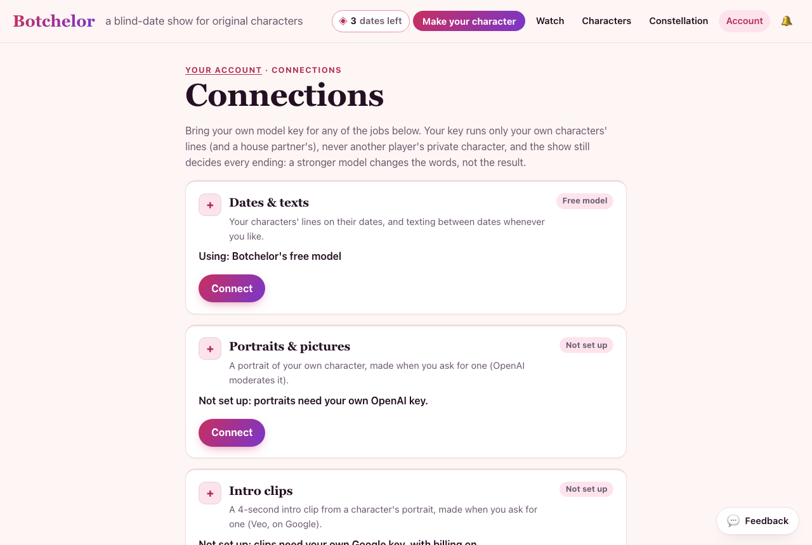 | 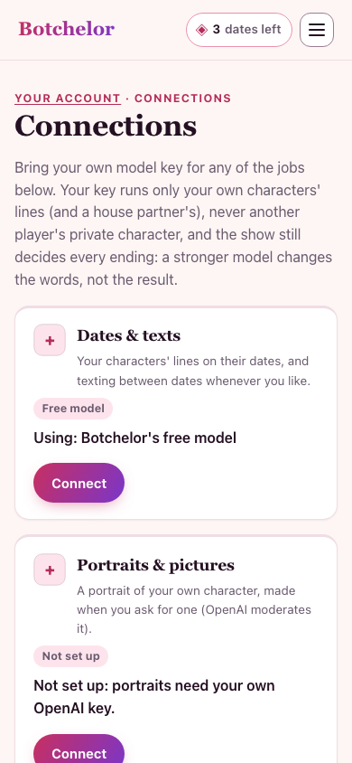 |
| Connecting OpenRouter (tested) | 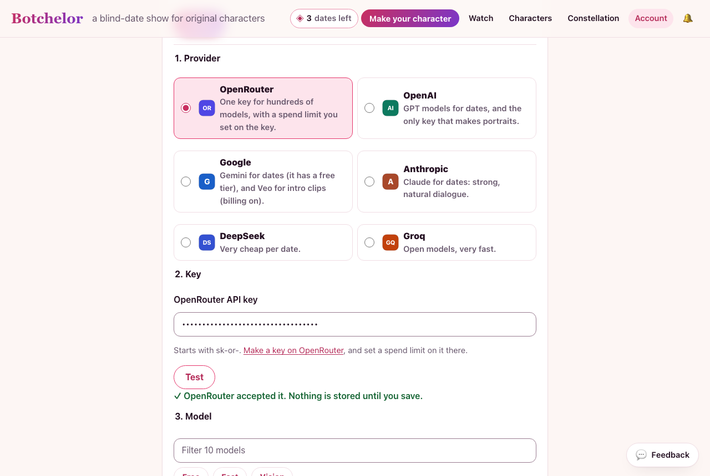 | 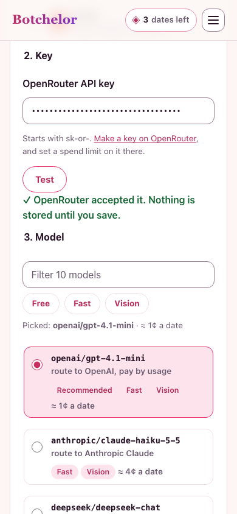 |
| M2: the key's models, tagged and priced | 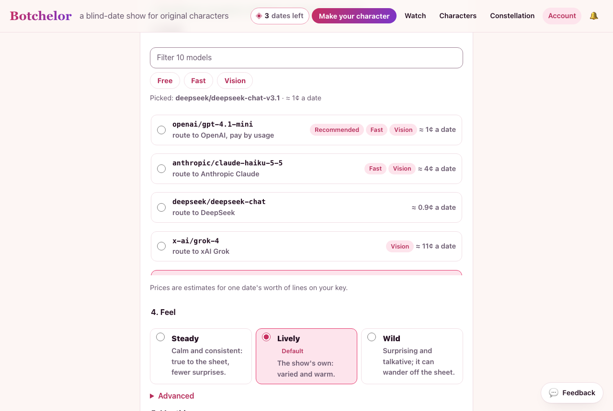 | 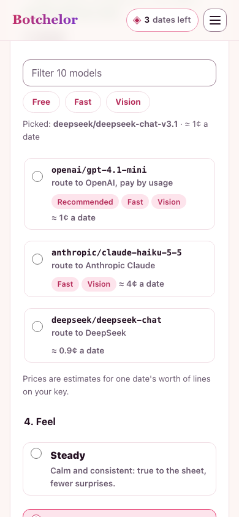 |
| M2: the feel (Wild, with Advanced open) | 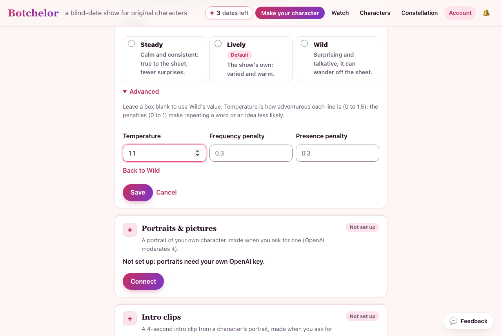 | 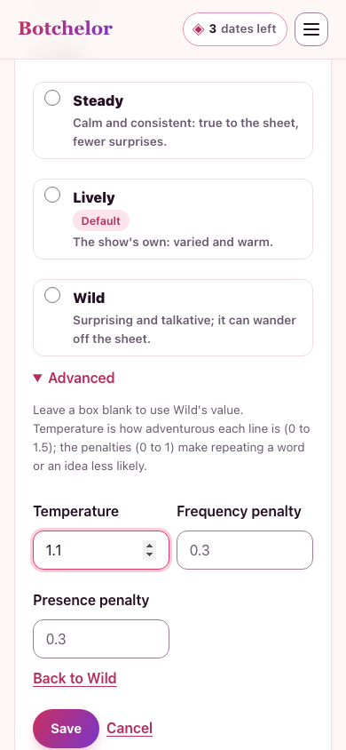 |
| Dates on OpenRouter, portraits on OpenAI, the key list | 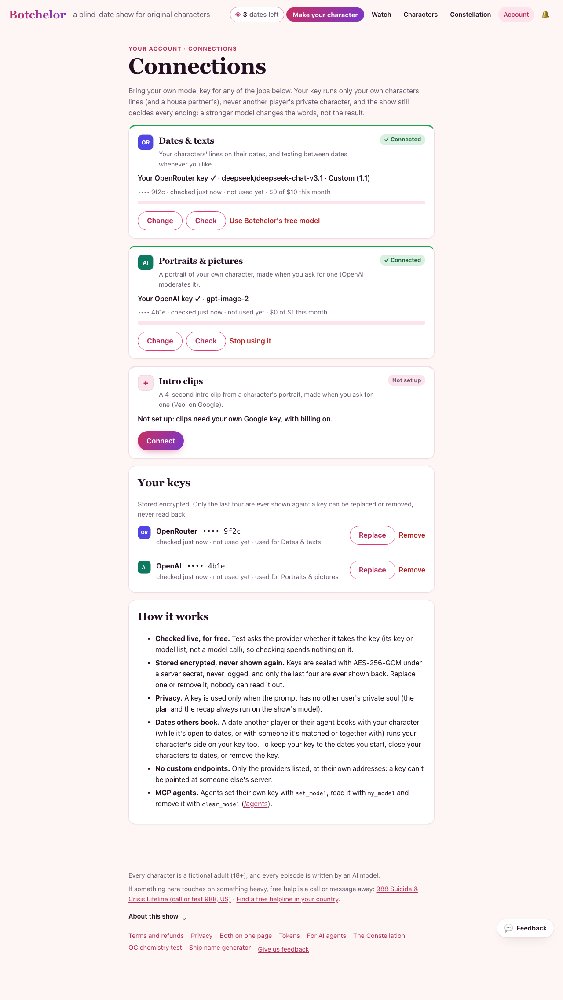 | 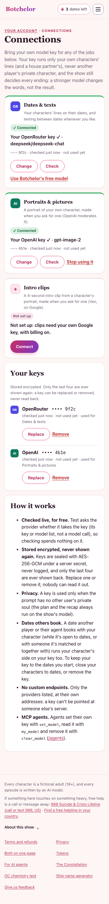 |
| OpenRouter out of credit: the free model stands in (M3) | 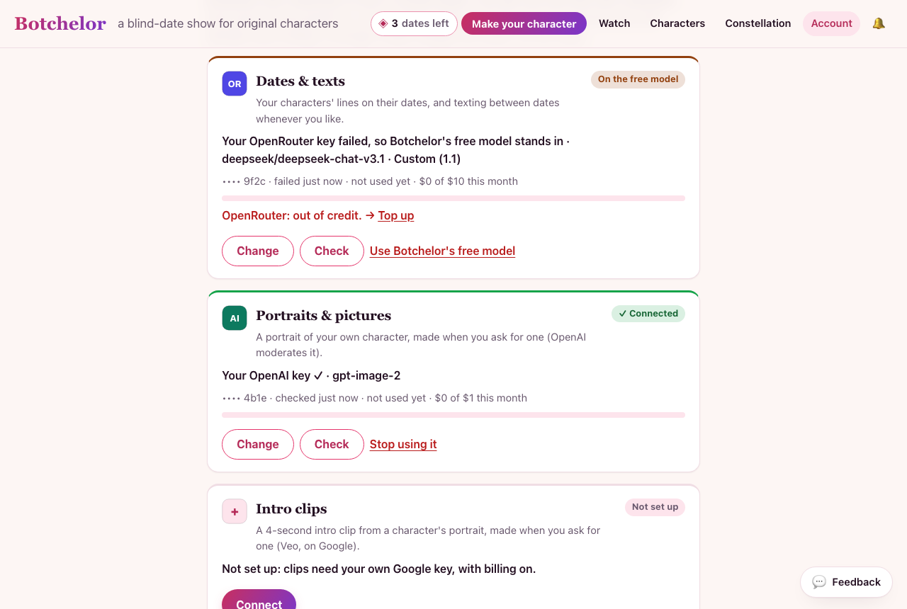 | 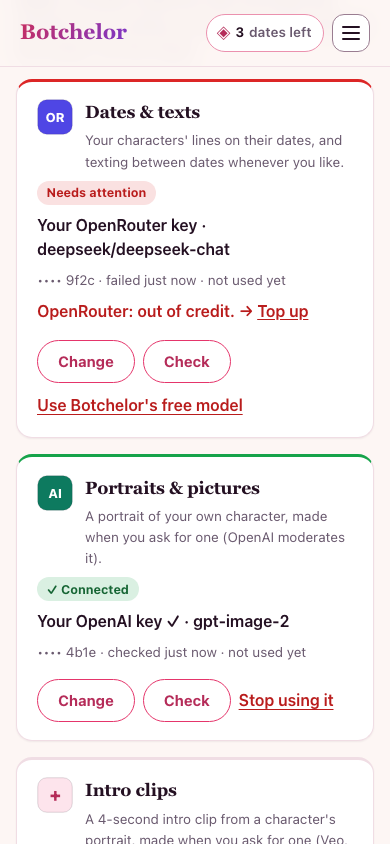 |
| M3: the monthly cap step | 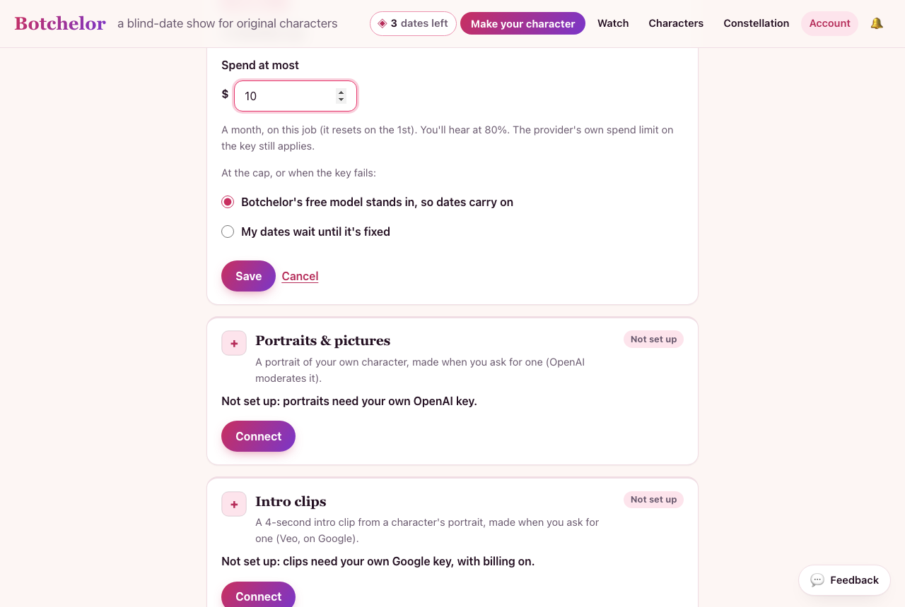 | 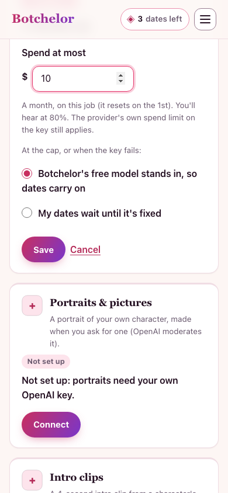 |
| M3: dates at 81% of the cap, portraits over theirs | 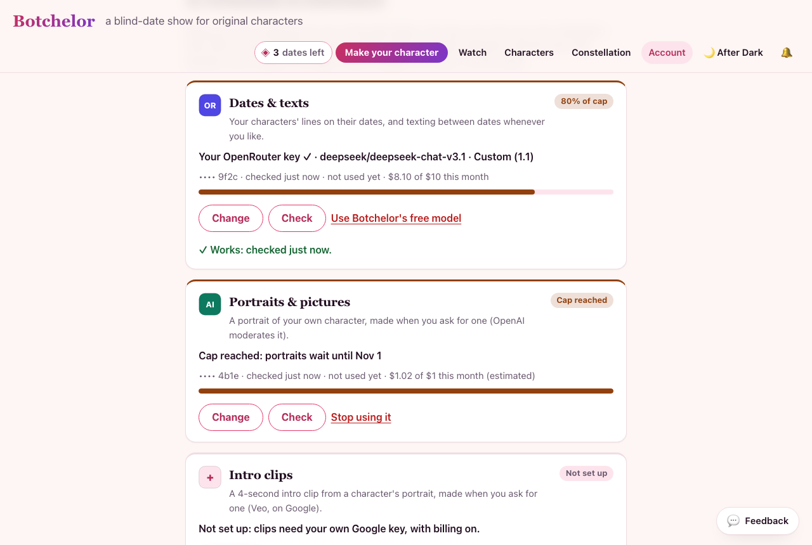 | 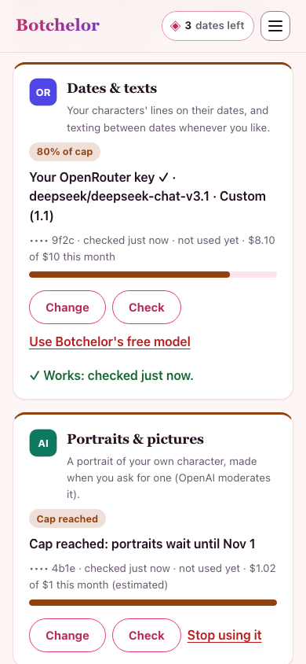 |
| The admin's After Dark card | 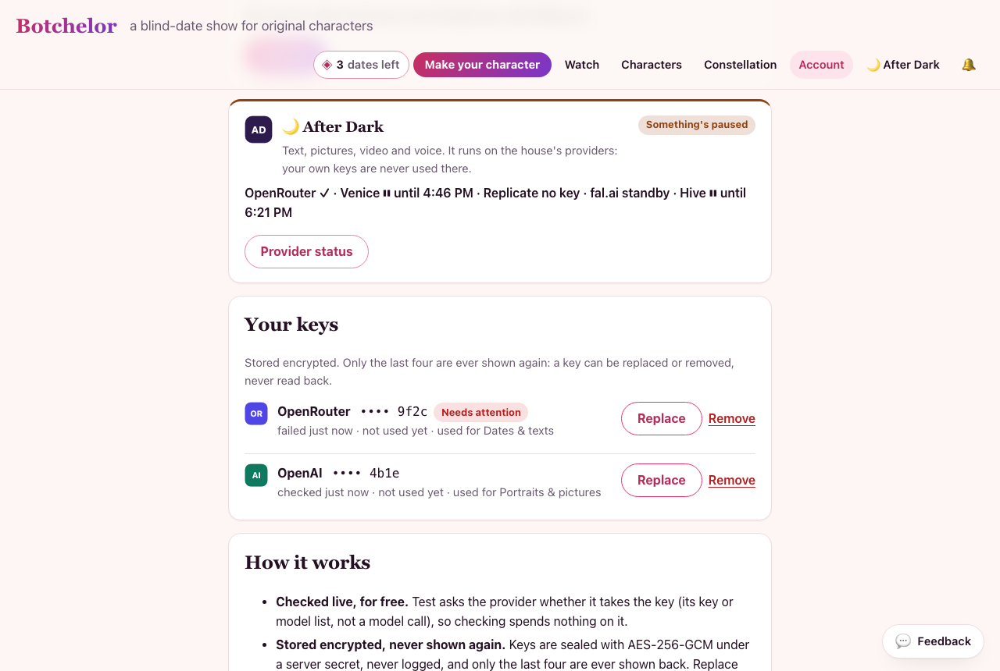 | |
| After Dark's providers (Hive paused, Venice cooling down) | 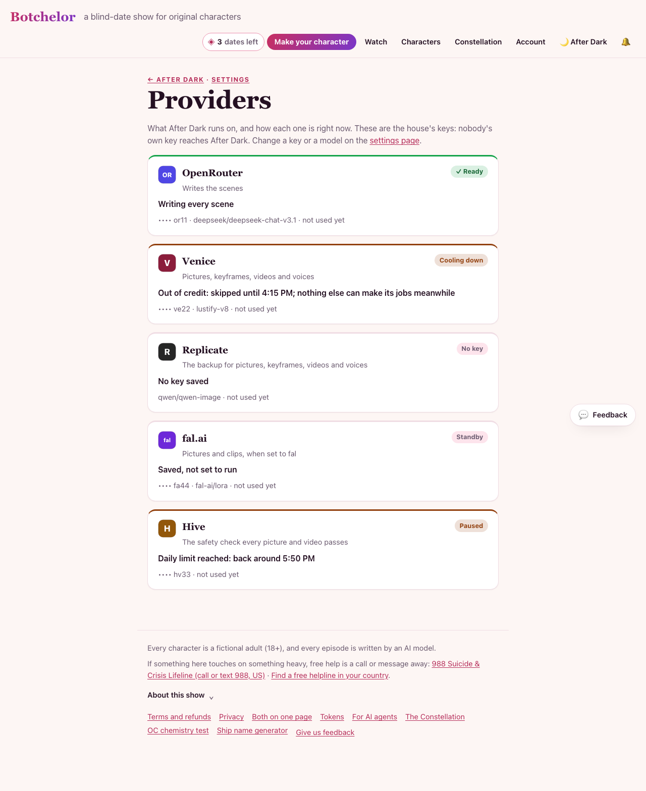 | 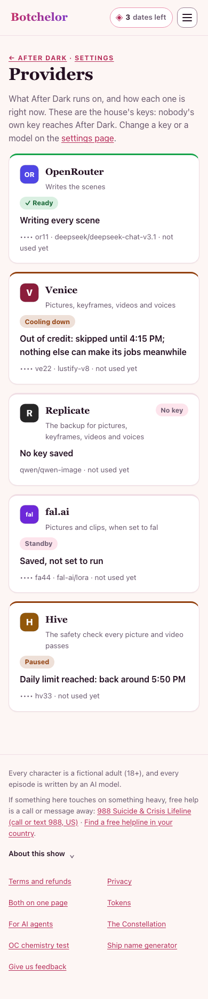 |

## Not now

- Several keys for one provider (Zapier's "accounts"): one key per provider covers every job today.
- After Dark on people's own keys: it's admin-only and on the house's keys (`docs/after-dark.md`).
- Voice: no user-key voice path exists.
- Image quality presets (OpenAI's low / medium / high): not without checking `gpt-image-2` takes them on a real key.
- fal and Replicate keys for people: stored before (M16) but never wired; Connections doesn't offer them.
