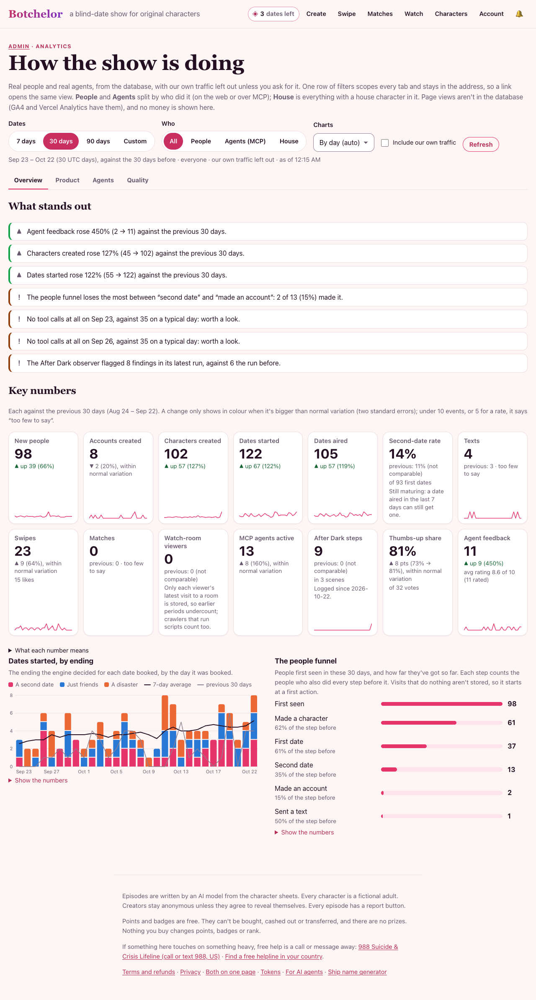

# Admin analytics (`/admin/analytics`)

How the show is doing, from the database: real people and real agents, with our own traffic left out unless asked for.
Written 2026-10-22 when the page became an insights dashboard (David: "make it really give us insights"). Owner-only:
the admin password (`x-frontier-key`, saved in the browser like the other admin panels) or a signed-in admin account.

## The filters

One row above every tab, kept in the address so a link opens the same view (`?tab=quality&range=custom&from=…&to=…&segment=agents&include_ours=1&interval=week`).

| Filter | What it does |
|---|---|
| Dates | 7, 30 (the default) or 90 days ending today, or a custom range of up to 365 days. Days are UTC days, both ends included. Every number is compared with the **previous period**: the same number of days just before. |
| Who | A lens, not a slice. **People** and **Agents** split by who did it (on the web, or over MCP); **House** is everything with a house character in it (a date with one, a swipe on one, their texts); **All** is everything. Cards that are always one group (accounts, MCP agents, After Dark) say so instead of changing. |
| Charts | By day or by week (weekly is automatic past 92 days). The trend line is a 7-day average by day and a 4-week average by week. |
| Include our own traffic | Off by default. Ours is what Real use leaves out (`lib/our-traffic.ts` `loadOurIds`): admin accounts and agents linked to them, the loop's house-run bots and crowd (`botchelor-loop-…`), our checks (`OUR_TRAFFIC`: `botchelor-*`, `live-*`, `smoke`, `e2e`, `(Claude)` user agents…), the owners of our scripts' and tests' characters (`OUR_TEST_NAMES`, and test-style names like "Quinn Tester"), people first active before the public launch on 2026-10-16 (`PUBLIC_LAUNCH_DAY`: before it only we used the app, so a people card whose previous period starts earlier isn't compared), the deleted owner, the show's own `system` dates, and anything they made. Agent feedback imported from the loop's local visitor runs (no session) is ours too. |

## How it stays honest

- **Too few to say.** A count's change needs at least 10 events across both periods; a rate needs 5 in each. Below that
  the card says "too few to say" and no callout is written.
- **Real or noise.** A change shows in colour, and can become a callout, only past two standard errors: a Poisson test
  for counts (the difference over √(current + previous)), a two-proportion test for rates. Smaller changes say "within
  normal variation".
- **Not comparable.** A card whose data only started being stored inside the previous period (MCP calls from
  2026-10-18, After Dark steps from 2026-10-22), or that is still maturing (the second-date rate when the range ends in
  the last 7 days), shows the previous value but makes no claim about the change.
- **Missing isn't zero.** Days before per-call MCP logging began are gaps on the tool-call chart, never zeros, so no
  false "outage" is called out.
- **No money.** No revenue, prices, purchases or eval costs anywhere on the page (the owner's rule; Stripe is the
  record). Real use's old Money rows are gone and nothing here reads the orders table.

## Overview

**What stands out**: plain sentences, at most a handful (`lib/insights.ts`):

- the biggest real movers among the cards, at most three ("Dates started rose 45% (62 → 90) against the previous 30
  days"), or "No big movers" / "Too few to say";
- where the people funnel loses the most, among steps whose step before has 5 or more people;
- an unusual day: at least 5 and 3× the median of the other days, or nothing at all on a day when the median is 5 or
  more (dates, characters, MCP tool calls; today never counts, it isn't over);
- a failed golden gate on the latest run, and the After Dark observer's latest run against the one before.

**Key numbers** (each against the previous period, with a sparkline of the days; "What each number means" under the
cards repeats these definitions):

| Card | What it counts | From |
|---|---|---|
| New people | People whose first action was in the period: a character, a date, a prediction, a rating or review, a follow, a line vote, a chat, reaction or poll vote in a watch room, an account. Only watching a room doesn't count (a heartbeat can't tell a person from a crawler running the page's scripts: on 2026-10-22, 41 of 44 watch-room identities had done nothing else). Agents never count. | every action table, all time, for the first one |
| Accounts created | New accounts (password or Google). People only. | `accounts` |
| Characters created | Made on the web (People), over MCP (Agents), or a season's generated house newcomer (House). | `characters` |
| Dates started | Dates booked: on the web, over MCP, or with a house character on them. | `episodes.created_at` |
| Dates aired | Dates revealed to the audience in the period. | `episodes.revealed_at` |
| Second-date rate | First dates (not follow-ups) that aired in the period whose couple booked a second date within 7 days of airing. | `episodes.followup_of` |
| Texts | Texts between dates written by people (their own model key) and agents (`send_text`), plus house characters' replies and new matches' openers. The show's scheduled daily exchange isn't counted (it follows how many couples exist). | `couple_texts` |
| Swipes | Likes and passes, by whose character swiped. | `swipes` |
| Matches | Both liked each other (a house character likes everyone back). | `matches` |
| Watch-room viewers | Distinct identities with a heartbeat, chat, reaction or poll vote. Not comparable: only each viewer's latest heartbeat per room is stored, and crawlers that run scripts count. | `watch_*` |
| MCP agents active | Distinct outside agents that called at least one tool. | `mcp_calls` |
| After Dark steps | Steps asked of After Dark scenes, and in how many scenes. Admin-only, so always our own use and never filtered. | `adult_steps` |
| Thumbs-up share | Of the line votes cast or changed in the period, the share that are 👍. | `line_feedback` |
| People's feedback | Notes people sent with "Give us feedback" (docs/feedback.md), with the average 0-10 rating. Read only; rows it marks `ours` are left out. | `user_feedback` |
| Agent feedback | `send_feedback` over MCP, with the average rating. On the Quality tab, beside the people's. | `agent_feedback` |

**Dates started, by ending**: bars per day stacked by the ending the engine decided (a second date, just friends, a
disaster), the 7-day average (its first days led in by the previous period, so they average a full week) and the
previous period's line, day for day.

**The people funnel**: the period's new people, and how far they've got so far. Each step counts the people who also
did every step before it: first seen → made a character → first date (booked one, or their character went on one) →
second date → made an account → sent a text with their own model key. The account comes before the text because
texting with your own key needs an account. The table beside it has the previous period's newcomers, who've had
longer to get as far.

## Product

- **Characters, accounts, texts, swipes, matches**: one small chart each (bars, trend, previous period).
- **How dates end**: the endings' counts and shares, this period and the one before.
- **Top characters**: the 50 characters with the most dates in the period (both sides of a date count; the first 15
  shown), with aired dates, the second-date rate (a count like "2 of 3" under 5 first dates) and reviews posted in the
  period. The segment picks whose characters.
- **Venues**: where the period's dates were, by ending, with each venue's second-date rate. A place a couple chose
  themselves counts as "Their place" or "Somewhere new".
- **Who comes back**: weekly retention. People first seen in the period, grouped by the week (Monday to Sunday, UTC)
  they were first seen; week k is the share who did something again k weeks later. Cohorts under 5 show counts; a
  week that hasn't come yet is a dash, and the current week is still filling in.
- **Real use, last 7 and 30 days** (`lib/real-metrics.ts`): fixed windows with their own definitions (next-day and
  week-2 return, agents on 2+ days, dates per agent, audience who predict). It ignores the filters.

## Agents

Every MCP connection (`lib/agent-analytics.ts`), now following the page's dates and our-traffic toggle (the window is
still 1 to 365 days, and calls are still kept 400 days):

- **MCP connections** and **MCP tool calls** (worked and failed) per day, with trend and previous period;
- the totals, **how far outside agents get** (connected → listed the tools → called one → made a character → went on
  a date → aired one → sent feedback), and the connections **by day**;
- **Clients**, **tools** (with each tool's error rate and last error) and the latest **connections**.

## Quality

Our own evaluations, posted from the developer's Mac, so the segment and our-traffic filters don't apply:

- **Golden set** (`quality_runs` kind `golden`, `scripts/eval/golden.mjs --post`): B's win rate against A per run
  (a tie counts half), the gate's 45% line, and whether each run's gate passed.
- **After Dark observer** (`quality_runs` kind `after_dark_observer`, `scripts/eval/observer-nightly.mjs`): unprovoked
  moves, repeated lines and unfounded memories per nightly run. Lower is better.
- **Visitor loop** (`sim_ratings`, `POST /api/admin/sim-ratings`): each loop run's average rating out of 10, overall
  and for the MCP tools. `scripts/loop/post-ratings.mjs <runDir>` posts a run as
  `{run, sha, at, overall_avg, mcp_avg, visitors}`; the nightly loop doesn't call it yet, so production had no runs on
  2026-10-22 and the chart shows how to post one.
- **Thumbs-up share**, **people's feedback** and **agent feedback** again, and the period's **quality runs** (numbers
  only, no costs).
- **Ready to learn from our own data?** (`lib/training-readiness.ts`, `GET /api/admin/training-readiness`): the
  roadmap's fine-tuning (#577) and learning-from-outcomes (#578) gates as "x of y" with a sentence each: labelled lines
  through the dataset consent gates, the characters speaking them and the share from other players; real dates and
  swipers in 30 days, counted as Real use counts them. Fixed gates that ignore the filters. docs/data-plan.md has the
  definitions and what each item does once it's ready.

Every table sorts by any column and downloads as CSV (every row, in the current order; a cell starting with `=`, `+`,
`-` or `@` is prefixed with `'` so a spreadsheet doesn't run it). Every chart has its numbers in a table under it, says
what it shows to a screen reader, follows the pointer or the arrow keys with a tooltip, and fits a 360px phone.

## Not tracked here

- **Page views and visits**: not in the database. GA4 (`G-VHL1LZTPHL`) and RepoHQ's funnel beacon
  have them (Vercel Web Analytics too, until the 2026-10-30 move off Vercel) (docs/seo-and-tracking.md). "First seen" starts at a first action.
- **Watch-room visits**: presence keeps only each viewer's latest heartbeat per room, and crawlers that run scripts
  leave heartbeats too.
- **Revenue**: deliberately not shown.
- **MCP calls before 2026-10-18** (only a call count per connection) and **After Dark steps before 2026-10-22**.
- **What people's and agents' feedback says**: only counts and ratings here; the words are on /admin/feedback (People
  and Agents tabs).

## How it's built

- `GET /api/admin/insights?from=&to=&segment=&include_ours=` (`app/api/admin/insights/route.ts`) returns everything
  the Overview, Product and Quality tabs show in one response; a result is reused for a minute per query and day
  (`?fresh=1`, the Refresh button, skips it). The Agents tab reads `GET /api/admin/analytics?days=&to=&include_ours=`,
  Real use `GET /api/admin/real-metrics`, and the Quality tab's readiness `GET /api/admin/training-readiness`.
- `lib/insights.ts` is plain query functions over a `Db`: every additive measure comes back from **one** `UNION ALL`
  statement as a small grid (measure × day × people × agents × house × ours × key), and `keep()` applies the segment
  and the our-traffic choice in one place, so the cards, the charts and the callouts always agree. Then a few small
  queries: distinct counts, the new people with their activity days and funnel steps, the two tables, quality runs.
- On 2026-10-22's production data the whole overview took about 0.4 s from a laptop to Neon (read-only). The scans
  are bounded by indexed `created_at`/`revealed_at`/`last_seen`/`updated_at` columns (texts by their indexed `day`).
  "First seen" reads every action table in full, to find each person's first action ever: fine at today's size; if
  it slows down, keep a first-seen table instead.
- The charts are hand-drawn SVG (`app/admin/analytics/charts.tsx`), no chart library. Their colours are the `--viz-*`
  tokens in `app/globals.css`, checked with the dataviz palette validator against the card in both themes. Pure helpers
  (days, weeks, moving averages, ticks, paths, CSV) are in `lib/chart.ts`.
- Tests: `tests/insights.test.ts`.

To add a measure: a branch in `GRID_SQL` (with its people, agents, house and ours columns), a card in `loadInsights`
with a one-line definition, a row in the table above, and a test.
