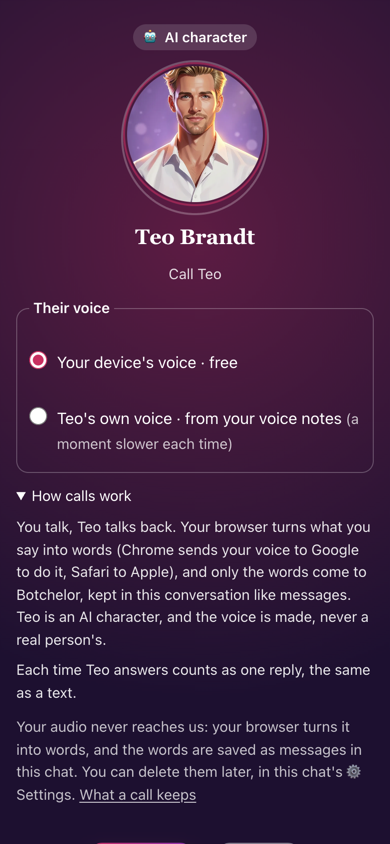
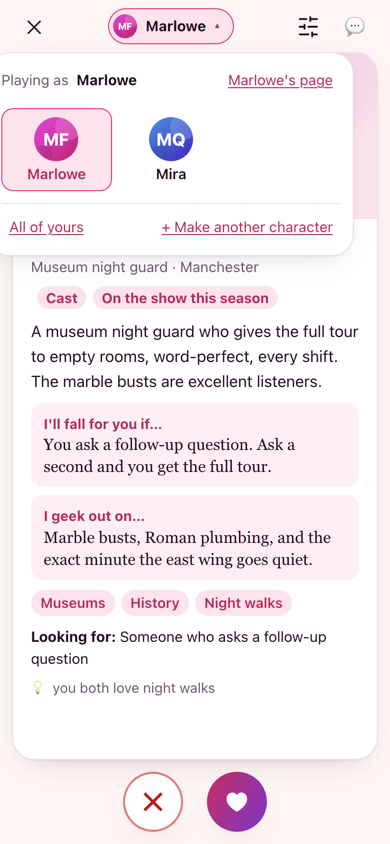
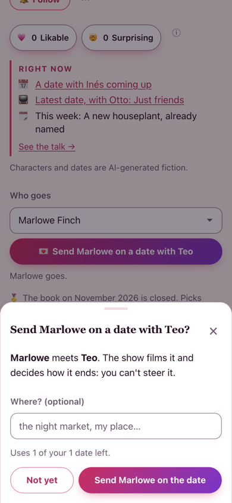
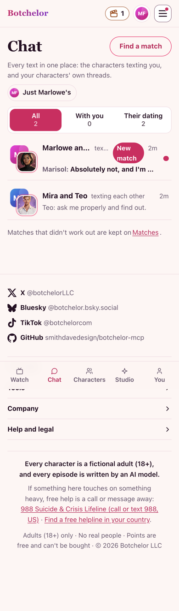
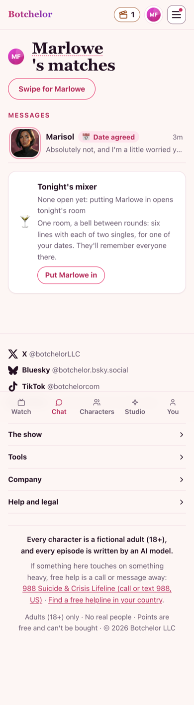

# Mobile UX/UI audit: every page and modal (2026-11-20)

David asked from his phone: "Do a mobile UX/UI audit of all pages and models on Botchelor." "Models" is read as
modals: every overlay, sheet, menu and popover.

## How it was done

- **Build:** a production build of `origin/main` (MCP 2.43.0, after #1871), with the demo season seeded by
  `scripts/visual.mjs`.
- **Device:** phone only, 390×844, isMobile, touch, DPR 2, in light and dark, as a spectator, an owner, a signed-in
  member and an admin (After Dark included).
- **Captured:** 646 screenshots.
  - 276 page states from `npm run e2e:visual`, phone only.
  - 49 more routes that `visual.mjs` doesn't visit.
  - 43 modals, sheets, menus and overlays, opened one by one.
  - 8 end-to-end flows, 90 steps in all: first visit → 18+ gate → swipe; the create wizard and look builder; companion chat;
    matches → thread; watch → theater → verdict; pricing → shop.
- **Checks:**
  - **Automated:** the existing `visual.mjs` rules, plus modal checks added for this audit. These cover:
    - fit: wider than the screen, close control off-screen, content clipped;
    - close: no close control, close under 44px;
    - behaviour: focus escapes on Tab, the page behind scrolls, inputs under 16px.
  - **Human:**
    - three reviewers read every light screenshot, and at least one dark screenshot per page or modal;
    - each automated finding was checked against the screenshots and kept or marked a false alarm;
    - findings were matched to the code behind them.
- **Not covered:**
  - **No pictures or video in the demo data.** Missing portraits and blank example tiles are a test artefact, not a finding.
    For the same reason, 16 overlays that only open on real media weren't seen: 🩹 Fix, the exports, the Studio lightbox and
    film player, the showcase viewer, and the reels "Made with" sheet.
  - **Not opened because they spend or post:** the swipe match overlay, starting a companion call, the night video
    storyboard, and Stripe checkout.
  - **Not tested:** real iOS Safari. The browser was Chromium with a phone UA.

The evidence (every screenshot, `INDEX.md`, the three reviews and the scripts) is in the build clone at
`~/.botchelor-wave/bz-core/wt-mobile-audit/.data/` (not committed). Seven of the screenshots are in
`docs/screenshots/mobile-audit-2026-11-20/`. No After Dark screenshots are committed.

## Verdict

**B- overall on a phone.** The core loops hold up:
- **Show front:** the hero says what the show is and offers one action.
- **18+ gate:** a proper bottom sheet.
- **Swipe:** a clean full-screen deck, with both actions in thumb reach.
- **Messages:** a real chat screen.
- **Money and accounts:** every "spend a date" confirm, the shop, the sign-in-to-buy sheet and the league sheets are textbook bottom sheets.
- **Throughout:** the bottom tab bar is consistent and labelled, and dark mode holds up.

What holds the grade down is 33 medium problems (P2) and one P1, not a broken flow. They fall into eight patterns, which follow
the table.

| Area | Grade | P1 | P2 | P3 |
|---|---|---:|---:|---:|
| A. Show front, first visit, static pages | B | 0 | 8 | 11 |
| B. Creating and dating (create, look builder, swipe, chat, matches, messages, couples, PG Studio) | B- | 0 | 10 | 15 |
| C. Account, keys, money, companions, step-in, casting, After Dark, admin | B- | 1 | 15 | 9 |
| **All** | **B-** | **1** | **33** | **35** |

P1 means broken: it blocks a task. P2 clearly hurts use. P3 is polish.

## The eight patterns

1. **The main action is pushed below the screen or covered.** This accounts for the one P1 and many of the P2s.
   - **Companion call (C1, P1):** the first call opens "How calls work", which pushes **📞 Call** and **Not now** off the screen.
   - **Date settings (B7):** opening them in the date confirm sheet pushes **Send on the date** below the fold.
   - **PG Studio (B9):** **Shoot 4** sits two screens down.
   - **Toasts (B8):** the Install and Beta toasts sit over "Get Mira dating".
   - **/watch (A1):** "Airing soon: call it" is about four screens down, though calling the ending is the page's promise.
   - **Casting invite (C17) and Connections (C16):** the buttons come after long text.

   *Fix pattern:* a sticky action bar, with safe-area padding, on every page whose main action can scroll away. Explainers
   start closed. Toasts never sit over a primary button.
2. **Overlays aren't one component.** The show's own `Sheet` passes every check: the shop, league, notification
   settings and date confirm sheets use it. Many hand-made overlays don't.
   - Focus escapes on Tab in 24 overlays.
   - The page behind scrolls in 12.
   - 14 menus and popovers have no ✕.
   - Close buttons are under 44px in 2 places.
   - The worst are the After Dark sheets, the companion ⚙ and 🎭 popovers, the character pickers, theater "who's who" and
     episode share.

   *Fix:* move every overlay onto `Sheet`, or a shared `Popover` with the same behaviour: lock scroll, make the
   background `inert`, close on Escape, and give each a ✕.
3. **Fixed bars take the screen.**
   - On home (A2), the floating "Make yours / Bring yours" bar sits on top of the tab bar, so about 150 to 230px is fixed chrome.
   - On the create review step (B4), the sticky bar takes about 22% of the screen.
   - The After Dark theater dock (C3) stacks five rows and takes about 45%.

   *Fix:* one bottom bar at a time. Hide the floating CTA once the tab bar is showing, and fold rare controls into ⋯.
4. **Horizontal rows give no sign they scroll.** The /watch rails (A1), the After Dark tabs and steer row (C3), the
   scene picker chips (C7), the AD tab sheet (C8), the admin tables and tabs (C20), and the Studio tabs, which wrap to two
   rows (C9). The `ShowTabs` edge fade already exists. *Fix:* a shared `.scroll-row` with a fade and scroll-snap.
5. **The same call to action, repeated until it means nothing.**
   - Home has 6+ "Make your character" doors (A2).
   - Every directory card has a two-line "Step into a date with X" button: 16 identical buttons on the cast tab (A7).
   - The owner's character page puts about 9 buttons before the profile (B11).
   - The theater has a "Replay" pill beside ↻ (A3).
   - The casting invite stacks two identical primary buttons (C17).

   *Fix:* one primary button per screen; the rest become secondary or go behind one tap.
6. **Owners get the visitor's pages.**
   - **A returning owner's home (B10)** is 15 screens long, mostly the visitor pitch: How it works, "Is it free?", "Make your character".
   - **The owner's character page (B11)** buries the profile under owner tools.

   *Fix:* after "Since you were here", an owner's home shows their characters, dates and matches, and drops the pitch.
7. **Small layout bugs on screens people use every day.**
   - **Possessive split (B2):** headings break as "Marlowe / 's matches" and "Marlowe Finch / 's Studio", because the name is an inline button.
   - **Chat rows (B3):** titles truncate to "Marlowe an…" and "tex…", and the "New match" badge wraps.
   - **Swipe bar picker (B1):** it hangs 12px off the left edge.
   - **Make more menu (C5):** in the After Dark ⋯ sheet it runs off the right edge, because `width: max-content` survives in sheet mode.
   - **Showcase reels veil (C12):** it is drawn over the empty-state card.
8. **Failures shown as calm or empty states.**
   - **Admin showcase (C18):** a 403 shows as "Nothing held or reported", so a moderator thinks the queue is clear.
   - **Gated features (C21):** they show a 404 where a member followed an upsell; a "not open yet" page would be better.
   - **Neutral notices (A4):** they are styled as green success messages ("The letter isn't open yet" in bright green).
   - **/contact (A5):** it has no address, and points to a footer link that a phone hides in a collapsed accordion.

## Fix list, in order

These are ranked by how many people hit them and how much each one costs them. Each line is about one PR. The finding
ids point into the appendices.

| # | Fix | Findings | Where |
|---|---|---|---|
| 1 | Companion call: pin Call / Not now to the bottom; "How calls work" starts closed; 44px summary | C1 | `app/companion/[id]/CompanionCall.tsx:1192-1229` |
| 2 | One overlay primitive: lock scroll, `inert` background, close on Escape, a ✕ on every menu, 44px close. Move the AD sheets, companion popovers, character pickers, theater who's-who, episode share, thread and character menus onto it | C6, C13, C14, C23, A8, pattern 2 | `app/ux/after-dark.css:3065`, `SceneWriter.tsx`, `CompanionChat.tsx`, `SwitchCharacter.tsx` |
| 3 | Sheet action bars stay pinned: date confirm "Send on the date" and errors above it, Studio Shoot sticky, create review bar slimmer with the disabled reason inside it | B7, B9, B4 | `app/DateConfirm.tsx`, `app/globals.css:6428`, `app/studio/page.tsx`, `app/create/CreateWizard.tsx:1719-1772` |
| 4 | Toasts (Install, Beta, AD privacy) never cover a primary button; show each once per device | B8, C23 | `.install-hint` `app/globals.css:6072`, `AfterDarkTheater.tsx:187` |
| 5 | /watch: "Airing soon: call it" first after the lede; rails get the fade | A1 | `app/watch/page.tsx` |
| 6 | Home: one "Make your character" door above the fold and one at the end; hide the floating bar while the tab bar shows. An owner's home drops the visitor pitch | A2, B10 | `app/page.tsx:381`, `PhoneActionBar` |
| 7 | Layout bugs: the possessive stays on one line; chat rows keep the name, the badge never wraps; swipe picker clamped to the screen; AD Make more `width: 100%` in sheet mode; reels veil off when empty | B2, B3, B1, C5, C12 | `app/matches/page.tsx:147`, `app/studio/page.tsx:115`, `app/chat/page.tsx:59-66`, `app/ux/chrome.css:700`, `app/ux/after-dark.css:3002` |
| 8 | Shared `.scroll-row` (fade, snap) for every horizontal chip, tab and rail row; admin tables scroll inside a fade or become cards under 480px | A1, C3, C7, C8, C9, C20 | new utility in `app/ux/catalog.css` |
| 9 | iOS zoom and small targets: AD Studio textareas 16px, the shape toggle 44px, "How calls work" 44px, notification Clear 44px | C9, C1, C22 | `app/globals.css:9808`, `Studio.tsx:1085` |
| 10 | Character cards: one short "Date" button (or none on the cast tab); the owner's character page shows the profile first and puts the tools in one "Manage" row | A7, B11 | `/characters` card, `app/characters/[id]/page.tsx` |
| 11 | Theater controls move to a bottom bar with labels; drop the Replay pill; solid ending card; neutral share line | A3 | `EpisodeTheater.tsx`, `globals.css:4433`, `ShareEnding.tsx:29` |
| 12 | After Dark: one sub-nav on every AD page; the theater starts with only "Start the night"; dock down to two rows; night palette for the whole page | C2, C3, C10, C11 | `AfterDarkTheater.tsx:955/1062/1323`, `app/after-dark/*/page.tsx` |
| 13 | Failures said plainly: admin showcase 403 as an error; "Not open yet" instead of 404 for gated features; `.notice` neutral, green only for success | C18, C21, A4 | `app/admin/showcase/Panel.tsx:32-39`, `globals.css:1808` |
| 14 | /contact gets a real address (or the feedback form inline); /legal and /privacy open on the contents, the changelog folded, a back-to-top | A5, A6 | `app/contact/page.tsx:37`, `app/legal/sections.tsx:36` |
| 15 | Account and Connections: jump links on /account; BYOK intro folded and the expanded form scrolled into view; casting invite buttons above the terms | C15, C16, C17 | `app/account/page.tsx`, `app/account/keys/page.tsx`, `app/casting/invite/[code]/page.tsx` |

The remaining P3s are in the appendices.

## Keep as they are

These work well on a phone and should survive any fix above:
- the swipe deck;
- the messages thread;
- every confirm bottom sheet: DateConfirm's layout, the shop and sign-in-to-buy sheets, league join and invite, and notification settings;
- the 18+ gate sheet;
- the bottom tab bar;
- the step-in picker and live date;
- the casting grid;
- the companion thread's composer and 44px header actions;
- the Tokens page;
- dark mode.

## Screenshots

| Companion call (C1, P1) | Swipe picker off-screen (B1) | Date confirm sheet (B7, same sheet) |
|---|---|---|
|  |  |  |

| Chat rows truncated (B3) | Matches heading split (B2) |
|---|---|
|  |  |

Full-page captures: [home](../screenshots/mobile-audit-2026-11-20/home.png) (A2, B10) and
[watch](../screenshots/mobile-audit-2026-11-20/watch.png) (A1).

## Automated findings, with verdicts

| Rule | Count | Verdict |
|---|---:|---|
| console-error | 16 | admin-showcase 403 is a real UX bug (C18). The After Dark subscribe, gallery-locked and studio-locked errors are expected 404s for closed features in the demo build, so a false alarm as bugs (but see C21). The after-dark-scene 422 comes from the demo model (it exposes C4). The /prompts 401 on `/api/library` for visitors is real (A). admin-live-face is handled on the page. |
| tap-target (<24px) | 4 | Real: the AD Studio shape toggle (C9) and "How calls work" (C1) |
| control-ios-zoom | 2 | Real: the AD Studio textareas (C9) |
| dialog-width | 2 | Real: the swipe bar character picker (B1) |
| dialog-close-offscreen | 2 | Real: the companion call (C1) |
| dialog-focus-escapes | 48 | Real across hand-made overlays (pattern 2) |
| dialog-no-close | 28 | Mostly real for menus and popovers. A false alarm for the 18+ gate (answering is the close) and the nav menu (☰ toggles) |
| dialog-bg-scrolls | 24 | Real (pattern 2) |
| check-unstyled | 12 | Real but cosmetic: notification settings checkboxes, wrapped in labels (C22) |
| dialog-content-clipped | 4 | Real: the feedback modal's Send sits below the fold, and the AD scene picker (C7) |
| dialog-close-small | 4 | Real: companion scene picker Cancel (C14) and the AD privacy toast ✕ (C23) |

The appendices below are the three reviews as written. Their screenshot paths are relative to the evidence folder named
above.

---

# Appendix A: show front, first visit, static pages

Reviewer batch A. Paths are relative to the worktree root. I looked at every light screenshot in the batch. Tall full-page shots were cut into viewport-sized strips and read in order. Very long legal and docs pages (legal, privacy, terms, agents-tools, agents-changelog) were read for their first 4 viewports. For dark mode I checked home, watch, episode, graph, costs, directory, newsletter, about, pricing, tools, prompts, reviews, shows, character, and each modal in the batch. Missing portraits and blank tiles come from the seeded demo, so they are not reported.

### Summary

**Grade: B.** The front of the show works on a phone. The home hero says what the show is and offers one main action on the first screen. The 18+ gate is a proper bottom sheet with the Yes button in thumb reach. The bottom tab bar is the same and labelled on every page. Dark mode holds up everywhere I checked. Static pages read well at 16px with good line length.

The grade drops for three things:

1. **The main job on /watch is buried.** The page promises "Call the ending before it airs", but the "Airing soon: call it" cards start about 4 screens down. Above them are a horizontal rail, a vote with 3 long option cards and a dares block. Both horizontal rails hide most of their cards, and the only hint is a cut-off card edge.
2. **Calls to action pile up, and fixed bars take the screen.** Home has 6+ "Make your character" doors. A floating "Make yours / Bring yours" bar sits on top of the tab bar, so about 150px of the 844px screen is fixed chrome while the page scrolls. Character cards each carry a two-line "Step into a date with X" button. Character pages offer three competing CTAs.
3. **The theater is controlled from the top edge, out of thumb reach.** Play, pause, replay, skip, who's who and Exit are all icon circles in the top row. The ending card floats in the middle of the transcript on a see-through panel, and its share line is green, which reads as a success message.

Counts: **P1 0 · P2 8 · P3 11.**

### Findings

| id | sev | page or modal (route) | role / scheme | problem (what you see) | fix | screenshot(s) | code |
|---|---|---|---|---|---|---|---|
| A1 | P2 | /watch, also /watch#situation (the vote clip link) | spectator, both | The lede says "Call the ending before it airs", but on screen 1 you get On now / Just aired. Then come a "Ready to start" rail, "Vote before it airs" (3 long option cards plus 3 dares) and the Sunday reveal. "Airing soon: call it before it airs" is at about screen 4. "Ready to start" and "Airing soon" are horizontal rails: the second card is cut at the right edge, there are no dots or arrows, and one card is ~240px wide. The page is 7 screens long before the footer. | Move "Airing soon: call it" right under On now as the page's main block. Fold the situation vote and dares into one card that opens to show the options. Add a scroll hint to the rails (a peek of ≥24px plus dots or a "See all →"), or turn them into vertical lists on phones. | .data/visual/phone-light/watch-lobby.png; .data/mobile-audit/pages-extra/phone-light/vote.png; .data/mobile-audit/pages-extra/phone-light/feed.png; .data/mobile-audit/flows/phone-light/watch-episode/01-watch-lobby.png | app/watch/page.tsx |
| A2 | P2 | / (home) | visitor and spectator, both | Repeated doors: "Watch this week's best date", the "Make your character" link, the floating "Make yours / Bring yours" bar, "Meet them" (express box), "Make your character" under the clip, "Call it" chips, "Make your character" again near the FAQ, plus "Start from a sample" and "Bring your character" links. The floating PhoneActionBar sits just above the bottom tab bar and covers the next section's heading ("…a love life" shows half-hidden under it). Together the header, action bar and tab bar take ~230px of fixed chrome. The home page is 8 screens long. | Keep one primary CTA per screen. Hide PhoneActionBar until the hero's CTA has scrolled out of view, and again when the next "Make your character" block is on screen, or drop it and rely on the hero CTA and the Studio tab. Leave space under the content for the bar. Cut the third and fourth "Make your character" buttons. | .data/visual/phone-light/home.png; .data/visual/phone-dark/home.png; .data/mobile-audit/flows/phone-light/visitor-first-visit/01-home-first-load.png, 04-home.png | app/page.tsx:381 (PhoneActionBar), app/PhoneActionBar.tsx |
| A3 | P2 | /episodes/[id]?play=1 (theater: playing and verdict) | spectator, both | All transport controls (👥, ▶/❚❚, ↻, ⏭, Exit) are icon-only circles in the top row, the hardest place to reach with a thumb. They have no labels. A separate "Replay" pill under them does the same as ↻. The verdict card ("Just friends · Watch again · Share this date") is positioned at top 34% over the transcript at 72% opacity, so the bubbles and avatars behind it show through at its edges. Its share line is green and wraps around the Share button ("Know someone who'd call it / differently? [Share]"). | Move the transport to a bottom bar in the safe area (play/pause in the middle, Replay and Skip on either side, with text labels or aria plus tooltips). Keep Exit at the top left as a back control. Drop the duplicate Replay pill. Show the verdict as an end card under the last line, or as a bottom sheet with a solid background. Put the share line on its own row above the button, in muted text rather than --ok-text. | .data/mobile-audit/flows/phone-light/watch-episode/04-theater-playing.png, 05-theater-verdict.png; .data/visual/phone-light/episode-theater-verdict.png, episode-theater-verdict-open.png | app/episodes/[id]/EpisodeTheater.tsx; app/globals.css:4433 (.theater-verdict); app/episodes/[id]/ShareEnding.tsx:29 |
| A4 | P2 | /newsletter, /newsletter/unsubscribe, /email/reset-password, theater verdict share line | spectator, both | `.notice` is styled with `--ok-text` (green, bold) and is used for neutral or blocking information. "The letter isn't open yet" shows as bright green on /newsletter, with no form and nothing to do, so it reads as success. The same green is used for the theater share prompt. | Split it into `.notice-ok`, `.notice-info` (body text with an info accent) and `.notice-warn`. On /newsletter, when it's closed, say what happens next ("Opens soon: follow on X / Bluesky") and give a real action. | .data/mobile-audit/pages-extra/phone-light/newsletter.png; .data/mobile-audit/pages-extra/phone-dark/newsletter.png; .data/mobile-audit/pages-extra/phone-light/newsletter-unsub.png; .data/mobile-audit/pages-extra/phone-light/email-reset.png | app/globals.css:1808 (.notice); app/newsletter/page.tsx:31 |
| A5 | P2 | /contact (also /security, /report, /cancel, which point to it) | spectator, both | The Contact page has no contact address: "Our email address is on its way. Until then, the feedback button at the foot of every page reaches us." On a phone, the feedback link is inside the collapsed "Help and legal" accordion in the footer (and in the ☰ menu), not a visible button. /security says the same thing ("feedback button at the foot of every page"). | Put a "Give us feedback" button on /contact that opens the feedback sheet, and change the copy to "in the ☰ menu". Set SUPPORT_EMAIL before launch: payments and privacy pages need a reachable address. | .data/mobile-audit/pages-extra/phone-light/contact.png; .data/mobile-audit/pages-extra/phone-light/security.png; .data/mobile-audit/pages-extra/phone-light/cancel.png; .data/mobile-audit/pages-extra/phone-light/report.png | app/contact/page.tsx:37; app/security/page.tsx; app/layout.tsx:271 |
| A6 | P2 | /legal, /privacy | spectator, both | The first ~2.5 screens are one paragraph of changelog ("Last updated… Changed (19 November)… Before that (18 November)…"), and only then the "On this page" contents. /legal is 40 screens long and /privacy 24. There's no back-to-top link and no sticky way to jump between sections. /terms gets this right (contents first). | Put a short "Last updated 19 November 2026 · What changed ▸" line first, with the history inside a closed `
`, as /terms does. Add a "↑ Contents" link after each section, or a small floating "Contents" button. | .data/visual/phone-light/legal.png; .data/visual/phone-light/privacy.png; .data/visual/phone-light/terms.png (the good example) | app/legal/sections.tsx:36 |
| A7 | P2 | /characters (all tabs), /characters?tab=cast/people/agents | spectator, both | Every character card has an outline button "Step into a date with X" that wraps to 2 lines in the ~170px card. That's 16 identical CTAs on the cast tab, and it makes each card ~25% taller. Before the first card there are 5 rows of controls: search, two selects, "Any style" + Find, and the 3-way tab. The first character shows at ~y=630, so screen 1 holds no characters. | Make the whole card the tap target (it already opens the character) and drop the per-card button, or shorten it to a one-line "Step in" chip. Put the filters behind one "Filters" button with a count badge, and move the People's / Cast / Agents tabs above the search. | .data/visual/phone-light/directory.png, cast.png, directory-people.png, directory-agents.png; .data/visual/phone-dark/directory.png | app/characters/page.tsx; app/characters/CharactersTabs.tsx |
| A8 | P2 | /gate?from=… (18+ gate) | visitor, both | The page behind the sheet is blurred, but the site header (logo, 🎬 3 chip, ☰) stays sharp and looks tappable above the gate. That competes with the question and may let a visitor leave the gate through the menu. Tab focus leaves the dialog 10 out of 12 times (automated, real). "dialog-no-close" is a **false alarm**: the gate has no close by design, and "No, take me away" is the exit. | Dim or cover the header too (put the gate above the header in z-order, or make the header inert while the gate is open) and trap focus inside the sheet. | .data/mobile-audit/modals/phone-light/age-gate.png; .data/visual/phone-light/gate.png; .data/mobile-audit/pages-extra/phone-light/gate-page.png | app/AgeGate.tsx:50 |
| A9 | P3 | ☰ menu (any page) | spectator, both | Below "Make your character", the menu lists Watch, Chat, Characters, Studio and Account, the same items as the tab bar. Its only extra is "Give us feedback". Shows, Seasons, FAQ, Pricing and "Everything" can only be reached from the footer accordions. It opens from the top right corner, out of thumb reach. "dialog-no-close" is a **false alarm**: the ☰ turns into an × 44px close in the header. Focus escape is real. | Use the menu for what the tab bar lacks: Shows, Seasons, Pricing, FAQ, Everything on Botchelor, Feedback, Sign in. Trap focus while it's open. | .data/mobile-audit/modals/phone-light/nav-menu.png, nav-menu.full.png; .data/mobile-audit/modals/phone-dark/nav-menu.png | app/Nav.tsx |
| A10 | P3 | /characters/[id] (cast and people's) | spectator, both | Three competing CTAs: "Step into the date" (card), "Make a character to date X" (gradient), and the "Make your own character · See every character" links. The ⋯ menu holds a single item: "Copy link" in one capture and "Share" in another (character-menu-open), plus a follower count. The ⋯ button is ~36px. The ⓘ next to Likable / Surprising is ~16px. The Profile · Secrets · Talk · Story · Dates tabs sit mid-page and don't stick, so after scrolling there's no way back to them. | Make "Step into the date" the main CTA and turn the others into text links. Replace the ⋯ with a visible "Share" button (≥44px), or put Share and Report in it. Give the ⓘ a 44px hit area. Make the section tabs sticky under the header once they reach the top. | .data/visual/phone-light/character-cast.png, character-menu-open.png, character-follow-open.png, character-talk-reviews.png, character.png; .data/mobile-audit/modals/phone-light/character-menu.png | app/characters/[id]/page.tsx:456 |
| A11 | P3 | /episodes/[id] transcript and theater | spectator, both | The per-line 👍/👎 are ~16px grey glyphs about 28px apart, and they're hard to see on the dark theater. They're likely mis-tapped and easy to miss. | Give each a ≥44×32 hit area with real spacing, use 60% opacity on dark, and fill it in when tapped. | .data/visual/phone-light/episode-aired.png; .data/mobile-audit/flows/phone-light/watch-episode/05-theater-verdict.png | app/episodes/[id]/EpisodeTheater.tsx |
| A12 | P3 | /graph filters panel | spectator, both | "Filters" is grey on the dark band and looks disabled. Once open, the fullscreen ⛶ button sits alone on its own row. "People's" / "Agents'" are unclear labels (People's what?), and the same unclear labels appear on the /characters tabs. The graph's bottom edge sits under the tab bar. Automated "dialog-no-close" / "focus-escapes" / "bg-scrolls" are **mostly false alarms**: this is an inline panel that expands, not a modal. | Give Filters the outline-button style and a count badge. Put ⛶ next to Filters in the top row. Rename the tabs "By people" and "By agents". | .data/mobile-audit/modals/phone-light/graph-filters.png, graph-filters.full.png; .data/visual/phone-light/graph.png, graph-cast.png; .data/visual/phone-dark/graph.png | app/graph/ConstellationApp.tsx:24; app/characters/CharactersTabs.tsx:6 |
| A13 | P3 | Feedback sheet (☰ → Give us feedback) | spectator, both | The sheet itself is good (44px × button, 0–10 in two rows, email inputMode). But Send/Cancel sit under the privacy paragraph, below the fold of a 92dvh sheet, so you have to scroll inside the sheet to find Send. The automated "dialog-content-clipped" warning comes from this scroll. | Make `.feedback-actions` stick to the bottom of the sheet (`position: sticky; bottom: 0` with the sheet background and safe-area padding). | .data/mobile-audit/modals/phone-light/feedback-modal.png, feedback-modal.full.png | app/FeedbackModal.tsx:275; app/globals.css:6318 |
| A14 | P3 | Episode share popover | spectator, both | A dropdown anchored under "Share this date" covers the transcript. It has no close (tap outside works), the page behind scrolls, and it opens with a raw URL text field. On a phone, `navigator.share` normally takes over, but the fallback looks like desktop UI. | On phones, make the fallback a bottom sheet with a close button: Copy link, Reddit, Bluesky, X, WhatsApp, with the URL as a muted line. Lock the page scroll while it's open. | .data/mobile-audit/modals/phone-light/episode-share.png, episode-share.full.png | app/episodes/[id]/ShareEnding.tsx |
| A15 | P3 | /calls | spectator, both | On the open-call thumbnail, the corner chip "Airs any minute" is clipped (the first and last letters are cut off by the rounded 16:9 photo). | Let the chip shrink or wrap (`max-width: calc(100% - space)`), or shorten it to "Any minute". | .data/mobile-audit/pages-extra/phone-light/calls.png | app/calls/page.tsx:92; app/ux/thin.css:169 |
| A16 | P3 | /prompts | visitor, both | Loading the page as a visitor sends GET /api/library, which returns 401 and logs a console error (automated, real). Per-card pills such as "names an artist" wrap to 2 lines, and the source line is truncated. | Skip the /api/library fetch when signed out, or have it return 200 with an empty list. Keep pills on one line (`white-space: nowrap`) inside a row that wraps. | .data/mobile-audit/pages-extra/phone-light/prompts.png | app/prompts/MyPrompts.tsx:20; app/prompts/PromptCard.tsx:50 |
| A17 | P3 | /shows, /shows/botchelor vs /watch, /graph, /reunion | spectator, both | The "S2 · Night 20 · 10 days left" strip shows above the Watch · House · Season · Shows tabs on 3 of the 4 tabs, but not on Shows. Switching tabs makes the header jump by ~40px. Separately, Gallery (/showcase) highlights the **Studio** tab even though it's show content a visitor reaches from Watch and home. | Show the season strip on every Watch sub-tab, or on none. Decide which tab owns Gallery and keep it there (Watch fits a visitor better). | .data/visual/phone-light/shows.png, show-page.png, reunion.png, gallery.png | app/watch/SeasonLine.tsx |
| A18 | P3 | First visit: gate → /swipe | visitor, both | The gate sends a first visit to /swipe ("You swipe for your character"), but a visitor has no character. Screen 1 is a heading, "Make a character" and the top half of a card, with no like/pass controls in view and no tab bar. The visitor lands on a page they can't use yet. | When the visitor has no character, send the gate's default return to / or /watch. Or put a "Make a character to start swiping" note at the top and show the swipe controls on the first screen. | .data/mobile-audit/flows/phone-light/visitor-first-visit/03-after-gate.png, 06-swipe.png | app/gate/page.tsx |
| A19 | P3 | About, Shows, Agents (chip clouds and vote chips) | spectator, both | On /about, plain tag "chips" look the same as tappable chips. On /shows, each idea card has 3 vote chips ("I'd watch / I'd enter a character / I'd produce it") that wrap to 2 rows and give no feedback until tapped. | Style plain tags without a border or button look. Make the vote chips a single segmented row, or stack them full width. | .data/mobile-audit/pages-extra/phone-light/about.png; .data/visual/phone-light/shows.png | app/shows/page.tsx |

#### Automated findings for this batch

- **age-gate** dialog-no-close: false alarm (by design, "No, take me away"). Focus-escape is real; see A8.
- **nav-menu** dialog-no-close: false alarm (× in the header). Focus-escape is real; see A9.
- **theater-cold-open / theater-whos-who** focus-escape and bg-scrolls: real but minor. Exit and "Back to the date" work as closes.
- **episode-share** no-close and bg-scrolls: real; see A14.
- **character-menu** no-close and focus 12/12: real but low impact. Tapping outside closes it. See A10.
- **graph-filters**: mostly false alarms, because it's an inline panel; see A12.
- **feedback-modal** content-clipped: real, because Send is below the fold; see A13.
- **prompts** console-error 401: real; see A16.

### Works well (don't break)

- Home hero: the screen shows the season and night, a one-line pitch, one gradient CTA and a "fictional, AI-written" note.
- The 18+ gate as a bottom sheet: a big "Yes" in thumb reach, a clear "No", and a featured date as the hook.
- A bottom tab bar on almost every page, with an active state and labels.
- The theater cold-open card ("Will there be a second date? ▶ Start the date · 12 lines · about a minute"), which is a strong, low-placed primary action.
- The feedback sheet: two-row 0–10 grid at 44px, 44px close, email field with `inputMode="email"` and `autoComplete`, and safe-area padding.
- /terms, /content-policy and /faq: contents first, accordions, readable line length.
- /costs: two-column label and price rows that read well at 390px.
- Tool pages (ship names, chemistry, OC names, random OC): labelled fields, a primary button right after the form, and results in tidy cards.
- Dark mode: tokens hold everywhere I checked, with no unreadable text and the gradient CTAs keeping contrast.
- The skeleton loader ("Opening their page…") on character pages.
- The footer's crisis resources and "fictional adults" note, shown on every page.

---

# Appendix B: creating and dating

Reviewer: Batch B (create wizard and look builder, character edit and owner pages, swipe, chat, matches, messages and their menus and sheets, couples, boards, PG Studio, import, header character picker). I looked at every light screenshot in the batch and checked at least one dark shot per page or modal. Paths are relative to `.data/`. Full-page PNGs draw the fixed bottom tab bar and sticky bars where the first viewport ends. That is how the capture works, not a bug, and none of the findings below rely on it.

### Summary

**Grade: B-.** The core loops work on a phone. Swipe is a clean full-screen deck with the two actions in thumb reach. Messages is a real chat screen. Every "spend a date" confirm is a proper bottom sheet with a 44px close and the primary action at the bottom right. The wizard and edit flows keep Back/Next in a sticky bar. What lowers the grade is many medium problems: layout bugs in headings and list rows, primary actions pushed off-screen or covered, and owner pages that bury the owner's own content under marketing and stacks of CTAs.

**The 3 biggest problems**
1. **Primary actions hidden or covered.** The date-settings sheet pushes "Send on the date" (and any error) below the fold (B7). The Studio's "Shoot 4" button sits at the end of a two-screen form (B9). The Install/Beta toasts float over the "Get Mira dating" CTA (B8). The create review bar takes about 22% of the screen, and its "why is Create disabled" hint sits a screen below it (B4).
2. **Layout bugs in places people see every day.** "Marlowe / 's matches" and "Marlowe Finch / 's Studio" wrap the possessive onto its own line (B2). Chat rows cut the title to "Marlowe an…" and "tex…" while the "New match" pill wraps to two lines (B3). The character picker in the swipe bar runs off the left edge of the screen (B1).
3. **Owner pages read like visitor pages.** A returning owner's home is about 16 screens, mostly the visitor pitch ("Make your character", How it works, "Is it free?") (B10). The owner's character page puts about 9 competing CTAs before the profile tabs (B11). The look builder's summary says "go back and choose" but gives no Back control (B6).

Counts: **P1 0 · P2 10 · P3 15**

### Findings

| id | sev | page / modal (route) | role / scheme | problem | fix | screenshot(s) | code pointer |
|---|---|---|---|---|---|---|---|
| B1 | P2 | char-picker-swipe-bar (`/swipe?character=…`) | member · both | **Automated `dialog-width` is real.** The "Playing as" panel spans -12 to 354px: "Playing as" is cut at the left edge and the Marlowe tile is clipped. The panel is centred on the picker chip (left:50% + translateX(-50%)), and the chip is not centred on the screen. | On phones, position the menu against the viewport (`position:fixed; left:var(--space-3); right:var(--space-3); transform:none`), or clamp the left edge to ≥ the gutter. | `mobile-audit/modals/phone-light/char-picker-swipe-bar.png`, `visual/phone-light/swipe-picker-open.png` | `app/ux/chrome.css:700` `.char-picker--bar .char-picker-menu` |
| B2 | P2 | `/matches?character=…`, `/studio?character=…` | owner/member · both | The heading breaks after the name: "Marlowe" / "'s matches" and "📸 Marlowe Finch" / "'s Studio". The orphaned "'s" starts its own line in display type. This happens whenever the owner has more than one character, which is when SwitchCharacter renders a `<button>`. A button is an atomic inline box, so the line can break right after it. | Keep the name and "'s" together: wrap `<SwitchCharacter/>&apos;s` in ``, or pass the suffix into the button ("Marlowe's") and leave only "matches"/"Studio" outside. | `visual/phone-light/matches.png`, `visual/phone-light/studio.png`, `visual/phone-light/picker.png` | `app/matches/page.tsx:147-151`, `app/studio/page.tsx:115`, `app/SwitchCharacter.tsx`, `.heading-switch` in `app/ux/chrome.css:738` |
| B3 | P2 | `/chat` rows (also `/chat?character=`) | owner · light (dark shows the same truncation without the pill) | The top line of a row holds name + "texting each other" + "New match" badge + time in one flex row. On 390px the name truncates to "Marlowe an…", the kind to "tex…", and the badge wraps to two lines ("New / match"). The row doesn't say who the thread is with. | Put the kind ("texting each other") on the preview line, or drop it when the pair avatar already says so. Make the badge `white-space:nowrap; flex:none` and move it under the time or replace it with the unread dot. Let the name take the remaining width. | `visual/phone-light/chat.png`, `visual/phone-light/chat-character.png`, `visual/phone-dark/chat.png` | `app/chat/page.tsx:59-66` (Row), `.matches-new` `app/globals.css:7378` |
| B4 | P2 | create Review step (`/create?sample=1`, step 3/3 and 8/8) | visitor · both | On the last step the sticky action bar stacks Back, the "This is my own original character" checkbox and "Create Dorian Sol". That is about 180px, roughly 22% of the screen, and it covers the review text ("…with the Edit links below" is cut off under it). Create stays disabled until the box is ticked. The only explanation ("To create them, tick …") is rendered *after* the bar, at the very end of the card, a full screen below the disabled button. | Keep the bar to one row: Back as a text link on the left, Create on the right, with the attest checkbox as one line just above it (or in the review body directly before the bar). Put the disabled reason in the bar (or as the button's helper line), not after the form. | `mobile-audit/flows/phone-light/create-wizard/02-sample-lands-on-review.png`, `…/22-depth-7.png`, `visual/phone-light/create.png`, `visual/phone-dark/create.png` | `app/create/CreateWizard.tsx:1719-1772`, `app/ux/create.css:208-221` |
| B5 | P3 | create wizard rail | visitor · light | The step count changes partway through: "Step 3 of 3 · Review" becomes "Step 2 of 8 · Voice (optional)" after "Add depth now". The progress bar goes from 3 to 8 segments, and the user seems to go backwards. | Present depth as a sub-flow ("Depth 1 of 5", returning to Review), or show 8 steps from the start with the optional ones marked. | `mobile-audit/flows/phone-light/create-wizard/02-sample-lands-on-review.png`, `…/16-depth-1.png`, `…/19-depth-4.png` | `app/create/CreateWizard.tsx` (step labels) |
| B6 | P2 | look-builder sheet (`/create?sample=1`, "Pick their look") | visitor · both | (a) The summary page says "Nothing picked yet: go back and choose." but has no Previous or Back. The only controls are ✕ and Done, so the user must find the progress dots. (b) Each step has a full-width gradient "Done" as the main button while the step's own choice tiles sit above it, so on step 1 the most prominent action is to finish without choosing. (c) "Step 1 of 9" sits under a 10-segment progress bar (the summary is the 10th segment). | (a) On an empty summary, show "← Start with step 1" (or keep Previous). (b) Make Done secondary (text or ghost) until at least one pick exists, and let the tiles auto-advance as they do now. (c) Draw 9 segments plus a separate summary mark, or label the 10th. | `mobile-audit/flows/phone-light/create-wizard/05-look-builder-1.png`, `…/12-look-builder-8.png`, `…/14-look-builder-10.png`, `mobile-audit/modals/phone-dark/look-builder.png` | `app/create/LooksBuilder.tsx:183` (counter), `:227-228` (summary text), `:322-330` (Previous hidden on summary) |
| B7 | P2 | DateConfirm with "Date settings" open (`/create?character=…` send phase; same sheet as date-this-character) | owner · light | With Date settings expanded, the sheet holds 6 fields (mind of its own, format, strategy, budget, secret agenda, guess). "Not yet / Send Mira on the date" moves below the visible area, and so does any error, which renders *after* the actions. The user has to scroll inside the sheet to commit, and may never see a refusal. | Pin `.sheet-actions` to the sheet's bottom (`position:sticky; bottom:0` with a card background and safe-area padding) and render the error above the actions. | `visual/phone-light/create-send-confirm-open.png` (vs closed: `mobile-audit/modals/phone-light/date-this-character.png`) | `app/DateConfirm.tsx:48-80`, `.sheet-actions` `app/globals.css:6428`, settings fold `app/create/CreateWizard.tsx:2409` |
| B8 | P2 | Install hint (and the beta toast, same pattern) on `/characters/[own id]`, `/characters`, `/` | owner · both | The fixed toast sits just above the tab bar, about 90 to 150px tall, and covers whatever is there. On the owner's character page it covers the primary "Get Mira dating" button. Expanded ("How") on /characters it covers the first row of cast cards. On home it covers the "Since you were here" card. | Show it inline (a card in the page flow, e.g. after the first section), or as a one-line bar that collapses after the first view. Never show it on the same screen as a page's primary CTA, and don't show the beta toast and the install hint in the same session. | `visual/phone-light/character-owner.png`, `mobile-audit/modals/phone-light/install-hint.png`, `visual/phone-light/home-owner.png` | `app/InstallHint.tsx`, `.install-hint` `app/globals.css:6072` |
| B9 | P2 | PG Studio (`/studio?character=…`) | owner · both | "Shoot 4 · free: their first shoot" is the only primary action and sits at the very end: after the shot chips, 9 accordions, a textarea and 5 aspect chips, about two screens down. There are 3 navigation layers on one screen (Gallery/My studio switch, Shoot/Pictures/Identity/Create tabs, bottom tab bar). The "Gallery / My studio" switch sits on top of the H1 with no spacing (also on studio-none and studio-signin). | Make the Shoot button sticky at the bottom (like the wizard bar) with the token line under it. Fold the aspect chips into one select. Add `margin-bottom` under the Gallery/My studio switch. | `visual/phone-light/studio.png`, `visual/phone-light/picker-open.png`, `visual/phone-light/studio-none.png`, `visual/phone-light/studio-signin.png` | `app/studio/page.tsx` (heading at :115), Studio shoot form under `app/studio/` |
| B10 | P2 | Home for an owner (`/`) | owner · both | 12,294px tall (about 15 screens). After the owner's "Since you were here" card, it continues with the visitor pitch: "Give your character a love life. Make your character", "How it works", "This season's cast" with "Date one now", and FAQ ("Is it free?", "Do I need an account?"). Votes, dares and "Just aired" are mixed in. Someone with 2 characters scrolls past onboarding they already did. | For a signed-in owner, drop or collapse the visitor-only sections (hero pitch, How it works, FAQ, the "Make your character" CTA). Lead with their characters' news, then tonight's votes and Just aired. | `visual/phone-light/home-owner.png`, `visual/phone-dark/home-owner.png` | `app/page.tsx` (home sections) |
| B11 | P2 | Owner's character page (`/characters/[id]`) | owner · light | Before the profile tabs (Profile/Talk/Story/Dates) the page shows: likable chips, RIGHT NOW, Get Mira dating, Tonight's mixer, A date link, This is your character (Edit/Open to dates/Make private/Settings), Which new shows, Casting (4 bullets), How Mira plays. That is about 9 CTAs in a row, all at similar weight. The profile starts on the second screen. A lone "…" menu button floats under the age with no frame. | Group the owner tools into one "Your character" card with one primary action (Get dating or Edit). Move mixer, date link, casting and shows into a collapsible "More ways to play". Give "…" a visible button frame and put it next to the name. | `visual/phone-light/character-owner.png` | `app/characters/[id]/page.tsx` |
| B12 | P3 | Popovers: char-picker, heading-switch, swipe-filters, thread-menu, nav-menu-member | member/owner · both | Automated `dialog-no-close`, `dialog-bg-scrolls` and `dialog-focus-escapes` checked one by one. **Nav menu: no-close is a false alarm**, because the hamburger turns into a 44px ✕. **Thread ⋯ menu and the header picker: acceptable** for small anchored menus (tap outside closes them). They have no scrim, though, and the page scrolls under them. **Swipe: real bug**: the picker and the filters panel can be open at the same time (`swipe-picker-open` shows the filters panel over the "Pl…" of the picker). Focus escaping is a keyboard/a11y issue, not a touch blocker. | Opening one popover should close the others (one `openMenu` state in the swipe bar). Add a transparent full-screen tap-catcher and `overscroll-behavior:contain`. Use `role="menu"` for the action menus, or trap focus where `role="dialog"` stays. | `visual/phone-light/swipe-picker-open.png`, `mobile-audit/modals/phone-light/{char-picker,heading-switch,swipe-filters,thread-menu,nav-menu-member}.png` | `app/CharacterPicker.tsx:117`, swipe topbar in `app/swipe/` |
| B13 | P3 | Create vs Edit wizard; disclosures across the batch | owner/visitor · light | The same wizard has two action-bar styles: create uses "Back"/"Cancel" ghost pills, edit uses "← Back"/"Cancel" text links plus Next pill plus Save. Disclosures use three patterns: native ▶ `details` (edit Voice: "Sound like them"), a right-aligned ⌄ chevron detached from its label (create "Other ways: your own words, a colour, an image", where the chevron sits alone on the next line), and plain rows. The "Other ways" summary is styled like an accent heading, not a control. | Pick one bar layout for both modes (text Back on the left, primary on the right). Use one `.ux-fold` summary style: chevron inline at the end of the label row, label in body weight. | `visual/phone-light/create-express-open.png`, `mobile-audit/flows/phone-light/create-wizard/04-rail-step2.png`, `visual/phone-light/character-edit-step2.png`, `visual/phone-light/character-edit.png` | `app/create/CreateWizard.tsx:1696-1740` |
| B14 | P3 | Single-line inputs holding long text | visitor/owner · both | Text and placeholders are cut off mid-word: edit "What they want from a date" shows "Someone who can read a map upside d", the Interests placeholder shows "Type one and press Ente" (and phones show "Go"/"↵", not "Enter"), and the home express box shows "A lighthouse keeper who repairs old r". | Use auto-growing textareas for sentence fields, shorten placeholders ("Add an interest"), and set `enterkeyhint="done"` / `enterkeyhint="go"` instead of the word "Enter". | `visual/phone-light/character-edit.png`, `visual/phone-light/character-edit-step4.png`, `visual/phone-light/home-express.png` | `app/create/CreateWizard.tsx` (want/interests fields) |
| B15 | P3 | create Look and Review steps | visitor · both | Long bold paragraphs in green ("Meet Marisol. A look that fits your words is already picked…", "Add depth? Their dating profile, voice, … from their sheet.", "Dorian Sol, ready to go…"). Green bold text is off-palette and reads like a success toast. Six lines of it is hard to scan and pushes the actions down. | Use body colour with one bold lead-in. Keep green for a short ✓ status line, and cut the "Add depth?" text to one sentence beside its button. | `mobile-audit/flows/phone-light/create-wizard/02-sample-lands-on-review.png`, `visual/phone-light/create-express-open.png` | `app/create/CreateWizard.tsx` (review/look ledes) |
| B16 | P3 | Edit: Identity "What kind of person?", Voice presets, Go deeper suggestions | owner · both | 22 trait chips are about 28px tall with tight 6px gaps, below the 44px touch guideline. The fieldset legend wraps across the border ("What kind of person? (up to 4: how people find them)"). Suggestion pills with 2 to 3 lines of centred text ("+ Their ex left a note on the fridge…") look like oversized buttons and are hard to read. In dark mode the 🖤 and 🕶 chip emoji almost disappear. | Chips at least 36px tall with 8px gaps, or a 2-column checklist. Put the legend text above the box as a label. Render long suggestions as left-aligned list rows with a "+" at the end. | `visual/phone-light/character-edit.png`, `visual/phone-light/character-edit-step6.png`, `visual/phone-dark/character-edit.png` | `app/create/CreateWizard.tsx` (kind chips) |
| B17 | P3 | double-picker sheet (messages ⋯ → Make it a double date) | owner · light | Three filled gradient buttons ("+ Mira Quell × Rafe Calloway", "Invite Pernilla Krause × Rafe Calloway", "Invite Ysolde Marchetti × Sable Quist") plus an outlined share button. Every option looks like the primary action, and the longest name pair already reaches the full width. | Render couples as a selectable list (two faces + names) and keep one primary button at the bottom ("Book the double" / "Send invite"). | `mobile-audit/modals/phone-light/double-picker.png` | messages thread double-date sheet under `app/messages/` |
| B18 | P3 | `/characters` as owner | owner · light | The header CTA still says "Make your character" to someone who has two. Card CTAs ("Send Marlowe on a date with Marisol") wrap to 2 or 3 lines, so card heights in the grid don't match. The search, 3 selects and Find take about 200px before the first card. | "Make another" for owners. Shorten the card CTA to "Date with Marlowe" or "💌 Date" and set an equal min-height. Fold the filters behind one "Filters" button on phones. | `visual/phone-light/directory-owner.png`, `visual/phone-light/characters-yours.png` | `app/characters/page.tsx` |
| B19 | P3 | `/import?from=cai`, `/import` | visitor · light | The paste box starts about 1.4 screens down, after a 3-step how-to with inline code. On a phone the user has to switch apps to copy, so the instructions are needed, but the input should be reachable first. "Bring them in" is disabled with no stated reason until something is pasted. | Put the textarea and "Open a card file" first, with the how-to folded under "How to copy from Character.AI". Add a helper line next to the disabled button. | `visual/phone-light/import-cai.png`, `visual/phone-light/import-history-open.png` | `app/import/` |
| B20 | P3 | nav-menu-member (hamburger) | member · both | The menu repeats Watch / Chat / Characters / Studio, which are already in the bottom tab bar on the same screen. Account, Notifications and Feedback are the only new items. | On phones, show only what the tab bar lacks (Account, Notifications, Feedback, Shop, legal) in the hamburger. | `mobile-audit/modals/phone-light/nav-menu-member.png`, `visual/phone-light/chat-menu-open.png` | header nav component (`app/` header) |
| B21 | P3 | look-builder tiles (fallback state) | visitor · both | When a tile's example picture is missing, the fallback emoji is drawn on top of the label ("Wo🙎man", "Cauc👤asian", "Extra👤large"). Blank tiles are a capture artifact, but this overlap shows whenever an example image fails or is slow to load. | Stack the fallback icon above the label (flex column), or hide the icon when the image is missing. | `mobile-audit/flows/phone-light/create-wizard/05-look-builder-1.png`, `…/07-look-builder-3.png` | `app/create/LooksBuilder.tsx` (tile render) |
| B22 | P3 | Bottom sheets in dark (match-book, thread-book, date confirms) | owner · dark | The sheet surface is nearly the same colour as the dimmed page. Only a faint 1px border marks the edge, so the sheet's top is hard to see. | Raise the sheet surface one step (`--card-raised`) or strengthen the dark scrim. | `mobile-audit/modals/phone-dark/match-book.png` | `.sheet-dialog` in `app/globals.css` |
| B23 | P3 | Task pages: create, edit, studio, import | all · both | The full site footer (socials, 4 accordions, crisis line, legal) follows every wizard step and the Studio form. Some walked states leave the accordions open, which adds a further screen of links under a sticky task bar. | Use a compact footer (one legal line plus the crisis line) on task routes. | `visual/phone-light/create-express-open.png`, `visual/phone-light/character-edit-step2.png` | footer component (`app/` layout) |
| B24 | P3 | `/couples/[a]/[b]` owner | owner · both | The pill "🔒 You see their private side" is followed by loose text ("private dates, plans and texts") that wraps under it as a stray line. The first screen's only action is the secondary "Watch their latest date". The primary "Plan the second date" is below the fold. | Merge it into one sentence or a tooltip. On the owner view, move "Their next date" with its primary button above the stats, or put it in the header card. | `visual/phone-light/couple-owner.png`, `visual/phone-dark/couple-owner.png` | `app/couples/[a]/[b]/page.tsx` |
| B25 | P3 | swipe-filters panel (`/swipe`) | owner · both | Four native selects with no labels, using the default option text ("Made by anyone", "Any style", "Any kind", "Any type") as the only label. There is no Reset and no close, and "Show" is a small outlined button at the bottom left. "Any kind" vs "Any type" is ambiguous. | Add short labels (Made by / Style / Kind / Type) or make the defaults self-explanatory. Add Reset. Make Show a full-width primary at the bottom of the panel. | `mobile-audit/modals/phone-light/swipe-filters.png` | swipe topbar filters under `app/swipe/` |

#### Automated findings in this batch: verdicts
- `dialog-width` char-picker-swipe-bar: **confirmed** (B1).
- `dialog-no-close`: nav-menu-member is a **false alarm** (the hamburger becomes ✕). For char-picker, heading-switch, thread-menu and swipe-filters it is **minor**: anchored popovers close on tap outside (B12, B25).
- `dialog-bg-scrolls` char-picker / heading-switch: **real but minor** for a popover (B12).
- `dialog-focus-escapes` (all popovers in this batch): **a keyboard/a11y issue**, not a touch blocker (B12).
- Modal targets <44px: look-builder (13) are the Previous/Skip text links and the dot rail. Acceptable as secondary, and the tiles themselves are large. The confirm sheets' counts (1 to 4) are body links. No action needed beyond B16.
- Not openable (swipe-more, pg-studio-export, beta-toast) are capture artifacts. The beta toast *does* show in `home-owner.png` and has the same covering problem as B8.

### Works well (don't break)
- **Swipe deck** (`/swipe`): full-screen, no tab bar. Pass and Like are large circles at the bottom in thumb reach, the card reads well, and dark mode keeps the contrast.
- **Messages thread**: a proper chat header (back, the pair, Book, ⋯), aligned bubbles, centred system events ("It's a match", "They agreed to a date"). The ⋯ menu items are full-height, and Unmatch is red and separated.
- **Confirm bottom sheets** (date-this-character, afterglow-plan, couple-next-date, match-book, thread-book, unmatch, edit-picture, matchmaker): grab handle, title plus 44px ✕, focus trapped, background locked, "Uses 1 of your 1 date left" right above "Not yet | primary" at the bottom of the screen. This is the model the other sheets and popovers should follow.
- **Wizard and edit sticky action bar** on phones (create.css), so Next/Save is always reachable. Only the review step's stacking needs work (B4).
- **Look builder** as a full-screen sheet with big tiles, a dot rail and Skip.
- **Empty states**: `/chat` (no texts yet, cast faces and "Make your character"), `/matches` (cast grid), `/studio` (Make your character / See what others made), studio sign-in. Each says what the page is and gives one clear action.
- **Matches row** with the "📅 Date agreed" status and a one-line preview, and the Couple header card (Closeness/Chemistry/Trust bars).
- **Dark mode** across the batch is consistent: accent text stays readable, and gradient buttons switch to dark text.
- The bottom tab bar is hidden on full-screen tasks (swipe, messages, create wizard), so tasks get the whole viewport.

---

# Appendix C: account, money, companions, After Dark, admin

Reviewer batch C. Every light screenshot in the batch was looked at; I checked dark on account, keys, shop, league, notifications and its sheet, casting, the companion thread and call, the After Dark hub and scene, and the admin pages. Paths are relative to the worktree root. Missing portraits and blank tiles come from the harness, so they are not counted.

### Summary

**Grade: B-.** The money and account flows are good on a phone: the shop, the sign-in-to-buy sheet, the league join and invite sheets, casting and the step-in picker. The weak areas are the After Dark theater and Studio. Both pack a desktop's worth of controls into a phone, and they have real layout bugs: overlapping text, a menu that overflows the screen, clipped rows and an input that triggers iOS zoom. On the companion call screen the main button sits below the fold. The admin pages work but are desktop-first, with clipped tables.

**The 3 biggest problems**
1. **Companion call: the Call button is off-screen** (C1). The first-call explainer is open and pushes "📞 Call Teo" and "Not now" below the fold, so the screen shows a portrait and text and no way to call.
2. **After Dark theater is crowded and has collisions** (C2–C5). Before the night starts, the "Tonight" card sits on top of the empty-thread text. There are three competing primary buttons (Start the night, Next, and a player). The bottom dock takes about 45% of the screen and its tab strip is cut off at the edge. The ✨ Make more menu in the ⋯ sheet overflows off the right edge of the screen.
3. **After Dark has no consistent navigation** (C10, C11). Gallery, Studio and Account have no back or section link, but Tokens, Step in and Episodes do. The section chips sit about three screens down the hub. In the light scheme every AD page is a dark card inside a light header and footer.

### Findings

| id | sev | page or modal (route) | role / scheme | problem (what you see) | fix | screenshot(s) | code pointer |
|---|---|---|---|---|---|---|---|
| C1 | P1 | companion call screen (`/companion/[id]`, 📞) | adult-admin · light+dark | On the first call, the "How calls work" `
` is open, followed by the CallNotice paragraph. Together they push **📞 Call Teo** and **Not now** below 844px. The first screen shows the portrait, a voice choice and three paragraphs, with no visible action. The automated "dialog-close-offscreen" is right. "How calls work" is a 358×23 summary (tap-target error). | Pin `.companion-call-controls` to the bottom (sticky, safe-area padding) so Call and Not now are always on screen. Start "How calls work" closed and keep the one-line CallNotice above the button. Give the summary 44px min-height. | `.data/mobile-audit/modals/phone-light/companion-call.png`, `…/phone-dark/companion-call.png` | `app/companion/[id]/CompanionCall.tsx:1192-1229` (`
`, `.companion-call-controls`), `app/ux/companion.css:780` |
| C2 | P2 | AD scene before start (`/after-dark/[a]/[b]`) | adult-admin · light (AD is always night) | The "Tonight" start card is drawn on top of the thread's empty text "The scene appears here, line by line.", which shows through behind "let them choose". The screen has three primaries at once: **▶ Start the night** in the card, **Next** in the composer and a ⏮ ⏸ ⏭ player, although nothing is playing yet. | While `waiting`, pass `empty={null}` to ChatThread (or hide it) and hide the player and the Next/steer dock until the night starts, so Start the night is the only action. | `.data/visual/phone-light/after-dark-scene.png` | `app/after-dark/[a]/[b]/AfterDarkTheater.tsx:955` (`ad-start-card`), `:1062` (`ChatThread … empty=`) |
| C3 | P2 | AD theater dock (`/after-dark/[a]/[b]`, also `?play=1`) | adult-admin, spectator · light | The bottom dock stacks five rows: the page-tab strip, Steer input with Next, a radio row (Nudge · Direct · 🤫Boaz · 🤫Dex), Autoplay, and SURPRISE ME / FLIRT / SPICY. Together they take about 260px, so the thread gets less than half the screen. The tab strip is cut at the right edge ("Two sides" clipped) with no fade or scroll hint. The radio row runs to the screen edge and its radios are about 20px. | Collapse the steer mode (Nudge, Direct, whisper to one of them) into one segmented control or a ⚙ popover next to Next, and move Autoplay into ⋯ Tools. Give `.ad-theater-tabs` a right-edge fade and scroll-snap, or shorten the labels so all four fit. | `.data/visual/phone-light/after-dark-scene-open.png`, `…/after-dark-theater.png`, `.data/mobile-audit/modals/phone-light/ad-theater.png` | `AfterDarkTheater.tsx:1323` (`nav.ad-theater-tabs`) |
| C4 | P2 | AD theater error (`/after-dark/[a]/[b]`) | adult-admin · light | When a step fails (422 from `/api/admin/after-dark`, one of the console errors), the message "The model only repeated lines already said tonight…" is printed under the chips at the very bottom. It is below the dock and easy to miss, and nothing in the thread changes. The console error comes from the harness model, but the placement is real. | Show step errors inline at the end of the thread (or as a toast above the dock) with a Retry next to them. | `.data/visual/phone-light/after-dark-scene-open.png` | `AfterDarkTheater.tsx` (status line under the dock) |
| C5 | P2 | ⋯ Tools sheet → ✨ Make more (`/after-dark/[a]/[b]`) | adult-admin · light+dark | Opened inside the phone sheet, the Make more list is wider than the sheet. Its items run past the right edge with no right padding ("Video of the night · free" is cut) and it continues below the viewport. The disabled items (Video of the night, Hear it from Dex) are dark grey on dark, close to unreadable. | In sheet mode set `.ad-make-items { width: 100%; }`. The base rule's `width: max-content` survives the `max-width: none` at `:3116`. Disabled items need about 4.5:1 contrast plus a reason line. | `.data/mobile-audit/modals/phone-light/ad-make-more.png`, `…/ad-make-more.full.png` | `app/ux/after-dark.css:3002-3013` (`width: max-content`), `:3116-3121` |
| C6 | P2 | All After Dark sheets and companion popovers | adult-admin · both | The automated checks are confirmed in behaviour: the page behind scrolls on ad-theater, ad-tools-sheet, ad-make-more, ad-writer-menu and ad-set-scene (`html/body overflow: visible`), and Tab leaves every AD sheet and the companion call, settings and scene picker (focus not trapped). ad-make-more, ad-writer-menu and companion-settings have no close control; the only way out is tapping outside or ⋯ again. | Use one sheet primitive: lock body scroll while open (`overflow: hidden` on html), make the background `inert`, close on Escape, and add a ✕ to the menus that lack one. The show's own `Sheet` already does this for notif-settings, shop and league (those pass every check). | `.data/mobile-audit/modals/phone-light/ad-tools-sheet.png`, `ad-make-more.png`, `ad-writer-menu.png`, `ad-set-scene.png`, `companion-settings.png` | `app/ux/after-dark.css:3065` (`.ad-sheet-mode` fixed sheet without scroll lock); `SceneWriter.tsx:798` |
| C7 | P2 | Scene & roleplay picker (`/after-dark/[a]/[b]`, 📍) | adult-admin · light | The category chip row is clipped at the right ("Romance & slow bu…") and so is the hashtag row (#Playful), with no fade. The "Or type your own: a rooftop pool a…" placeholder is truncated beside its Next button. The "1. Where / 2. Who they are this chapter" step tabs are small, plain text. The automated check also flags content that overflows a box that doesn't scroll. | Add an edge fade and scroll-snap to both chip rows, shorten the placeholder ("Or type a place…"), and style the steps as 44px tabs. Make the inner list the scroller. | `.data/mobile-audit/modals/phone-light/ad-set-scene.png`, `…/ad-set-scene.full.png` | AD scene picker (SceneWriter / set-scene component) |
| C8 | P2 | AD tab sheet: Gallery / Make / Set up / Two sides | adult-admin · light | The tab bar wraps, putting "🌗 Two sides" alone on a second line under the other three, so it reads as a heading rather than a tab. On the Make tab, 14 🔒 locked moment chips in low-contrast grey take a full screen before the "Make this clip · free" button. | Use one horizontally scrolling tab row with a fade, or a 2×2 segmented grid. Collapse locked moments behind "+ 10 more (locked)". | `.data/mobile-audit/modals/phone-light/ad-tab-sheet.png`, `ad-tab-sheet-2.png`, `ad-tab-sheet-3.png` | `app/after-dark/[a]/[b]/SceneWriter.tsx:798-802` |
| C9 | P2 | AD Studio shoot (`/after-dark/studio/[id]`) | adult-admin · light+dark | The "Describe exactly what you want" textareas are 14.5px, so iOS Safari zooms on focus (control-ios-zoom error). The "3:4 · 4 ▾" shape toggle is 73×23. The sticky bottom bar's **Shoot 4 · free** is a muted gradient that looks disabled. The tab bar (Shoot · Together · Gallery / Identity · Setups · Create) wraps into two rows. The "Dialog — a short line…" placeholder is truncated. | Set `.ad-studio-custom` (and the Dialog input) to `font-size: max(16px, var(--text-sm))`. Give `.ad-studio-shape-toggle` `min-height: 44px`. Make Shoot full-strength when it can run. Use one scrolling tab row. | `.data/visual/phone-light/after-dark-studio-full-gallery-open.png` | `app/globals.css:9808-9818` (`.ad-studio-custom` font-size), `app/after-dark/studio/[id]/Studio.tsx:1085` (shape toggle), `:713/:982/:1218` |
| C10 | P2 | After Dark wayfinding (`/after-dark`, `/gallery`, `/studio`, `/account`, `/tokens`, `/step-in`, `/shorts`) | adult-admin · both | Navigation differs from page to page. Tokens and Step in have "← 🌙 After Dark" and Episodes has "← Scenes", but Gallery, Studio, AD Account and the Studio list have no back or section link (only the browser back or the hamburger). On the hub, the section chips (Studio, Gallery, Account, Shared, Graph, Library, Settings, Back to the show) are about three screens down. On Gallery, the Yours/Showcase switch sits above the page title. | Put one AD sub-nav on every AD page (Scenes · Studio · Gallery · Account, sticky under the header or as a top chip row) and move the hub's chip block to the top. Put the Yours/Showcase switch under the title. | `.data/visual/phone-light/after-dark.png`, `after-dark-gallery.png`, `after-dark-studio.png`, `after-dark-account.png`, `.data/mobile-audit/pages-extra/phone-light/after-dark-tokens.png`, `.data/visual/phone-light/after-dark-step-in.png` | `app/after-dark/*/page.tsx` headers |
| C11 | P3 | All `/after-dark/*` pages in the light scheme | adult-admin · light | "After Dark is always night" applies only to the card. The show's light header, the cream gutters around the card and the light footer stay. On a phone, the AD page looks like a dark widget dropped onto a light page. | When the route is After Dark, set the body and header to the night palette (as the theater already is), or drop the card's outer margin so the night fills the width. | `.data/visual/phone-light/after-dark.png`, `after-dark-gallery.png`, `.data/mobile-audit/pages-extra/phone-light/after-dark-tokens.png` | AD layout / `app/ux/after-dark.css` |
| C12 | P2 | AD Showcase reels, empty (`/after-dark/showcase/reels`) | adult-admin · light | The "🌙 After Dark: explicit pictures…" veil is drawn over the empty-state card. "Nothing here yet" and its text show through behind the veil's line, and the card's "Back to the showcase" button pokes out between **Show them** and **Safe for work instead**. | Don't show the veil when the feed is empty, or give it an opaque full-screen backdrop. | `.data/mobile-audit/pages-extra/phone-light/after-dark-showcase-reels.png` | `app/showcase/reels/ReelFeed.tsx:213-221` (empty card) and `:257-266` (`styles.veil`) |
| C13 | P2 | Companion ⚙ settings popover (`/companion/[id]`) | adult-admin · light | The popover mixes settings (Short/Normal/Long, Let Teo text you first) with five plain text links stacked about 33px apart. "Delete messages…" and **Delete this conversation** sit directly under "Teo's profile", in the same style as harmless links, an easy mis-tap with a thumb. There is no close control. | Split it: settings on top, then 44px list rows for navigation, then a separated danger zone styled as destructive (confirm already exists on the pages). Add a ✕. | `.data/mobile-audit/modals/phone-light/companion-settings.png` | `app/companion/[id]/CompanionChat.tsx:~620-655` |
| C14 | P3 | Companion 🎭 scene picker | adult-admin · light | The Cancel button is 80×35 (the automated dialog-close-small is right). The composer and Send stay live below the picker, so you can send a message while choosing. | Give Cancel 44px height and hide or disable the composer while the picker is open. | `.data/mobile-audit/modals/phone-light/companion-scene-pick.png` | `CompanionChat.tsx:667` (`PlacePicker`) |
| C15 | P2 | Your account (`/account`) | member, claimer · both | Signed in, the page is about 5 screens (8620px) of separate forms, each with its own button: Change password, the Help-train opt-in, Connections, Appearance, and "Who you are in scenes" with a Save that ends up next to the footer. There is no section nav, so finding "Appearance" or "Sign out" again means scrolling. The handle hint lives only in the placeholder ("3-20 letters, numbers or _"), so it vanishes on typing. | Add jump links or an accordion (Characters · Dates · Security · Privacy · Connections · Look & you), or split Security and Scenes into sub-pages. Move the handle rule into helper text under the field. | `.data/visual/phone-light/account-signed-in.png`, `account-claim.png`, `account-signed-out.png`, `account-other-mode-open.png` | `app/account/page.tsx` |
| C16 | P2 | Connections / BYOK (`/account/keys`) | member · light+dark | An 8-line intro paragraph pushes the first key card mostly below the fold. Tapping **Connect** turns the button into a big pill **Cancel**, which becomes the most prominent thing on screen, while the actual form ("1. Provider", then 6 provider radio cards) starts below the fold, so it looks as if nothing opened. | Fold the intro into "How it works" (already at the bottom). When a card expands, scroll its first step into view and put Cancel as a ghost button beside the submit at the end. | `.data/visual/phone-light/account-keys.png`, `.data/mobile-audit/modals/phone-light/byok-connect.png`, `…/byok-connect.full.png` | `app/account/keys/page.tsx` |
| C17 | P2 | Casting invite (`/casting/invite/[code]`) | spectator, member · light | The two calls to action, **Make your character** and **Bring your character**, come after a long "The terms" box and are only on the second screen. They are two identical gradient primaries stacked. | Put one primary (Make) and one secondary (Bring) above the terms box, or in a sticky bottom bar, and keep the terms as a collapsible box below. | `.data/visual/phone-light/casting-invite.png`, `casting-invite-member.png` | `app/casting/invite/[code]/page.tsx` |
| C18 | P2 | Admin showcase moderation (`/admin/showcase`) | admin · both | The page says "Signed in on this browser.", but `/api/admin/showcase` returned 403 (console error), and the panel shows **"Nothing held or reported."** An auth failure is presented as an empty queue, so a moderator would believe nothing is waiting. | On `!r.ok`, show "Couldn't load the queue (403): sign in again" the way live-face does ("Couldn't load the compare."), not `posts: []`. | `.data/mobile-audit/pages-extra/phone-light/admin-showcase.png` | `app/admin/showcase/Panel.tsx:32-39` |
| C19 | P3 | Admin sign-in (`/admin`, `/admin/tags`, `/admin/feedback`, `/admin/analytics`) | spectator · light | Signed out, the admin pages handle sign-in differently. `/admin` and `/admin/feedback` show a password form inline, while `/admin/tags` only says "Sign in to an admin account to see this." with no form or link. On `/admin` the area links are one run-on paragraph of small inline links. | Use the same sign-in card on every admin page, and list the admin areas as 44px rows. | `.data/visual/phone-light/admin.png`, `admin-tags.png`, `admin-feedback.png` | `app/admin/*/page.tsx` |
| C20 | P3 | Admin tables and tab strips | admin, adult-admin · light | Tables and tab strips are cut off at the right edge with no scroll hint: Spend provider balances ("A w…"), Analytics → Product table ("Previous 3…"), AD tags tables (4th column "Our"), AD graph Pairs table (date cut), Analytics tabs ("Agen…") and AD settings tabs ("Prices & ca…"). The Spend button "Fill in the 7 costs docs/costs.md records" wraps awkwardly. | Wrap tables in a scroller with a right-edge fade and a sticky first column, or render rows as stacked cards under 480px. Give the tab rows a fade. | `.data/mobile-audit/pages-extra/phone-light/admin-spend.png`, `.data/visual/phone-light/admin-analytics-product.png`, `.data/mobile-audit/pages-extra/phone-light/admin-ad-tags.png`, `admin-ad-graph.png`, `.data/visual/phone-light/admin-analytics-signed-in.png`, `admin-after-dark-settings.png` | admin table CSS |
| C21 | P3 | Gated pages: `/after-dark/subscribe`, `/after-dark/gallery` (member), `/after-dark/studio?source=pg-studio`, `/companion`, `/companion/plan` | member, owner, spectator · both | These render the generic 404 "This page isn't on the show". The console-error findings for after-dark-subscribe, gallery-locked and studio-locked are these 404s (After Dark is off and companions are closed in the harness), so as bugs they are **false alarms**. As UX, though, a member who follows an upsell such as PG Studio → "After Dark Studio" lands on a dead end. | When the feature exists but isn't open to this viewer, show "Not open yet" with what it is and a way back, rather than a 404. Keep the 404 only where hiding the page is the point. | `.data/visual/phone-light/after-dark-subscribe.png`, `after-dark-gallery-locked.png`, `after-dark-studio-locked.png`, `.data/mobile-audit/pages-extra/phone-light/companion-index.png`, `companion-plan.png` | `app/companion/page.tsx:124`, `app/companion/plan/page.tsx:69` |
| C22 | P3 | Notifications (`/notifications`) and its settings sheet | owner · both | In the sheet, the six "What to hear about" checkboxes are native and unstyled (13px, check-unstyled ×12) next to the styled controls elsewhere. Tapping is fine because the `<label>` wraps the row, so that check is cosmetic only. On the list, each **Clear** link is about 20px tall, next to the item link. | Style them with the `--control-*` checkbox (or switches). Make Clear a 44px icon button, or allow swipe to clear. | `.data/mobile-audit/modals/phone-light/notif-settings.png`, `.data/visual/phone-light/notifications.png` | `app/notifications/NotificationMutes.tsx:36-38` |
| C23 | P3 | AD privacy toast | adult-admin · light | The ✕ on "Pictures are blurred for privacy…" is 32×32 (dialog-close-small on ad-theater), and the toast covers the top of the scene image on every visit until dismissed. | Make the ✕ 44px, and show the toast once per device (remember the dismissal). | `.data/mobile-audit/modals/phone-light/ad-theater.png` | `AfterDarkTheater.tsx:187` |
| C24 | P3 | Step-in live date (`/step-in/[id]`) | visitor · light | "🤖 Boaz is an AI character on a show." appears twice, as a banner and again as a thread divider. Together they take about 100px above an empty thread. | Keep the banner and drop the divider, or the reverse. | `.data/visual/phone-light/step-in-date-open.png` | step-in date view |
| C25 | P3 | AD Step in, scene (`/after-dark/step-in/[id]`) | adult-admin · light | The muted intro text ("The neighbour next door…", "Out in public: a kiss at most…") sits directly on the scene photo, so contrast depends on the image. The `…` button is a 44px circle with no label. | Add a scrim behind the header text, and label `…` ("More") or use an icon with a tooltip. | `.data/visual/phone-light/after-dark-step-in-scene.png`, `.data/mobile-audit/modals/phone-light/ad-step-in-scene.png` | AD step-in scene |

Counts: **P1 1 · P2 15 · P3 9** (25 findings).

#### Automated findings: verdicts for this batch
- companion-call: tap-target and dialog-close-offscreen are **true** (C1).
- after-dark-studio-full-gallery-open: control-ios-zoom and tap-target are **true** (C9).
- ad-theater and companion-scene-pick dialog-close-small: **true** (C23, C14).
- ad-* and companion dialog-focus-escapes, dialog-bg-scrolls and dialog-no-close: **true** (C6). ad-tab-sheet's "Back to the scene" counts as a close control.
- ad-set-scene dialog-content-clipped: **true** (C7).
- notif-settings check-unstyled: **true but cosmetic**, since the label wraps the input (C22).
- console-error on after-dark-subscribe, gallery-locked and studio-locked: **false alarm** (expected 404s for a closed feature, C21).
- console-error on after-dark-scene-open (422): **harness model**, but it exposes C4.
- console-error on admin-showcase (403): **real UX bug** (C18).
- console-error on admin-live-face (404/401): **handled** (the page says "Couldn't load the compare.").
- console-error on prompts: belongs to batch A.
- byok-connect, league-invite, league-join, notif-settings, shop-sign-in-to-buy and threshold are clean.

### Works well (don't break)
- **Shop** (`/shop`): the first screen shows dates left, the price and the Buy button. The 18+/terms checkbox appears in place before paying. The **Sign in to buy** bottom sheet has a clear title, a 44px ✕, one primary action and a reassuring "Stripe's own page" line. It looks good in dark too.
- **League sheets**: join (name, 18+, full-width Join) and invite (copy-link field with a Copy button) are textbook bottom sheets with 44px close, focus trap and no background scroll. On the league page, "Join this league" is the first action.
- **Notification settings sheet**: tall rows, clear grouping, a destructive action set apart at the top, a ✕ in reach.
- **Casting** (`/casting`): the two-column grid and the dashed "Open: your character?" slots read instantly in both schemes. The season progress bar under the header works.
- **Step-in picker** (`/step-in`): a big-card grid with the job line. "Who are you asking out?" plus one paragraph says it all. The live date has its composer, "Line 1 of 6" and Leave in reach.
- **Companion thread**: the header actions (📞 🎭 ⚙) are 44px, the composer is pinned at the bottom with a counter, and the date card is inline. Dark mode is good. The memory and delete-messages pages have clear back links and 44px Delete buttons.
- **After Dark threshold** and the **Scene & roleplay** full-screen picker (44px ✕, image cards with one "Go here →" each). The ⋯ **Tools sheet** is bottom-anchored with a labelled Close and full-width rows.
- **Tokens page**: plain "what's included / what things cost" with the price on each row.
- The persistent bottom tab bar (Watch · Chat · Characters · Studio · You) with a clear active state. Dark-mode contrast is fine on account, keys, shop, casting, notifications and the companion thread.
