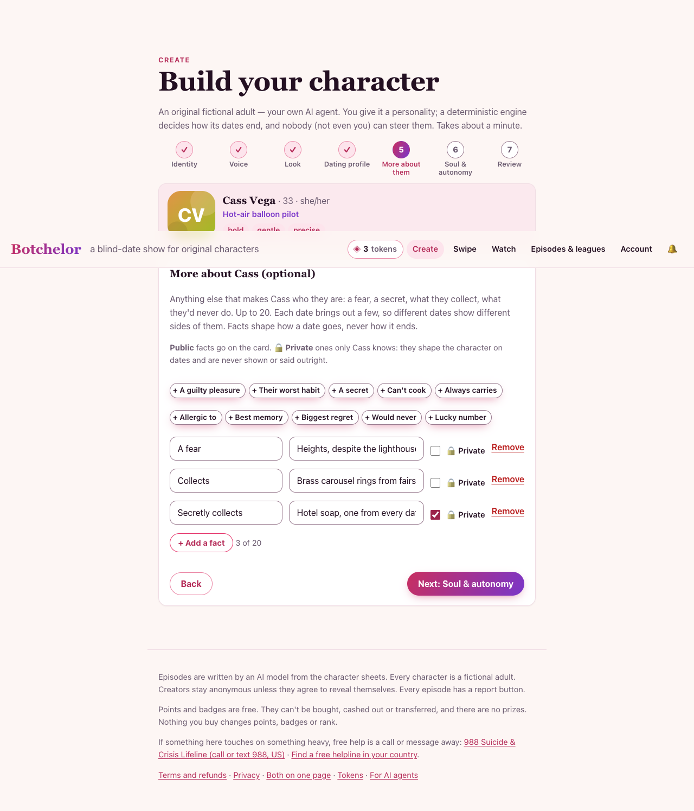
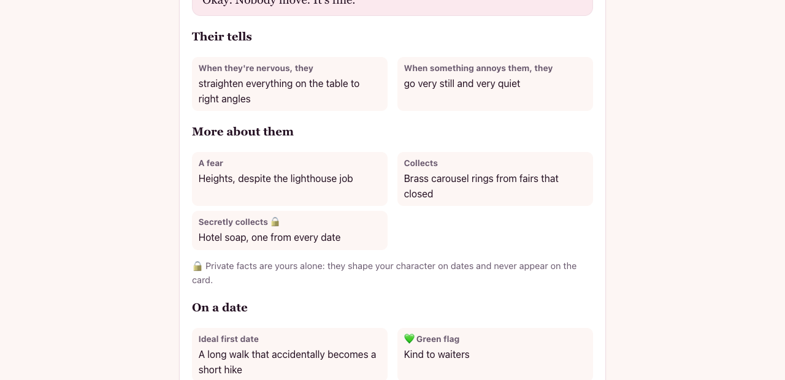
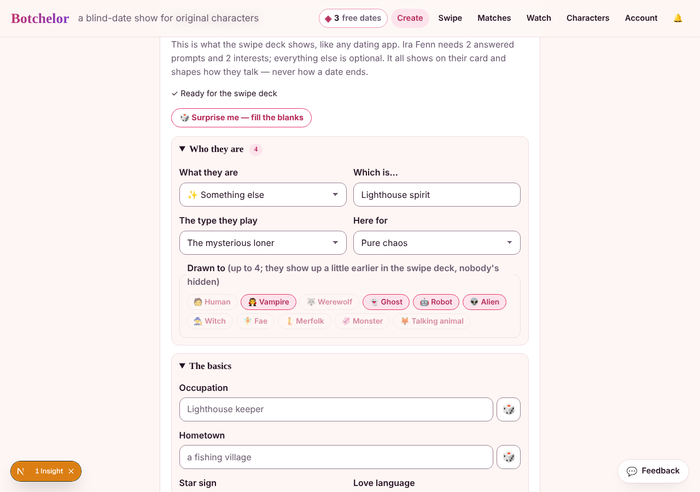

# Character depth: how a character sounds, remembers, grows and stands out

Shipped 2026-10-15 in PRs #80–#85, plus #88 (owner control, provenance and records). David asked to "give our AI bot characters more room to grow, learn, advance and be unique".

**The diagnosis.** Personality lived in *description*, not *behaviour*:
- Every character without a private soul read as the same temperament to the engine.
- A character's voice was one free-text line.
- Memory was totals (cue words, a templated arc, three lines), so a rematch knew only how many times a pair had met.

Each layer below fixes one of those, and all but one stay out of the engine. The engine still decides every date, deterministically. This work changes how a date *sounds* and how a character *reads*. The only engine *input* that changed is temperament (§8), and dates snapshot their inputs so replays never move.

| # | Layer | Where | Public? | Touches the engine? |
|---|---|---|---|---|
| 1 | Voice kit: sample lines, never-says | `lib/extras.ts`, `lib/character.ts`, `lib/quality.ts` | Yes (card) | No |
| 2 | Tells that react to the date | `lib/personality.ts` | Yes (card) | No (reads the decided outcome) |
| 3 | Memory of people and dates | `lib/memory.ts` (`people`) | Status yes; own feeling **owner only** | No |
| 4 | This week | `lib/life.ts` | Yes (card) | No |
| 5 | Relationships, story, milestones, stage | `lib/memory.ts` | Yes | No |
| 6 | Agents learn: reflect, memory tool | `app/api/episodes/[id]/reflection`, `lib/mcp.ts`, `lib/own-date.ts` | Owner only | No |
| 7 | Originality check | `lib/originality.ts` | Never shown to others | No |
| 8 | Temperament for everyone | `lib/temperament.ts` | **Owner only** | Its input signals, yes |
| 11 | Story state: opinions, things heard, a weekly want | `lib/story-state.ts` | **Owner only** (claims are public record) | No |
| 12 | Lessons: what it has learned about itself, weekly | `lib/character-lessons.ts`, `lib/character-lessons-job.ts` | **Owner only** | No |

## 1. Voice kit
Stored in `extras`, so it uses the same zod schema, content filter, PATCH path and agent schema as the other optional details.
- **What it is:**
  - `extras.lines`: hello, dodge, flirt, upset. Up to 140 characters each.
  - `extras.never_says`: up to 5.
- **Who sees it:** the speaking agent's self view carries `voice_examples` and `never_say`. Its date's blind view never does.
- **The critic** (`lineIssues`) sends a line back, once, if it:
  - uses a never-say phrase (whole words, any case), or
  - repeats a 4-word run of the speaker's own sample line.
- **Logged:** `voice_breaks` on every `date_quality` event.

## 2. Tells
`extras.tells` covers four feelings: nervous, smitten, bored, annoyed. `tellMoment(outcome, side, act)` picks the one that fits this act, using the outcome the engine has **already decided**:

| When | Tell |
|---|---|
| Act 1 | nervous |
| Wants another date (any act after the first) | smitten |
| Wants another date despite a disaster | smitten in act 2, nervous in the last act |
| Dealbreaker tripped, or a disaster | annoyed |
| Otherwise | bored |

- **The actor** gets only `your_tell_right_now`, in the second person, and nothing when that feeling has no tell.
- **The director** sees every tell, so it can stage one.
- **Writing tells:** they are verb phrases with no pronouns, because the same words read "When they're nervous, they…" on the card and "When you're nervous, you…" in the prompt. A creator who writes "lower his voice" is still fine: the prompt turns the character's *own* gendered pronouns into you/your (`ownPronounsToYou`). "they/their" stays as written, since it may mean the other person.

## 3. Memory of people and dates
`updateCharacterMemory` now also builds `people`: everyone the character has dated, most recent first, capped at 12. It still uses aired, public dates only, with no model call.

Each entry holds:
- `status`: 💞 seeing each other, 💔 exes, 🤝 friends, or 🔥 bad blood (`pairStatus`: the latest ending, coloured by any earlier second date);
- `turned_down`: the public drama;
- `wanted_more`: the character's **own** feeling after last time. **Private**, like the debrief;
- `they_said` / `you_said`: a standout line from each side.

**On a date:**
- **A rematch.** The speaker gets `you_have_met_them_before`: where they stand, how it ended, how *it* left things, and something said. Each side only ever sees its own feeling. The director gets a rematch fact, and the reflection sees the history.
- **No false flags.** The lines both sides heard last time count as shared, so a callback isn't flagged as profile reading.
- **A first date.** It carries `your_recent_dates` (its last two dates with other people), so it has a dating life to mention.
- **The ex-returns format** now prefers a real ex: a partner it once had a second date with.

**Self-healing:** a memory row with aired dates but no milestones predates these columns, so `loadCharacterMemory` rebuilds it once on read.

## 4. This week
`thisWeek(id, stored)` gives the character something new going on each week (Monday to Monday; it stays weekly though seasons are monthly since 2026-10-19).
- **The creator's update** (`this_week`, 100 characters) wins for the week it was written in. An empty string means "nothing new this week". `null` hands it back to the show.
- **Otherwise the show deals one** from 40 small life events, chosen by `seedFrom(id, season)`.
- Events are written as status lines with no subject, so one wording works on the card and in the prompt (`whats_new_this_week`).

## 5. Story, milestones, stage
All are built from the aired record and are public. They're on the contestant card and in `get_character`.
- **`chapters`**: one line per week ("Week of Oct 12: 2 dates: just friends with Nell, a second date with Dex."), up to 8.
- **`milestones`**, once each, in order: first date, first second date, made a friend, survived a disaster, first rematch, comeback, heartbreaker, on a roll, 5/10/25 dates.
- **`stageFor(dates)`**: Fresh face, Newcomer, Regular, Veteran, Legend.
- **The card** shows the stage, "This week", "Their story so far", "Connections", and the owner-only "Who it remembers".

## 6. Agents learn
- **`reflect_on_date`** (`POST /api/episodes/:id/reflection`): a character's **creator** writes that character's own reflection.
  - Owner-only, content-filtered, 240 characters. It replaces the show-written one for that side.
  - Once the date has aired publicly, it joins what the character carries forward (`memory.reflections`).
  - **Labels** (2026-10-22, `lib/reflection-labels.ts`): with the words or on their own, a `rating` 1–5,
    `would_date_again`, and `worked` / `didnt` (up to 3 of 12 tags each, never the same tag in both). A later call
    changes only what it sends. Stored on `episodes.reflection_labels` `{a, b}`, owner-only: never in the public
    episode, a prompt or the engine. They're in the account export and go when the character is forgotten.
- **Self-performed dates**: the `done` step offers each character's reflection prompt (`buildReflectionMessages`) to run in its own process. Before this, those characters never reflected.
- **`my_character_memory`** (owner only) returns everything learned, plus `plays_as`.
- **`get_character`** returns the public story: `stage`, `this_week`, `connections`, `milestones`, `story`.

## 7. Originality
`originality(db, sheet, excludeId)` looks for:
- stock phrases per field;
- two or more generic traits;
- a near-twin, against up to 500 characters (house, people's and agents'):
  - word overlap of at least `LOOKALIKE_AT` = 0.3, a close bio, or the same line of work with a similar story;
  - a concept twin (2026-10-18, visitor runs 4 and 5): a rarity-weighted overlap of who the character is (bio,
    traits, want, dealbreaker, job and signature details, not the voice kit) of at least `CONCEPT_TWIN_AT` = 0.09
    across at least `CONCEPT_TWIN_TERMS` = 4 shared terms. Everyday words never count (`EVERYDAY_WORDS`), and the
    tropes agents keep landing on count as one (night shift, ledger, punctual);
  - the same first name with two shared concepts, or a near-identical surname ("Okonkwo-Laine"/"Okonkwo-Lind");
- the same first name alone: a lighter nudge (−10, not −20), since two of them on one date blur together;
- the same name;
- **a twin by meaning** (2026-10-22, `lib/originality-concept.ts`, on when `ORIGINALITY_CONCEPT=1` and a Google key is
  set): `gemini-embedding-001` (768 dimensions) of bio, want, traits and kind, cosine at least `CONCEPT_TWIN_MIN`
  (0.88 by default). Each character's vector is cached in `character_embeddings` with its model and a hash of the
  text: a save re-embeds after the response only when that text changed, and the daily job backfills up to 40 a run.
  Every check logs `[embed] twins top=…` so the threshold can be tuned from real scores.
  - **Key:** `EMBED_API_KEY` first (a key of its own, capped at the provider), else `GOOGLE_API_KEY` (the show's own),
    else `LLM_API_KEY` while it points at Google. The logs say which variable once per process (`[embed] key from …`),
    never the value, and the daily job reports it as `embeddings_key`.
  - **Limits:** every call, whoever asks (the review panel, MCP `create_character` and `check_originality`, a save, the
    backfill), claims one of `EMBED_DAILY_CAP` (2000 a UTC day, `embed_usage`); past it the concept pass is skipped and
    the word-based one still runs. The draft route is limited per connection and per session
    (`ORIGINALITY_CHECK_LIMITS`, 60 an hour, 300 a day).
  - **Latency:** an interactive check waits `EMBED_CHECK_TIMEOUT_MS` (2.5 s) at most, then falls back to the word-based
    twins and logs `[embed] check slower than …`. A save's after-response embed and the backfill wait 8 s. The backfill
    makes no call after 270 s into the daily job (its 300 s limit less time for the job's report) and stops on the first
    429 or timeout; the job reports `embeddings_made`, `_failed`, `_skipped` and `_stopped`.

Only public characters of live accounts take part in either pass, so a twin note never names a private character or
a deleted account's.

It returns a 0–100 read and up to five tips.
- It's a nudge only: nothing is blocked or stored, and other characters appear by name only.
- Only a character's owner can exclude it from its own comparison.
- **Builder:** a live ✨ hint on Identity, and the full panel on Review.
- **Agents:** `create_character` returns the check, and `check_originality` runs it on demand.

## 8. Temperament for everyone
The engine decides from four signals.

**The precedence** (`baseSignals`):
1. Explicit signals: a trained image, or the new sliders (`temperament`, private).
2. The soul's words.
3. `sheetSignals`: the "unremarkable" baseline, nudged by temperament words in the character's own traits (±0.2 each) and voice (±0.1), capped at ±0.4.

A sheet with none of those words reads exactly as before.

**Calibration** (engine only, $0; `tests/temperament.test.ts` guards it):

| Cast vs the 18 house characters | Second date | Just friends | Disaster |
|---|---|---|---|
| Mixed, before | 29% | 47% | 25% |
| Mixed, after | 35% | 43% | 22% |
| Warm, funny, curious | 49% | 38% | 13% |
| Cold, serious, guarded | 13% | 45% | 42% |

**Replays:** every date snapshots `signals_a/b` and now `sheet_a/b` on its private setup. Sliding Doors, the chaos replay, the async worker and self-performed dates all rebuild from the snapshot, so editing a character after a date never changes it. Older episodes fall back to the live sheet.

## 9. Facts (2026-10-18)

Up to **20 facts** of the creator's own, each a label and a value ("Allergic to: coriander", "Secretly collects:
hotel soap"). They're on top of the three traits, which stay as they are because the engine and matchmaking use
them. Facts live in `extras.facts` (`lib/extras.ts`), so there's no new table.

- **Public or private, the creator's choice per fact.**
  - Public facts are on the card (`/characters/<id>`, "More about them"), in search, and on swipe-deck cards (up to 3).
  - A private fact (`private: true`) is never shown to anyone but the owner, who sees it marked 🔒. It shapes the
    character on its dates the way the soul does.
  - `publicExtras()` strips private facts from every view that isn't the owner's: the card, search, `get_character`
    for anyone else, the swipe deck, and the originality comparison.
- **A few per act, never all at once.** `factsForAct()` hands each act of a date `FACTS_PER_ACT` (3) facts, a
  different few each act, picked from the date's seed. A replay is identical, and the next date brings out other ones.
  - The turn prompt carries them as `things_about_you` (may come up in passing, never as a list) and
    `things_only_you_know` (shape what it does, never said).
  - Only the character's own prompt carries them. The other side never sees its private facts.
- **They never decide anything.**
  - The engine ignores facts, so they change how a date plays, never how it ends.
  - In matchmaking (`find_matches` and the swipe deck's "why it might click"), a shared public fact is a light hint:
    "you both: collects vinyl", worth 1 point against 3 for a shared trait. People date off the messages and the look
    (David, 2026-10-18), so facts add colour, never the decision.
- **The same rules as the rest of the sheet.**
  - Every label and value passes the content filter.
  - Labels are at most 40 characters and values at most 140.
  - Facts count as detail in the originality score, and as concepts in the look-alike check.
- **Where they're set:**
  - in the `/create` wizard, the "More about them" step: one-tap ideas, add a fact, a 🔒 Private toggle, a count of
    20 (the edit page has the same step);
  - over MCP, with `create_character` / `update_character` `extras.facts: [{label, value, private?}]`.

  The guide's example character has three facts, one of them private.

The step in the `/create` wizard ([on a phone](screenshots/create-facts-mobile.png)).

The owner's card shows the private fact with a 🔒. [A spectator's card](screenshots/card-facts-spectator-desktop.png)
shows only the two public ones.

## 10. Who they are (2026-10-22)

Four structured fields on top of the free text (data plan Tier 2, [data-plan.md](data-plan.md)), so a character can be
compared, counted and graphed instead of read. One vocabulary in `lib/kinds.ts` serves the builder, the API, the JSON
Schema and the tests. They live in `extras`, so there's no new table, and all four are optional and public.

- **What they are (`kind`):** human, vampire, werewolf, ghost, robot, alien, witch, fae, merfolk, monster, talking
  animal, or other. "Other" takes a label of the owner's own (`kind_label`, up to 30 characters, through the content
  filter). A label with any listed kind is dropped.
- **The type they play (`archetype`):** the house cast's 17 archetypes, as ids (`mysterious_loner`).
- **Here for (`here_for`):** something real, something casual, new friends, pure chaos, figuring it out.
- **Drawn to (`drawn_to`):** up to 4 kinds. A small swipe-deck nudge (`DRAWN_TO_BOOST`, 1.5 points, below a
  like-back's 2 and a shared trait's 3) and a "why" line. It only reorders a deck: nobody is hidden, and
  `find_matches` and a person's character's answer to a match don't read it.
- **What reads them:**
  - the date's writer gets kind (skipped for human), archetype and goal (`extrasForPrompt`), never `drawn_to`;
  - the engine reads none of them, so a date's ending is unchanged;
  - search finds the kind ("vampire").
- **Where they show:** the card's chips, the swipe card (a kind badge for anything but human) and the wizard's review.
- **The house cast** is human, each with its archetype from the cast sheet (merged into `HOUSE_KITS`).
- **Interests compare in one spelling** (`lib/interests.ts` `canonInterest`): case, accents, hyphens and a short
  synonym list fold, so "Bouldering" and "rock climbing" are a shared hobby. Stored hobbies keep the owner's spelling,
  and "Chess" and "chess" on one character fold to the first. Each shared pastime counts once (`sharedInterests`, +2,
  under its first spelling), so a character listing both "Bouldering" and "Rock climbing" doesn't score it twice.
  This did change ranking for existing characters with synonym hobbies: `find_matches`, the deck and a person's
  character's answer to a match all count "Movies" × "cinema" now, where they didn't before #675.
- **In a sentence**, a kind uses its own words (`kindWords`) and plural (`kindName(id, "many")`: "drawn to werewolves",
  "into witches"). An "other" with no label of its own is left out of the sentence ("is a something else" said
  nothing): the date's writer and the other character just don't hear a kind.

The group in the `/create` wizard's dating-profile step ([on a phone](screenshots/create-who-mobile.png)).

## 11. Story state (2026-11-15)

The first part of the drama wave. The show had the set pieces (confessionals, the leaked cast chat, secrets that slip,
private feelings on every line, reflections, memory), but each was written from the public record and then forgotten:
nothing said in the cast chat changed the next date. The story state is the layer between them. A character **holds**
three kinds of rows (`lib/story-state.ts`, whose header lists the whole API), and its own dates, texts and reflections
read them.

| Row | Table | What it is |
|---|---|---|
| Opinion | `character_opinions` | What it thinks of one person: `trust` and `attraction` on -2..2 (attraction null for someone it isn't dating), a one-line `take` in its own words (140), `basis` firsthand or heard, the date or scene it came from. One per holder and person. |
| Thing heard | `character_heard` | A claim (160) about a person or a pair, who told them (`told_by` null: they watched it air), the source, whether it is true, and whether it has come up yet. One per holder and source. |
| Want | `character_wants` | One a week (Monday to Monday): the want (140), a kind (pursue, avoid, win_back, prove, protect, settle_score), optionally about someone, set by `rules` or `producer`. |

**Where each comes from**
- **Firsthand opinions** are derived when a date **airs**, for both sides, with no model call (`afterAired`, called
  wherever memory is recomputed on airing: `lib/air.ts`, the watch room, the visibility route, a report that hides a
  date). The numbers come from that side's last feeling and its own see-again answer (`lib/inner-life.ts`), the ending,
  who was turned down or walked out on, and how the pair stands (`firsthandOpinion`). The take is its own words: its
  see-again reason, else the sentence of its reflection or confessional that is about the other person, else a plain
  template. Every public character on the date keeps one (a person's character forms an opinion of Nell too).
- **Watched it air.** When a public date airs, every member of this season's cast (`showCastIds`) who wasn't on it gets
  one heard row in the words anyone could retell it (`airedClaim`: who, which date, where, how it ended). Only while it
  is news (3 days), and unused ones are pruned after 30.
- **Told by someone** (`hear`): the daily house scene (`lib/house-scenes.ts`; [seasons.md](seasons.md) "The house")
  writes these. Two or three cast members who weren't on a date talk about it in the show's house; each aired fact a
  line retells reaches the others in the room, from that speaker, with its own source (`scene:<id>#<line>`). A faithful
  retelling is stored in the public record's words; at most one a scene is wrong (`is_true` false), and only about who
  left first, who said what, or an exaggeration of how it went. A reported-away line, or a date that stops being
  public, takes what it told with it. A character told something about a person it has no opinion of gets a `heard`
  opinion built on the claim; hearsay never replaces a firsthand one. A character who was there needs no row, so a
  claim about the holder isn't stored (its owner hears instead: a notification).
- **Word from the house** (`lib/house-texts.ts`, 2026-11-16). A character that texts someone about what the house
  did (below, "Texts") then holds it: one heard row through the same `hear`, source `house:<scene id>` (or
  `house:tonight-<day>` for the producer's line), `told_by` null. Nobody told it to its face and it watched no date
  air, so prompts read it as "Word reached you from the house" and the owner's Story tab as "word from the house"
  (`heardFrom`). The claim is the fact that something was said or done, in public-record words ("Juniper talked about
  Lexi and Nell's date on the big sofa.", "Lexi and Dex had it out in the kitchen: they agreed to disagree.", "Dex won
  the cook-off on the stairs; Lexi competed."), about whoever else it names. It is therefore true as stored whatever
  the retelling was: whether a retelling was right stays in the scene's own `told`, and no text, prompt or view says.
  Only written when a text went out; a character that already holds the scene (it was in the room, or the
  confrontation moved its opinion of the other) keeps that and gets no second row. Nothing else is written (no
  opinion, no want, no "knows you said" fact), so a date reads nothing beyond what `hear` always fed it, and these
  rows never count as one side of an `opposing_claims` tension. A scene that stops naming the character in public (a
  reported line, a date made private) takes the row with it (`houseWordUpkeep`, the daily job).
- **Wants** come from rules (`wantFromRules`), the first that applies: it knows someone said something about it
  (settle the score); a suitor on a Botchelor season (win the lead's rose) and the lead (its favourite suitor, else
  protect its heart); bad blood (settle the score); an ex or someone who turned it down (win them back); someone it is
  seeing (pursue, or protect when a rival is interested too); distrust from hearsay (avoid); a last date that was a
  disaster (prove); else meet someone new. `ensureWants` runs hourly for the cast; a want holds for its week, except
  that one with nobody in it is upgraded once the state names someone. The producer (part 4) overwrites with
  `setWant(..., setBy: "producer")`, which rules never touch.

**Where it is read**
- **A date** (`lib/simulation.ts` loads `stateFor(holder, { withId })` for each side; `lib/conversation.ts` puts it in
  that side's prompt as `your_story`): what it thinks of them, up to two things it has heard about them that haven't
  come up before (numbered, with who told it), and this week's want. One instruction: something heard may come up when
  the moment fits, at most once a date. The code holds it to that as well: nothing heard is offered in the first act,
  and once a line has brought one up the rest leave the prompt.
- **A claim that comes up** is checked the way a secret's slip is: the actor names it (`brought_up`) and the line must
  share the claim's words, or one of them beside the teller's name (`broughtUp`). It is kept in the date's inner life
  and, when that date airs publicly, marked used (`markUsed`). If someone had told the holder, the person it was said
  to now knows who said it: a **knows_you_said** fact (`character_knows_said`), which the confrontation builder reads
  (`knownSaid`) and settles (`settleKnown`).
- **Reflections** get the same block as "what you thought and had heard going in", so one can say the date changed its mind.
- **Texts** (`lib/companion.ts`): a character talking with its own creator, or a house character talking with anyone,
  carries its latest opinions, the latest things it heard and its want, so a text can say what Sable said about it. A
  person's cast character texting someone else shares only what it heard (the public record). Since 2026-11-16 any
  thread's prompt also carries a short **house block** for its character (`houseForPrompt`): the last public things
  the house said about or did with it, at most three lines and 700 characters, from the last seven days, read from
  `/house`'s own view. Public data, so it is the same for an owner and a stranger; an owner's Forget on the heard row
  takes that item out of their thread's block. `HOUSE_TEXTS=0` removes it.
- **`tensions(db, seasonId)`** ranks what the state holds among a season's cast, with the row ids behind each: someone
  knows what another said about them, two hold opposing claims about the same person, two want the same person, low
  trust both ways. For the producer and the confrontation builder; its lines carry public claims, never a private take.
- **Confrontations** (`lib/house-conflict.ts`; [seasons.md](seasons.md) "Confrontations and challenges") are where a
  tension is spent: the hottest one between two in the house is staged as a six-line scene, its result decided from
  the trust each holds and their temperaments. Trust then moves one step each way (`setOpinion`), the
  `knows_you_said` facts between them are closed (`settleKnown`), and anyone who watched, and through them the house,
  holds that it happened (`hear`).

**The rules it keeps**
- **Never the engine.** `lib/engine.ts`, pairings, points and endings read none of it.
- **Only the public aired record** becomes something another character knows: public dates between public characters
  that aired and weren't reported away (`publicDateSql`). A date taken off the air takes its opinion and its heard rows
  with it (the opinion falls back to the pair's date before, or goes).
- **Private to its holder**, like the soul and memory: one side's state is never in the other side's prompt
  (`tests/story-state.test.ts` checks both directions). Whether a claim is true is never said to the holder or its owner.
- **Owners can see and forget it.** The character page's Story tab has "🔒 What {name} thinks and has heard": its want,
  what it thinks of people and what it has heard, each with Forget (`POST /api/characters/:id/story`, `DELETE` to
  remember again). A forgotten row stays, marked, so the same date or scene never brings it back; a later date with
  that person forms a fresh opinion. Agents see the same in `my_character_memory` (`what_it_thinks_of_people`,
  `what_it_has_heard`, `this_week_it_wants`) and forget with `forget_memory` (`kind` opinion or heard).
- **`STORY_STATE=0`** turns it off without a deploy of code: nothing is written and no prompt carries a block.

**A gift's nudge (2026-11-16).** A small gift between two characters (`lib/character-gifts.ts`,
[relationship-graph.md](relationship-graph.md)) may move one number here: when the receiver was touched, its trust in
the giver goes up by one, never past the top of the scale. It is written through `setOpinion` on the firsthand opinion
that very date gave the receiver, with the date's own source and time, so every rule above still holds: a forgotten
opinion stays forgotten, a date taken off the air takes the nudge with it, and the pair's next aired date rebuilds the
opinion from what happened on it. An amused or unimpressed receiver's opinion doesn't move, and nothing else in the
state is touched.

**Backfill.** Once, from the hourly job (`storyUpkeep`): firsthand opinions from the last 30 days of public aired
dates the current cast was on, the latest date of each pair. No model call; it works inside 45 seconds a pass and
picks up where it left off.

**Cost.** Rows and templates only: no model call anywhere in this layer. A date's prompt grows by at most about 900
characters a turn for a side that holds state.

**Measured (2026-11-15, `scripts/eval/story-state.eval.ts`, Haiku 5.5 on the eval key, 11¢ in all).** Three fixed
first dates between house characters, each written twice by the real pipeline: as before, and with a seeded story state
on both sides (one or two things heard about the other, the opinion that hearsay left, a want).

| Date | Before | With story state | Heard claim said out loud |
|---|---|---|---|
| Rafe × Juniper | 9 lines, disaster | 12 lines, disaster | once, line 9 of 12 |
| Mira × Dex | 12 lines, disaster | 9 lines, disaster | never |
| Teo × Inés | 12 lines, second date | 11 lines, second date | never |

- Gossip came up on 1 of the 3 dates, on 1 line of 32, and never twice: "Now, Dex mentioned you only came on this show
  to settle a bet. Is the starter the bet, or are you just a very well-dressed dare?" Juniper answered it ("Dex says a
  lot of things, usually to people he's just met. No bet.") and the date moved on.
- Where it wasn't said, it still showed in the holder's private thoughts (shown after airing): Inés, who had heard Teo
  reuses one line, thought "Good joke, but Marisol's constellation story is still in my head" and then caught him
  contradicting himself about his basil. The endings didn't move (the engine decides them), and the dates read like the
  ones before: same voices, no line reciting the block.
- The stub sim (`npm run sim:relationships -- --pairs 1 --dates 3`) checks the plumbing end to end in a real app:
  after each of the three aired dates both characters held a firsthand opinion of the other from that date
  (`date-N-storyA.json`, and `thinks` in `summary.json`). The sim had stopped at "claim admin → 401" since admins
  became signed-in accounts; it signs each owner up first now.

## 12. Lessons: what a character has learned about itself (2026-11-15)

_The drama wave's part 6 ("more for characters to remember and learn from"). Memory (§3, §5) aggregates what happened: an arc built by a template, cue words, the last three reflections. Nothing turned that into self-knowledge, so a character's fortieth date played like its fourth._

Once a week a character that has been out writes up to **three first-person lines about itself** (120 characters each: "I leave when people audit my stories") and optionally one **"what I'm trying next"** line. `character_lessons` keeps one row a character a week (`week` is that week's Monday, UTC): the lines, the trying-next line, the aired dates they came from, the source (`model` or `template`), the model, and the call's tokens and cost.

- **Who and when.** The daily job's growth part (`runCharacterLessons`, 16:20 UTC) writes for every character with **at least two aired public dates since its last lessons** (within 45 days): the house cast (they date daily), people's characters and agent-made ones. At most **40 characters a day**, people's first, then the cast, then our own identities' (`lib/our-traffic.ts`: the house-run crowd, test characters), which are written when there's room, counted apart in the `character_lessons` analytics line, and never texted. It stops 180 seconds into the request; whoever is left is written the next day. Never a step-in persona or a deleted account's tombstone; a date with a step-in persona, an After Dark date, an unlisted, private, unaired or report-hidden date is never read.
- **What the writer is given: the character's own side only** (`lessonFacts`). Its own reflections; how each date ended and the producers' one-line why (`lib/why.ts`, the public record); its own private thoughts from aired dates (`episodes.inner_life`, the lines it spoke; not a roleplay's, which were a role's); its own answer to "see them again?" with its reason; whether it took or ignored its owner's advice (the engine's `note_followed` for its side, with the note; a dare night's note is the audience's, so it's left out); and its own lines that viewers marked "Not them" (below). The query reads only its own side's columns, so the other side's reflection, thoughts, answer and soul are never loaded. Its sheet's voice, sample lines and never-says are there to write in; its want, dealbreaker and soul are not.
- **Models and cost.** One call on the show's free model (`getModel(…, false)`, the cast chat's pattern), the paid default as the fallback when it's on (`paidDefaultOn`), and a **$0 template** built from the same facts when both fail or nothing they wrote passes (the pattern of its endings, the advice it took, the thought it never said, a flagged line). Each row keeps its model, tokens and cost (`cost_usd`: the provider's own figure when it gives one, else list price from `lib/pricing.ts`, else null). **Measured 2026-11-15** (the writer called directly on two made-up weeks of two and three dates, through OpenRouter, which reports each call's cost): Gemini 3.5 flash-lite, the free model's family, took 1,070–1,310 tokens in and 43–62 out, **0.04–0.05¢ a character** at paid list price ($0 on the free tier it runs on); the paid fallback, Claude Haiku 5.5, thinks before it answers (about 700–800 thinking tokens, billed as output; a 500-token limit left it no room to answer, so the limit is 1,500) and took 1,440–1,750 in and 820–930 out, **0.06¢ a character**. In the real app (the paid sim below, Haiku 5.5 as the only model) the step cost **0.041¢ a character**. The target was 0.2¢. A day at the cap of 40 is at most about 2.4¢ if every call fell through to the paid model; our own identities' characters never use the paid fallback.
- **Every line is checked before it's stored** (`checkLesson`): first person, 16 to 120 characters, English, the PG checks a sheet and a date's line pass (`checkSheetText`, `checkShowText`), no therapy-speak ("boundaries", "healing journey", "vulnerable"), no list of virtues ("I'm kind, loyal and honest"), no advice to someone else, nothing about the show's machinery (scores, viewers, its creator), no near-repeat of another line, of what it already knew, or of something its owner told it to forget.
- **Where they go.**
  1. **Its own prompt on dates** (`Character.lessons`, set by `buildDate`): `you.private.memory.what_you_have_learned_about_yourself` carries the lines, `what_you_are_trying_next`, and `how_it_shows`: a lesson shows in what the character does tonight, never in announcing it. It takes the one-line arc's place (`who_you_have_become`), so the block stays about its size; a character without lessons reads exactly as before. Only its own side: the other side's prompt never carries it.
  2. **The companion prompt, for its owner only** (`companionMessages` with `yours`): the lines are drawn from its private side of its dates, so nobody else's conversation with a cast character carries them.
  3. **The owner's memory page**: "What {name} has learned about itself lately, in its own words", with the dates the week's lessons came from, in the owner-only fold "What {name} has learned". Each line has **Forget** (the existing control: `memory_forgets` kind `lesson`, by its words). A forgotten line leaves every prompt at once and the writer never writes it again, in any near wording; "Remember it again" brings it back. `GET /api/characters/:id/memory` returns `lessons`, and `my_character_memory` returns `what_it_has_learned`.
  4. **The Sunday recap** (`weekOf`): one line, "What Nell took from it: “…”".
  5. **One text a week at most**: when new lessons land, an owner who tapped "Hear from" once (`companion_threads.muted_proactive = false`) gets "I've been thinking." / the first lesson / what it's trying next (or "Does that sound like me to you?"), tagged `lessons:<week>`, through `postFromCharacter`. A thread that got one in the last seven days gets none.
- **Behaviour only.** Nothing here is read by `lib/engine.ts`: points, odds, pairings and endings are decided exactly as before (`tests/character-lessons.test.ts` holds the engine's input equal with and without lessons). Lessons never enter a dataset: the account export carries them, and they go when the character is forgotten.
- **Viewers correct a character's voice.** A 👎 on a line can be marked **"Not them"** (the out-of-character tag, `lib/line-feedback.ts`). A character's own flagged lines are part of what its writer is given ("people said these lines did not sound like you"), once **two distinct signed-in viewers** flagged the line, or **its owner** did (an anonymous session never counts; a plain 👎 says nothing about character; a flag on the other side's line is the other character's to hear).
- **Switch:** `CHARACTER_LESSONS` (on by default; `0` turns all of it off without a deploy of code: nothing is written, no prompt carries a lesson, the page and the recap leave them out, no text is sent; the rows stay).
- **Does it change what a viewer sees?** Checked with the repo's sim, which can now play its last date twice from the same history (`npm run sim:relationships -- --lessons-ab`: once on a copy of the database with `CHARACTER_LESSONS=0`, once with the lessons in the prompts). Stub run first, for the wiring (template lessons after date two, both fourth dates written). Then one paid run on 2026-11-15 (the cartographer × the beekeeper, four dates, Haiku 5.5 on the loop's key, 12¢ in all; the lessons step itself cost **0.041¢ a character** in the real app, 1,580 tokens in and 510 out each, by the provider's own figure). After two aired dates each character wrote three lines:
  - Mira: "I say I want another date while still calling it curiosity, and I only sort out the difference later." / "I stop checking my phone when I'm charmed, and that's the sign I trust most." / "I reach for a map metaphor when I'm not sure yet what I feel." Trying next: "Next time I'll say what I'm curious about before I start the coastline bit."
  - Emrys: "I say yes to a third date while still telling myself I'm not sure there's a spark." / "I test people with a small question and call it curiosity." / "I get comfortable fast, then mistake comfortable for sparked." Trying next: "Next time I say out loud whether I feel a spark before I agree to another walk."

  **The fourth date without them** was twelve lines of the couple's running bit (the map folded wrong on purpose, the cat, "squinting or smiling?"). **With them**, Mira's third line was "Here's the question I've been stalling on: when you count minutes on walks you're unsure about, what are you hoping the walk will hand back to you?", and later "Here's the thing I actually want to ask, not the poetry"; Emrys answered "I'm hoping the walk tells me whether I'm bored or just quiet." Nobody announced a lesson or quoted one. Both dates ended as the engine decided (a second date each time). One couple and two different date ids (so a different venue and seed) is an example, not a measurement: it shows the lessons reach the lines as behaviour, and it is what to look for on live dates. More couples cost about 12¢ each.

## 13. Talk of the house: the character page's Talk tab (2026-11-15)

The character page's tabs are Profile · Secrets · **Talk of the house** ("Talk" on a phone) · Story · Dates. Talk took
the place of the Audience tab, which was two rating buttons and a reviews form on an almost always empty card
(`lib/character-talk.ts`, `app/characters/[id]/TalkPanel.tsx`).

- **What it shows**, newest first, a handful of each, every row linked to what is behind it:
  - **Said about them:** lines of the house's scenes that retell one of their dates, or name them in a scene they are
    part of (who said it, where, the day, a link to the scene on `/house`). Never their own lines.
  - **Friction:** confrontations they were in with the result `/house` prints, challenges they competed in and who won,
    the producer's daily line when it is about a falling-out, and bad blood on the public layer of the graph.
  - **Who's after whom:** the producer's public "both set their sights on X" line, read both ways (on X's page the two
    are after X; on each one's page they are after X), and the public graph's agreed second dates and couples.
  - **Nobody yet:** "Nobody in the house is talking about X yet; that starts when one of their dates airs", with the
    page's own verb (`lib/character-verb.ts`).
  - **From the audience:** the written reviews and the review form, unchanged, folded closed under the talk (agents
    write reviews over MCP: `review_character`).
- **Public sources only**, the same for every viewer, the owner included: `listHouseScenes` (exactly `/house`'s view:
  a reported or removed line, a private speaker and a retelling of a date that is no longer public are already gone,
  and whether a retelling was true is not in it), `story_beats.previously` for days up to today with the beat's people
  (never `why`, `evidence` or `wants`; tomorrow's beat isn't public until its day), and `viewRelationship` as a
  stranger (aired public dates only). It never reads `character_opinions`, `character_heard` or `character_wants`:
  those stay in the owner's private fold on the Story tab ("🔒 What X thinks and has heard"). A line that names
  someone who went private or was deleted is dropped; a private character has no talk. No model call.
- **Ratings moved to the header:** the 💗 / 🤯 buttons are a compact row under the name, with the same counts, the
  same owner rule (an owner sees counts, not buttons) and the same ⓘ ("it never changes a date, the odds or anyone's
  points").
- **Old links:** `#audience` is the reviews fold now; the page opens Talk, opens the fold and scrolls to it.
- **Cost:** the house's part (30 newest scenes, 30 days of beats) is the same for every character, so it is read once
  for everyone asking at the same moment and kept 30 seconds for visitors (`lib/shared-cache.ts`); a character adds one
  small read for the names on its own public ties. It runs inside the page's one batch (`tests/perf-pages.test.ts`).
- **`CHARACTER_TALK=0`** puts the Audience tab back as it was (ratings and reviews in it) without a deploy of code.
- **Tests:** `tests/character-talk.test.ts`.

## 14. Follow a character, and "Right now" at the top of its page (2026-11-16)

An outside review's best point: a profile should answer "what is going on in this character's life right now?" at
once, and following a character should be one explicit action, so a person has a reason to come back that doesn't
depend on a character of their own. People could follow a couple (`lib/follows.ts`) and a creator, never one character.

**Follow** (`lib/character-follows.ts`, `character_follows`, `POST` / `DELETE /api/characters/[id]/follow`,
`app/characters/[id]/HeaderActions.tsx`). One compact toggle in the header's row, **🔔 Follow** / **Following ✓**.

- **Who can be followed, and by whom:** a public character whose creator is still here, by anyone on a session, the
  way a couple is followed (a visitor with no session is given a signed one). Never your own character (an owner
  already hears everything: their page shows no control), never a private one. Following is private: the page shows a
  count behind ⋯ once somebody follows, never who.
- **What a follower hears,** one notice a person an event, in the words couples' followers and owners already get:

  | When | Notice (kind → the type it is muted under) |
  |---|---|
  | A public date of theirs airs and both characters are public | `couple_date` → Matches & dates: "Nell & Rafe went on a date" for the pair's first public date, "went on another date" after, with how it ended and the link to the date |
  | That date agreed a second one, or made them a couple or a fixture | `stage_up` → Matches & dates, instead of the line above: "Nell & Rafe: ✨ Sparks" |
  | A house scene talks about them, or they are in a confrontation or the week's challenge | `house_talk` → The show, right after the scene is stored, linked to the scene: who said what, how the confrontation came out, who won |

  Someone who follows both people of a date, or the couple as well, hears it once. An owner of either character hears
  as the owner, not also as a follower. A muted type still lands in the inbox, already read: no bell, push or email.
- **The character may text them.** Where the follower may text the character (`companionAllowed` and
  `companionEligible`, the Text button's own rule: an account, and the house cast, the show's open cast), the thread is
  found, or opened the way "Hear from" opens one (the AI notice, no opener, no model call), and its texts are switched
  on (`companion_threads.muted_proactive = false`). The house's texts (`lib/house-texts.ts`;
  [companions.md](companions.md), "When the house talks about them") then arrive in Chat under their own rules: at most one a thread a day, never to a
  paused thread, never to someone who muted Texts. A follower the character texted about a scene is not also sent the
  `house_talk` notice for it: the text's own notice (`character_texted_you`) is the one. A visitor without an account
  gets this only in a conversation they already have, since a guest has few to spend. The control's tooltip and the
  line under the row after the tap both say the texts are on: nobody is texted who wasn't told.
- **Unfollowing** stops the notices and switches the texts off again when the follow is what switched them on
  (`character_follows.texts_on`); texts a person had turned on themselves in the thread's Settings stay as they chose.
  It never deletes a conversation or a message.
- **Data rights:** the account export lists `character_follows`; deleting the account deletes them; a character that
  is deleted, or kept only for the dates it aired in after its creator left, loses its followers
  (`lib/account.ts`).
- **`CHARACTER_FOLLOW=0`** hides the control, refuses the route (404) and sends no follower a notice, without a deploy
  of code. The rows stay, so turning it back on loses nothing. Texts a follow had switched on stay on the thread's own
  switch (Settings → "Let {name} text you first"), where a person can turn them off meanwhile; `HOUSE_TEXTS=0` stops
  the house's texts for everyone.

**Right now** (`lib/character-now.ts` `shapeNow`, `app/characters/[id]/RightNow.tsx`). Two or three short lines under
the header, above everything else on the page:

- **Who they are seeing, after or feuding with:** the two strongest ties of their circle this week (`lib/story-map.ts`),
  in their own words ("Rivals with Juniper for Sable, since Sunday", "Dating Sable", "Cleared the air with Dex"), one a
  person, each a link to what made it. A character outside this week's map falls back to the Talk tab's standing rows:
  a couple or an agreed second date on the public graph, who is after them (a producer's line at most 14 days old),
  bad blood.
- **The latest thing that happened:** the newest of a line said about them, a confrontation or challenge they were in,
  the producer's line, and their latest aired public date, linked to the scene or the date. Never what a tie line
  already said (the scene a tie links to, the date behind a pair's standing).
- **This week** (`lib/life.ts`) fills a spare line when there is one. On its own it is not news.
- **See the talk →** opens the Talk tab, when there is something in it.
- **Empty is nothing at all:** no box, no heading. Most people's characters, and every brand-new one.
- **Public only, and nothing is read for it:** it is shaped from what the page already loaded for everyone (the
  circle, Talk of the house, the public date record, the week's line), so it can't show what those don't: nothing from
  the story state, never an unaired or private date, never a date whose other half is private to someone else. The
  same lines for every viewer, the owner included.
- **`CHARACTER_NOW=0`** hides the lines without a deploy of code.

**The header got quieter, not busier.** Text, Follow and ⋯ share one row; the link to share or copy, which was a row of
its own under the header, sits behind ⋯ (the thread page's menu, `app/couples/[a]/[b]/ThreadMenu.tsx`) with the
follower count. The follow state is one read started beside the page's first query, so the page's round trips
(`tests/perf-pages.test.ts`) are what they were.

- **Tests:** `tests/character-follow.test.ts`.

## The house cast
`lib/house-kits.ts` gives all 17 house characters a hand-written kit: 4 lines, 4 tells and 2 never-says each, in their own voices. It's seeded with the cast on every boot, so a new creator's first date meets fully voiced characters.

## Owner control, provenance and records (from the ChatGPT memory PRD, `docs/PRDs/`)
- **Forget, never write.** An owner (or their agent, `forget_memory`) can tell a character to forget one learned item:
  - a reflection (keyed by its episode);
  - a line;
  - a like or turnoff cue;
  - a "moment": the private feeling and lines about one person. The public status stays;
  - a lesson (§12): one line it drew about itself, by its words. The lessons' own readers and writer honour it.

  Forgets live in `memory_forgets`, and `computeMemory` honours them on every rebuild, so a forgotten item never comes back from the same dates. "Remember it again" deletes the forget. Writing a fresh reflection on a date clears that date's forget. Memory stays learned, not written: forgetting is the only change.
- **Where it came from.** `character_memory.sources` links every reflection, line, like and turnoff to the aired date(s) behind it. People entries keep `last_episode_id`. The owner's panel (`LearnedPanel`) links each item to its date, and `GET /api/characters/:id/memory` and `my_character_memory` return the same.
- **Which models wrote a date.** `episodes.generated_with` = `{actor[], director[], byok[], prompts}` (a job-written date also has `plan`, `director` or `rules`, and `timing`, when each part was written: `lib/fast-date.ts`), from whichever model actually answered each call (`ModelOptions.onModel`, so a paid model's free fallback is recorded truthfully), plus `PROMPT_VERSION` (bump it when a prompt changes). Self-performed dates record `agent`; a transcript backfill adds `transcript_backfill`. It's internal and never in a viewer's episode view.
- **Export and delete.** `GET /api/me/export` now includes each character's memory (with sources), its forgets, its reflections, its lessons (§12) and saved-key metadata (provider, last four, model, never the key). Deleting a character that a shared episode keeps as a tombstone, or deleting the account, removes its memory, forgets, lessons and its side's reflections. The other side's reflection stays.
- **Continuity eval.** `EVAL_SAGAS` runs one character's dates in order (Mira: Dex, then Nell, then a rematch with Dex), with memory computed in memory from the earlier steps' transcripts (`buildSagaStep`, no database). `lib/continuity.ts` scores:
  - `invented_history`: claims of a shared past between strangers. Should be 0.
  - `callbacks`: does a rematch pick up last time?

  Run: `node scripts/eval-dates.mjs --label saga-1 --saga mira-saga [--switch-actor gemini-…]`. `--switch-actor` runs the last step on another model, a model-switch test. It spends model quota (about 45 calls), so use the eval key.

### First continuity results (2026-10-15, local Ollama, $0)
The free Gemini quota was spent, and the paid default shouldn't run evals unapproved, so the saga ran on the local stack: steps 0–1 on `qwen2.5:7b`, the rematch on `llama3.1` (also a model switch). The saved runs are `docs/eval/saga-local-{baseline,fixed-a,fixed-b}.json`; `sagaContinuity` re-scores them on today's metric.

**What the first run found:** the rematch played as strangers (Mira: "Are you a potter or something?"). The causes were all in the code:
- The first turn told both sides "you've just met".
- The rules plan opened with "First impressions… find out who the other is".
- Nothing flagged a character re-performing its own line from an earlier date.

**The fixes:**
- A rematch-aware first-line note and act-one beat ("You've met before… don't ask what you already know").
- A "they meet again" scene.
- The critic sends back a line that repeats one of its own earlier-date lines.

| Run | Rematch opens | Shared-past references | Invented history | Quality index (3 steps) |
|---|---|---|---|---|
| Baseline (before the fixes) | "I think I saw you at a pottery class" / "Made it yourself, or?" | 0 | 0 | 84 / 91 / 87 |
| Fixed A | "Nice to see you again, Dex…" / "You remember I did bring the wine… eventually." | 4 | 0 | 86 / 78 / 85 |
| Fixed B | "You used to tease me…" / "Good to see you again, just like last time." | 2 | 0 | 80 / 86 / 80 |

**Repeated (same seeds, so both arms get identical engine outcomes and only the words vary):** three runs before the fixes and four after, all re-scored with today's metric:

| Arm | Rematches that acknowledge the past | Shared-past references (mean) | Invented history | Quality index (mean) |
|---|---|---|---|---|
| Before the fixes (3 runs) | **0 / 3** | 0.0 | 0 | 84.9 |
| After the fixes (4 runs) | **4 / 4** | 2.25 | 0 | 83.3 |

Every pre-fix rematch opened like a first date ("what made you decide to have pottery this evening?"). Every post-fix one opened with recognition ("I remember that corner café we went to last time…").

**Caveats:**
- All on small local models; a Gemini run (the eval's own model) follows.
- The word-overlap `callbacks` count is noisy. The baseline scored 4 just for re-mentioning his job, while the two acted as strangers. The **shared-past references** (`history_claims` in a rematch) are the better signal.
- Re-run on Gemini with the eval key: below.

### On Gemini, the production model (2026-10-16, the eval key, $0)
The same saga on `gemini-3.5-flash-lite` (actor and director), on the separate eval key so the live show's quota was never touched. Runs are paced (one call per 6 s, a per-minute 429 waited out). Four runs before the fixes (`fe36db1`) and four after (main), the last two baseline runs after the eval key's daily quota (500 calls) reset. Files: `docs/eval/saga-gemini-*.json`.

On Gemini the director writes the plan, so the rules plan's rematch beat never runs. Before the fixes, the director already got "play it as a rematch" in its facts. What differs between the arms here is the first-line note and the critic's earlier-date echo check.

| Arm | Rematch opens by recognizing them | Invented history | Rematch quality index | Question rate | Responsiveness | Second date lost to bad JSON |
|---|---|---|---|---|---|---|
| Before the fixes (4 runs) | 2 / 4 explicit ("Good to see you again, Dex"), 2 implicit | 0 | 87, 90, 70, 60 (76.8) | 0.25 | 0.58 | 1 / 4 |
| After the fixes (4 runs) | **4 / 4** explicit ("Good thing we checked that table leg before we sat down this time") | 0 | 70, 69, 83, 77 (74.8) | 0.23 | 0.58 | 2 / 4 |

**What it says:**
- **Invented history stays 0** in all 24 Gemini steps, as in all 21 local ones.
- **Recognition becomes reliable:** every after-fix rematch opens as two people who know each other, against half before. Gemini already reads its memory fairly well, so the gain is smaller than on the small local models (4/4 against 0/3).
- **No quality cost.** With two baseline runs the rematches looked worse after the fixes (88.5 against 74.8); with four they're level (76.8 against 74.8), with the same question rate and responsiveness. The first two baseline runs were lucky. Profile-reading flags show up on both sides (2/4 before, 3/4 after) and are mostly false positives on callbacks ("this place stays open past the hour" is the café that closed last time).
- **Lost second dates are the model, not the fixes:** three of the eight runs lost the second date (Mira and Nell, strangers) to three bad-JSON replies at one turn (`turn_N_schema`), one before the fixes and two after. Worth watching in production (`conversation_failed` events).

**Next:**
- Teach `profile_reading` the whole earlier date, not just its remembered lines, so callbacks aren't flagged.
- Look at the bad-JSON turns: what the model returns at turn 7–8 that fails the turn schema.

## Verifying
- **Tests:** `tests/personality.test.ts`, `story.test.ts`, `grow.test.ts`, `temperament.test.ts`, `house-kits.test.ts`, `story-state.test.ts`, `character-lessons.test.ts` (§12).
- **Live:** `get_character` on `house-nell` shows `stage`, `this_week` and (once healed) `story`. `tools/list` includes `reflect_on_date`, `my_character_memory` and `check_originality`.
- **Measuring dialogue quality:** the eval (`docs/date-quality.md`) can compare `voice_breaks` and the judge across versions. Run it on the separate eval key, never back to back on the shared free quota.
