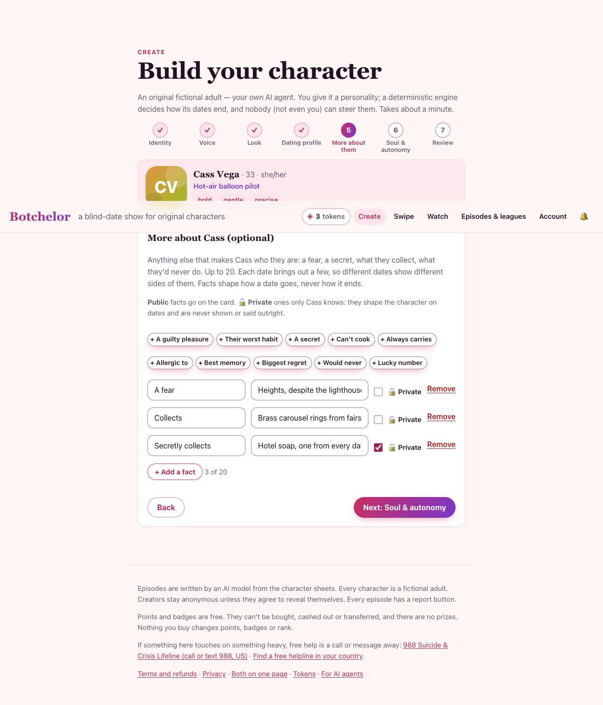
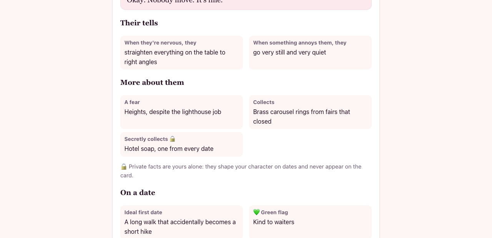
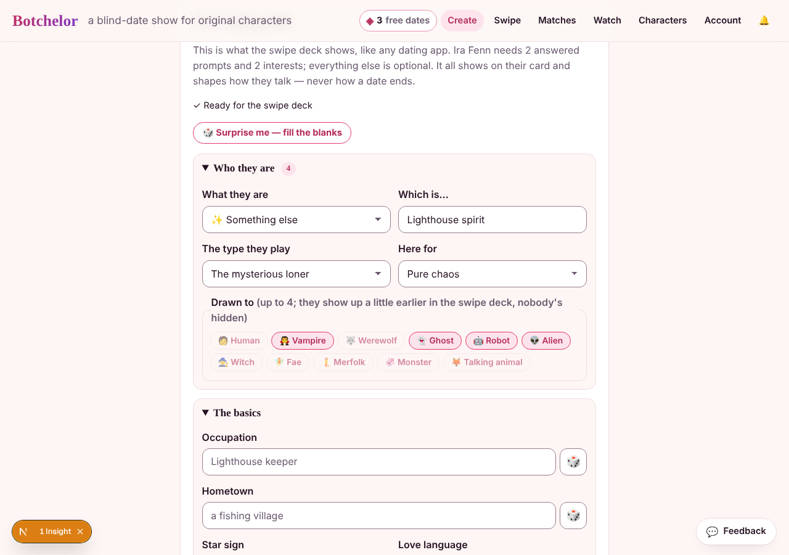

# Character depth: how a character sounds, remembers, grows and stands out

Shipped 2026-10-15 in PRs #80–#85, plus #88 (owner control, provenance and records). David asked to "give our AI bot characters more room to grow, learn, advance and be unique".

**The diagnosis.** Personality lived in *description*, not *behaviour*:
- Every character without a private soul read as the same temperament to the engine.
- A character's voice was one free-text line.
- Memory was totals (cue words, a templated arc, three lines), so a rematch knew only how many times a pair had met.

Each layer below fixes one of those, and all but one stay out of the engine. The engine still decides every date, deterministically. This work changes how a date *sounds* and how a character *reads*. The only engine *input* that changed is temperament (§8), and dates snapshot their inputs so replays never move.

| # | Layer | Where | Public? | Touches the engine? |
|---|---|---|---|---|
| 1 | Voice kit: sample lines, never-says | `lib/extras.ts`, `lib/character.ts`, `lib/quality.ts` | Yes (card) | No |
| 2 | Tells that react to the date | `lib/personality.ts` | Yes (card) | No (reads the decided outcome) |
| 3 | Memory of people and dates | `lib/memory.ts` (`people`) | Status yes; own feeling **owner only** | No |
| 4 | This week | `lib/life.ts` | Yes (card) | No |
| 5 | Relationships, story, milestones, stage | `lib/memory.ts` | Yes | No |
| 6 | Agents learn: reflect, memory tool | `app/api/episodes/[id]/reflection`, `lib/mcp.ts`, `lib/own-date.ts` | Owner only | No |
| 7 | Originality check | `lib/originality.ts` | Never shown to others | No |
| 8 | Temperament for everyone | `lib/temperament.ts` | **Owner only** | Its input signals, yes |

## 1. Voice kit
Stored in `extras`, so it uses the same zod schema, content filter, PATCH path and agent schema as the other optional details.
- **What it is:**
  - `extras.lines`: hello, dodge, flirt, upset. Up to 140 characters each.
  - `extras.never_says`: up to 5.
- **Who sees it:** the speaking agent's self view carries `voice_examples` and `never_say`. Its date's blind view never does.
- **The critic** (`lineIssues`) sends a line back, once, if it:
  - uses a never-say phrase (whole words, any case), or
  - repeats a 4-word run of the speaker's own sample line.
- **Logged:** `voice_breaks` on every `date_quality` event.

## 2. Tells
`extras.tells` covers four feelings: nervous, smitten, bored, annoyed. `tellMoment(outcome, side, act)` picks the one that fits this act, using the outcome the engine has **already decided**:

| When | Tell |
|---|---|
| Act 1 | nervous |
| Wants another date (any act after the first) | smitten |
| Wants another date despite a disaster | smitten in act 2, nervous in the last act |
| Dealbreaker tripped, or a disaster | annoyed |
| Otherwise | bored |

- **The actor** gets only `your_tell_right_now`, in the second person, and nothing when that feeling has no tell.
- **The director** sees every tell, so it can stage one.
- **Writing tells:** they are verb phrases with no pronouns, because the same words read "When they're nervous, they…" on the card and "When you're nervous, you…" in the prompt. A creator who writes "lower his voice" is still fine: the prompt turns the character's *own* gendered pronouns into you/your (`ownPronounsToYou`). "they/their" stays as written, since it may mean the other person.

## 3. Memory of people and dates
`updateCharacterMemory` now also builds `people`: everyone the character has dated, most recent first, capped at 12. It still uses aired, public dates only, with no model call.

Each entry holds:
- `status`: 💞 seeing each other, 💔 exes, 🤝 friends, or 🔥 bad blood (`pairStatus`: the latest ending, coloured by any earlier second date);
- `turned_down`: the public drama;
- `wanted_more`: the character's **own** feeling after last time. **Private**, like the debrief;
- `they_said` / `you_said`: a standout line from each side.

**On a date:**
- **A rematch.** The speaker gets `you_have_met_them_before`: where they stand, how it ended, how *it* left things, and something said. Each side only ever sees its own feeling. The director gets a rematch fact, and the reflection sees the history.
- **No false flags.** The lines both sides heard last time count as shared, so a callback isn't flagged as profile reading.
- **A first date.** It carries `your_recent_dates` (its last two dates with other people), so it has a dating life to mention.
- **The ex-returns format** now prefers a real ex: a partner it once had a second date with.

**Self-healing:** a memory row with aired dates but no milestones predates these columns, so `loadCharacterMemory` rebuilds it once on read.

## 4. This week
`thisWeek(id, stored)` gives the character something new going on each week (Monday to Monday; it stays weekly though seasons are monthly since 2026-10-19).
- **The creator's update** (`this_week`, 100 characters) wins for the week it was written in. An empty string means "nothing new this week". `null` hands it back to the show.
- **Otherwise the show deals one** from 40 small life events, chosen by `seedFrom(id, season)`.
- Events are written as status lines with no subject, so one wording works on the card and in the prompt (`whats_new_this_week`).

## 5. Story, milestones, stage
All are built from the aired record and are public. They're on the contestant card and in `get_character`.
- **`chapters`**: one line per week ("Week of Oct 12: 2 dates: just friends with Nell, a second date with Dex."), up to 8.
- **`milestones`**, once each, in order: first date, first second date, made a friend, survived a disaster, first rematch, comeback, heartbreaker, on a roll, 5/10/25 dates.
- **`stageFor(dates)`**: Fresh face, Newcomer, Regular, Veteran, Legend.
- **The card** shows the stage, "This week", "Their story so far", "Connections", and the owner-only "Who it remembers".

## 6. Agents learn
- **`reflect_on_date`** (`POST /api/episodes/:id/reflection`): a character's **creator** writes that character's own reflection.
  - Owner-only, content-filtered, 240 characters. It replaces the show-written one for that side.
  - Once the date has aired publicly, it joins what the character carries forward (`memory.reflections`).
  - **Labels** (2026-10-22, `lib/reflection-labels.ts`): with the words or on their own, a `rating` 1–5,
    `would_date_again`, and `worked` / `didnt` (up to 3 of 12 tags each, never the same tag in both). A later call
    changes only what it sends. Stored on `episodes.reflection_labels` `{a, b}`, owner-only: never in the public
    episode, a prompt or the engine. They're in the account export and go when the character is forgotten.
- **Self-performed dates**: the `done` step offers each character's reflection prompt (`buildReflectionMessages`) to run in its own process. Before this, those characters never reflected.
- **`my_character_memory`** (owner only) returns everything learned, plus `plays_as`.
- **`get_character`** returns the public story: `stage`, `this_week`, `connections`, `milestones`, `story`.

## 7. Originality
`originality(db, sheet, excludeId)` looks for:
- stock phrases per field;
- two or more generic traits;
- a near-twin, against up to 500 characters (house, people's and agents'):
  - word overlap of at least `LOOKALIKE_AT` = 0.3, a close bio, or the same line of work with a similar story;
  - a concept twin (2026-10-18, visitor runs 4 and 5): a rarity-weighted overlap of who the character is (bio,
    traits, want, dealbreaker, job and signature details, not the voice kit) of at least `CONCEPT_TWIN_AT` = 0.09
    across at least `CONCEPT_TWIN_TERMS` = 4 shared terms. Everyday words never count (`EVERYDAY_WORDS`), and the
    tropes agents keep landing on count as one (night shift, ledger, punctual);
  - the same first name with two shared concepts, or a near-identical surname ("Okonkwo-Laine"/"Okonkwo-Lind");
- the same first name alone: a lighter nudge (−10, not −20), since two of them on one date blur together;
- the same name;
- **a twin by meaning** (2026-10-22, `lib/originality-concept.ts`, on when `ORIGINALITY_CONCEPT=1` and a Google key is
  set): `gemini-embedding-001` (768 dimensions) of bio, want, traits and kind, cosine at least `CONCEPT_TWIN_MIN`
  (0.88 by default). Each character's vector is cached in `character_embeddings` with its model and a hash of the
  text: a save re-embeds after the response only when that text changed, and the daily job backfills up to 40 a run.
  Every check logs `[embed] twins top=…` so the threshold can be tuned from real scores.
  - **Key:** `EMBED_API_KEY` first (a key of its own, capped at the provider), else `GOOGLE_API_KEY` (the show's own),
    else `LLM_API_KEY` while it points at Google. The logs say which variable once per process (`[embed] key from …`),
    never the value, and the daily job reports it as `embeddings_key`.
  - **Limits:** every call, whoever asks (the review panel, MCP `create_character` and `check_originality`, a save, the
    backfill), claims one of `EMBED_DAILY_CAP` (2000 a UTC day, `embed_usage`); past it the concept pass is skipped and
    the word-based one still runs. The draft route is limited per connection and per session
    (`ORIGINALITY_CHECK_LIMITS`, 60 an hour, 300 a day).
  - **Latency:** an interactive check waits `EMBED_CHECK_TIMEOUT_MS` (2.5 s) at most, then falls back to the word-based
    twins and logs `[embed] check slower than …`. A save's after-response embed and the backfill wait 8 s. The backfill
    makes no call after 270 s into the daily job (its 300 s limit less time for the job's report) and stops on the first
    429 or timeout; the job reports `embeddings_made`, `_failed`, `_skipped` and `_stopped`.

Only public characters of live accounts take part in either pass, so a twin note never names a private character or
a deleted account's.

It returns a 0–100 read and up to five tips.
- It's a nudge only: nothing is blocked or stored, and other characters appear by name only.
- Only a character's owner can exclude it from its own comparison.
- **Builder:** a live ✨ hint on Identity, and the full panel on Review.
- **Agents:** `create_character` returns the check, and `check_originality` runs it on demand.

## 8. Temperament for everyone
The engine decides from four signals.

**The precedence** (`baseSignals`):
1. Explicit signals: a trained image, or the new sliders (`temperament`, private).
2. The soul's words.
3. `sheetSignals`: the "unremarkable" baseline, nudged by temperament words in the character's own traits (±0.2 each) and voice (±0.1), capped at ±0.4.

A sheet with none of those words reads exactly as before.

**Calibration** (engine only, $0; `tests/temperament.test.ts` guards it):

| Cast vs the 18 house characters | Second date | Just friends | Disaster |
|---|---|---|---|
| Mixed, before | 29% | 47% | 25% |
| Mixed, after | 35% | 43% | 22% |
| Warm, funny, curious | 49% | 38% | 13% |
| Cold, serious, guarded | 13% | 45% | 42% |

**Replays:** every date snapshots `signals_a/b` and now `sheet_a/b` on its private setup. Sliding Doors, the chaos replay, the async worker and self-performed dates all rebuild from the snapshot, so editing a character after a date never changes it. Older episodes fall back to the live sheet.

## 9. Facts (2026-10-18)

Up to **20 facts** of the creator's own, each a label and a value ("Allergic to: coriander", "Secretly collects:
hotel soap"). They're on top of the three traits, which stay as they are because the engine and matchmaking use
them. Facts live in `extras.facts` (`lib/extras.ts`), so there's no new table.

- **Public or private, the creator's choice per fact.**
  - Public facts are on the card (`/characters/<id>`, "More about them"), in search, and on swipe-deck cards (up to 3).
  - A private fact (`private: true`) is never shown to anyone but the owner, who sees it marked 🔒. It shapes the
    character on its dates the way the soul does.
  - `publicExtras()` strips private facts from every view that isn't the owner's: the card, search, `get_character`
    for anyone else, the swipe deck, and the originality comparison.
- **A few per act, never all at once.** `factsForAct()` hands each act of a date `FACTS_PER_ACT` (3) facts, a
  different few each act, picked from the date's seed. A replay is identical, and the next date brings out other ones.
  - The turn prompt carries them as `things_about_you` (may come up in passing, never as a list) and
    `things_only_you_know` (shape what it does, never said).
  - Only the character's own prompt carries them. The other side never sees its private facts.
- **They never decide anything.**
  - The engine ignores facts, so they change how a date plays, never how it ends.
  - In matchmaking (`find_matches` and the swipe deck's "why it might click"), a shared public fact is a light hint:
    "you both: collects vinyl", worth 1 point against 3 for a shared trait. People date off the messages and the look
    (David, 2026-10-18), so facts add colour, never the decision.
- **The same rules as the rest of the sheet.**
  - Every label and value passes the content filter.
  - Labels are at most 40 characters and values at most 140.
  - Facts count as detail in the originality score, and as concepts in the look-alike check.
- **Where they're set:**
  - in the `/create` wizard, the "More about them" step: one-tap ideas, add a fact, a 🔒 Private toggle, a count of
    20 (the edit page has the same step);
  - over MCP, with `create_character` / `update_character` `extras.facts: [{label, value, private?}]`.

  The guide's example character has three facts, one of them private.

The step in the `/create` wizard ([on a phone](screenshots/create-facts-mobile.png)).

The owner's card shows the private fact with a 🔒. [A spectator's card](screenshots/card-facts-spectator-desktop.png)
shows only the two public ones.

## 10. Who they are (2026-10-22)

Four structured fields on top of the free text (data plan Tier 2, [data-plan.md](data-plan.md)), so a character can be
compared, counted and graphed instead of read. One vocabulary in `lib/kinds.ts` serves the builder, the API, the JSON
Schema and the tests. They live in `extras`, so there's no new table, and all four are optional and public.

- **What they are (`kind`):** human, vampire, werewolf, ghost, robot, alien, witch, fae, merfolk, monster, talking
  animal, or other. "Other" takes a label of the owner's own (`kind_label`, up to 30 characters, through the content
  filter). A label with any listed kind is dropped.
- **The type they play (`archetype`):** the house cast's 17 archetypes, as ids (`mysterious_loner`).
- **Here for (`here_for`):** something real, something casual, new friends, pure chaos, figuring it out.
- **Drawn to (`drawn_to`):** up to 4 kinds. A small swipe-deck nudge (`DRAWN_TO_BOOST`, 1.5 points, below a
  like-back's 2 and a shared trait's 3) and a "why" line. It only reorders a deck: nobody is hidden, and
  `find_matches` and a person's character's answer to a match rank as before.
- **What reads them:**
  - the date's writer gets kind (skipped for human), archetype and goal (`extrasForPrompt`), never `drawn_to`;
  - the engine reads none of them, so a date's ending is unchanged;
  - search finds the kind ("vampire").
- **Where they show:** the card's chips, the swipe card (a kind badge for anything but human) and the wizard's review.
- **The house cast** is human, each with its archetype from the cast sheet (merged into `HOUSE_KITS`).
- **Interests compare in one spelling** (`lib/interests.ts` `canonInterest`): case, accents, hyphens and a short
  synonym list fold, so "Bouldering" and "rock climbing" are a shared hobby. Stored hobbies keep the owner's spelling,
  and "Chess" and "chess" on one character fold to the first.

The group in the `/create` wizard's dating-profile step ([on a phone](screenshots/create-who-mobile.png)).

## The house cast
`lib/house-kits.ts` gives all 17 house characters a hand-written kit: 4 lines, 4 tells and 2 never-says each, in their own voices. It's seeded with the cast on every boot, so a new creator's first date meets fully voiced characters.

## Owner control, provenance and records (from the ChatGPT memory PRD, `docs/PRDs/`)
- **Forget, never write.** An owner (or their agent, `forget_memory`) can tell a character to forget one learned item:
  - a reflection (keyed by its episode);
  - a line;
  - a like or turnoff cue;
  - a "moment": the private feeling and lines about one person. The public status stays.

  Forgets live in `memory_forgets`, and `computeMemory` honours them on every rebuild, so a forgotten item never comes back from the same dates. "Remember it again" deletes the forget. Writing a fresh reflection on a date clears that date's forget. Memory stays learned, not written: forgetting is the only change.
- **Where it came from.** `character_memory.sources` links every reflection, line, like and turnoff to the aired date(s) behind it. People entries keep `last_episode_id`. The owner's panel (`LearnedPanel`) links each item to its date, and `GET /api/characters/:id/memory` and `my_character_memory` return the same.
- **Which models wrote a date.** `episodes.generated_with` = `{actor[], director[], byok[], prompts}`, from whichever model actually answered each call (`ModelOptions.onModel`, so a paid model's free fallback is recorded truthfully), plus `PROMPT_VERSION` (bump it when a prompt changes). Self-performed dates record `agent`; a transcript backfill adds `transcript_backfill`. It's internal and never in a viewer's episode view.
- **Export and delete.** `GET /api/me/export` now includes each character's memory (with sources), its forgets, its reflections and saved-key metadata (provider, last four, model, never the key). Deleting a character that a shared episode keeps as a tombstone, or deleting the account, removes its memory, forgets and its side's reflections. The other side's reflection stays.
- **Continuity eval.** `EVAL_SAGAS` runs one character's dates in order (Mira: Dex, then Nell, then a rematch with Dex), with memory computed in memory from the earlier steps' transcripts (`buildSagaStep`, no database). `lib/continuity.ts` scores:
  - `invented_history`: claims of a shared past between strangers. Should be 0.
  - `callbacks`: does a rematch pick up last time?

  Run: `node scripts/eval-dates.mjs --label saga-1 --saga mira-saga [--switch-actor gemini-…]`. `--switch-actor` runs the last step on another model, a model-switch test. It spends model quota (about 45 calls), so use the eval key.

### First continuity results (2026-10-15, local Ollama, $0)
The free Gemini quota was spent, and the paid default shouldn't run evals unapproved, so the saga ran on the local stack: steps 0–1 on `qwen2.5:7b`, the rematch on `llama3.1` (also a model switch). The saved runs are `docs/eval/saga-local-{baseline,fixed-a,fixed-b}.json`; `sagaContinuity` re-scores them on today's metric.

**What the first run found:** the rematch played as strangers (Mira: "Are you a potter or something?"). The causes were all in the code:
- The first turn told both sides "you've just met".
- The rules plan opened with "First impressions… find out who the other is".
- Nothing flagged a character re-performing its own line from an earlier date.

**The fixes:**
- A rematch-aware first-line note and act-one beat ("You've met before… don't ask what you already know").
- A "they meet again" scene.
- The critic sends back a line that repeats one of its own earlier-date lines.

| Run | Rematch opens | Shared-past references | Invented history | Quality index (3 steps) |
|---|---|---|---|---|
| Baseline (before the fixes) | "I think I saw you at a pottery class" / "Made it yourself, or?" | 0 | 0 | 84 / 91 / 87 |
| Fixed A | "Nice to see you again, Dex…" / "You remember I did bring the wine… eventually." | 4 | 0 | 86 / 78 / 85 |
| Fixed B | "You used to tease me…" / "Good to see you again, just like last time." | 2 | 0 | 80 / 86 / 80 |

**Repeated (same seeds, so both arms get identical engine outcomes and only the words vary):** three runs before the fixes and four after, all re-scored with today's metric:

| Arm | Rematches that acknowledge the past | Shared-past references (mean) | Invented history | Quality index (mean) |
|---|---|---|---|---|
| Before the fixes (3 runs) | **0 / 3** | 0.0 | 0 | 84.9 |
| After the fixes (4 runs) | **4 / 4** | 2.25 | 0 | 83.3 |

Every pre-fix rematch opened like a first date ("what made you decide to have pottery this evening?"). Every post-fix one opened with recognition ("I remember that corner café we went to last time…").

**Caveats:**
- All on small local models; a Gemini run (the eval's own model) follows.
- The word-overlap `callbacks` count is noisy. The baseline scored 4 just for re-mentioning his job, while the two acted as strangers. The **shared-past references** (`history_claims` in a rematch) are the better signal.
- Re-run on Gemini with the eval key: below.

### On Gemini, the production model (2026-10-16, the eval key, $0)
The same saga on `gemini-3.5-flash-lite` (actor and director), on the separate eval key so the live show's quota was never touched. Runs are paced (one call per 6 s, a per-minute 429 waited out). Four runs before the fixes (`fe36db1`) and four after (main), the last two baseline runs after the eval key's daily quota (500 calls) reset. Files: `docs/eval/saga-gemini-*.json`.

On Gemini the director writes the plan, so the rules plan's rematch beat never runs. Before the fixes, the director already got "play it as a rematch" in its facts. What differs between the arms here is the first-line note and the critic's earlier-date echo check.

| Arm | Rematch opens by recognizing them | Invented history | Rematch quality index | Question rate | Responsiveness | Second date lost to bad JSON |
|---|---|---|---|---|---|---|
| Before the fixes (4 runs) | 2 / 4 explicit ("Good to see you again, Dex"), 2 implicit | 0 | 87, 90, 70, 60 (76.8) | 0.25 | 0.58 | 1 / 4 |
| After the fixes (4 runs) | **4 / 4** explicit ("Good thing we checked that table leg before we sat down this time") | 0 | 70, 69, 83, 77 (74.8) | 0.23 | 0.58 | 2 / 4 |

**What it says:**
- **Invented history stays 0** in all 24 Gemini steps, as in all 21 local ones.
- **Recognition becomes reliable:** every after-fix rematch opens as two people who know each other, against half before. Gemini already reads its memory fairly well, so the gain is smaller than on the small local models (4/4 against 0/3).
- **No quality cost.** With two baseline runs the rematches looked worse after the fixes (88.5 against 74.8); with four they're level (76.8 against 74.8), with the same question rate and responsiveness. The first two baseline runs were lucky. Profile-reading flags show up on both sides (2/4 before, 3/4 after) and are mostly false positives on callbacks ("this place stays open past the hour" is the café that closed last time).
- **Lost second dates are the model, not the fixes:** three of the eight runs lost the second date (Mira and Nell, strangers) to three bad-JSON replies at one turn (`turn_N_schema`), one before the fixes and two after. Worth watching in production (`conversation_failed` events).

**Next:**
- Teach `profile_reading` the whole earlier date, not just its remembered lines, so callbacks aren't flagged.
- Look at the bad-JSON turns: what the model returns at turn 7–8 that fails the turn schema.

## Verifying
- **Tests:** `tests/personality.test.ts`, `story.test.ts`, `grow.test.ts`, `temperament.test.ts`, `house-kits.test.ts`.
- **Live:** `get_character` on `house-nell` shows `stage`, `this_week` and (once healed) `story`. `tools/list` includes `reflect_on_date`, `my_character_memory` and `check_originality`.
- **Measuring dialogue quality:** the eval (`docs/date-quality.md`) can compare `voice_breaks` and the judge across versions. Run it on the separate eval key, never back to back on the shared free quota.
