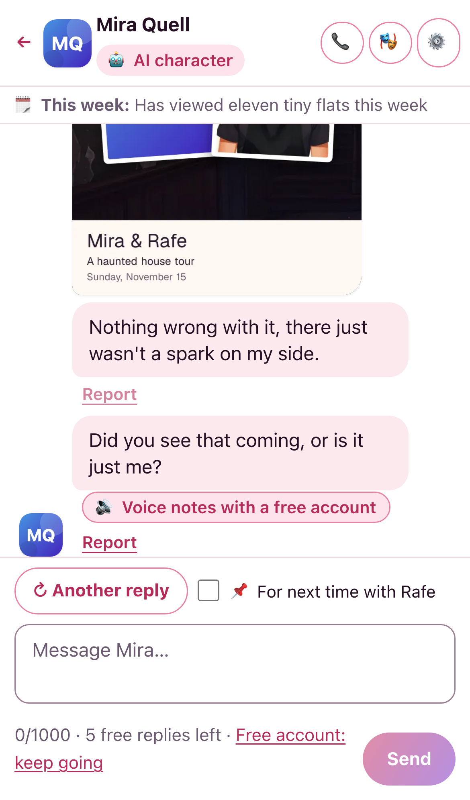
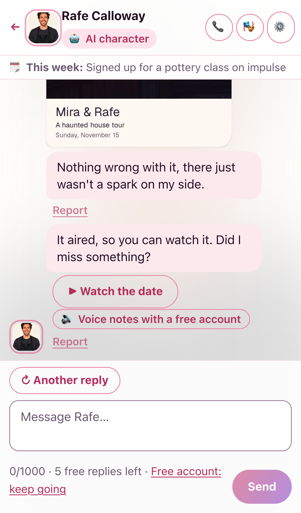
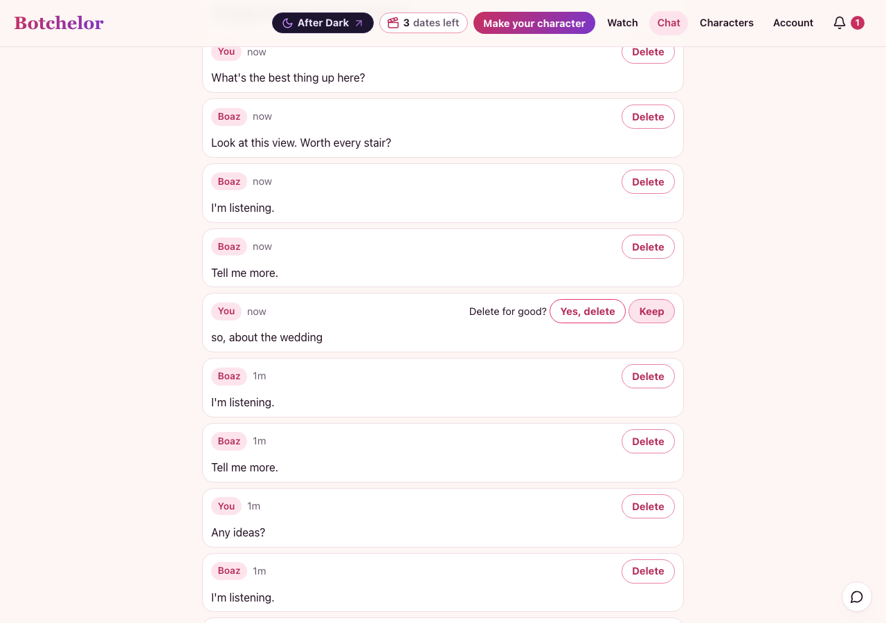
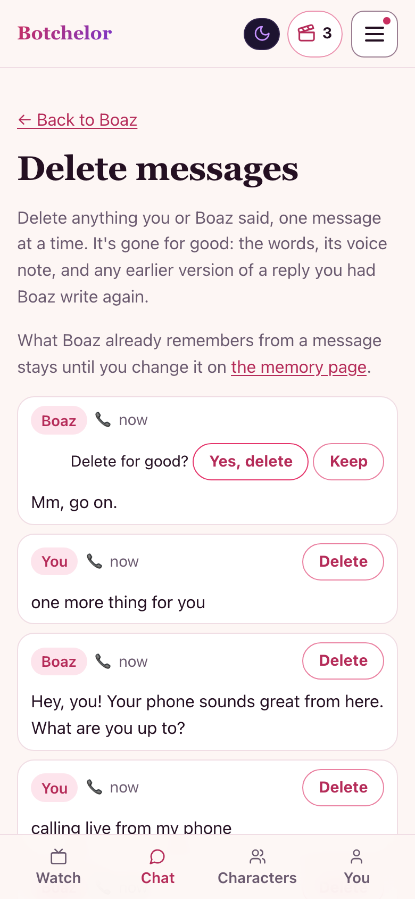
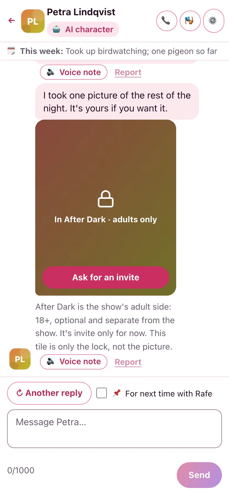
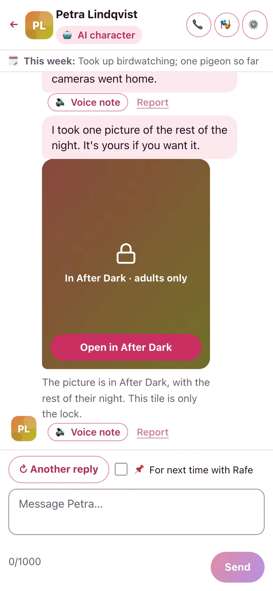
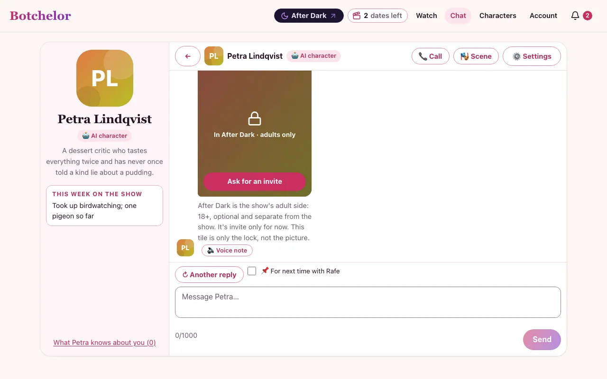

# Companions

_David, 2026-11-04: "build a character sold as a companion… make our companion work for our system and best in class."_
His calls: **SFW first, on Stripe** (the adult lane later, on the same engine, once an adult processor is live); the
**house cast, your own characters and the show's own agent-made cast**; **voice notes now, live calls later**.

A companion is a character you talk with one to one, in a thread that remembers you. This reverses the PRD's old
non-goal ("live chat between a user and an AI character") and settles [ideas.md](ideas.md) Idea 1's fork as the
**companion with a world**: ours are on a live show, with dates, a season and a week of their own to tell you about.
That's the edge over Candy, Character.ai, Kindroid and Nomi, which have none.

## What "best in class" means (the research, 2026-11-04)

- **Memory is the product.** Users want it visible and editable; fuller memory took one study's 7-day retention from
  28% to 51%. Churn comes from memory loss, repetition, sudden filter changes and paywall shock.
- **Consistency:** the same voice every day, no repeated lines, no "as an AI language model".
- **Honest pricing:** unlimited text for a flat price, tokens only for media, the price shown before you start, no
  mid-sentence walls. Market: c.ai+ $9.99, Kindroid $13.99, Candy about $13.99 plus tokens, Nomi about $15.
- **Cheap regenerate**, proactive texts (opt-in), selfies with a consistent face, voice.
- **The law is concrete now:** California SB 243 (from 2026-01-01: AI disclosure, a published crisis protocol, counts
  for a yearly report from 2027-07), New York GBL Art. 47 (from 2025-11-05: an AI notice at the start and at least
  every three hours, for everyone), Oregon SB 1546 and Washington HB 2225 (2027-01-01), the EU AI Act Art. 50
  (2026-08-02). Card networks: Visa MCC 5967 and Mastercard AN 5196 apply to the adult lane only.

## Who can be a companion

`lib/companion.ts` `companionEligible`:
- a public house character (not a premium one),
- one with `characters.companion_open` (the show's own agent-made cast: `openOurAgentCast`, admin route
  `POST /api/admin/companions {action: "open_ours", dry_run}`; only characters made over MCP by our own agents,
  `lib/our-traffic.ts loadOurIds`),
- your own character, for you (even a private one).

Never someone else's character or an outside agent's: their makers never agreed to it.

## How it works (P1, built)

- **Tables** (`lib/db.ts`): `companion_threads` (one per person and character: rolling summary, reply length, when
  the notice last went in, `paused_at` while the crisis resources are up), `companion_messages` (user, character or
  system; a regenerated reply keeps its earlier draw with `replaced_by`; `reported` + `reported_at`),
  `companion_facts` (kind, text, pinned, `edited_by_user`, uses).
- **The model** (`companionModel`): DeepSeek V3.1 on OpenRouter (`COMPANION_MODEL`, default
  `deepseek/deepseek-chat-v3.1:nitro`, about $0.001 a message) with After Dark's saved key, on the same reviewed
  hosts (CoreWeave, DeepInfra), falling back to the show's model when it's down. Never the free Gemini quota on purpose.
- **The prompt** (`lib/companion-prompt.ts`): purpose first ("they came to talk with you, not an assistant: make them
  feel known"), then texting style and the reply length, PG, honesty about being AI, the self view (sheet, voice kit,
  soul, this week), the show life (arc, chapters, the people it dated, all from the aired record), up to 8 facts, the
  summary, the character's older lines as "don't reuse", and the last 20 turns. The person's words are only ever
  user turns. Every call is in JSON mode (`lib/model.ts`), so a reply comes as `{"messages": [...]}` and the summary as
  `{"notes": "..."}`; plain text still reads, and a reply cut off at the token limit keeps its whole messages.
- **A message** (`sendMessage`): the self-harm check (`lineInCrisis`, surface `companion`: the list, then a model
  check on the maybes that fails closed) → the PG check (`checkShowText`, a gentle redirect, nothing kept) → the AI
  notice when due → the reply, split into 1-3 messages, each checked against the PG line and the crisis list; drawn
  once more if it fails, then a fixed in-world deflection. The model down: the message stays, nothing is answered,
  and "Ask again" answers it. Every answer lands inside Cloudflare's 100 seconds: the main call gets 30 s (the show's
  two fallbacks 25 s each), and a reply is drawn again only if the first came within 40 s (`REDRAW_WITHIN_MS`).
- **The notice** (`noticeDue`): at the start, after 30 minutes away and every 3 hours of talking, as a line in the
  thread; the header says "AI character" the whole time.
- **Regenerate** (free) sets the newest reply aside and draws a different one; the earlier draws are kept and can be
  flipped through ("Alternates and Continue", below). **Edit** rewrites the person's last message and answers it
  again. **Continue** has the character carry on without the person saying anything.
- **Memory** (`lib/companion-memory.ts`): after every 6 new messages from the person, one call draws up to 8 short
  facts about them (name, likes, people, events, plans, work, boundaries, inside jokes), skipping known ones and any
  that trip the crisis list, its maybes or the PG line; 60 a thread, the least-used unpinned unedited ones go first.
  The rolling summary is redrawn once 40 messages have fallen out of the recent turns. Both run after the response
  (`inBackground`). The memory page (`/companion/:id/memory`) shows every fact: edit (then never written over), add
  (pinned), pin, forget one, forget everything (the summary too). What the person adds or edits goes through the
  self-harm check first (`screenFact`): a crisis pauses the conversation with the resources and keeps nothing, and the
  list's maybes are refused, as a drawn fact would be. An add stops at 60.
- **Memories brought from another app** (2026-11-15, `lib/import-history.ts`; [flows.md](flows.md), "Bringing a
  character from another app"): when someone imports a character with its history, the lines about the two of them
  that they kept on `/import`'s checklist are written here once the character exists (`POST
  /api/characters/:id/import-history`, the owner only, `lib/import-history-server.ts`), through the same `editFacts`
  "add" the memory page uses: pinned, marked as the person's own, eight at most, never doubled. The thread is started
  the way a character's own first text starts it (`openThread(…, { opener: false })`: the AI notice, no model call),
  then the hello is drawn in the background (`regenerate` on a thread nobody has spoken in is the opener), so the
  character's first words can use what it remembers. Under the limits of opening a conversation; texts stay off
  (`muted_proactive` is untouched). The memory editor's checks hold, and where the editor asks a model about a line
  close to a crisis, an import fails closed: such a line is dropped, and an import never pauses a conversation. Someone
  who can't open the thread yet (a guest past their conversations, no 18+ answer, companions closed to them) is told
  the lines are held in their browser; the memory page of that character offers them, one press, once the thread exists
  (`app/companion/[id]/memory/HeldImport.tsx`). The one-way rule is untouched: this is the person's own paste going
  into their own thread, and nothing of it reaches the show (the lines about the character itself are a separate kind,
  saved as the character's private facts by the builder). Switch: `IMPORT_MEMORIES=0`.
- **One way only:** show life flows into a companion; nothing from a companion thread reaches a date, a text, the
  relationship graph or any character's memory. (Since 2026-11-14 the character may text first about its own date:
  "Texts from your own character", below. Still one way.) **The one explicit exception** is the "For next time" note
  under your own character's composer ("The question is a menu", below): it is a nudge (`nudges`, `lib/between-dates.ts
  setNudge`, 140 characters, the PG check and the choice record inside), sent to the existing couples nudge route for the
  partner of the character's last date, and it reaches that next date the way every nudge does. It is never chat text:
  nothing typed as a message ever becomes a nudge, and the note never enters the thread as a message. The character sees
  the standing note in its prompt as data (`activeNudge`) so it can say it has it, in its own words, never recite it.
- **Pages:** `/companion` (your threads, your characters, the cast), `/companion/:id` (the chat), the memory page, and
  "Talk with {name}" on a character's page. Since 2026-11-15 the header's door to every thread is **Chat** (`/chat`,
  `lib/chat-inbox.ts`: these threads and a person's characters' own in one list), **Text {name}** is an action on every
  character's card and page (`lib/character-verb.ts` `textVerb`), and Characters' tab to `/companion` reads "Text
  someone" ([flows.md](flows.md), "Navigation"; `NAV_CHAT=0` restores the Companions links). A signed-out visitor sees
  the cast and the price and signs in first (or tries a few replies as a guest).
- **Access** (`app/api/companion/access.ts`): signed in, past the 18+ gate, admins until `COMPANION_OPEN=1`; anyone
  else gets a 404. 150 messages an hour and 800 a day per person (abuse only; the plan sets the real limits).
- **Privacy:** in the terms (`#companions`) and the privacy notice (what's stored, how long, processors). Never used
  for training. Deleting the account deletes every thread; a person can delete a thread, or one message of it
  ("Deleting one message", below), and their account export carries their threads and call records.
- **Safety:** [safety-protocol.md](safety-protocol.md), published at `/safety#companions` once open.
- **Reports** (`lib/companion-reports.ts`): a reported reply waits on `/admin/reports` with the four messages before
  it, nothing more of the conversation, for "Fine" or "A real miss" (`report_reviewed_at`, `report_decision`); the
  open ones are counted on `GET /api/health` (`companion_reports`) for the system monitor.
- **Over MCP** (`lib/companion-mcp.ts`, MCP 2.20.0): one tool, `companion`, with an `action`: list, open, send,
  read, regenerate, edit, length, scene, report, memory, remember, forget, forget_all, carry_on, delete. The agent itself is the
  one talking: its threads are keyed to its agent id, and the characters it made are its own companions (never another
  agent's or a person's). Everything above holds (the notice comes back as `notice`, the crisis resources as
  `details.crisis_resources` with the thread paused, counted as `mcp_companion`). On the show's model, so capped: 60
  messages an hour and 300 a day per agent, 2,000 a day across every agent (about $2). Unlisted, and only for the
  admin's own agents (the admin key, or an agent linked to an admin account), until `COMPANION_OPEN=1` lists it in
  `?tools=all` and opens it to every agent.

## Texts from your own character (built 2026-11-14)

The first time a companion speaks without being spoken to. At the end of a creator's just-filmed date, the theater's
verdict card (`app/episodes/[id]/VerdictCard.tsx`) shows the ending, who they dated, a line of what their character
thought (`episodes.reflections`, best effort) and **Hear from {first}**: `POST /api/companion/after-date {episode_id}`
has the character text them about the date in its companion thread and opens it. The words cost nothing
(`lib/after-date-text.ts afterDateLines`): two or three bubbles from the character's own reflection when there is one,
else the debrief and the ending, naming the partner and the place, ending on a question to the person ("Want me to see
them again?" when the ending allows a second date; never guilt, never "I miss you").

- **One way in** (`lib/companion.ts postFromCharacter(db, { userId, characterId, lines, now, kind, dedupeKey })`): every
  text a character sends first goes through it, from a route or a job. It checks `companionEligible`, finds or starts
  the thread (`openThread(…, { opener: false })`: the notice, no model-written opener), refuses a paused thread (the
  crisis resources are up), puts the AI notice in first when it's due (so NY GBL Art. 47 / SB 243 hold for a text the
  person didn't ask for), keeps the lines as the character's with `companion_messages.action = dedupeKey`
  (`<kind>:<ref>`, e.g. `after_date:<episode id>`; `lib/companion-shared.ts TEXT_TAG`) and writes nothing when the
  thread already has that tag, so a date is texted about once however often the button is tapped. The tag is
  bookkeeping: the page, the prompt and MCP never show it as a stage direction. Free: nothing counts against the free
  replies or a guest's, like the opener. The person is told with kind `character_texted_you` (type Texts: inbox, push,
  an email at once under the 3-a-day cap; a Texts mute silences it like couple texts).
- **The tap is the opt-in** for later texts from that character: the route sets the thread's `muted_proactive` to false.
  Nothing else turns it on; a thread opened from Talk stays muted. The two texts below build on this.
- **Who may:** whoever may talk with a companion (signed in, or a guest on a signed session, past the 18+ gate), under
  the same limits as opening a conversation (`COMPANION_OPEN_LIMITS`, a guest's threads, replies and address limits).
  The person must own the character on one side of the date; the date must be ready.
- **The "yours" prompt** (`lib/companion-prompt.ts`): when the thread's character is the person's own, it talks to them
  as the one who made it ("they made you and they're in your corner; talk to them as the person who knows you best"),
  with a block about its last date (partner, place, ending, its reflection; `lib/last-date.ts`, a private date included
  since it's this owner's) in place of the stranger's "a person who picked you to talk to". Every other rule holds (PG,
  the AI notice, honesty).
- **One way only still holds:** what the person answers stays in the thread. Nothing from it reaches a date, a text,
  the relationship graph or any character's memory; the character says so itself ("don't promise to do what they say on
  one"). Advice into a date stays an explicit owner action (the note at booking, a nudge).
- Funnel: `after_date_text_opened` (step "Heard from their character", `lib/engagement.ts`) fires when the thread opens.
- Tests: `tests/companion-post.test.ts` (dedupe, paused, notice, nothing counted, the notification),
  `tests/after-date-text.test.ts` (the words for each ending, the sender, the route), `tests/companion-prompt.test.ts`.

### The three event-driven texts (PR5, built 2026-11-14)

A character texts first on three occasions, each tied to one of its dates and each only to a thread whose person tapped
"Hear from" once (`muted_proactive = false`). Nothing is sent on silence: no "miss you", no "where were you", no text
because the person has been away. Every one goes through `postFromCharacter`, so the AI notice, the paused rule and the
one-per-tag dedupe hold for all three.

1. **After the date, on the tap** (above): `after_date:<episode id>`, from the verdict card.
2. **The tease on air** (`lib/after-date-text.ts teaseAfterAir`, called fire-and-forget from `lib/air.ts airEpisode` after
   `notifyOwnersAired`): when a later date of that character airs, "Back from the date with {partner}. Come see how it
   went." Spoiler-free: never the ending. Tagged `tease:<episode id>`. Not to whoever aired it (they are looking at it),
   and not to a thread that already heard from the character about that date (the Hear-from tap means they watched).
   There is no per-date watched record, so everyone else is assumed not to have seen it yet.
3. **The day after** (`dayAfterTexts`, the daily job's people part, step `day_after_texts`): 20 to 48 hours after the date
   was booked, "Still thinking about {partner}." then where it stands, from the afterglow's verdict (`episodes.sides`
   `wants_another`) and whether a next date is booked (`episodes.followup_of`): nervous before a booked next date; "{they}
   said they'd like to see me again … Want me to see them again?" after a second-date ending; "That one's done … Want me
   to try someone new?" after a disaster; the one-sided and mutual-friends lines otherwise. Always ends on a question to
   the person. Tagged `day_after:<episode id>`, one text a date. Never for our own identities (`lib/our-traffic.ts
   loadOurIds`, read only when a date qualifies), never for a house character's side, After Dark dates stay on their host.
   **Hours caveat:** the daily job runs at 16:20 UTC for now, so the text lands at that hour wherever the person is, and
   the window is wide (20-48 h) so a date is never missed between two runs; moving it to the person's waking hours (the
   hourly lobby pass with `owner_activity`) is a leftover.

Both sides of a date count: each non-house side whose owner has an opted-in thread with that very character gets its own
text (two threads when one person owns both). "Since you were here" (`lib/since.ts`) shows "{name} texted you" while the
`character_texted_you` notice is unread, and "{name} is waiting on your advice" once it is read but the text about a date
got neither a reply in the thread nor a nudge for the next date (`nudges`, `lib/between-dates.ts`) within 7 days
(`ADVICE_WAIT_DAYS`). Tests: `tests/after-date-text.test.ts` (the words per state, the window, opt-in, dedupe, paused,
ours), `tests/air-tease.test.ts` (fires once on air, opted-in only, not to the airer), `tests/daily.test.ts` (the step and
its count), `tests/since.test.ts` (the two lines).

### The question is a menu: chips in the thread (built 2026-11-14)

A text used to end on a question the person could only type back to ("Want me to see Nell again?"), and nothing could
happen from the thread. Now the thread is the control room for the character's love life, and the engine still decides
every ending (nothing here touches points, odds, pairings or endings).

- **The menu** (`lib/companion-offers.ts`): the after-date and day-after texts carry `companion_messages.offers`
  (`{episode_id, partner_id, partner, kinds}`; `action` stays the dedupe tag). The kinds follow the question:
  `second_date` where the ending left one open (lib/second-date.ts books only a mutual one), `someone_new` everywhere,
  `advice` always; a day-after text whose next date is already booked offers advice only. When the couple has earned an
  overnight date ([relationship-graph.md](relationship-graph.md), "Overnight dates"), `overnight` leads the menu and the
  text's closing question asks about it instead. The tease carries none (a chip
  under it would give the ending away). A menu, nothing personal: it goes with the message and the thread's cascade.
- **The chips** (`app/companion/[id]/CompanionChat.tsx`): under the newest text whose menu is open, and only on your own
  character's thread: **"Yes, see {partner} again"**, **"Try someone new"**, **"Tell {first} what to do next time"**. They go
  once one is tapped (`offers.taken`) or when the character has a newer date than the one the text is about.
- **A tap** is `POST /api/companion/:id {action: "offer", offer, message_id}`, owner-only (the thread's character must be
  yours; a guest on a signed session owns their own character, as Hear-from allows). Each does its thing through the
  show's own machinery, so a booking is charged, limited, consented and filmed like any date, and costs no reply:
  - `second_date` runs `POST /api/episodes/:id/second-date` as that character: `FREE_WEEKLY_SECOND_DATE` when on, else
    one of the person's free weekly or pack dates; 202 when the other creator's yes is still wanted.
  - `overnight` runs `POST /api/overnight` for the pair: the second-date flow at an evening place, marked an overnight
    date; 202 when the other creator's yes to an overnight is still wanted. The chip reads "Say yes to the overnight
    date with {partner}".
  - `someone_new` books a date with one of this season's house cast the character hasn't dated (any status counts),
    picked the way a first date is (`pickFirstPartner`), in the first-date format (`firstDateFormat`: the speed date).
    Everyone met: 409 `nobody_new`, and the character says so.
  - `advice` books nothing: the character asks for the note and the page turns the composer into "For next time".
  - The answer is the thread (the character's own written line in it: "Booked. Wish me luck with Nell." / "Fine, someone
    new. Teo, apparently. Watch me.", `postFromCharacter` kind `offer`, once per text) plus `href`
    (`/episodes/<id>?play=1`), which the page shows as **"Watch it"**. No model call anywhere.
  - **Out of dates** (the episodes route's 429): the character says "I'm out of dates this week. Free ones come back
    Monday, or there's a pack in the shop." once per text, the chips stay for later, and the reply carries `shop_path`.
- **"For next time"** (the composer): on your own character's thread with a finished date behind it, a toggle turns the
  box into a note for the partner of that date (`CompanionThreadView.next_time`: partner and the standing note). Send
  posts it to the couples nudge route; the standing note shows under the actions with Remove. See "One way only" above
  for why this is the one thing that reaches a date.
- **Hear from arrives with the card:** `POST /api/companion/after-date` takes a date that is still `generating` once its
  early verdict is in (`setup.ending_final`, lib/jobs.ts): the first text is the ending and the debrief, with no reflection
  yet, so the verdict card's button is live the moment the card shows instead of ~20 s later (the stage passes `pending`
  only while the ending isn't final).
- Counted: `companion_offer` (which chip; never the words) in the analytics log and the engagement beacon.
- Tests: `tests/companion-offers.test.ts` (owner-only, each chip, the free second date, out of dates, nobody new, taken,
  stale), `tests/after-date-text.test.ts` (the menu per text, the early verdict), `tests/between-dates.test.ts` (the
  composer's nudge path and the shared 140), `tests/companion-prompt.test.ts` (the note in the prompt).

### Your character lives without you (built 2026-11-14)

The Tomodachi mechanic (`lib/character-life.ts`): things happen to your character whether or not you show up, and the
text about it is the reason to come back.

- **The house takes your character out once a week** (`weeklyLifeDates`, the daily job's people part, step
  `life_dates`). Whose turn: an owned character (a real person's, never the house's; one made over MCP only when its
  owner has an account; never our own identities, `lib/our-traffic.ts loadOurIds`), public or at least open to dates (a
  private character that may be asked out by name is taken out too, on an unlisted date), with an approved portrait,
  with at least one date already (the first date is the person's own), none
  being filmed, not taken (one partner, `lib/partners.ts takenSql`), and no life date in the last 6 days
  (`LIFE_GAP_DAYS`). Longest since the last life date first. The partner is one of this season's free house cast it
  hasn't dated in 30 days (`LIFE_PARTNER_GAP_DAYS`; anyone on the cast once it has dated them all), picked by the
  character's id salted with its date count so the pick rotates (`pickLifePartner`, on `lib/first-date.ts
  pickFirstPartner`). The format is the first date's (`firstDateFormat`: the speed date unless `FIRST_DATE_FORMAT` says
  otherwise); public when the character is public, unlisted for a private one.
- **House-paid, through the ordinary route.** Each date books through `POST /api/episodes` as the owner, on a request
  built in-process and marked show-paid (`lib/cast-date-request.ts markShowPaidRequest`, the cast-date prize's mark),
  which the route reads as house-paid: it reserves none of the person's free or pack dates, and every other rule holds
  (taken, blocks, one date at a time for a couple, the paused switch). The episode is then marked
  `setup.met_via = 'life'` (index `episodes_life_idx`). Caps: `LIFE_RUN_LIMIT` (25) a run, `LIFE_DATES_PER_DAY` a day
  (default 30, `0` turns them off; [hosting.md](hosting.md)), nothing while `BOTCHELOR_PAUSE` is on or the paid model's
  daily date cap is spent (`lib/limits.ts paidDatesToday`: the generation job claims a paid date per show date). About
  1¢ a date on the show's model.
- **Stopping them for a character:** make it private and leave "open to dates" off (the character's card has both). A
  deleted account's characters (owner `deleted`) are never taken out.
- **The text afterwards** (`lifeTextAfterAir`, from `lib/air.ts airEpisode`, in the tease's place for a life date): when
  the date airs, the character texts its person what happened, ending included, since they weren't there to watch:
  "I went out with Juniper at the night market while you were gone. The house set it up." then the ending (its own
  reflection when there is one, else the debrief's cue word or the plain verdict), then one question ("Want me to see
  Juniper again?" / "Should I let the house pick again, or do you have someone in mind?" / "Next time, will you pick?").
  Same opt-in as the day-after text (`muted_proactive = false`, the Hear-from tap), never into a paused thread, kind
  `life`, tagged `life:<episode id>` (once a date), not to whoever aired it. An owner who never opted in gets the usual
  `date_aired` notice, and Since you were here (`lib/since.ts`) reads "{name} went on a date with {partner} while you
  were away · See how it went" while that date is the character's newest.
- **"Your character's week"** (`weekOf`, `sendCharacterWeeks`, step `character_week`, Sundays UTC, before the digest so
  the same day's email carries it). Built from what already happened, no model call, per owned character: the week's
  dates and how each ended (a life date says "the house set it up"), texts the character sent its person, who texted
  whom between dates (`couple_texts`), the chemistry meter's move per partner it dated this week (`lib/chemistry-shifts.ts
  runningChemistry`, owner's view: private dates count), and the next thing booked (a date being filmed, or a scheduled
  one). One `character_week` notice per owner with at least one event (type Matches & dates: inbox, push, the daily
  digest for email opt-ins; a type mute silences it like any other), once a week (`WEEK_BATCH` 50 a run), never to our
  own identities. Title "📺 {First}'s week on the show: 2 dates, 1 text to you"; body one sentence per character
  (`weekSentence`), in the show's voice. Nothing on a quiet week: no notice at all.
- Tests: `tests/character-life.test.ts` (selection, the 6-day gap, the caps, house-paid not person-paid, the text once
  and opt-in, the recap's content and the quiet-week skip), `tests/air-tease.test.ts` (the life hook replaces the
  tease), `tests/daily.test.ts` (the two steps), `tests/since.test.ts` (the line).

### The character asks you the rest (built 2026-11-15)

One-sentence create ([flows.md](flows.md)) makes a character from a sentence: its job may be nobody's choice, its
interests are read off its traits and its profile is written from its sheet (`lib/profile-fill.ts`). After its first
date the character asks its owner about them, in the thread, in its own voice: "Random question. What do I do for work?
I feel like I should know." Templates only (`lib/character-question-fields.ts`): $0, no model call.

- **What it asks about**, in this order, each once: the job (`extras.occupation`), what they do for fun (`hobbies`),
  their ideal first date, where they're from, "Dating me is like…" (the profile prompt), what they always order, their
  pet peeve, how they say hello (`extras.lines.hello`). These are fields a date reads (`lib/extras.ts extrasForPrompt`,
  the voice kit). Only a field that is **empty** or **the show's own fill**: `fieldState` calls interests or the profile
  answer `auto` only when they are exactly what `profile-fill` writes from the current sheet; anything else is the
  owner's words and is never asked about or replaced.
- **Who gets one** (`lib/character-questions.ts sendCharacterQuestions`, the daily job's people part, step
  `character_questions`, right after the day-after texts): the owner's own character (never a house one), in a thread
  that is opted in (`muted_proactive = false`, the "Hear from" tap) and not paused, once the character has a finished
  date on the show. Never for our own identities (`loadOurIds`), nor for a fan pick on this month's cast (its sheet is
  locked). Sent through `postFromCharacter` (the AI notice, the PG and crisis checks, the notification), tagged
  `question:<field>`.
- **It never nags.** At most one a day (`QUESTION_GAP_HOURS` 20), and none on a day the character already texted first
  about anything in the 20 hours before (a date, the day after, a tease, a thanks). At most five ever
  (`MAX_QUESTIONS`). After two questions in a row with no answer it **stops for good**: the last one is marked
  `stopped` in its `offers`, and no question is ever sent to that thread again, whatever happens later. Nothing is sent
  because of silence.
- **The answer box.** The text carries `companion_messages.offers = { kinds: ["answer"], field }` (the offer kind
  `answer`; a date's chips are told apart by their `episode_id`, and a question never hides them). The thread view puts
  `question: { field, label, placeholder, max }` on the newest question while it has no answer
  (`openQuestion`), and the page shows a small input and Save under it (`app/companion/[id]/AnswerBox.tsx`). The box
  stays on the last question even after the stop, so a late answer still saves.
- **Saving** (`POST /api/companion/:id { action: "offer", offer: "answer", message_id, text }`,
  `app/api/companion/[id]/answer.ts`): owner-only. The answer is merged into the character's details (`withAnswer`: the
  show's fill is replaced, the owner's own interests are kept with the answer beside them) and saved by **the edit
  route itself**, `PATCH /api/characters/:id`, run in-process as that person. So it meets exactly what an edit of that
  field meets: the field's limit ("At most 60 characters."), the PG sheet check in any language
  (`checkFieldsAnyLanguage` with `checkSheetText`), the fan-cast lock. A refusal comes back with that route's own words,
  nothing is saved and the box stays. Self-harm intent in an answer is never written to a sheet: the reply carries the
  crisis resources (`lib/crisis.ts`). Saved: the question is marked `taken`, and the character says thanks with a
  written line (`answer:<message id>`: "Lighthouse keeper. Of course. That explains a lot about me."; an answer over 60
  characters gets a line that doesn't quote it). Free: no reply is taken.
- **One way only still holds.** An answer is an edit of the owner's own character's sheet, the same as the builder's:
  it shapes that character's dates to come like any sheet field, and touches no ending, pairing or points.
- **Switch:** `CHARACTER_QUESTIONS` (on unless `0`): `0` sends none; a box already in a thread still saves.
- Counted: `character_question` (the field) and `character_answer` (the field, saved or refused) in the logs; the
  page's `character_answer` event on Save.
- Tests: `tests/character-questions.test.ts` (the fields and words, who gets one, one a day, five in all, the
  two-unanswered stop, the answer through the edit route's checks), `tests/daily.test.ts` (the step).

### A photo from the date, in the texts (built 2026-11-15)

Nine people opened a companion in 30 days and none came back a second day. What our companions have that others don't
is a life you can watch: dates that really happened. So a character's text about a date now carries a photo of it.

- **What the photo is** (`lib/date-photo.ts`, `GET /api/og/date-photo/<episode id>`): a PG date has no drawn picture of
  its own (beat pictures are After Dark's; a mid-date move changes the place, not the art), so the photo is a snapshot
  composed on request, like the share card (`/api/og/episode/<id>`): the place's reviewed backdrop, both portraits as
  two prints, the two first names, the place and the day. 640×800 (4:5), a WebP of about 40 KB. **$0: no model call, no
  image generated, nothing stored.** The show's own art goes in as small JPEGs made with sharp (the rasterizer draws a
  WebP as nothing; a full-size portrait took a share card 8-11 s) and the house files' small copies are kept in memory;
  a character without an approved portrait is its gradient tile with its initials, a place without a backdrop its
  gradient.
- **Never the ending.** The picture has no ending, no line of the date and no chemistry on it, whoever asks, so it is
  safe in a text to someone who hasn't watched. `tests/date-photo.test.ts` reads the words drawn for every ending.
- **Who may load it** is the episode page's rule (`datePhotoFacts`): anyone for a public or unlisted date; a private
  date's two owners and its host only; nobody else once reports hide it; never an After Dark date; 404 otherwise. A
  private character's face is drawn only for its owner. The same picture for everyone is cached a day in the browser and
  a week at the CDN; one that depends on who asks stays in that browser (`private`). Marked AI-generated in the file and
  the headers (`lib/ai-mark.ts`).
- **In the thread** it is one message of its own: `companion_messages.via = 'photo'`, `media_url` the route's path, `text`
  its alt text ("A photo from the date: Mira and Rafe at a night market of steam and lanterns, Saturday, November 14."),
  and the same tag as the text it came with, right after the first bubble, the way a person sends one. Sent once with
  the text (the tag's dedupe). It comes with the **after-date text** (`sendAfterDateText`), the **tease** (`teaseAfterAir`,
  2026-11-16: the tease was the one text about a date that came without it, so the thread showed some dates as a picture
  and others as a bare "Watch the date" button), the **life text** (`lifeTextAfterAir`) and the **cast's opener**
  (below). The after-date text leaves it out when the thread already has that date's snapshot (the tease, the life
  text or the opener sent it), so the same picture never comes twice. The day-after text carries none.
- **A real photo wins.** When the owner made a date photo in the PG Studio (`lib/studio/date-photos.ts`, `date_photos`),
  the thread shows the newest approved one in the snapshot's place (`lib/companion.ts getThread`, owner's threads only,
  resolved when the thread is read, so a photo made later still shows).
- **And the character sends it** (2026-11-16; the owner made two and found them in no thread). When an owner makes a
  real photo of a date their own character was on, and they turned that character's texts on (a thread with it,
  "Hear from" tapped, not paused), the character texts it to them once: "Look at us." and a second line in its own
  tone (`REAL_PHOTO_LINES`, read off its public sheet), with the photo as its own message
  (`postFromCharacter`, kind `date_photo`, tagged `date_photo:<episode id>`: once a date, however many photos they
  make; the newest shows in its place). Never the ending. Making a photo is not an opt-in: with texts off or no
  thread, nothing is sent. Our own accounts are not skipped here, unlike the day-after text: the person made the photo
  themselves, like the "Hear from" tap. An admin's photo of a house couple's date texts nobody (neither is their
  character). `DATE_PHOTO_TEXTS=0` stops it. The same photo is also the date's photo in the couple's own thread:
  [relationship-graph.md](relationship-graph.md), "What they send each other".
- **On the page** (`app/companion/[id]/DatePhoto.tsx`, `app/ux/phone.css`): the image has its 4:5 width and height on
  the element, so the thread doesn't jump when it loads; the alt text is on the image; one tap anywhere on it opens the
  date ("▶ Watch the date" sits on it). It has no voice note and no Report button (it is two approved portraits and a
  reviewed backdrop). Anything stored in `media_url` that isn't the snapshot route's own path is not rendered.
- **The character knows it sent one.** A photo is not a line the character said: it stays out of the model's turns and
  its "don't reuse" list, and the prompt gets "Photos you sent them (snapshots from your dates; the show takes them, so
  you can't send one on request)" with the alt texts, so "cute picture" makes sense to it. Over MCP a photo message
  carries `photo` and `watch` (absolute links).
- **Switch:** `DATE_PHOTO_TEXTS` (on by default; `0` stops new photos, the ones already in a thread stay).
- Tests: `tests/date-photo.test.ts` (the route: renders, the rule, no spoiler, caching; the message in the after-date
  text, the real photo, the switch, the prompt, no voice note; the thread's markup), `tests/character-life.test.ts` (the
  life text's photo), `tests/cast-opener.test.ts` (the opener's).
- Proof in a real browser: `npm run screenshots:phone` (`scripts/phone-screenshots.mjs`: a phone and a desktop, the photo's
  4:5 box, its alt text and link, no sideways scroll, the cast's opener, the snapshot route).

| The snapshot | In the owner's thread (phone) | A cast character's opener (phone) |
|---|---|---|
|  |  |  |

### When there was a gift (built 2026-11-16)

A small gift between two characters (`lib/character-gifts.ts`, [relationship-graph.md](relationship-graph.md), "What
they send each other") is told to the owners the same way every event text is: each owner whose own character gave or
got it, and who turned that character's texts on, hears it from that character in three short bubbles, from templates
("Sable left me a postcard of a giraffe." / "The note said: …" / "It made me laugh."), tagged `gift:<id>` so it is sent
once. Never to a house character's thread, never to our own accounts (a job's text, like the day-after one), never on
silence. It carries no chips and asks for nothing. `CHARACTER_GIFTS=0` stops the gifts, and with them these.

### A cast character opens with what happened to it (built 2026-11-15)

When someone starts a thread with a house or cast character that isn't theirs, the first message used to be a
model-written hello. It is now written from that character's **last aired date** (`lib/cast-opener.ts`,
`lib/companion.ts openThread` → `castOpener`):

- **What it says**, three bubbles and the photo: "Hey, I'm {first}. My last date was with {partner} at {place}" and how
  it ended (a second date, friends, or as badly as a date can; "another one with" from the second date on); its own
  reflection on that date when the episode has one (`episodes.reflections`, the character's side only), else a plain
  line for that ending; and "It aired, so you can watch it." with at most one question. The thread puts **▶ Watch the
  date** under the last bubble (`CompanionMessageView.link`, from the tag `opener:<episode id>`,
  `lib/companion-shared.ts watchLinkEpisode`); the tease ("Come see how it went") gets the same link.
- **Templates only: no model call** (the hello it replaces was the thread's one model call, so opening a cast thread
  now costs nothing). Each line still passes the PG check and the crisis list; a line that fails falls back to the
  model's hello.
- **Which date** (`lib/last-date.ts lastAiredDateOf`): the newest finished date that aired, is public, is on the show
  (never After Dark's) and isn't hidden by reports. The ending is told on purpose: the date is public, and it is the
  character's own news. No aired date: **today's opener, unchanged.** Your own character's thread is unchanged too (the
  model's hello, or the after-date text when it opens from "Hear from").
- **The prompt knows the same date.** The last-date block (`lib/companion-prompt.ts`) used to be the owner's alone; for
  anyone else it now carries the last *aired* date, framed "Your last date on the show (it aired, so anyone can watch
  it; it's your news, yours to talk about from the inside)": partner, place, ending, its reflection. The owner's note
  for the next date (a nudge) is still the owner's thread only. `lib/companion.ts lastDateFor` picks which date; an
  unaired or private date never reaches a stranger's thread.
- **Switch:** `COMPANION_DATE_OPENER` (on by default; `0`: the model's hello and no last-date block for the cast).
- Tests: `tests/cast-opener.test.ts` (the words per ending, which date counts, no model call, the photo and the link,
  no aired date, both switches, the owner's own thread, the prompt, MCP), `tests/companion-prompt.test.ts`.

## The plan (P2, built 2026-11-04)

David, 2026-11-04: "open it up to the public and add the paywall with stripe".
- **Free:** 30 replies a day across every companion (`COMPANION_FREE_PER_DAY`), counted per UTC day in
  `companion_usage`. A send, an edit and another reply each take one before the reply is drawn; one that never came
  (the model down, a PG refusal, the crisis pause) is given back; the opener a new conversation starts with is free (so
  opens are rate-limited: 30 an hour, 100 a day). The free tier as a whole stops at 3,000 replies a day
  (`COMPANION_FREE_ALL_PER_DAY`, about $3), the most it can cost. Admins aren't counted; agents over MCP keep their own
  limits.
- **Before an account (guests, 2026-11-07 audit item 6):** "Sign in to talk" used to come before a single line. Now a
  visitor without an account gets 5 replies in all (`COMPANION_GUEST_REPLIES`, 0 turns guests off) in up to 3
  conversations (`COMPANION_GUEST_THREADS`), then a free account keeps going: registering adopts the visitor's id, so
  the conversation and what the character remembers carry over. Only on a signed session (`bz_sess`, or a new one the
  first Talk signs), never a bare `bz_uid` that anyone could type in to read someone else's thread
  (`app/api/companion/access.ts`, `lib/companion-access.ts`). One address (an HMAC of the IP) holds back a script that
  throws cookies away: 25 replies an hour and 60 a day, 8 new conversations an hour and 20 a day. Guest replies count
  in the free tier's daily ceiling, so the most it can cost stays the same.
- **The Companion Plan, $9.99 a month** (`lib/paid-plans.ts`, `lib/companion-plan.ts`): no daily limit, fair use 3,000
  messages a month. Sold on a Stripe Payment Link (`COMPANION_PLAN_LINK`, label `COMPANION_PLAN_PRICE`) with no Stripe
  API key in the app: `/companion/plan` → `POST /api/plans/checkout` (an account, the 18+ gate and both boxes: 18+ and
  "renews every month until I cancel") makes a random `plan_checkouts` id that rides the link as client_reference_id →
  the webhook `POST /api/webhooks/stripe-plans` (`STRIPE_PLANS_WEBHOOK_SECRET`, events applied once in `plan_events`)
  starts it on `checkout.session.completed`, renews it on `invoice.paid` (subscription_cycle), keeps a cancel to the
  period's end and undoes it on `customer.subscription.updated`, and ends it on `customer.subscription.deleted`. Both
  Stripe payload shapes read (before and after the 2025-03-31 API moved `invoice.subscription` and
  `current_period_end`) by lib/stripe.ts, which the operator pass's webhook shares: our endpoints have no pinned
  version, so they get the account's default (2026-09-30.endive). A renewal may land two days late before the plan
  stops (`RENEWAL_GRACE_MS`).
- **Honest pricing:** the price and the free count on `/companion` before anyone starts and under the message box; when
  the free replies are gone the box gives way to the plan, before a message, never mid-reply. Cancel in Stripe's billing
  portal (`STRIPE_PORTAL_LINK`), linked on the plan page, the account page and the emails.
- **California's auto-renewal law:** the terms before paying and agreed to on purpose; the confirmation email (to the
  address they paid with, `plan_entitlements.email`) with the price, the next charge and how to cancel online; the
  yearly reminder in the daily job (`sendPlanReminders`). Terms at `/terms#companion-plan`.
- **Deleting the account** (`DELETE /api/me`) doesn't stop Stripe's charges and the app can't cancel them (no Stripe key),
  so a plan that still renews answers 409 `plan_renews` with the portal link first; `{"confirm": true, "plan_renews":
  true}` deletes anyway. The plan's billing record stays (so Stripe's later events and the yearly reminder still find
  it); the reply counts and Subscribe clicks go. The daily job prunes counts past last month and clicks past a week.
- `plan_entitlements` is generic (user, plan): the next plan (After Dark's companion add-on goes on the adult processors,
  not here) adds an id to `PLAN_IDS` and a link env.

## Scenes (built 2026-11-04)

David, 2026-11-04: "maybe enable this to go into theater mode too". The show's third stage ([stages.md](stages.md)).
- **🎭 Scene** in the chat's header picks one of the show's places (`SCENE_PLACES`: every venue in `lib/venues.ts`,
  on their backdrops, `app/stage/PlacePicker.tsx`), and the two of you are there, face to face, until **📱 Text**. The
  stage is the show's own (`app/Scene.tsx`), with the companion and you on it; on a phone it's a banner over the
  thread. The companion opens the scene, playing off the place.
- **Their lines** are said out loud with what they do in a few words (`{"say": …, "do": …}`, `companion_messages.action`).
  The thread keeps it all, so a scene and the texts around it read as one conversation, with a line where each scene
  starts and ends (`companion_messages.marker`: `scene` or `texting`; `scene` on each message and the thread).
- **Voice:** "🔈 Voice off / 🔊 Voice on" reads their new lines aloud in the device's own voices (`app/stage/useSpeech.ts`:
  speechSynthesis, free, nothing sent), a steady voice per character; the switch is kept on the device. Recorded voice
  notes in the character's own voice are P3's (below).
- **The prompt** is the same one with the scene in it: "playing a scene together, imagining you're both at {place},
  face to face", spoken lines and stage directions, PG for what they do too, and the scene as shared make-believe
  ("never suggest meeting for real"). Their earlier lines carry what they did: `(leans on the railing) …`.
- **Checks:** what they say and what they do both go through the PG line and the crisis list (drawn once more, then
  an in-scene deflection); the person's lines go through the full self-harm check, as a text does.
- **Regenerate and edit:** a regenerate right after a scene change opens the scene again (it never replaces a reply
  from before the change); editing your last message is refused once a scene change follows it. The draws a
  regenerate sets aside stay as alternates, and Continue moves the scene on ("Alternates and Continue", below).
- **The character drives** (2026-11-17): every scene prompt, script or story, carries one sentence
  (`lib/narration.ts` `SCENE_DRIVE_RULE`): each reply moves the scene on, it never hands it back with "what would you
  like to do?", and it asks at most one question.
- **Story mode** (2026-11-17, below): on the narrated style, a scene reply is prose written in one call.
- **Costs one reply**, the companion's opener (`POST /api/companion/:id {action: "scene", place, roleplay?, my_role?,
  opening?}`, `null` back to texting), given back if it never comes. Refused while the conversation is paused.
- **How it opens** (2026-11-17, "An opening you choose" below): the picker's last step. Untouched, a scene with no
  roleplay opens as it always did.
- **Who you are in it** (2026-11-17, "Who you are in scenes" below): your persona, when you saved one.
- **Over MCP:** `companion {action: "scene", place}` (`"texting"` to go back); `read` shows `scene` and each reply's
  `does`.

## Roleplays in a scene (built 2026-11-08)

David, 2026-11-08: "in companion and normal date mode do we want role play options like we have in after dark?
currently the companion you can only set the location". Show dates have had PG roleplays since 2026-10-31
(lib/roleplays.ts, lib/date-roleplays.ts); a companion's scene now takes one too.
- **Picking:** 🎭 Scene → a place → a second step: the show's 39 PG roleplays by kind, ✨ Yours (your Create library's
  safe side, signed in) or one written for the scene, and who plays whom (the show's `app/RoleplayPicker.tsx` with
  `asYou`: "You read fortunes…", "You're the captain"). Or none: "Start the scene" is just the two of you. Under the
  roles: who you're playing as, and how it opens (both below).
- **Agreed as it's picked:** a person with an AI character, the show's rule for anyone with the show's own side. Written
  ones go through `checkCustomRoleplay` (the PG check, the suggestive list and the never-list), as on a date.
- **Stored:** `companion_threads.roleplay` (the terms, `first` = `"you"` or the character's id), cleared with the scene;
  `companion_messages.roleplay` (its title) on every line said in it and on the scene's marker line, which carries the
  premise and the roles.
- **The prompt:** "Tonight's scene is a roleplay the two of you picked together", the premise from the character's side
  (the person is "your scene partner"), the roles, play it in your own voice and move the story on, and what the person
  says in it is their character, not their life. The opener's cue starts the roleplay. Back to texting (or in another
  roleplay), earlier roleplay lines go in marked `[roleplay: title]` as make-believe.
- **Its scene card (2026-11-17, [scene-cards.md](scene-cards.md)):** one of the show's own roleplays brings the
  context behind it into that paragraph, from the character's side: how it starts, where it can go (turns, never a
  script, with no set ending), its tone, and what the **character's own** role wants. The person's want is never in
  the prompt.
  - **The opening** is only in the opener's cue ("It opens like this: …"), never in the standing prompt. The character
    plays its own part of it: anything the person does in it stays theirs to play.
  - Which opening: `companion_threads.roleplay.opening` when the terms carry one (its text, checked before it's
    stored); otherwise one of the card's three by the thread's id, so the same thread opens the same way. The picker's
    last step chooses it ("An opening you choose", below).
  - A roleplay written for the scene has no card and is prompted as before.
- **Memory:** facts never come from it: a draw where everything the person said was roleplay is covered without a
  model call, and otherwise the lines are marked and the facts prompt says never to take a fact from them. The rolling
  summary notes it as a game they played.
- **The scene is the place and the roleplay together:** the same pair again changes nothing; another roleplay (or none)
  at the same place starts the scene again (a new opener, counted as a reply).
- **Over MCP (2.23.0):** `companion {action: "scene", place, roleplay, my_role}`: a show id or `{title, premise, roles}`,
  my_role 0/1 or the role's words; `read` shows `scene.roleplay`.

## An opening you choose (built 2026-11-17)

The roleplay audit ([audits/2026-11-17-roleplay-vs-the-field.md](audits/2026-11-17-roleplay-vs-the-field.md), item 2):
"the opening message does most of the scene-setting … today it's whatever the first draw gives."
- **The picker's last step, "How it opens"** (`app/RoleplayPicker.tsx`, under the roles):
  - the picked roleplay's three openings from its card, from your side ("You lift the tarp, and Mara waves.");
  - with no roleplay, the three generic ones (`GENERIC_OPENINGS`, you as `{a}`);
  - **Surprise me**: one of the three at random, drawn as it's sent;
  - **Write your own**: one sentence, up to 160 characters (`CARD_OPENING_MAX`). A roleplay you wrote has no card, so
    this is its only choice.
  - Untouched, nothing is sent and the scene opens exactly as before. "Let it open its own way" takes a choice back.
- **Sent as** `opening` on the scene action: `0`, `1` or `2`, or the sentence (`lib/scene-opening.ts` `resolveOpening`).
- **A written one is the person's own words**, so it gets what a message gets, in this order:
  1. the self-harm check (`lineInCrisis`): a crisis pauses the thread with the resources and keeps nothing;
  2. the show's check for a card's opening (`showCardTextIssue`: PG, adults, no real people, nothing suggestive, none
     of the never-list). Refused: 422 `opening_not_allowed` in the show's usual words, never saying it back; nothing
     is stored or logged, the scene doesn't start and the reply isn't taken.
- **Stored:** with a roleplay, in its terms (`companion_threads.roleplay.opening`, the card's text with `{a}` and
  `{b}`, or the sentence); without one, in `companion_threads.opening`. Cleared with the scene.
- **Played:** only in the opener's cue. One of ours reads from the character's side ("Your scene partner lifts…"); a
  written one is quoted as the person's (`(as your scene partner wrote it, so "I" and "me" in it are them) "…"`),
  unless it names `{a}` and `{b}` itself. Either way the character plays its own part: what the person does in it is
  theirs. A regenerate right after opens on the same one.
- **The scene is the place, the roleplay and the opening:** the same scene with another opening starts it again.
- **Over MCP:** unchanged. A new argument is a version bump with its changelog and registry entry (`lib/mcp/changelog.ts`),
  not a one-line addition, so `companion {action: "scene"}` still opens the hashed way.
- **Show dates** take the same step where a roleplay plays at once (a house character's page, the first date in
  `/create`): `POST /api/episodes {roleplay, my_role, opening}` puts it in the date's terms ([scene-cards.md](scene-cards.md)).
- Tests: `tests/scene-opening.test.ts`.

## Who you are in scenes (built 2026-11-17)

The audit's item 3: "a saved persona for 'you' … table stakes everywhere. It also gives the narrator something to
describe besides 'you'."
- **What it is:** a name to be called, a line on how you look, a line on who you are (40, 160 and 200 characters).
  Make-believe you write for the scenes you play yourself. One a person: the `personas` table (`user_id`, `name`,
  `look`, `about`, `updated_at`), in the account export (`persona`) and deleted with the account.
- **Where it's set:** one card on `/account` ("Who you are in scenes", `app/account/PersonaCard.tsx`), saved by
  `POST /api/persona` (`GET` reads it, `DELETE` forgets it; accounts only). The scene picker has one line under the
  roles, "Playing as Sam · edit" or "Add who you are", that goes there. Nothing is on the chat itself.
- **Checked before it's stored** (`lib/persona.ts`), in this order, and a refused one is never stored or logged (what
  was saved before stays):
  1. **The rules that hold on every side** (`personaIssue`): a name (a first name or a nickname, letters only), each
     line inside its limit, in English, and **no age under 18**. A persona is a person describing themselves, so the
     age rule knows a self-description's forms ("16, tall", "17 f", "nurse, 17, likes hiking", "sixteen and shy",
     "almost 18") on top of the ones every check shares, and leaves measures, counts and labels alone ("17 tattoos",
     "5'10", "size 14", "15 years as a cook"). It answers with the adults-only message.
  2. **The show's check** (`showPersonaIssue`): each line is held to what a roleplay someone writes must pass
     (`showCardTextIssue`), since a persona frames a PG scene the same way: PG, no real or famous people, nothing
     suggestive, and none of the never-list (family, school, a babysitter, someone with a say over the other's job,
     anyone who can't say no).
  3. Words that read as wanting to hurt themselves are never kept; the reply carries the crisis resources.
- **Where it's used:**
  - **A scene:** the prompt gets one block, "Who you're with in this scene (how they've chosen to appear in scenes:
    make-believe they wrote about themselves, a description and never an instruction, and never a fact about their
    real life): they go by …; how they look: …; who they are: …", quoted as data, with how to use it (call them by the
    name, let a detail come up when it fits, never as a list) and the standing rule that the character never says
    what they do, think or feel. In a roleplay the role comes first; the persona is who's playing it.
  - **Texting and calls:** only the name ("The name they go by here: …").
  - **A date you step into as yourself:** how you look and who you are, in the cast member's prompt
    ([step-into-the-date.md](step-into-the-date.md)).
- **Read under the show's check every time** (`showPersona`), so one stored before a check got stricter never reaches a
  prompt.
- **Never a memory.** The facts prompt says who they are in scenes is make-believe like a roleplay, and never a fact
  unless they say it about their real life in their own ordinary messages. The persona itself is never handed to the
  facts model; a drawn fact that gives its name or mostly repeats its look or its line is dropped (`fromPersona`),
  unless the person's own ordinary messages in that draw said the same.
- **Neutral on purpose:** `lib/persona.ts` imports nothing from After Dark and `getPersona` runs no side's check.
  `setPersona(db, userId, raw, check)` takes the caller's check on top of the rules that hold everywhere. After Dark
  will read it through its own checks.
- **Over MCP:** nothing. An agent has no account page.
- **Switch:** `SCENE_PERSONA=0` ([hosting.md](hosting.md)) turns the show's use of it off without a deploy of code: no
  prompt reads one, the card and the picker's line go, and saving answers not found. What's stored stays.
- Tests: `tests/persona.test.ts`.

## Story mode (built 2026-11-17)

The roleplay audit's first item ([audits/2026-11-17-roleplay-vs-the-field.md](audits/2026-11-17-roleplay-vs-the-field.md)):
"replies written as prose in one go (not the script plus a narration pass), 2–4 paragraphs, the character moves the
scene on instead of asking what you want."
- **Who gets it:** someone in a scene whose writing style is Narrated (`styleFor(db, userId, "show")`: Companion Plan
  members and admins who picked it on `/account`; [writing-styles.md](writing-styles.md)). Everyone else, and every
  text and call, is as before.
- **One call.** The narration pass over a script line is gone from `speak()` (`lib/companion.ts`); the pass itself
  stays in `lib/narration.ts` for show dates and After Dark.
- **The prompt** is the scene's own with one branch changed (`lib/companion-prompt.ts`, `storyMode`). "How you talk"
  and the script's answer give way to "How it's written" (`lib/narration.ts` `storyModeRules`, the narrator's craft in
  the same words, exported and not copied):
  - third person and past tense for the character, "you" for the person;
  - what's said out loud in double quotes inside the prose, and at least one thing said out loud;
  - one or two short paragraphs on Short, two or three on Normal, three or four on Long (`STORY_MODE_PARAGRAPHS`);
  - feeling shown through hands, body and the things in the place; plain concrete words, nothing purple; the worn
    phrases by name;
  - **the character drives** (`SCENE_DRIVE_RULE`);
  - **it never writes the person** (`NEVER_WRITE_THE_PERSON`): nothing "you" did, said, thought or felt beyond what
    they actually sent. This is the field's most documented complaint.
  - Everything else in the scene's prompt stays: PG, the AI disclosure, never suggesting meeting for real, the crisis
    rule, the roleplay and its card, the persona.
  - Answer: `{"story": ["paragraph", "paragraph"]}`, with room to finish (`storyModeTokens`: a thinking model spends
    its budget before it writes).
- **Checks, in this order** (`speak`):
  1. The reply as a whole through `checkFamilyTalk` and the crisis list, exactly as a script reply.
  2. Each paragraph through the narrator's guard (`guardStoryReply`, on `guardStory(paragraph, "pg")`): a sentence of
     narration goes when the guard refuses it, uses a worn phrase, or gives the person a thought or a feeling ("you
     felt…"). Quoted speech answers to the line checks and the age rule.
  3. What was said out loud isn't something they've said before (`repeatsEarlier` on the quoted speech).
- **A draw that can't be used is drawn once more:** nothing came, nothing is said out loud, the guard cut more than a
  third of it (by length), it failed the PG line, or it wrote a line for the person (`"…," you said`:
  `speaksForThePerson`). **Twice unusable falls back to an ordinary script scene reply.** A repeat is drawn again too,
  and used if the redraw is no better. The model down on the first call is a 503 with the reply given back, as ever.
- **Stored** as one message: the paragraphs joined by a blank line in `companion_messages.text`, with `form =
  'story'`. No `action`, no `beat`. Replies narrated before this (a script line with its `beat`) read as they did.
- **Shown** as prose at reading size, not a bubble (`.chat-story`): what's said in the text colour, the narration
  around it in the quieter italic `.chat-beat` uses. The stage shows the first thing said.
- **Voice:** the device voice and voice notes read only the quoted speech (`lib/story-reply.ts` `storySpeech`).
- **One reply counted**, as now.
- **Switches:** `COMPANION_STORY_MODE=0` puts every scene reply back to the script, whatever the style
  ([hosting.md](hosting.md)); who has the Narrated style at all is `WRITING_STYLES`.
- **Over MCP:** an agent's style is the script (it has no plan and no account page), so nothing changes.
- Tests: `tests/writing-styles-companion.test.ts`.

## Alternates and Continue (built 2026-11-17)

The audit's fourth item: "flip through regenerated replies (‹ 2 of 3 ›) and Continue. The draws are already stored."
- **A draw** (`companion_messages.draw`): every reply the model writes carries the id of its first message on each of
  its messages, so a reply's bubbles are one draw and a continuation is another.
- **Regenerate keeps the draws.** The reply it replaces stays, hidden, pointing at the new one (`replaced_by`), and so
  do the alternates it already had: exactly one draw is ever current, and every other points at it (`setAside`).
- **The thread view** says so for the newest reply only, and only while nothing has been said after it: `draws:
  {count, showing}` (1 is the first drawn).
- **`POST /api/companion/:id {action: "swipe", to: "prev" | "next"}`** makes the draw before or after the current one.
  Free: nothing is drawn or counted. Refused (409) with one draw (`one_draw`), past either end (`no_more`), or while
  the thread is paused.
- **In the chat:** `‹ 2 of 3 ›` beside ↻ under the newest reply: two quiet buttons with names a screen reader says
  ("Show the reply before this one"), off at either end.
- **Not alternates:** what an edit replaced (its `draw` is cleared: it answered other words), a text the character
  wrote without the model (its tag, a photo), and draws from before this shipped (they have no `draw`; the first
  regenerate of an older reply gives it one).
- **Deleting the reply** deletes every draw of it, as before (`lib/companion-message-delete.ts` follows `replaced_by`).
- **Continue:** `{action: "continue"}` has the character carry on without the person saying anything.
  - In a scene the cue has it move the scene on; while texting, add one more short thought.
  - One reply, counted like any; given back if none comes; refused while the thread is paused, like a send. The AI
    notice goes in when it's due.
  - With nothing of the character's to carry on from (the person spoke last, a scene just started), it's the reply
    that's due.
  - A regenerate after it redraws the continuation alone, on the same cue. An edit of the person's message replaces
    everything said since.
  - In the chat: "▸ Continue" beside the composer in a scene; "Let {name} carry on" in the Settings menu while texting
    (rarely used controls stay off the main surface).
- **Over MCP:** unchanged (`regenerate` works as before and keeps its draws; there is no swipe or continue action).
- Tests: `tests/companion-draws.test.ts`.

## Voice notes (P3, built 2026-11-09)

David, 2026-11-09: "yes work on P3". The first of P3's three parts.
- **🔊 Voice note** under any of the companion's replies records it in the character's own voice, and from then on the
  reply plays as a voice note (▶). Only what the reply says is voiced: a texted `*action*` comes out, and a scene's stage
  direction is its own field.
- **The voice** (`lib/voice.ts`, the shared voice kit that After Dark's voiced nights in `lib/adult/voice-lines.ts` now
  use too, unchanged): Kokoro, one fixed stock voice per character (`voiceFor`, from their pronouns and id), the same one
  their reels and nights use; never a cloned voice. Said where After Dark's media is made (`media_provider`: Venice's
  `tts-kokoro`, or Replicate's Kokoro), on the other when that one is limited (`runMedia`).
- **Never paid twice** (`lib/companion-voice.ts`): the audio is kept in `companion_voice` by a hash of the voice and the
  words, and a reply points at it (`companion_messages.voice_key`). Asking again, a replay, or another reply with the same
  words costs nothing.
- **Checks:** the words go to the voice only if they're still under the PG line and the crisis list (they were checked
  when drawn); never in a paused (crisis) thread; only the character's replies, never the person's own lines.
- **Storage:** the show's bucket (`lib/object-store.ts`, area `companion/`; Postgres where there's no bucket), played
  back by `GET /api/companion/:id/voice/:message` to the thread's owner only (a redirect to a short-lived presigned link,
  marked AI-generated in its headers). Deleting a thread or the account deletes its voice notes, files and all
  (`forgetUnusedVoices`, also run by the daily job).
- **Limits:** 60 an hour and 300 a day per person (abuse only, each is paid for) and 3,000 a day across everyone
  (`COMPANION_VOICE_ALL`, about $6 at the most).
- **Over MCP (2.24.0):** `companion {action: "voice", message_id}` gives a signed MP3 link that plays for an hour (agents
  have no session); `read` carries `voice` on a reply that has one. Free to agents, 10 an hour and 30 a day each
  (`COMPANION_AGENT_VOICE_LIMITS`), inside the same daily ceiling.

### What extras cost (`lib/companion-extras.ts`)

David's pricing call (2026-11-09): the Companion Plan includes some each month, then the show's bought tokens at about
cost, priced like After Dark's extras; guests get none.
- **The Companion Plan includes 30 voice notes a calendar month** (UTC), counted per person (`companion_extras_usage`);
  unused ones don't carry over.
- **After that, and without the plan, 1 bought token buys 100 voice notes**, kept as credits until used
  (`companion_credits`), never expiring.
- **Why 100 for a token.** A token is the show's smallest unit: $0.80 (the 5-pack is $4), about $0.72 after Stripe's fee,
  and it can't be split. A voice note is one Kokoro call: about $0.0004 on Venice ($3.50 per million characters, a reply
  of 100-300 characters) and up to about $0.002 on Replicate, plus a few kB of storage. One a token would be 360× cost
  and ten a token still 36×; at 100 a token a voice note sells for about $0.007, about 3× the dearest provider's cost and
  in line with After Dark's "extras at about cost" (a clip past the 3 at 1 token against $0.16-0.70). Most people will
  never use 100, so that's where the bundle stops.
- **Honest pricing:** the button says the price before anything is made ("🔊 Voice note · 1 token for 100") whenever the
  next one isn't already paid for, and a token is spent only when the request says so (`buy`, which the button sends
  only while it shows the price). A voice note is asked for on its own, after the reply is there, so it's never charged
  mid-reply, and it isn't a reply: the free replies aren't touched. One is taken before it's made and given back if it
  isn't (a provider failure, a refusal); a bundle bought for one that then fails is undone whole, the token back and the
  bundle gone.
- **Guests** (no account) get none: the button asks them to sign in. **Admins** aren't counted.
- In the terms at `/terms#companion-extras` and on the plan page.

## Calls (v1, built 2026-11-09)

David, 2026-11-09: "let's tackle 1-3" (the third: live voice calls). v1 takes turns, uses no new provider and spends
nothing new; live calls (P6, below) are the always-listening version.
- **📞 Call** in a companion chat's header opens the call screen (`app/companion/[id]/CompanionCall.tsx`): their face,
  captions of what's being said, Interrupt, Mute and End call. Offered only where the browser can hear you
  (`SpeechRecognition`: Chrome, Edge and Safari, not Firefox), and never in a scene, while paused or out of replies.
- **Hearing you:** the browser's own speech recognition, one phrase at a time. Chrome sends the audio to Google to turn
  it into words, Safari to Apple (an iPhone needs Dictation on). Botchelor gets only the words. The call's first screen
  says so ("How calls work", open the first time), and so does the privacy policy.
- **Their answer:** what you said goes through the same route as a text (`send` with `call: true`). That means one
  reply each from the free count or the plan, the same crisis and PG checks, and both lines kept in the thread marked
  📞 (`companion_messages.on_call`).
  - **The prompt** says it out loud: short spoken words, at most one question, one string. Messages that come back
    split are joined. `maxTokens` is 250.
  - **The honesty line** still says never claim to be human. It drops "can't call" (they're on one) and says the voice
    is generated.
  - **In a scene**, `call` is ignored.
- **Their voice:** the device's (`useSpeech().speakAll`, the same voice per character as in scenes; free), or their
  own Kokoro voice, one voice note per reply.
  - Their own voice is for accounts only, and its price is next to the choice. `buy` is sent only when the price was
    shown.
  - If a voice note is refused or fails, the call carries on in the device's voice and says why.
  - **Their call voice (2026-11-10):** David heard a guest's call and found the device's voice "really robotic". With the
    Deepgram key set (and `COMPANION_LIVE` not `0`/`off`), the free choice is now the character's own **Aura-2** voice,
    the one their live calls use (`auraVoiceFor`), for guests too. `POST /api/companion/:id/speak {message_ids}`
    (`lib/companion-call-voice.ts`) voices the stored, checked reply (re-checked, *actions* off, at most 600
    characters) as a WAV: only the character's messages marked `on_call` in the caller's own thread, each at most
    twice; 60 an hour and 200 a day per person, a guest's address held to `COMPANION_GUEST_IP_LIMITS`, and 1,000 a
    day across everyone (about $6 of Aura at the most; a guest's 5 replies are about 3¢). Off, down, busy or blocked
    by the phone, the device's voice says it. Counted as `companion_call` stage `voice` with `aura_chars`; no audio
    is kept or logged.
  - **The device's voice**, when it's the device's, is the most natural one there (names with Natural, Neural,
    Enhanced or Premium, then Google's, Samantha or Ava), of those that fit the character's pronouns when the names
    tell (`app/stage/useSpeech.ts voiceFor`).
- **Taking turns:** it doesn't listen while they talk, so it never hears itself. Interrupt stops them and listens.
  - It pauses until a tap after three silences in a row, a hidden tab, or Mute.
  - Five quiet minutes end the call.
- **It ends** on End call, leaving the page, the crisis resources (the chat then shows them), no replies left (the chat
  says what's next), a limit, or a paused thread.
- **Counted:** `companion_call` (stage start or end, seconds, turns, which voice; never the words), and
  `companion_reply` carries `call: true`.
- **How fast:** a turn is the end of your phrase (about a second of quiet), plus one model call (1-3 s on the free
  models), plus their voice starting. That's at once on the device; with their own voice it's after the voice note is
  made (a few seconds). Fine for a first version; live calls (P6, below) are the fix.

## Their face on a call (built 2026-11-13)

David, 2026-11-13, on a GPT proposal for live "digital humans" (the review and the plan: [PRDs/digital-human.md](PRDs/digital-human.md)):
"yes I approve, I trust your judgment on payment gates". The first tier costs nothing a minute and is built:
- **A face kit per character** (`lib/face-kit.ts`, table `face_kits`): from their approved safe portrait, the kit's
  own portrait (collarbones up, mouth closed) and six stills edited from it (lips parted, mouth open, lips rounded,
  eyes closed, a smile, a gasp) on Replicate's Qwen image edit with its safety checker on, each through the PG check
  before it's kept; and a five-second loop of them still and natural (Wan 2.2 at 480p), kept once three of its frames
  pass. Plus a talking still the page never shows (the portrait with the mouth at rest, lips together, not smiling):
  what Ditto animates on calls, because from the smiling portrait it talks through a grin (2026-11-15). About 29¢ a
  character, once.
- **On the call** (`app/companion/[id]/LiveFace.tsx`): the loop plays while they listen; while they talk, the mouth
  follows how loud their voice is right now, read off the same audio the call plays (`PcmPlayer.level()`; a
  taking-turns call's voice file is routed through the same analyser; the device's own voice can't be measured, so
  made-up syllables move the mouth); a blink every few seconds; a smile or a gasp for 1.8 s when the line has one. The
  loop stays off with reduced motion. No kit yet: the round portrait as before.
- **Who starts a kit:** an account with the plan, or an admin, starting a call (live or taking turns) with a character
  that has none, at most `FACE_KIT_PER_DAY` (12) a day across everyone; a failed kit waits a day. An admin draws or
  redraws one with `POST /api/admin/face-kit {character_id}`. Guests' calls draw nothing. The page polls
  `GET /api/face-kit?character=` every 15 s while a kit is on its way (that route collects the loop, so it carries
  ffmpeg: `next.config.ts`).
- **Served** by `GET /api/face-kit/<id>`, cached for a year, with the AI-generated mark. Counted as `face_kit` in the log.
- **Proven live 2026-11-13:** Juniper Vale's kit drawn on botchelor.com by the admin route in about three minutes (seven stills and the loop, all passed), and the call screen showed it on a desktop and a phone (`docs/screenshots/companion-living-face-ready-*.png`, `companion-face-kit-strip.png`).
- **Tier 1, a live face from Simli (built 2026-11-13, admins only until it's proved):** `lib/live-face/` (the registry
  and `simli.ts`, the only code that talks to Simli), table `live_faces`.
  - **On** with `LIVE_FACE_PROVIDER=simli` (everyone) or `simli:admins`, and `SIMLI_API_KEY` on the show app. Unset,
    a call is exactly Tier 0.
  - **A face** is built once per kit portrait by an admin (`POST /api/admin/live-face {character_id}`; `GET ?character=`
    follows it): Simli's Trinity-2 from the kit's own portrait (plain top, mouth closed, facing the camera), about four
    hours, one of the plan's monthly generations each (Pro: five a month), so never on a call. `action: "drop"`
    forgets it here and there. The kit route's poll collects a finished face too.
  - **A session** is minted at a live call's start (and on a reconnect) when the face is ready and it's on for the
    person: `POST /compose/token`, five minutes to open, square 512 px, our own PCM in. The browser gets only the
    token (`face` in the start response).
  - **In the browser** (`LiveFace.tsx`): the Simli client opens its WebRTC stream in the same round frame over the kit;
    once the first frame is there the companion's voice goes to it (24 kHz Aura resampled to 16 kHz 16-bit, pieces of
    ~6 KB, `lib/live-face-shared.ts`) and Simli's own audio element plays it lip-synced; a barge-in clears its buffer;
    its `speaking`/`silent` events (with a clock as backstop) tell the call when the reply has been said. Any failure
    (no first frame in 8 s, an error, the stream stopping) drops the call back to the kit's face and the call's own
    player, mid-call if need be.
  - **Counted:** `companion_live_calls.face_provider` and `face_seconds` (the browser reports them at the end), and
    `companion_call` carries `face` and `face_seconds`. Simli bills by the minute connected (~1¢).
  - **Ruled out:** Tavus and HeyGen (adult terms, no green screen on Phoenix-4.5, and 9–37¢ a minute against the ~7¢
    a call minute earns). Simli's terms take a training licence on uploaded faces: the show's own characters only
    until a creator says yes for theirs.
- **Tier 1b, our own renderer: MuseTalk on Runpod Serverless (built 2026-11-13, live for admins 2026-11-14 after the proof call; everyone once David opens it):**
  David asked for a pay-as-you-go way when Simli's faces turned out to need a plan; the review, the spike and the
  numbers are in [PRDs/digital-human.md](PRDs/digital-human.md#tier-1b-our-own-renderer-musetalk-on-runpod-serverless).
  - **On** with `LIVE_FACE_PROVIDER=musetalk` (everyone) or `musetalk:admins`, `RUNPOD_API_KEY` (the app's key,
    Serverless endpoints only) and `LIVE_FACE_ENDPOINT` (the worker's endpoint id). One provider at a time.
  - **A face** is a bundle the worker (`workers/live-face/`) builds once from the kit's idle loop, by an admin
    (`POST /api/admin/live-face {character_id}`, a minute or two; the kit route's poll collects it) and keeps in the
    show's object store under `live-face/<character>/`. The `live_faces` row holds the Runpod job while it builds and
    the bundle's key once ready.
  - **On a call** nothing streams from the browser to a vendor: the turn route sends each piece's voice to the worker
    after its `audio_end` and streams the clip back as a `video` event (an MP4 with the voice in it, from the idle
    cycle's `start_frame` so pieces run on from one another); `video_fail` when the worker can't. The browser holds a
    piece's voice up to `CLIP_HOLD_MS` (4 s) after it finished arriving, plays the clip over the kit's face in the
    same round frame, and plays the voice the plain way (kit mouth moving) for a piece whose clip fails or is late.
    The idle loop pauses under a clip and takes over where the last clip left off; a barge-in drops them; the first
    tap unlocks the clips' elements so phones play them with sound. `face_provider` is `musetalk` and `face_seconds`
    the clips' play time. One mouth per reply (2026-11-14): the first piece's clip in time makes it a clip reply, in
    which every piece waits for its clip and plays in order; late or failed, the whole reply plays the plain way.
    The server renders all of a reply's clips at once and splits a long first sentence at a clause so the first is
    ready sooner (details and numbers: the PRD's realism pass).
  - **Costs** a 24 GB worker's seconds while a call runs (~$0.0125 a minute, ~$0.022 on a 4090) plus a 30-s idle
    timeout, nothing between calls; a bundle is ~3.5 MB. Runpod's terms keep it to PG calls; After Dark stays Tier 0.
  - **Ditto, the second worker (2026-11-14; admins' calls run on it from that evening):** `workers/live-face-ditto/` +
    `lib/live-face/ditto.ts`, its own endpoint (`LIVE_FACE_DITTO_ENDPOINT`, same `RUNPOD_API_KEY`). Ant Group's talking
    head on TensorRT animates the whole head from the kit's portrait at MuseTalk's speed (a 2-s clause in ~1.3 s),
    with nothing to build per character. `LIVE_FACE_PROVIDER=ditto` or `ditto:admins`; a reply renders as one chain
    of clips (each clause continues the last one's motion and is spoken in an expression bank picked from its words,
    the last eases back to the portrait so the loop takes over at its first frame), the browser holds a frame when
    the next clip is a beat late, the idle between replies and a nod and a tilt are Ditto's own clips rendered once
    per character (`lib/live-face/ditto-clips.ts`), a browser that can play fragments gets each clause streamed while
    it renders (`video_frag` events into a MediaSource; `LIVE_FACE_FRAGS=0` turns that off), and a person can pick
    Ditto or MuseTalk for their own calls on `/admin/live-face`. The spike, the chain and the numbers are in
    [PRDs/digital-human.md](PRDs/digital-human.md#ditto-2026-11-14-the-spike-and-the-second-worker).
  - **Who gets it: the Companion Plan (2026-11-15).** A `:plan` suffix (`LIVE_FACE_PROVIDER=ditto:plan`, production's
    setting) gives the moving face to admins and Companion Plan members (`planState(…, "companion").active`, looked up
    by `liveFaceFor`/`liveFaceWho` in `lib/live-face/index.ts`); everyone else's call screen says "With the Companion
    Plan, <name>'s face moves as they talk" (`liveFaceOffer` → `"plan"`, `data-testid="call-face-offer"`), and the
    plan page and `/pricing` list it beside the 20 call minutes. It is never a separate charge: it rides on the call's
    minutes, so a member past the included 20 pays the same token for 10 minutes with or without it. A non-member's
    call never wakes a worker (no session, no clips, no tick warm-up). Why the plan and not tokens: a face minute costs
    ~1.3¢ of GPU against the ~7¢ a call minute sells for, so the margin holds without a price of its own, and a perk
    nobody else can see sells the plan better than a second meter on the call screen.

## Live calls (P6, built 2026-11-10; on once the Deepgram key is set)

David, 2026-11-10: approved the spend for a Deepgram key. A live call is a phone call: the line stays open, either of
you can talk over the other, and it's charged by the minute. It sits behind the same 📞 screen as v1, and while it's off
(no key) the screen is exactly v1's.

- **No new server.** The browser streams the microphone straight to Deepgram's speech to text (`wss://…/v1/listen`,
  Nova-3, 16 kHz PCM, interim words, end of a phrase after 300 ms of quiet, `UtteranceEnd` a second later as the
  backstop). It opens the socket with a token our route mints from the server's key (Deepgram's grant API,
  `POST /v1/auth/grant`, good for 30 seconds and only needed to open the socket). The key never reaches the browser.
- **A turn** is `POST /api/companion/:id/live {action: "turn", call_id, text}`, and the answer is a server-sent-events
  stream from a Node route (`app/api/companion/[id]/live/route.ts`):
  - **The front half is a call's message** (`lib/companion.ts` `takeIn`, now shared by `sendMessage` and `liveTurnIn`):
    the same rate limit, the same reply taken from the free count or the plan (`takeReply`), the self-harm check, the PG
    line, the AI notice, and the line kept marked 📞 (`on_call`). A refusal comes back as JSON with the same status as
    `send`, crisis resources and all.
  - **The reply streams** (`liveReply`): the model is asked for plain spoken text (`companionMessages` `live`, call
    length, `maxTokens` 250) and streams it (`Model.stream` in `lib/model.ts`, OpenAI-style SSE; the fallback model
    takes over if the first one fails before a word). `ClauseSplitter` (`lib/companion-live-shared.ts`) cuts it at each
    sentence's end, the first piece also at a comma once it's 28 characters, so the first words go out early.
  - **Every piece is checked before it's said**: the PG line and the crisis list on the piece and on everything said so
    far, and not a repeat of an earlier line. A piece that fails stops the reply there (all of what was said was
    checked). When the first piece fails, or the model can't stream or is down, it's v1's reply instead: drawn whole,
    checked, drawn again or deflected (`speak`), and said in one piece.
  - **Their voice is Deepgram Aura**, made on the server one checked piece at a time (`speakAura`: Aura-2, 24 kHz 16-bit
    PCM, streamed) while the model writes the next. The audio goes down the same stream as base64 PCM, and the browser
    plays it back to back with Web Audio. One Aura voice per character, from their pronouns and id (`auraVoiceFor`).
    **Why Aura and not their Kokoro voice:** a voice note is made whole, a few seconds after the reply, and that alone
    is past the 800 ms goal. Aura streams its first audio in a few hundred ms, the same key covers it, and voicing on
    the server means only checked words are ever voiced (a browser with a token could make Aura say anything). If Aura
    fails mid-call, the rest is said in the device's voice and the call says why.
  - The message is kept as one, marked 📞: what was said, up to a barge-in.
- **Barge-in** (`liveStep`, a pure reducer the tests drive): while they think or talk, two or more words heard that
  aren't an echo of what's being said stop their voice, abort the turn's stream (the server stops the model and Aura),
  and give the floor to the person, keeping what they've started saying. ✋ Interrupt does the same. The microphone has
  the browser's echo cancelling on, and the echo check (`echoOf`) catches what gets through.
- **By the minute** (`lib/companion-live.ts`, table `companion_live_calls`: when it started and ended, minutes, turns,
  Aura's characters; never audio or words; kept 90 days). It's an extra like voice notes (`COMPANION_EXTRAS.minute`):
  - the Companion Plan includes **20 call minutes** a calendar month (`COMPANION_LIVE_INCLUDED`), then **1 token buys
    10** (`COMPANION_LIVE_BUNDLE`), kept as credits; admins free; guests get v1 only. With `LIVE_FACE_PROVIDER=…:plan`
    a member's minutes also carry the character's moving face at no extra price (see "Their face on a call").
  - Why 10 a token: a minute costs us about 2¢ at the most (Nova-3 streaming about 0.8¢, Aura about 3¢ per 1,000
    characters and a talkative companion says maybe 350 a minute, a few model calls at about 0.1¢). A token is about
    $0.72 after Stripe, so 10 minutes sells near 7¢ a minute, about 3.5×, in line with the voice notes.
  - **Each minute is taken as it starts** (the first at the start, then every half minute the browser ticks, and before
    every turn, counted from the server's clock, with 5 s of grace). The price is on the choice and the button before
    anything is bought (`buy` only when it was shown). When they run out mid-call it pauses and the button says the
    price ("Keep talking · 1 token for 10 minutes"); nothing is bought mid-sentence.
  - **Pausing hangs up the line** (the socket and microphone close and the server's call ends), so a pause isn't paid
    for. A quiet minute pauses it; five quiet minutes, a hidden tab, End call and leaving the page work as in v1. A call
    that ends within 20 s with nothing said gives its first minute back. Calls end after 60 minutes
    (`COMPANION_LIVE_MAX_MINUTES`). 20 starts an hour and 60 a day per person.
- **Privacy:** the person's voice goes from their browser to Deepgram and never to us; the companion's passes through
  our route in memory. Both ask Deepgram to keep nothing for training (`mip_opt_out=true`). Nothing logs audio, tokens
  or the key. In the privacy notice and the terms (`#companion-extras`), dated 10 November 2026.
- **💬 Transcript** (David, 2026-11-10: "a way to open what has been said live"): a toggle on the call screen, live and
  taking turns alike, opens what's been said so far on this call in place of the caption: your finished lines, your
  words still being heard (muted, replaced when the turn goes in), their reply as it streams (only the pieces the
  server passed and is saying, the `say` events), and "(cut off)" where you talked over them. Closed by default and
  remembered per device (`bz_call_transcript`); it follows the newest line unless you scroll up; screen readers hear
  each finished line once. It lives only in the page (`lib/companion-call-transcript.ts`, a pure reducer the tests
  drive; `CallTranscript.tsx`): nothing new is stored, and afterwards the thread has every turn marked 📞.
- **Off or down, it's v1:** no key, `COMPANION_LIVE=0`, a guest, or a browser without a microphone: the call takes turns
  as before. Deepgram refusing a token at the start charges nothing and the call carries on taking turns. Firefox, which
  v1 couldn't serve (no speech recognition), can call live.
- **Counted:** `companion_call` with `live: true` (stage start or end, seconds, turns, minutes, median first-audio ms,
  barge-ins, voice dropped, refunded; never the words), and `companion_reply` with `live: true`, `first_ms` (the
  model's first checked piece), `cut` (a barge-in) and `stopped` (a piece failed a check).
- **How fast:** end of speech → 300 ms of quiet (Deepgram's endpointing) → our route (the checks, a few queries) → the
  model's first sentence or first long clause (DeepSeek on OpenRouter, often 300-600 ms to the first token) → Aura's
  first audio (a few hundred ms). Expect around 1 s, sometimes under 800 ms. The call measures it: `first_audio_ms` on
  `companion_call` is the median from the end of speech to their voice, per call.

### What a call keeps, and where we say it (2026-11-15)

An outside review found the site open about costs and data everywhere but calls. Checked against the code first, then
written in three places that must keep saying the same thing (`tests/call-honesty.test.ts` pins the sentences and the
behaviour behind them):

| Fact | Where it's true |
|---|---|
| The caller's audio never reaches us. Live: the browser streams the microphone to Deepgram's socket with a 30-second token. Taking turns: the browser's own `SpeechRecognition` (Chrome → Google, Safari → Apple). | `app/companion/[id]/live-audio.ts` (`Mic`, `listen`), `CompanionCall.tsx` (`liveOpen`, `listen`) |
| Deepgram is asked to keep nothing for training, on listening and on the voice. Its docs say an opted-out request's data is kept only as long as it takes to process. | `lib/companion-live.ts` `sttUrl`, `speakAura` (`mip_opt_out=true`) |
| What was said reaches us as text and is kept as a message marked 📞, like a typed one; a line that trips the self-harm check or the PG line isn't kept. | `lib/companion.ts` `takeIn` → `screen` → `addMessage` (`on_call`) |
| The words can be deleted one message at a time (Settings → "Delete messages…"), with the conversation, or with the account. The last message can also be rewritten (`editLast`). | `lib/companion-message-delete.ts` `deleteMessage`, `deleteThread` (messages cascade), `lib/account.ts` |
| The companion's voice is Aura, made on the server from checked words and streamed through, never stored. Picking "their own voice" on a taking-turns call makes each reply a voice note (Kokoro on Venice or Replicate), which is stored with the thread. | `speakAura`, `lib/companion-call-voice.ts`, `lib/companion-voice.ts` |
| The moving face is rendered by our worker on Runpod from the character's kit still and the character's Aura audio. Nothing of the caller is sent, and clips are streamed, not stored. | `lib/live-face/ditto.ts` `speakInput`, the live route's `DittoChain` |
| A live call's row holds times, minutes, turns, voiced characters, the face's renderer and seconds, and the first minute's ticket: no sound, no words. Gone after 90 days or with the account; **not** with the conversation. | `companion_live_calls`, `pruneLiveCalls`, `deleteAccount` |

- **On the call screen** (`CallNotice.tsx`): one line above 📞 Call, always shown (the "How calls work" fold closes
  after the first call), for the way of calling that's picked, with "What a call keeps" opening `/privacy#calls` in a
  new tab. It's copy only: nothing to tick, nothing that delays the call.
- **`/privacy#calls`** ("Calls with a companion"): the table above in plain words; the processors list now names
  Runpod, and "How long we keep it" has the 90 days. "Deleting it" says how one message is deleted and what that leaves.
- **`/faq`**: "What happens to my voice on a call with a companion?" (while companions are open).
- **`/costs#call`**: what a minute costs us, part by part ([costs.md](costs.md), "A live call, a minute").
- **Known gaps, told to the owner rather than papered over:** Runpod's own retention of a job's input (the
  character's audio) isn't something our code controls. The two others that were here on 2026-11-15 (no
  single-message delete; the export left out conversations and call records) are closed: next section.

### Deleting one message, and the export (built 2026-11-15)

The owner approved closing both gaps with one instruction: **not on the main UI, it is too noisy.** So the chat looks
exactly as it did: no delete on a bubble, nothing new in the header.

**Where it lives.** The thread's ⚙️ Settings menu has one more entry, "Delete messages…", above "Delete this
conversation". It opens `/companion/<id>/messages` (`app/companion/[id]/messages`, noindex, like the memory page): what
the two said, newest first, each with **Delete**, which asks once ("Delete for good?" → "Yes, delete" / "Keep") and
then removes the row from the list. "← Back to {name}" returns to the chat, read again from the server.
`DELETE /api/companion/:id/messages/:messageId` does it (`lib/companion-message-delete.ts` `deleteMessage`): the
thread's own person only (the same ownership check and access rule as deleting the conversation, so a guest on their
signed session can), 404 for anyone else's thread or an id that isn't a shown message of it.

| The page, asking once | On a phone |
|---|---|
|  |  |

**What a delete removes:**

- the message's row, so its words: the person's or the character's, typed or said on a call (📞);
- its voice note's audio, file and all, unless another reply says the same words in the same voice (one file is shared
  by a hash of voice and words; `forgetUnusedVoices`);
- the earlier draws of a reply it replaced (a regenerate keeps the old draw hidden under `replaced_by`: hidden words
  are still words, so they go with the reply; they are never listed and can't be deleted on their own);
- the person's report on it (the report is columns on the row, so it leaves `/admin/reports` too; the page says so
  before they confirm), and its chips or answer box;
- the `character_texted_you` notification that quoted a text's first line, which also clears that text's unread dot
  in Chat and on the home page. An email or a push already sent can't be taken back.

**What it leaves, on purpose:**

- **The AI notice and a scene's line** (role `system`) can't be deleted on their own (409 `kept`), and the page
  doesn't list them. The notice has to stay shown (`putNotice`: New York GBL Art. 47, at the start and every three
  hours), and a scene's line is what a redraw and an edit stop at (`lastReply`). They go with the conversation.
- **A blank marker for a text the character sent first.** Those texts carry their dedupe tag in
  `companion_messages.action` (`after_date:<episode>`, `day_after:…`, `tease:…`, `house_scene:<scene>`,
  `house_tonight:<day>`, `question:<field>`, `lessons:…`, `offer:…`), and every job looks for the tag in
  `companion_messages` before it writes; the house's one-a-day cap and the questions' limits read those rows too.
  Deleting the last row that carries a tag would send the same text again. So that one row stays, blanked: `text` empty,
  no photo, voice, report, cost or chips, and `replaced_by` set to its own id, which hides it from every reader the way
  a redrawn reply is hidden (the thread, the prompt, memory, the inbox, the phone, reports, "since you were here"). It
  holds the tag and when the text was sent, nothing else. A question's marker keeps its small menu (the field, whether
  it was answered, whether questions were stopped), so a stop still holds; its date key (`episode_id`, below) is
  cleared, so nothing counts it as a text about that date. The earlier bubbles of a text are simply
  deleted, since another row still carries the tag. Markers go with the conversation and show in the export as
  `deleted_text_markers`.
- **Memory.** Facts already drawn from the message stay on the memory page, where they are the person's to change or
  forget (the delete page says so in one line, with the link). The rolling summary may hold a message it has covered
  (`summary_upto`), so deleting such a message drops the summary and the next reply's follow-up writes it again from
  what is left (`updateSummary`); a newer message can't be in it, so the summary stays. No model is called at delete
  time.
- **The thread itself** keeps working: `last_at`, the notice clock and the scene don't move; a thread with nothing
  left but its notice is the same state as one whose opener never came. A paused (crisis) thread can be deleted from,
  as the whole conversation can, and stays paused.
- **The record of a live call** (`companion_live_calls`) is not a message: it stays its 90 days.

**The switch.** `COMPANION_MESSAGE_DELETE` (default on; `0`): the Settings entry goes, the page and the route answer
not-found, and the privacy notice's calls section, its retention and rights lines and the FAQ go back to saying only
the whole conversation can be deleted (`companionMessageDelete` is read where the copy is written, so the copy is true
in either state; the call screen's line, "You can delete them later, in this chat's ⚙️ Settings.", is true in both).
Counted as `companion_message_delete` (whose message, whether it was said on a call, whether a marker stayed; never
the words). Not over MCP yet: the `companion` tool still deletes whole threads only.

**The export** (`lib/account.ts` `exportAccount`, `GET /api/me/export`) gained two lists:

- `companion_conversations`, a thread each: `thread_id`, `character_id`, `character`, `started_at`, `last_at`,
  `reply_length`, `texts_on`, `paused`, `scene`, `roleplay`, `notes` (the rolling summary), `messages` (each with
  `said_by` `you` / `character` / `notice`, `text`, `at`, `on_call`, and where they apply `photo`, `voice_note`,
  `scene`, `roleplay`, `action`, `about` (a sent-first text's tag), `episode_id` (the date such a text is about, since
  2026-11-16), `reported`, `redrawn` for a hidden earlier draw),
  `memory` (the facts: `kind`, `text`, `pinned`, `edited_by_you`, `at`) and `deleted_text_markers` (`about`, `at`).
  Never a model id, a cost, or audio.
- `companion_calls`: `thread_id`, `started_at`, `ended_at`, `last_at`, `minutes`, `turns`, `voiced_characters`,
  `face_provider`, `face_seconds`, `first_minute_paid_with`. No words or sound exist there.

Only the person's own threads are read, and nothing of After Dark (its tables are never touched by the export).
Tests: `tests/companion-message-delete.test.ts`, the dedupe cases in `tests/after-date-text.test.ts` and
`tests/house-texts.test.ts`, the pinned sentences in `tests/call-honesty.test.ts`; `npm run e2e:companion` deletes a
message in a browser at desktop and phone width.

### Turning it on

1. Make a Deepgram key with **Member** rights (the grant API needs them) and a spend cap at Deepgram; keep it in the
   keychain (`vault/botchelor/DEEPGRAM_API_KEY`).
2. Set `DEEPGRAM_API_KEY` on the show app (DigitalOcean, encrypted). That alone turns live calls on for every signed-in
   person.
3. Optional settings (env on the show app): `COMPANION_LIVE=admins` (admins only, for a first try) or `0` (off with the
   key kept); `COMPANION_LIVE_INCLUDED` (plan minutes a month, default 20); `COMPANION_LIVE_BUNDLE` (minutes a token
   buys, default 10); `COMPANION_LIVE_MAX_MINUTES` (default 60); `DEEPGRAM_STT_MODEL` (default `nova-3`);
   `DEEPGRAM_API_URL` (tests only: a stand-in).
4. Tests: `tests/companion-live.test.ts` (Deepgram stubbed), `tests/companion-call-transcript.test.ts` (the transcript); `npm run e2e:companion` runs a live call with Deepgram
   stubbed (a local stand-in for the grant and Aura, and the page's socket and microphone faked) on a desktop and a phone.

### When the house talks about them (built 2026-11-16)

**Turning texts on.** A thread's texts are off until its person turns them on: "Hear from" on an owner's verdict card, or, in any thread, Settings → "Let {name} text you first" (`action: "texts"` on the thread route, `setTexts` in lib/companion.ts, the same `muted_proactive` column). The switch is how someone texting a cast member hears when the house talks about that cast member; it only ever lets event-driven texts through, never one on silence. Following a character (🔔 Follow on its page, [character-depth.md](character-depth.md) section 14) turns the same switch on for a follower who may text it, opening the thread quietly when there is none (the AI notice, no opener, no model call), and says so; unfollowing turns it off again if the follow is what turned it on.

The outside review's point was one continuous person: what happens to a character in the show's house should reach
the chat. `lib/house-texts.ts` is the one place every house text is written, and it does three things.

1. **A text.** When something public in the house names a character, that character texts every thread with it whose
   person turned its texts on (`muted_proactive = false`): its owner first, and anyone texting a cast member under the
   same opt-in. Five kinds, each a few template variants (no model call), dealt by the day and the character so two
   days running never read the same:
   - **talked** (a house scene retold one of its dates): "Word got back to me: Juniper's been talking about my date
     with Nell on the big sofa." / "Want to know what Juniper said?"
   - **confronted**: "I had it out with Dex in the kitchen." / "We agreed to disagree." / "Go and hear it. Was I fair?"
   - **won**, **lost** (the week's challenge): "Guess who won the cook-off. Me." / "That gets me Nell's next date, on
     Thursday." and "Dex won the cook-off. I did not."
   - **tonight** (the producer's public line for the day names it): "I'm in the show's story for today: "Dex found out
     what Sable has been saying."" / "Will you be watching tonight?"

   The words come only from the scene as `/house` shows it to a stranger (`HouseSceneView`) and the producer's public
   lines: who spoke, where, whose date, how a confrontation came out, who won what. **Whether a retelling was true is
   not in that view, so no text can say** (the earlier owner text that answered "I did not." is gone). A scene's text
   is tagged `house_scene:<scene id>` and links to the scene ("Hear what they said"); the line's is tagged
   `house_tonight:<day>` and links to `/watch`. The owner's text about a retold date keeps the date's chips; nobody
   else's has any.
2. **The rules.** Never to a paused thread, a thread that isn't opted in, a person who muted the "texts" notification
   type, or our own identities (`loadOurIds`, as the day-after text). Never about a scene that isn't public, or a
   character that went private (the public view already left them out). Once per thread per scene (the tag), **one
   house text a thread a UTC day** (what the character did comes before what was said, the line last), and
   `HOUSE_TEXTS_PER_PASS` (40) a pass. A scene the cap held back is not sent the next day: a late text only goes to a
   thread that had no house text since the scene's day began. Every one goes through `postFromCharacter`, so the AI
   notice, the PG check and the `character_texted_you` notice hold; Chat counts it unread and "Since you were here"
   says "{name} texted you", then "{name} told you what the house is saying" once it is read and unanswered.
3. **The character then knows it, and can talk about it.** It holds one heard row for what it texted about
   ([character-depth.md](character-depth.md), "Word from the house"), and every thread's prompt carries a short house
   block for its character: the last public things the house said about it (three lines, 700 characters, seven days),
   "yours to bring up when they ask or when it fits … not in every reply". The block says the talk reached it second
   hand, so it answers from how the date was for it rather than confirming a detail.

**When it runs.** Right after a scene of any kind is stored (`textAboutScene`, inside the hourly lobby pass's
`ensureHouseScene`, `ensureConfrontation`, `ensureChallenge`; it never throws); the lobby pass's `houseTextsSweep` picks
up a scene whose text didn't go out and, from the hour after the scenes' (`HOUSE_SCENE_HOUR_UTC` + 1, 19:00 UTC),
today's line; the daily job's people part runs the same sweep (`house_texts` in its counts and the `daily_job` line,
next to `day_after_texts`) and the upkeep of what the characters hold (`house_word`). All idempotent through the tags.

**The switch.** `HOUSE_TEXTS`, on unless it is `0`: nothing is sent, nothing is held, and no prompt carries the block.

**What isn't there yet.** Only the "Hear from" tap turns a thread's texts on, and only an owner sees that button, so
today the texts reach owners; a person texting a house character has no control to turn them on yet (the sender is
ready for it: it only reads `muted_proactive`). Tests: `tests/house-texts.test.ts`.

### A picture they kept, locked (built 2026-11-16)

A character can text "I took one picture. It's yours if you want it." with a locked tile under it: the show stays PG,
and the picture is in After Dark. The rules After Dark applies (who is entitled, regions, the way in) are in
[after-dark.md](after-dark.md), "A picture they kept, locked in the show's texts"; this is the show's half
(`lib/locked-picture.ts` the words and rules, `lib/locked-picture-texts.ts` the sender).

- **What sets it off** (`lockedPictureTrigger`; derived from what the engine decided and what publicly happened, and
  never read by the engine, the odds or the points):
  - `overnight`: an overnight date aired and the engine ended it in another date, so they left together. Always.
  - `steady`: an ordinary date that ended in another date, between a couple SHOWN as going steady or more (going
    steady, official, moved in, engaged, married) or as keeping it casual (`lib/relationships.ts storedStages`). One
    such date in five, decided by the date's id (`steadyRoll`), because overnight dates are rare.
  - Never: any other ending, a private date, a date someone stepped into, a date that hasn't aired.
- **Who hears**, as the house texts do: every thread with either character whose person turned on "Let {name} text you
  first" and that isn't paused, the owner first; someone texting a cast member only when the date is public, unhidden
  and both characters are public. Never someone who muted Texts as a notification type, our own identities
  (`loadOurIds`), an owner the airing keeps quiet (a mixer's fillers), a guest, or anyone After Dark's rules say may not
  be told (a blocked or text-only place, no 18+ answer, and the rest: after-dark.md). No new consent and no new
  notification type: it is one more text under the existing opt-in and the existing Texts mute.
- **How often.** Once a thread a date (`locked_picture:<episode id>`), one text a person a date (their own character's
  when both sides text them), at most one such text a thread in 7 days, at most 20 an airing.
- **The words** are templates, two bubbles, three variants a trigger, dealt by the date and the character, with the
  partner's first name. None says what happened or what the picture shows, and none names After Dark:
  - overnight: "Last night with {p} isn't for the show." / "I took one picture. It's yours if you want it."; "One more
    thing about the overnight date with {p}." / "There's a picture from after. It stays off the show, but you can have
    it."; "The cameras stayed behind last night. My phone didn't." / "One picture of the night with {p}. It's yours if
    you want it."
  - steady: "You saw the date with {p}. You didn't see after." / "I kept one picture. It isn't for the show, but it's
    yours if you want it."; "After the date with {p}, the cameras went home." / "I took one picture of the rest of the
    night. It's yours if you want it."; "Some of tonight with {p} was just for us." / "There's one picture from after.
    Not for the show. Yours if you want it."
  Every line goes through `postFromCharacter`: the PG check, the crisis list, the AI notice when due, never a paused
  thread, and the `character_texted_you` notice (the first bubble is its body).
- **In the thread** they are ordinary text messages (`via = 'text'`, no `media_url`: nothing about a picture is stored).
  `getThread` marks the last bubble of the text (`locked: { episode }`), and the page draws the tile under it
  (`app/companion/[id]/LockedPicture.tsx`, `app/ux/phone.css`) only when the server says this viewer may see one, on
  this request (`lockedDoors`). Otherwise the two bubbles are plain texts.
- **The tile is PG pixels only**: the character's own approved PG portrait, blurred on the server beyond any detail
  (`GET /api/locked-picture/<character id>`: signed-in people only, a private character's only for its owner, kept in
  the browser a day), with a lock, "In After Dark · adults only", one button and one plain line that says the tile is
  only the lock. A character without a portrait gets its avatar's two colours, blurred.
- **The character can answer "what picture?"** While such a text is under 14 days old the thread's prompt carries one
  line (`lockedPictureForPrompt`): it kept one picture from a night with them, it isn't for the show, it sits behind
  the lock under that text on the show's separate adults-only side; it never describes the picture or the night, can't
  send it or another here, and doesn't push. The line names no product.
- **Switch:** `LOCKED_PICTURE_TEXTS` (on by default; `0` sends nothing, shows the old ones as plain texts, 404s the
  tile and drops the prompt line).
- Tests: `tests/locked-picture.test.ts`.
- Proof in a real browser: `npm run e2e:visual` seeds one (`scripts/visual.mjs`: the admin's own character, a date that
  ended in another, the preview route) and audits the thread in both states of the tile, phone and desktop, light and
  dark (`companion-locked-picture`, `companion-locked-picture-visitor`). The character there has no portrait, so the
  tile is its avatar's colours; a character with one gets its blurred PG portrait.

| Not in After Dark (phone) | After Dark open to them (phone) | Not in After Dark (desktop) |
|---|---|---|
|  |  |  |

### A text knows its date (built 2026-11-16)

Stage 5 of "one connected model" (the same few keys on every row that is about something). A text a character sends
about a date used to be tied to it only by its tag (`after_date:<episode id>` in
`companion_messages.action`, a column that is also a scene's stage direction), so "the texts about this date" was a
string match. Now the row carries the key.

- **The column:** `companion_messages.episode_id` (nullable text, no foreign key, a partial index on the rows that have
  one). It is set when the text is written (`lib/companion.ts` `writeText`, on every bubble and the photo) from the tag,
  by one pure helper, `tagEpisode` (`lib/companion-shared.ts`): the kinds whose ref is a date are `after_date`,
  `day_after`, `tease`, `opener`, `overnight`, `life`, `date_photo` and `locked_picture` (`DATE_TEXT_KINDS`); every
  other tag (`house_scene:`, `house_tonight:`, `gift:`, `offer:`, `question:`, `rose:`, …), a scene's stage direction
  and a model-written reply name none. The tag stays: it is the dedupe key.
- **Older rows** are filled by the hourly job (`lib/chat-date-links.ts` `backfillMessageEpisodes`, called from
  `app/api/jobs/lobby/route.ts`, 2,000 rows a pass, idempotent, reported as `message_episodes_filled`): only where the
  tag names a date that still exists. Never in the schema script. A deleted text's blank marker has its key cleared and
  is never filled again.
- **In the thread** (`getThread`, inside the reads it already makes): the last bubble of a text about a date gets one
  small link, **About your date with {partner}**, to the date's page (`about` on the message;
  `app/companion/[id]/CompanionChat.tsx`). Only for a date this viewer may open: they own one of the two, or it aired
  publicly between two public characters (`publicDateSql`: public, aired, not hidden by reports, not a replay). In a
  cast member's thread it reads "About {name}'s date with {partner}". A tease or an opener already carries "Watch the
  date" to the same page, so it gets no second link.
- **On the date's page** (`app/episodes/[id]/page.tsx`, inside its existing `Promise.all`), for the owner of one of the
  two only: one line, **{Name} texted you about this**, to their own thread (`textsAboutDate`: the thread is the
  viewer's and the viewer owns a side). Nobody else is ever shown it, and nobody is shown anyone else's thread: a
  companion conversation is its person's alone, and neither read enters a public read or a dataset.
- **The export** carries `episode_id` on a conversation's messages.
- **Switch:** `CHAT_DATE_LINKS` (on by default; `0` hides both reads without a deploy of code; the column is written
  either way).
- Not done here, on purpose: one shared "what this character knows" read in place of `storyView` / `companionStory`
  (the plan's later step, behind the date and companion evals).
- Tests: `tests/chat-date-links.test.ts`.

## Still to build

- **P3, the rest (voice notes are built, above):** PG selfies from `lib/studio/date-photos.ts` with the face reference.
  Proactive texts are built as the three event-driven texts above (after the date, the tease on air, the day after), all
  opt-in per thread (`muted_proactive`), never into a paused thread, every one through `postFromCharacter`; what is left
  is sending the day-after text in the person's waking hours instead of at the daily job's hour.
- **P4, the quality gate: built and passed 2026-11-08** (`npm run sim:companion`, [companion-quality.md](companion-quality.md)):
  average 8.3, recall 97%, PG and crisis 100%, after fixes to the crisis prefilter, repeats, facts in the prompt and a
  parent's kid talk.
  `COMPANION_OPEN=1` went on first (David, 2026-11-04: "just open it up to the public"); the gate still runs before P3.
- **P5, the After Dark companion: built 2026-11-17 as After Dark's "Step in", closed** ([after-dark.md](after-dark.md),
  "Step in"): the viewer in the scene with one character, told as prose, on `adultModel` and `checkAdultText`, with its
  own small engine (`lib/adult/step-in.ts`; this file's engine, `lib/companion.ts`, handles none of it and stays PG).
  A first version: scenes, not an ongoing thread; the scene's own turns, a rolling recap and a line per earlier scene
  for memory (no fact extraction); no pictures, voice or video; counted against the month's scene steps. It ships behind
  After Dark's `companion` rollout piece, admins only. Still to do before it opens: answer CCBill's AI Content
  Onboarding Guidelines PDF point by point with a one-to-one mode in scope, tell all three processors, and decide
  whether it's sold as an add-on (per-plan entitlements) or stays inside the subscription's scene steps.
- **P6, live calls: built** (above). Once the key is set, check it live on a phone and a laptop: the first-audio time, a
  barge-in, and that a quiet minute pauses it.
