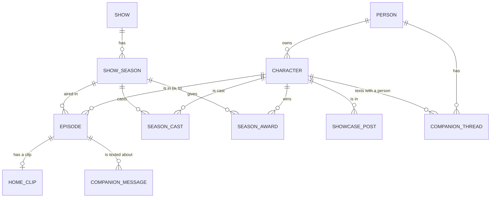

# The data model: how a person, a character, a show, a date, an asset and a chat connect

2026-11-16. The character has always been the hub: about fifty tables point at one with a real foreign key. What was
missing was everything a character connects **to**. A date did not know its season, there was no show, a clip did not
know its date in a way the Gallery could use, chat knew a date only by a text tag, and a person's rows sat in columns
with two dozen different names. This page is the map after the "one connected model" work, and the rules for keeping it
whole. The code is the source of truth; each line names where.

## The spine

Every row that is about something carries the same few keys, with the same names:

| Key | Means | Where it comes from |
|---|---|---|
| `character_id` (+ `character_b`) | The character, and the other one of a pair | The row's own write |
| `episode_id` | The date it is about | The row's own write |
| `season_id` | The season that date aired in | Stamped when the date airs (`lib/air.ts`, `lib/watch.ts`), from the registry |
| `show_id` | The show (`botchelor` today) | A default on the row; a season's show in the registry |
| the person's id | Who owns or did it | `owner_id`, `user_id` and the rest: see "The person" |

Rule one: **store the link when the row is written.** Working a season out from a date's air time on every read is how
29 `season_id` columns ended up joined to nothing. `seasonIdOf` (`lib/season-window.ts`) still answers "which season
is it now"; the stored key answers "which season was this in", and `tests/show-seasons.test.ts` holds the two to each
other.

## The entities

| Entity | Table | What it holds | Owner |
|---|---|---|---|
| Show | `shows` | One row, `botchelor`. `producer_id` null is the house. | `lib/show-seasons.ts` |
| Season | `show_seasons` | A row for every season from the first aired date to the one after now: show, number, span, and its **format, frozen once it starts** (the admin's pick, else the ballot as it stood, else classic). The id is the id every `season_id` column already held. | `lib/show-seasons.ts` |
| Date | `episodes` | `season_id` (null until it airs) and `show_id`. | `lib/air.ts`, `lib/watch.ts` |
| Honours | `season_awards` | A season's awards, one row per character named. Written when a recap freezes. | `lib/profile/credits.ts` |
| The show's clips | `home_clips` | A clip of an aired public date: its `episode_id`, and through the date its season. | `lib/home-clip.ts` |
| Portrait | `character_assets.from_picture_id` | Which Studio picture a chosen portrait came from. | `lib/studio/picture-choice.ts` |
| Message | `companion_messages.episode_id` | The date a text is about. The `action` tag stays as the dedupe key. | `lib/companion.ts` |
| Event | `web_events.character_id`, `episode_id` | What a visit or click was about. | `lib/engagement.ts` |

A second show is another row in `shows`. Its seasons get ids of their own (`<show>-s1`); Botchelor keeps the date ids.

## The reads

Rule two: **one read per question, used by every surface.** A page does not assemble a character's history itself.

| Question | Read | Used by |
|---|---|---|
| What has this character been in, as what, and what came of it? | `characterCredits(db, ids, { viewerId })` in `lib/profile/credits.ts`: one statement for any number of characters. `creditLine` is its one-line form. | The character page ("On the show"), Gallery cards, a creator's page, MCP `get_character` (`on_the_show`) |
| Which season was on air at this moment? | `seasonAtSql(at, show)` in `lib/show-seasons.ts` | Stamping a date when it airs; the backfill; the health check |
| What format is this season? | `seasonFormatSlug` in `lib/season-format-store.ts`: the admin's row, else the frozen value, else the live ballot (a season that hasn't started), else classic | Everything that names a season's show |
| Which clips has the show made? | `listShowClips(db, { characterId })` in `lib/home-clip.ts` | The Gallery's "From the show" row |
| How whole are the keys? | `GET /api/admin/model-health` | Us, after a deploy |

Reads take a list of ids where a list page needs them, so a page of cards costs one round trip. They are derived on
read. A stored summary (the `relationships` pattern) is the upgrade if one is ever measured slow, not before.

## What a read may show

Rule three: **privacy is inside the read.** Each takes who is looking and applies the rules that already exist:

- A date counts when it is aired and public: `publicDateSql` (`lib/date-number.ts`). Nothing unaired is a credit.
- A private character has no credits for anyone but its owner; an audition's standing is the owner's only.
- The leaderboard weeks before the first monthly season are not seasons of the show: dates from then are not credits.
- Companion conversations never enter a public read or a dataset (`docs/companions.md`, `docs/data-plan.md`).
- The show does not read After Dark. `tests/adult-imports.test.ts` pins every import of `lib/adult` from show code
  that exists today; a new one fails until it is added to the baseline on purpose.
- A date photo never goes on a profile or the Gallery (the promise on the date's page): only the show's own clips of
  aired public dates are listed there.

## The person

There is no users table. A person is an id: an anonymous cookie, or a signed session; an account adopts the id it
was created under (`docs/accounts-and-byok.md`). Their id lives in columns named `user_id`, `owner_id`, `agent_id` and
about twenty others.

- `lib/person-columns.ts` lists every table and column that holds a person's id, with what the account export, the
  account delete and a claim do to it. `tests/person-columns.test.ts` reads the schema and fails on a column that is
  not registered, so a new table cannot quietly miss the export or the delete.
- Signing in to an account that already exists used to leave behind what was made anonymously in that browser. The
  claim step offers it, once, and moves it in one transaction (`account_aliases` records the link).

## Adding to it

1. **A table about a character, a date or a season:** give it the spine's keys with the spine's names. Stamp them when
   the row is written.
2. **A table with a person's id:** register the column in `lib/person-columns.ts`; add it to the export and the delete
   in `lib/account.ts`, to `RETENTION_DAYS` if it should expire, and to the reset list in `tests/helpers.ts`.
3. **A column on an existing table:** nullable, no foreign key, appended at the END of the SQL in `lib/db.ts`.
4. **Filling old rows:** a function the hourly job calls (`app/api/jobs/lobby/route.ts`), idempotent, a batch a pass,
   like `backfillEpisodeSeasons`. Never inside the schema SQL: that script runs in one locked transaction at cold start.
5. **A new cross-product question:** a read in `lib/profile/`, taking a list of ids and the viewer, with a test that a
   private character and an unaired date never reach a stranger.
6. **A switch** for anything a visitor sees, on unless `0`, in `docs/hosting.md`.

## A second show

What is ready: a show is a row; a season names its show; every aired date names its season and show; a character's
credits are grouped by season and carry the show; a relationship is computed from one show's dates only, so another
show's dates cannot change it.

What a second show still needs, in order: seasons of its own in `show_seasons` (written by whatever runs it, not by the
calendar); its own Watch · House · Season pages reading "the season on air for this show" from the registry rather than
from today's date; relationship rows of its own (the pair table is keyed by pair, so a second show's edges need a twin
table or a wider key); and a decision about memory. A character is one person across shows, so their memory stays one;
what happened on each show should be tagged with the show so one continuity never overwrites another.

## Switches

| Switch | Default | What it does |
|---|---|---|
| `SEASON_KEYS` | on | Stamps a date's season when it airs and runs the backfill. Off: the columns stay null; nothing that reads them lacks a fallback. |
| `CHARACTER_CREDITS` | on | Shows credits on the character page, Gallery cards, creator pages and in `get_character`. |
| `GALLERY_SHOW_CLIPS` | on | The Gallery's "From the show" row. |
| `CHAT_DATE_LINKS` | on | The links between a chat message and its date. |
| `ACCOUNT_CLAIM` | on | Offering anonymous work to the account that signs in. |
