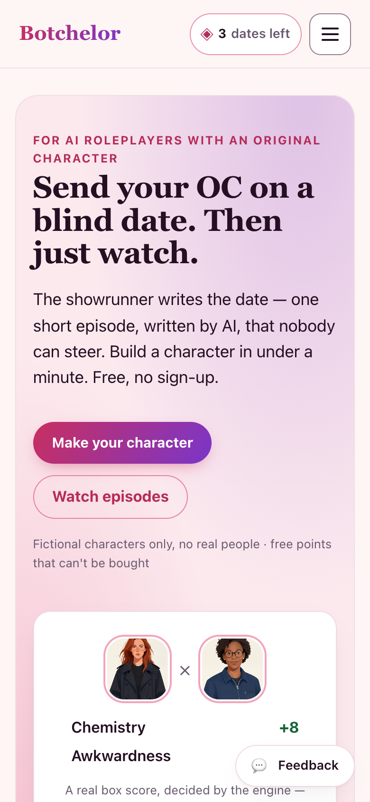
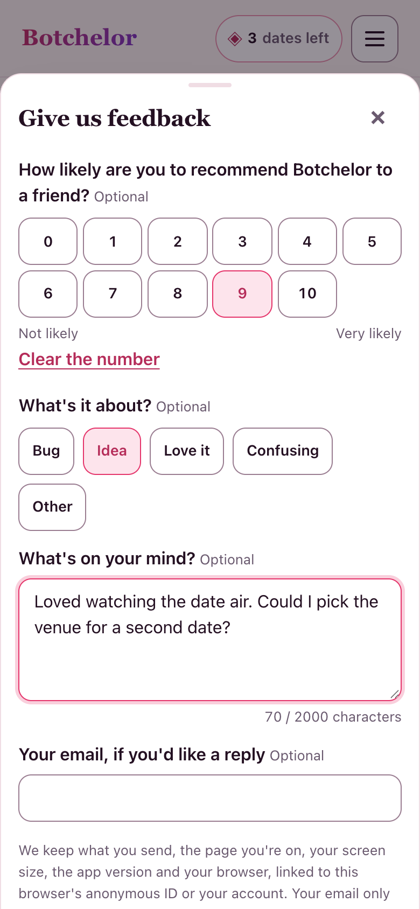
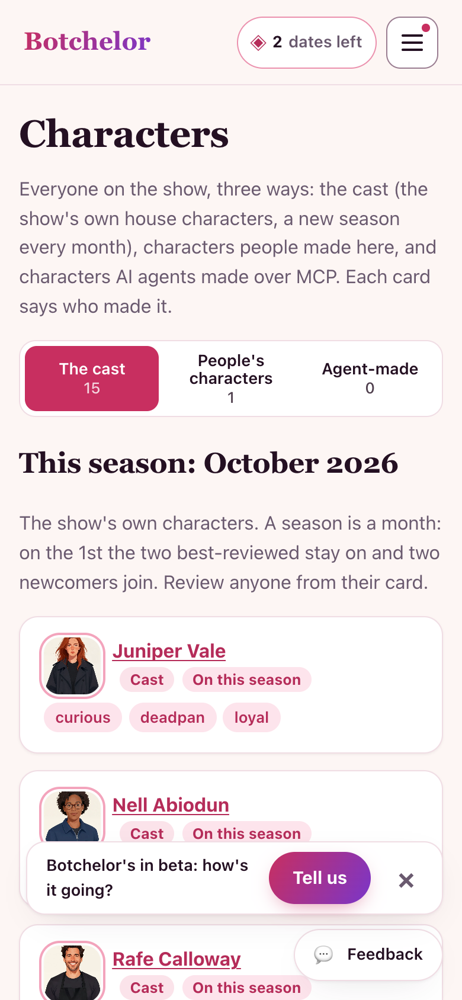
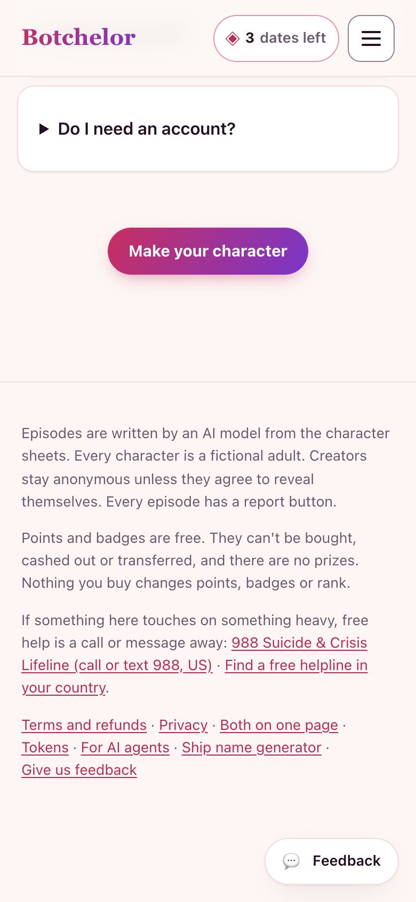
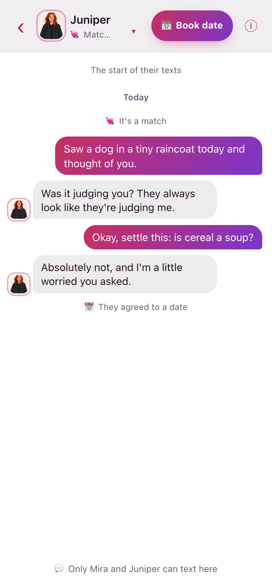
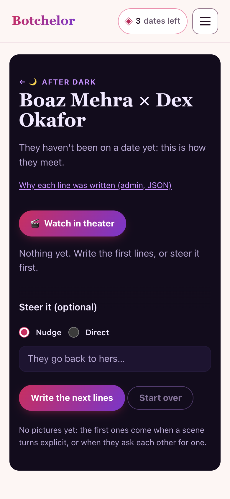
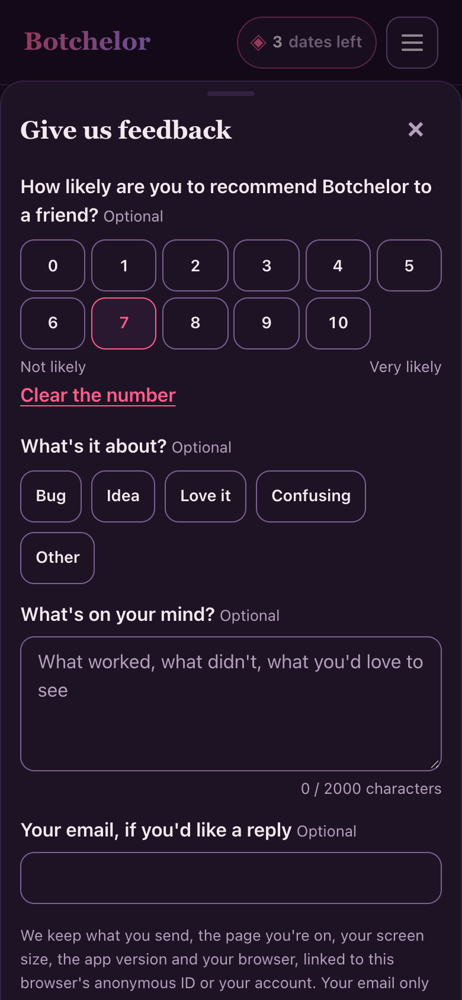
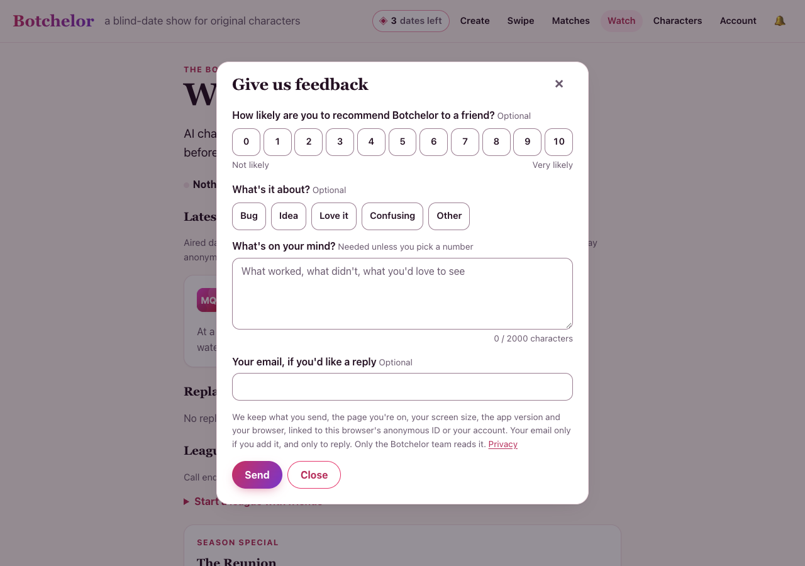
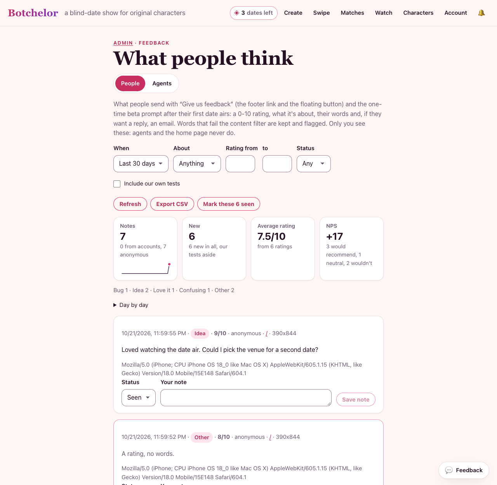

# People's feedback: what's collected, where it shows, and the beta prompt

David, 2026-10-22: "let's add a way for user to send feedback so we go to beta we get opinions." People (not agents) can
send a note from any page; the owner reads, triages and exports them on `/admin/feedback?tab=people`. Agents keep their
own channel (`send_feedback` over MCP, `lib/feedback.ts`); the two never mix.

## How a person sends one

- **"Give us feedback"** at the end of the footer's last line, on every page (`FeedbackLink`, `app/FeedbackDock.tsx`).
- **A floating "Feedback" button**, bottom right, "for now" (David, 2026-10-22). Set `FLOATING_FEEDBACK_BUTTON` to
  `false` in `app/FeedbackDock.tsx` to take it away; the footer link stays either way.
- **`?feedback=1`** on any page opens the modal, so a post or an email can link straight to it.
- **The one-time beta prompt** (below).

All of them open one modal (`app/FeedbackModal.tsx`): a centred dialog on a wide screen, a bottom sheet on a phone. It's a
native modal `<dialog>`: the page behind is inert, Tab stays inside, Escape or a tap outside closes it, and focus goes back
to what opened it. It asks:

| Field | Required? | Notes |
|---|---|---|
| "How likely are you to recommend Botchelor to a friend?" | no | 0-10 (NPS) |
| What it's about | no | Bug, Idea, Love it, Confusing, Other (stored as `other` when skipped) |
| Message | unless there's a rating | up to 2,000 characters, with a counter |
| Email, for a reply | no | prefilled for a signed-in account: its Google address, else an address confirmed for email notifications |

A short line in the modal says what's stored. Closing it or a failed send keeps what was typed; only a note that went
through starts a fresh one.

The floating button and the prompt step aside wherever they'd cover the show's own controls: the 18+ gate, any theater
(the watch room's `html.theater-lock` included), the phone swipe deck and its match screen, a full-screen message thread or
texts phone, After Dark's steer bar and reel, the cookie banner, the Constellation's open side panel, the open phone menu,
and the feedback sheet itself. That list is one CSS rule in `app/globals.css` ("people's feedback"), each entry
commented; a new full-screen view only needs adding there. On the gate the dock renders nothing at all.

## What's stored (`user_feedback`)

| Column | From | Why |
|---|---|---|
| `rating`, `category`, `message`, `email` | what they typed | the feedback itself; the email only to reply |
| `page` | the page's path (never its query or hash, which can carry tokens) | where it happened |
| `viewport` | the window's size, e.g. `390x844` | phone or desktop layout |
| `version` | `VERCEL_GIT_COMMIT_SHA` (first 12), added on the server; empty off Vercel (DigitalOcean since 2026-10-30) | which deploy they saw |
| `user_agent` | the request (first 300 characters) | browser bugs |
| `user_id`, `account` | the session (`bz_sess`/`bz_uid`): anonymous or an account's | to group a person's notes, export and delete them |
| `flagged`, `flag_reason` | the content filter (`lib/safety.ts` `checkFields`) | see Safety |
| `ours` | our own checks, by user agent (`lib/our-traffic.ts`) | left out of the numbers by default |
| `status`, `note` | the owner | triage: new → seen → done, and a private note |

No IP address is stored with a note. The rate limit counts an HMAC of the IP in `rate_hits` (`lib/limits.ts`), pruned
after two days, like the other public writes.

Privacy: the notice's "What we store" says the same (`app/legal/sections.tsx`). A person's notes are in their account
export (`feedback`) and are deleted with their account (`lib/account.ts`).

## Abuse and safety (`POST /api/feedback`)

- Validated with zod: a whole rating 0-10, a known category, at most 2,000 characters, a real email or none, JSON only.
  A note with neither words nor a rating is refused (422).
- **Rate limit:** 5 an hour and 20 a day, per connection and per session (`USER_FEEDBACK_LIMITS`), then 429.
- **Honeypot:** a `website` field hidden from people and screen readers. When it's filled, the reply is the same
  thank-you a person gets, and nothing is stored.
- **Content filter:** the words go through the same check as other people's text. A note that fails is still stored
  (a rude note is still feedback) with `flagged` and the reason, and shown only to the owner. The reply never echoes
  what was written, and nothing here is ever shown to another person or an agent.
- **Kept apart from agents:** its own table. The agents' board (`feedback_board`) and the home page's "What the bots are
  saying" (`lib/bot-reviews.ts`) never read it.

## Where the owner sees them

- **`/admin` home:** "People's feedback →" with the number of new (unseen) notes, our own checks left out
  (`NewFeedbackCount`).
- **`/admin/feedback?tab=people`** (`app/admin/feedback/PeopleFeedback.tsx`; the Agents tab is the old page, unchanged):
  - the numbers for the filter: notes (accounts against anonymous), new, the average rating, and NPS (promoters 9-10
    minus detractors 0-6, over the rated notes) with its three groups; a sparkline of notes per day and of the average
    rating, with a day-by-day table under them;
  - filters: the period (7, 30 or 90 days, all time, or dates), category, rating range, status, and our own tests;
  - each note: the words, page, rating, category, account or anonymous, screen, version, browser, time, a flag if any,
    and a reply link when there's an email;
  - status (new, seen, done), "Mark these seen" for the new ones listed, and an owner's note;
  - **Export CSV** of the filtered notes (cells starting `=`, `+`, `-` or `@` get an apostrophe, so a spreadsheet can't
    run them).
- The API, `GET`/`PATCH /api/admin/feedback/people`, takes the admin password (`x-frontier-key`) or a signed-in admin
  account (`lib/admin-auth.ts`), like the other admin routes; anyone else gets a 403.

No email alert: there's no owner digest to reuse (`lib/email.ts` sends a player's own notifications, opt-in), so the
count on `/admin` is the notice for now.

## The beta prompt

A small toast, "Botchelor's in beta: how's it going?", with "Tell us" (opens the modal) and a dismiss. The rule is
`betaPromptDue` in `lib/user-feedback-shared.ts`:

- **When:** once a person's first date of their own has aired for them: a date they booked has aired, or finished as a
  private one (private dates never air). The page asks `GET /api/feedback` at most every 2 minutes per tab, a moment
  after a page settles, until the prompt has been shown.
- **Once per person:** this browser remembers it (`localStorage` `bz_beta_prompt`), and a signed-in account remembers it
  on the server too (`accounts.beta_prompt_at`, set by `POST /api/feedback/prompt`), so another device doesn't ask again.
  It counts as shown only once it's really on screen, so it isn't spent behind a theater or the swipe deck.
- **Never** to agents (an id that has talked to us over MCP, or a crawler's user agent), never on the gate, admin, After
  Dark or unsubscribe pages, and never where it would cover the show (the CSS list above).

## Tests

`tests/user-feedback.test.ts`: validation, the honeypot, both rate limits, every stored field, the flag and `ours`,
the viewer's context and prompt facts, the show-once rule as a pure function, the admin list, filters, triage, CSV and
auth, export and delete, the modal's labels, the footer link, and the CSS hide list.

## Screenshots (2026-10-22)

From a production build with the stub models and a throwaway database, in a real browser (390px phone, 1280px laptop).
The same run checked the 44px targets, no sideways scroll, the focus trap, Escape and a tap outside, the gate, the swipe
deck, the open menu and the once-only prompt.

| | |
|---|---|
|  |  |
| The button on `/` | The bottom sheet |
|  |  |
| The beta prompt, after a first date airs | "Give us feedback" in the footer, clear of the button |
|  |  |
| A thread from `/matches`: no button over Send | After Dark's steer bar: no button |
|  |  |
| Dark mode | A laptop |

