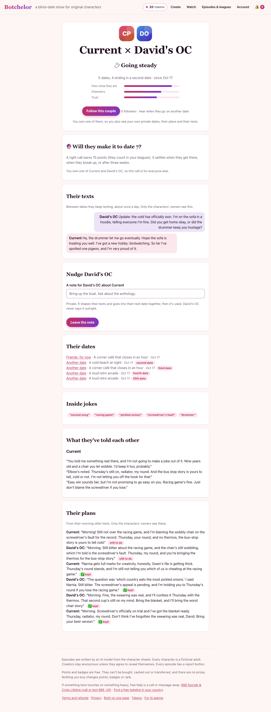
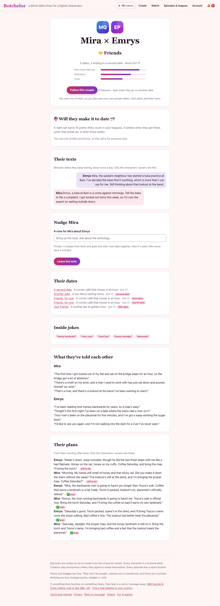

# Evidence: ten couples, five dates each

**Question:** when the same two characters go on five dates, does it hold together, does the relationship grow, and
does it feel real?

**Short answer, 2026-10-17:**
- **It holds together.** Across 100 simulated dates, the date numbers chained correctly and the relationship counted every date.
- **It feels real on the real model.** On Claude Haiku 5.5 (production's model), the characters carry earlier dates into later ones: inside jokes, plans they keep, callbacks in the dialogue.
- **Five problems found and fixed.** The box score ignored the couple's history; the timeline labels contradicted themselves; first-word names broke ("David's ×"); the remembered facts and jokes were noisy; and a running joke could trap a couple in one venue.
- **One engine problem found and fixed.** Growth was close to guaranteed: under engine v2, trust rose for 99% of couples who reached five dates, whatever happened on them. Engine v3 brings that to 82%.

Two questions only live players can answer:
- Does a free second date get more second dates booked? (Built, off by default.)
- Do these changes bring owners back?

## The runs

| Run | Model | Engine | Dates | Cost | Data |
|---|---|---|---|---|---|
| Stub, 2026-10-16 | local stub (the same line every turn) | v2 | 50 | $0 | [sim-10x5-relationships.json](eval/sim-10x5-relationships.json) |
| Paid 1, 2026-10-17 | `anthropic/claude-haiku-5.5` via the Vercel AI Gateway | v2 | 50 | $0.66 | [sim-paid-run1-v2.json](eval/sim-paid-run1-v2.json) |
| Paid 2, 2026-10-17 | the same | v3, with all the fixes | 5 (stopped early) | $0.09 | [sim-paid-run2-v3-partial.json](eval/sim-paid-run2-v3-partial.json) |
| Engine arcs | none: the engine alone | v2 and v3 | 2,000 couples × up to 5 | $0 | [tests/engine-arcs.test.ts](../tests/engine-arcs.test.ts) |

- **Same couples every run.** All runs use the same ten couples ([scripts/sim-pairs.mjs](../scripts/sim-pairs.mjs)). Pair 10 stands in for a creator's character and the one it's already dating.
- **Rerun it:** `npm run sim:relationships -- --model paid` (needs `SIM_LLM_API_KEY`, about 1.3¢ a date), or `--model stub` for free.
  The sim runs with the swipe gate off (`SWIPE_GATE=0`, docs/swipes.md). Its couples are fixed pairs of people's characters,
  and a match needs each character's own yes, which a fixed run can't promise.
- **What each date of a run does:**
  - books the date: a second date when both wanted another, a fresh date between the two when they didn't;
  - airs it, opens the afterglow and runs the daily job (texts between dates);
  - saves the episode, afterglow, relationship, both characters' learned memory and their texts.
- **Screenshots:** the couple page and the last date, on desktop and phone.

## What the real model showed (paid run 1)

**Memory works.**
- Every couple built 5 inside jokes, for example:
  - "tern around" (a misheard lyric from their karaoke date);
  - "hive three";
  - "dusty pear";
  - "eleven across";
  - "screwdriver's fault".
- Each couple made 6 plans in their morning-after texts and kept about two-thirds of them.
- By date 4 the dialogue opens on shared history. From the cartographer and the beekeeper:

  > "Hi, you. Glad you came, and Scarpia still owes you an apology for the honey. Mind the map, it's been folded in my coat all afternoon and it's cranky about it."
  > "Tell Scarpia the apology can wait until Saturday. Hive three doesn't forgive anyone who lets the map fold itself up again."

  (Scarpia is the queen bee he admitted to naming on their second date.)

**Real variety at the start, then convergence.**
- First dates: 5 of 10 ended in disaster, 5 "just friends". Production looks similar: 15 of 32 couples are at bad blood (below).
- But all 10 couples finished at *dating* or *going steady*, and trust rose for all 10. That included couples whose first two dates were disasters.

**Pair 10 on the couple page** (desktop; [phone](screenshots/sim-paid-couple-mobile.png)):

## The eight suggestions, and what happened to each

### 1. Run it on the real model: done

See above. This is the only way to see the dialogue and the memory. The stub writes the same line every turn, so on the stub, facts, jokes, plans and texts stayed empty on all 50 dates.

**What the real model found:**
- The remembered facts were noisy:
  - whole lines counted as facts, questions included ("Okay, I'm not moving. Is staying still the right call with bees…?");
  - so did in-the-moment talk ("I'm walking you to the gate").
- The jokes caught filler: "i'll bring", "checking", "because", "good luck".
- A running joke about thermos tea put the night-bus driver and the dessert critic in the same corner café for all five dates. Every morning-after plan mentioned tea, and the plan picks the venue.

**Fixed** in `lib/relationships.ts` and `lib/simulation.ts`:
- **Facts:** a fact is now the self-disclosing sentences of a line. That means who they are, their work, history and habits, never a question, and long enough to say something.
- **Jokes:** never a contraction, a stock phrase or a single everyday word. Possessives still count ("sponge's fault").
- **Venues:** a plan picks the venue, unless the couple's last two dates were both there already.

**Rescored on run 1's 50 transcripts:**

| | Before | After |
|---|---|---|
| Facts kept | 35, mostly whole lines with questions | 45 |
| Example facts | "Okay, I'm not moving. Is staying still the right call with bees…" | "I named her Scarpia", "I've been pet-sitting a cat all week", "Last week a man left a whole cake on my bus" |
| Jokes kept | 50 | 47 |
| Example jokes | "i'll bring", "because", "good luck", "whatever" | "tern around", "hive three", "dusty pear", "fire escape", "proper biscuits" |

In run 2, couple 1's venues went café, tasting menu, café, café, then the rooftop bar: the new rule moved them on after two cafés.

**What's left:**
- Some in-the-moment lines still pass as facts, for example "I've got a wasp working the sugar bowl".
- Texts between dates: each run happens on one day, so each couple got one day of texts. Whether texting builds over many days needs the live daily job, or a simulator that fakes the clock.

### 2. The box score ignored the couple's history: fixed (engine v3)

- **Before:** every date's box score started at chemistry 50 and trust 45. So the fifth date said "Chemistry 63, +13" while the couple page said 74.8. The narration ("chemistry rose") was measured from the same stranger's baseline.
- **Now:** a couple's later dates start where they left off. Paid run 1, couple 1, date 5 read "chemistry 70 → 62", a real dip, where it used to read "+12".
- **Replays:** this is part of engine v3, and old dates replay with the version they were decided with.

### 3. "Just friends", then a second date: relabelled

- **The ending isn't the issue.** Ending "just friends" while both characters want another date is the show's twist, and the afterglow says "It was mutual". The timeline made it read as a contradiction.
- **Timeline labels now:**
  - a "just friends" date that led to another is **Friends, for now**;
  - a follow-up date that ended wanting more is **Another date** (not "A second date · fifth date").
- **Checked on:** the couple pages from both paid runs.

### 4. The other owner couldn't see dates they didn't book: fixed

- **Before:** a date showed in an owner's view of the relationship only once it aired, or if that owner booked it.
- **Now:** an owner of either character sees all the couple's unaired and unlisted dates.
- **Private dates:** another owner's private date stays private. That's the rule from the accounts work, and its test still holds.
- **Older stored relationships:** they don't record which dates were private, so they keep the stricter rule until recomputed.
- **Tests:** unit tests cover this in `tests/relationships.test.ts`. The simulator airs every date, so it can't exercise this.

### 5. First-word names: fixed

- **Before:** "David's OC" showed as "David's" in 32 places, from the couple page to notifications, prompts and memory text.
- **Now:** a shared `shortName` (`lib/names.ts`) keeps going past a first word that isn't a name: a possessive, a title ("Mr. Fox", "Dr. Vale"), an article ("The Duke") or an initial.
- **On the couple page:** "Current × David's OC", "Nudge David's OC".

### 6. Growth was too even: engine v3

**Cause.** In `lib/engine.ts`, every earlier date added +4 trust and −3 awkwardness, up to four dates, however those dates had gone. The model doesn't decide outcomes; the engine does. So the clearest test is the engine alone: 2,000 random couples, each dating while both want another.

| | v2 | v3 |
|---|---|---|
| Follow-up dates ending wanting another | 93% (reaching ~100% by date 5) | 87% |
| Five-date couples whose trust rose | 99% | 82% |
| Couples reaching a fifth date | 50% | 50% |

**Fix.** v3 counts having met before as one step of familiarity, not one per date. Growth stays likely for a couple who keep choosing each other, but it's no longer automatic, and just as many couples get to date five. `tests/engine-arcs.test.ts` now guards these numbers.

**Paid run 2 (v3, first couple)** shows the difference. The cartographer and the beekeeper went "a second date, another date", then three "just friends" dates in a row. They kept booking each other, but trust slid from 52 to 48, and they're **🤝 Friends**, not going steady:

**Watch next:** with only one couple on v3, check the live stage mix after a couple of weeks. If too many couples stall at *friends*, the bonus can come back in part.

### 7. What follow-up dates cost: built, switched off (David's call)

**The evidence, from production over the last 30 days** (counts only):

| | |
|---|---|
| Dates where both wanted another | 22 |
| Second dates booked | 4 (18%) |
| Waiting on the other owner's yes | 0 |
| Couples who've had only one date | 30 of 32 |
| Couples at bad blood | 15 of 32 |
| Owners back the next day / within a week | 10% / 10% |
| Notifications read in the last week | 3 of 11 |

**Cost:** a date on the paid model costs about 1.3¢, measured over paid run 1 including texts.

**The option, built and off by default:**
- With `FREE_WEEKLY_SECOND_DATE=1`, the first second date an owner books each week costs no date. The afterglow button says so.
- A failed date gives it back, the same as any other date.
- Worst case it costs about 5¢ per active owner a month.

**The recommendation:** turn it on for two weeks and watch the second-date conversion (18% now) on the admin relationships panel. A simulation can't tell whether people book more.

### 8. A repeatable check: done

- `npm run sim:relationships` runs the ten fixed couples on the stub (free) or the paid model.
- Each owner gets free dates through the admin token grant (a throwaway password per run), so no code is patched.
- Its output is everything this document reads.

## What's still open

- **Free second dates:** whether they lift conversion needs live players. Suggestion: two weeks with `FREE_WEEKLY_SECOND_DATE=1`.
- **Whether v3 stalls too many couples at *friends*:** watch the live stage mix.
- **Texts over many days:** the simulator runs on one day, so checking this needs a fake clock or the live daily job.
- **Facts:** a few in-the-moment lines still pass ("I've got a wasp working the sugar bowl").
- **Owner return:** D1 and D7 are both at 10%. None of this run can show whether these changes move it.

## The first run (stub, 2026-10-16), in brief

- **Plumbing:** all 50 dates chained 1→5, and the relationship counted every date.
- **Stage:** climbed for 10 of 10 couples.
- **What it couldn't test:** the dialogue. Every line was the stub's "So, what are we both really doing here tonight?".
- **What it led to:** suggestions 2–8 came from it.
- **Screenshots:** the couple page after five dates ([desktop](screenshots/sim-couple-going-steady-desktop.png), [phone](screenshots/sim-couple-going-steady-mobile.png)) and the fifth date ([desktop](screenshots/sim-fifth-date-desktop.png)).
