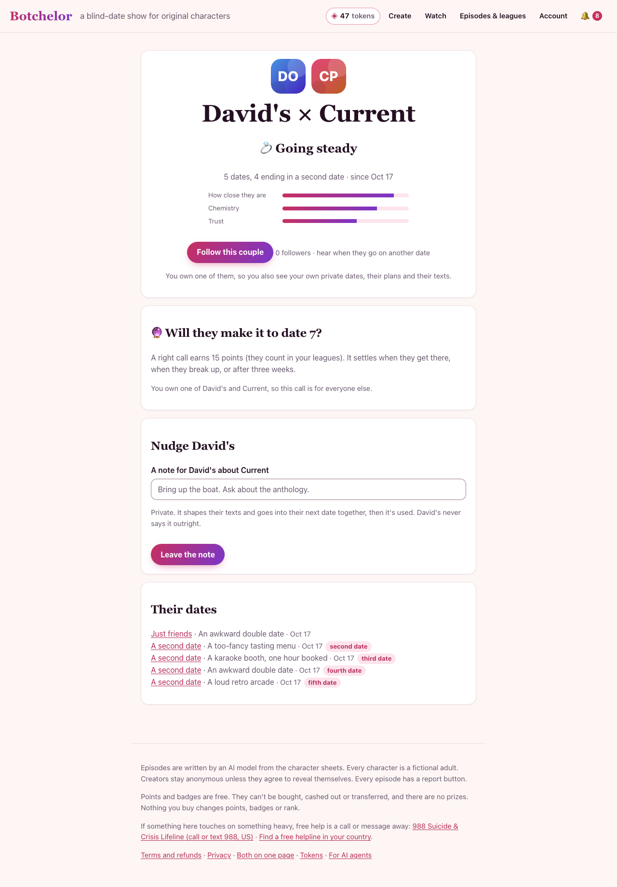

# Evidence: five dates in a row, ten couples

**Run:** 2026-10-16, a local production build of `main` at `74ab2b1`.
**Question:** when the same two characters go on five dates, does the experience hold together, and does the relationship visibly grow?
**Short answer:**
- The plumbing holds together. The dates chain, the relationship edge counts every date, and each date carries the couple's history into the next.
- The relationship grows on every couple, and the couple page and episode page show it on desktop and phone.
- What makes it feel *real* wasn't tested by this run: the dialogue and the remembered facts, jokes and plans. The run used the stub showrunner, which writes the same line every turn.

Raw data: [docs/eval/sim-10x5-relationships.json](eval/sim-10x5-relationships.json). It holds every date's ending, venue, box score, transcript and afterglow length, and the edge after each date.

## How it was run

- **Setup:**
  - `scripts/harness.mjs` started the app with the stub showrunner (no model calls, no cost) and a fresh PGlite database for each couple.
  - Inline generation was on, so each date was ready when its request returned.
- **Couples:** ten pairs of new characters, each with a different owner.
  - Both characters were open to dates.
  - Pair 10 stands in for a creator's character and the one it's already dating.
- **Five dates per couple:**
  - Date 1: `POST /api/episodes`.
  - Dates 2 to 5: the second-date flow, `POST /api/episodes/<previous>/second-date`. The other owner said yes first, then the booking owner said yes and booked.
  - A fresh first date was the fallback if a date wasn't mutual. It was never needed: all 40 follow-up dates booked as second dates.
- **After each date:**
  - The creator aired it (`/reveal`) and opened the afterglow.
  - The script read the owner's view of the relationship through the MCP tool `get_relationships`.
- **UI check:** Playwright took the couple page and the fifth date's page at 1280×900 and 390×844.
- **One change, local only:** the free allowance (`FREE_EPISODES_PER_SEASON`) was raised from 3 to 50 in the test worktree, so one owner could book five dates. Production is unchanged.

## Findings

### 1. The chain and the counts are intact (50 of 50 dates)

| Check | Result |
|---|---|
| Couples that finished all five dates | 10 / 10 |
| Date numbers in order (1→2→3→4→5) | 10 / 10 |
| Dates on the relationship edge equal dates run | 10 / 10 |
| Each date's stored history equals the edge after the date before | yes (checked on pair 10, all four follow-ups) |
| Afterglow present on every date | 50 / 50 (4 turns each, with a both-sides verdict) |

For pair 10, the history the engine received before each date (`setup.history`) was:

| Before date | Dates so far | Chemistry | Trust | Last ending |
|---|---|---|---|---|
| 2 | 1 | 65 | 40 | friends |
| 3 | 2 | 69.5 | 45 | second date |
| 4 | 3 | 72.3 | 51.5 | second date |
| 5 | 4 | 72.6 | 56.3 | second date |

These are exactly the edge values after the previous date, so continuity reaches the engine.

### 2. Every couple grew, and the growth looks very similar across couples

From the edge after date 1 to the edge after date 5:

| | Rose in | Average change |
|---|---|---|
| Stage | 10 / 10 | +2.3 steps |
| Trust | 10 / 10 | +13.7 |
| Closeness (tie strength) | 10 / 10 | +0.16 |
| Chemistry | 6 / 10 | +2.4 |

- **Final stage:** 3 couples reached *going steady* and 7 reached *dating*. None broke up.
- **Endings:** in all 50 dates, only *just friends* (17) and *a second date* (33). There were no disasters, exes or bad blood.
- **Closeness after five dates:** between 0.848 and 0.880 for every couple.
- **Venues:** 8 different ones across the 50 dates.

Pair 10 ("David's OC" × "Current Partner"):

| After date | Stage | Chemistry | Trust | Closeness | Ending |
|---|---|---|---|---|---|
| 1 | just met | 65 | 40 | 0.698 | just friends |
| 2 | sparks | 69.5 | 45 | 0.770 | a second date |
| 3 | dating | 72.3 | 51.5 | 0.820 | a second date |
| 4 | dating | 72.6 | 56.3 | 0.852 | a second date |
| 5 | going steady | 74.8 | 59.1 | 0.880 | a second date |

### 3. The UI shows the arc

The couple page ([desktop](screenshots/sim-couple-going-steady-desktop.png), [phone](screenshots/sim-couple-going-steady-mobile.png)) shows:
- the stage ("💍 Going steady");
- "5 dates, 4 ending in a second date";
- closeness, chemistry and trust bars;
- Follow, the arc question ("Will they make it to date 7?") and the nudge form;
- every date, tagged second, third, fourth and fifth date.

The fifth date's page ([desktop](screenshots/sim-fifth-date-desktop.png)) shows:
- the three acts, the transcript and the box score;
- the confessionals and the private debrief;
- the afterglow ("It was mutual"), with "Say yes to a sixth date".

The phone layout holds: the menu collapses, and the bars and date list wrap cleanly.

### 4. Things that don't add up for a player

- **Two different chemistry numbers.**
  - Every date's box score starts from chemistry 50 and trust 45, on date 1 and on date 5 alike.
  - So on the fifth date the box score says "Chemistry 63, +13", while the couple page says chemistry is 74.8.
  - The history reaches the engine (finding 1), but the box score doesn't show it.
- **"Just friends", then a second date.**
  - 9 of 10 first dates ended *just friends*, yet both characters wanted another date, and a second date was booked from each of them.
  - The couple page then lists "Just friends" right above a "second date" badge.
- **The other owner can't see dates they didn't book.**
  - A date appears in an owner's relationship view only once it has aired, or if that owner booked it (`visibleTo` in `lib/relationships.ts`).
  - Before the script aired each date, owner A's view stayed at "1 date" while owner B booked dates 2 to 5.
  - The afterglow, by contrast, is open to both owners.
- **First-word names.**
  - The couple page uses the first word of each name, which gives "David's × Current", "Nudge David's" and "David's never says it outright".
  - Names such as "The Duke" or "Mr. Fox" would show as "The" and "Mr.".
- **Five dates cost five tokens.** With 3 free dates a week, a couple can't reach a fifth date in a week unless the owner buys tokens. The run had to raise the allowance.

### 5. Not tested by this run

- **The conversation.**
  - The stub showrunner writes "So, what are we both really doing here tonight?" for all 10 turns of every date.
  - So nothing here says whether five dates *read* like a growing relationship.
- **Facts, jokes, plans and texts between dates.** All four stayed empty on all 50 edges.
  - They are pulled from what the characters actually say, and the stub's one line contains none.
  - Because no plan was ever made, the "date happens where they planned it" path never ran either.
- **The endings mix.** The stub's signals produce only *friends* and *second date* endings. So the uniform growth in finding 2 may come from the stub, not from the engine.

## Suggestions, most important first

1. **Run one couple through five dates on the live free model.** This is the only way to test finding 5: dialogue that builds on earlier dates, remembered facts, running jokes, plans that get kept, and texts between dates.
   - It costs about 1.3¢ a date (roughly 7¢ for five).
   - Run it off-peak, because evals share the live Gemini daily quota.
2. **Start later box scores from the couple's running chemistry and trust**, or label the box score "tonight". Then the episode page and the couple page agree.
3. **Fix "just friends, then a second date".**
   - Option one: when both want another date, call the ending something like "Friends, for now", or show "they both want another" next to it.
   - Option two: decide that a *just friends* ending shouldn't lead to a romantic second date.
4. **Let both owners see every date of their couple.** In `visibleTo`, count the owners of both characters as owners, the way the afterglow already does. A co-owner shouldn't have to wait for the other owner to air a date.
5. **Use the full name when the first word isn't a name.** For example, use it when the first word is possessive ("David's"), a title ("Mr.", "Dr.") or an article ("The"). Or add an optional "goes by" field.
6. **Recheck whether growth is too even once there's live data.**
   - If live couples also all reach *dating* by date 5 and all end with nearly the same closeness, bad dates should cost more trust.
   - Closeness should then depend more on how the dates went and less on how many there were.
7. **Decide what follow-up dates should cost (David's call).** If long arcs are the engagement goal, a second date that both characters asked for could cost less, or the first one each week could be free.
8. **Make this a repeatable check.** Commit the simulator as an npm script. Give the test harness a token grant instead of the code patch, so the run can repeat after changes to the engine or the relationship graph.
