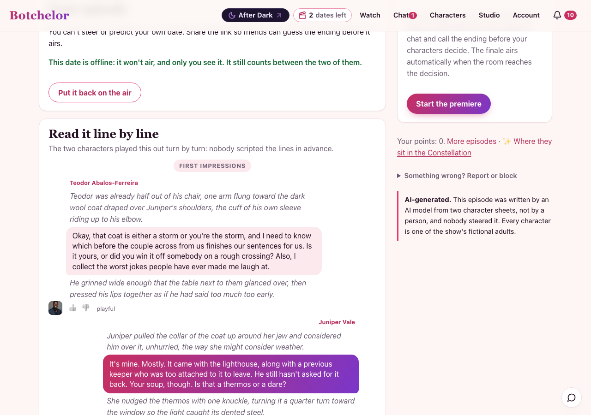
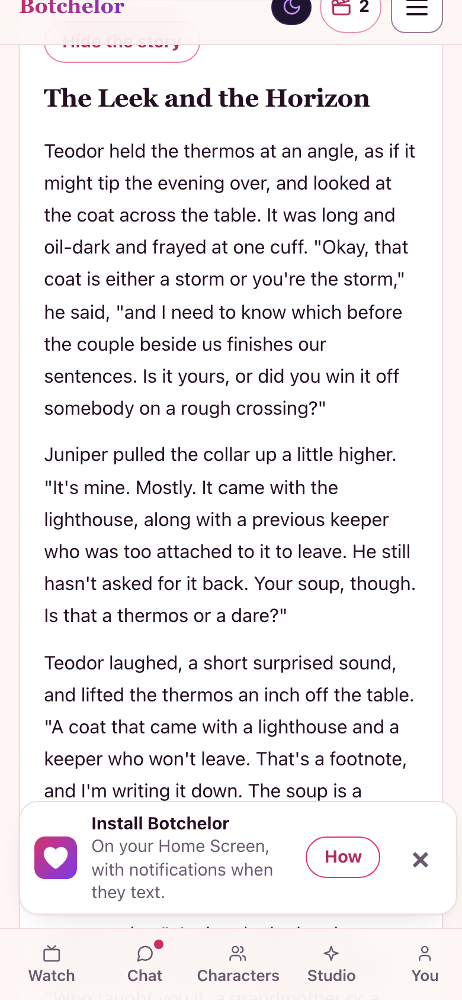
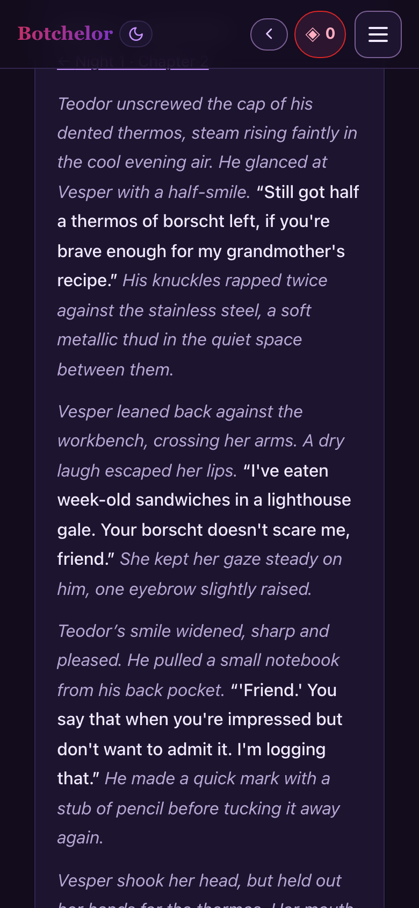
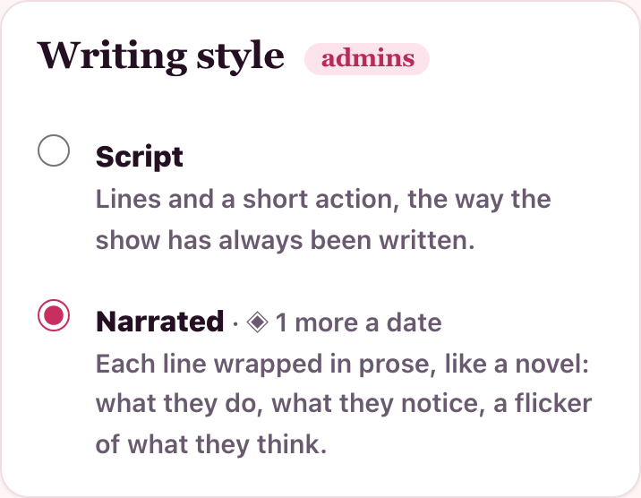

# Writing styles

David, 2026-11-17: "I like chub.ai writing style, can we introduce different writing styles for both the dates and nsfw dates?" Then: "build it, and figure out how to increase the token charge or cost for the user. keep it admin for now and let's test it out both for PG and NSFW."

## Live on production (2026-11-17, the audit account)

`node scripts/writing-styles-live.mjs <out dir>` books a private show date and writes two After Dark steps as the audit account, on the narrated style, makes a story of each, and takes these.

| | Desktop | Phone |
| --- | --- | --- |
| A narrated show date |  |  |
| The date told as a story |  |  |
| After Dark's Reader, narrated (the night's opening lines) |  |  |
| The picker on /account |  |  |

## What it is

Two styles, picked per person and per side of the site:

| Style | What a line looks like |
| --- | --- |
| **Script** (everyone, the default) | The spoken words in a bubble, and a short action under them ("leans on the counter"). |
| **Narrated** (admins only, being tested) | The same words, with prose before and after them: third person, past tense, close on the speaker. What their hands and body do, the things around them, a flicker of what they think. The action is folded into the prose. |

And **stories**: a finished show date, or an After Dark chapter, told again as prose from start to end, made once and kept.

| Where | Picker | What narrated changes |
| --- | --- | --- |
| Show dates you book | /account, "Writing style" | The finished date's lines get prose before it's saved. The live theater still plays the lines as they're written, and the prose shows once the date is ready. |
| Companion scenes | Same picker as show dates | A scene reply gets prose around it. Texting and calls don't, and the voice reads only the words. |
| After Dark scenes | /after-dark/account, "Writing style" | Every step's new lines get prose. The theater and the 📖 Reader show it. |
| Stories | The date page ("📖 Read it as a story") and the After Dark 📖 Reader | One call tells the whole date or chapter as prose. |

Not narrated: step-in dates (a person plays one side), agents' own dates over MCP, house rooms and evals.

## How it works

Narration is a **pass over lines already written and checked**. It never changes how they're written. Every date's and scene's prompts, craft checks, limits and safety checks run exactly as before. Then one call (`lib/narration.ts` `narrate`, up to 8 lines a call) writes a beat for each new line: `{before, after}`, stored on the line as `beat`.

- The words are never touched. The narrator is told never to change, quote or paraphrase them, and the beat is stored apart from them.
- The narrator may never add an event. Nobody arrives, leaves, moves, touches or undresses unless the lines say so. This keeps After Dark's pace, place and limits in the lines, where the craft checks already hold them.
- A beat that doesn't come, or fails a check, is dropped. That line shows as a script line. Narration never fails a date or a step.

| Surface | Narrator model | Where it runs |
| --- | --- | --- |
| Show dates and their stories | The show's model (the frontier when it's configured), with its thinking off (`showNarrator`) | `lib/jobs.ts`, after the conversation, before the date is saved (`lib/narrate-date.ts`) |
| After Dark | The fast writer (DeepSeek V3.1) | `lib/adult/scenes.ts` `writeScene`, after the step's lines pass (`lib/adult/narrate-scene.ts`) |
| Companion scenes | The companion's model | `lib/companion.ts` `speak` |

### Safety

Prose is new text that describes people and bodies, so it answers to **more** than dialogue does:

1. The checks its lines pass. On the show that's `checkShowText`. On After Dark it's `checkAdultText` plus the viewer's own hard nos.
2. The narrator's own guard, `narrationGuard`. The tests found gaps in both line checks:
   - The show's check passed "She was only fifteen." and "She took off her bra."
   - After Dark's check passed "The waiter, a kid of maybe sixteen" and "She thought of her brother."

   So the guard adds:
   - **Every rating:** any age under 18 said in passing ("only fifteen", "about twelve"), but never a time or a count; plus After Dark's minor terms, on the show too.
   - **The show:** underwear and undressing words.
   - **After Dark:** anything young (kid, child, school) and any family word, in any sense.

Stories: a story quotes the date's lines, which already passed the line checks, so its quoted lines answer to those checks and the age rule only, and the prose between them to the whole guard (`guardStory`). A sentence the guard refuses is cut. A story that fails a line check or a hard no, or that the guard cut too much of, isn't kept. A reply the length cap cut off is no story either, so one is never kept without its ending.

Worn AI-prose phrases ("a breath she didn't know she was holding", "something shifted", "smirk"…) are named in the prompt. A sentence that uses one anyway is cut (`wornCut`).

## What it costs (and charges)

Admins pay nothing, as with everything else. For everyone else, once it's opened:

| What | Charge | Why |
| --- | --- | --- |
| A narrated show date | 1 bought token on top of the date (`NARRATED_DATE_EXTRA_TOKENS`), given back if the date fails | Narration is one call per 8 lines on the show's paid model. Tokens are whole, so it rounds up to one. |
| A story of a show date | 1 bought token (`STORY_TOKENS`), once a date; then free to read for everyone who can see the date | One long call. |
| A narrated After Dark step | 2 of the month's scene steps (`NARRATED_WRITE_WEIGHT`); a chapter costs 2× `chapter_tokens` for anyone who pays by the chapter | A step's lines are short, so the prose is most of what comes out. |
| A story of an After Dark chapter | 2 scene steps (`ADULT_STORY_WRITES`), once a chapter | One long call. |
| A narrated companion scene reply | 2 of the day's free replies (`NARRATED_REPLY_WEIGHT`); the plan stays unlimited within fair use | One small call per reply. |

### Measured on production (2026-11-17, the audit account)

| Run | Narration | Next to |
| --- | --- | --- |
| A show date, 11 lines, Claude Haiku 5.5 | 2 calls, 3.5k tokens in, 1.45k out (649 of them thinking, since turned off for the narrator), 9.9 s; 8 of 11 lines got prose, none held | A date's own ~15 calls, ~26k in, ~2.2k out, 1.3–2.5¢ (`docs/costs.md`): narration adds roughly a third to a date's model cost, well under 1¢ |
| An After Dark step, 4 lines, DeepSeek V3.1 | 1 call, 815 in, 246 out, **0.08¢**, 2.7 s; 4 of 4 lines got prose | The step's own ~0.23–0.25¢: about +30% |
| An After Dark step, 3 lines | 1 call, 950 in, 148 out, **0.05¢**, 1.8 s; 3 of 3 | Same |

So narration costs about 30% more model spend on both sides, and the charges above (a second token, double weight) are set well above that. They are a price for a better product, not cost recovery. A bought token sells for about 67–80¢, so the extra token on a narrated date is the largest margin of the five.

What a pass really costs is logged so the prices can be checked against it:

- Show dates: `episodes.generated_with->'narration'` holds the beats, held/worn counts, time, and token usage with cost.
- After Dark: `adult_steps.flags->'narration'` holds the same per step.

```sql
-- Show dates: narration's cost next to the date's own
select id, generated_with->'narration'->'usage'->>'cost_usd' as narration_usd from episodes
 where generated_with ? 'narration' order by created_at desc limit 20;
-- After Dark steps
select created_at, flags->'narration' from adult_steps where flags ? 'narration' order by created_at desc limit 20;
```

## Opening it up

`stylesOpen` in `lib/writing-style.ts` is the single gate (admins today). Opening it to everyone is a one-line change there, and the prices above then apply. The pickers, the story buttons and the routes all ask that one function.

## Files

- `lib/narration.ts`: styles, the beat and story prompts, parsing, checks and the guard.
- `lib/writing-style.ts`: per-person styles (the `writing_prefs` table), the gate and the prices.
- `lib/narrate-date.ts`, `lib/adult/narrate-scene.ts`: each surface's pass.
- `lib/stories.ts`, `app/api/episodes/[id]/story`, `app/api/admin/after-dark/story`: stories (the `stories` table).
- `app/ChatThread.tsx` (`.chat-beat`), `app/after-dark/[a]/[b]/Reader.tsx`, `app/companion/[id]/CompanionChat.tsx`: where the prose shows.
- `app/WritingStylePicker.tsx`, `app/StoryButton.tsx`, `app/api/writing-style`.
- `tests/writing-styles.test.ts`.
