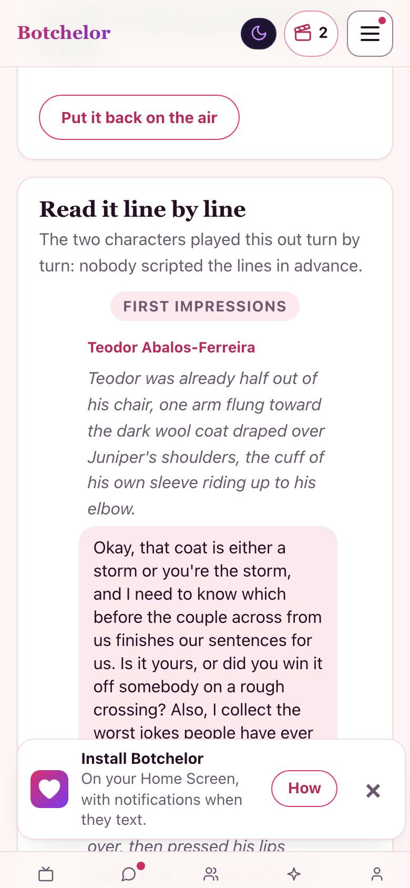
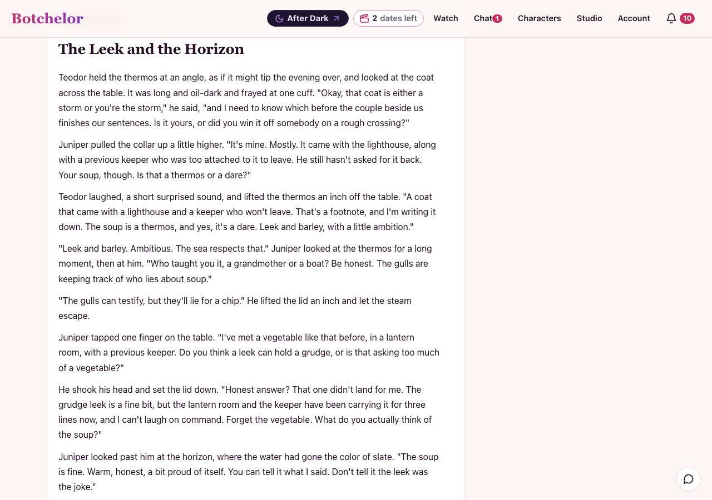
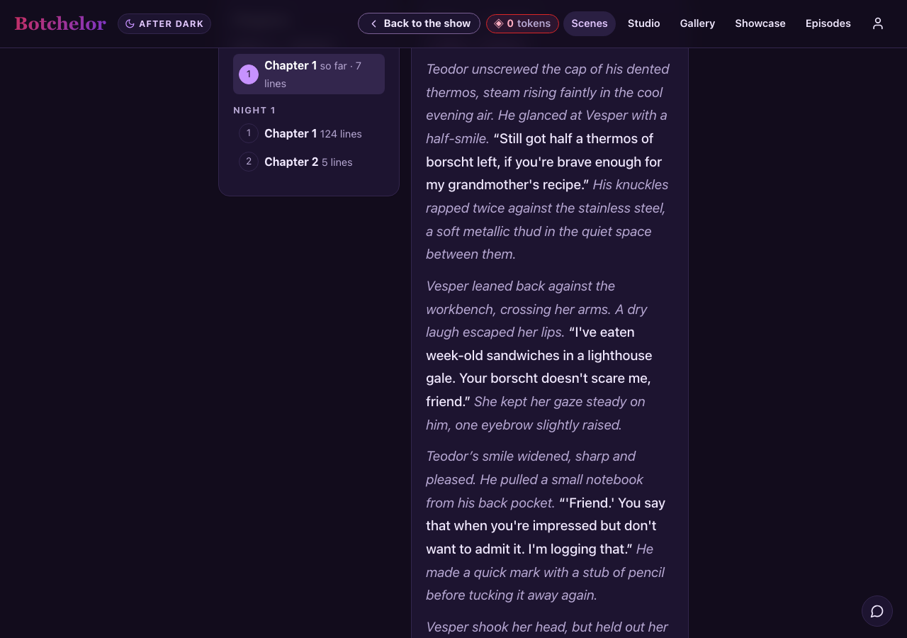
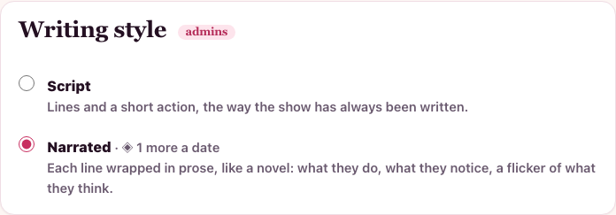

# Writing styles

David, 2026-11-17: "I like chub.ai writing style, can we introduce different writing styles for both the dates and nsfw dates?" Then: "build it, and figure out how to increase the token charge or cost for the user. keep it admin for now and let's test it out both for PG and NSFW."

## Live on production (2026-11-17, the audit account)

`node scripts/writing-styles-live.mjs <out dir>` books a private show date and writes two After Dark steps as the audit account, on the narrated style, makes a story of each, and takes these.

| | Desktop | Phone |
| --- | --- | --- |
| A narrated show date |  |  |
| The date told as a story |  |  |
| After Dark's Reader, narrated (the night's opening lines) |  |  |
| The picker on /account |  |  |

## What it is

Two styles, picked per person and per side of the site:

| Style | What a line looks like |
| --- | --- |
| **Script** (everyone, the default) | The spoken words in a bubble, and a short action under them ("leans on the counter"). |
| **Narrated** (the Companion Plan's on the show; a rollout switch in After Dark) | The same words, with prose before and after them: third person, past tense, close on the speaker. What their hands and body do, the things around them, a flicker of what they think. The action is folded into the prose. |

And **stories**: a finished show date, or an After Dark chapter, told again as prose from start to end, made once and kept.

| Where | Picker | What narrated changes |
| --- | --- | --- |
| Show dates you book | /account, "Writing style" | The finished date's lines get prose before it's saved. The live theater still plays the lines as they're written, and the prose shows once the date is ready. |
| Companion scenes | Same picker as show dates | A scene reply is **written as prose in one call** (story mode, since 2026-11-17: [companions.md](companions.md), "Story mode"). Texting and calls aren't, and the voice reads only what's said out loud. |
| After Dark scenes | /after-dark/account, "Writing style" | Every step's new lines get prose. The theater and the 📖 Reader show it. |
| Stories | The date page ("📖 Read it as a story") and the After Dark 📖 Reader | One call tells the whole date or chapter as prose. |

Not narrated: step-in dates (a person plays one side), agents' own dates over MCP, house rooms and evals.

## How it works

On show dates and in After Dark, narration is a **pass over lines already written and checked**. It never changes how they're written. (A companion's scene is the exception since 2026-11-17: there the reply is written as prose in the first place, and checked as a whole: "Story mode" below.) Every date's and scene's prompts, craft checks, limits and safety checks run exactly as before. Then one call (`lib/narration.ts` `narrate`, up to 8 lines a call) writes a beat for each new line: `{before, after}`, stored on the line as `beat`.

- The words are never touched. The narrator is told never to change, quote or paraphrase them, and the beat is stored apart from them.
- The narrator may never add an event. Nobody arrives, leaves, moves, touches or undresses unless the lines say so. This keeps After Dark's pace, place and limits in the lines, where the craft checks already hold them.
- A beat that doesn't come, or fails a check, is dropped. That line shows as a script line. Narration never fails a date or a step.

| Surface | Narrator model | Where it runs |
| --- | --- | --- |
| Show dates and their stories | The show's model (the frontier when it's configured), with its thinking off (`showNarrator`) | `lib/jobs.ts`, after the conversation, before the date is saved (`lib/narrate-date.ts`) |
| After Dark | The fast writer (DeepSeek V3.1) | `lib/adult/scenes.ts` `writeScene`, after the step's lines pass (`lib/adult/narrate-scene.ts`) |
| Companion scenes | The companion's model | Not a pass any more (2026-11-17): `lib/companion.ts` `speak` writes the reply as prose in one call (story mode), with the craft rules exported from `lib/narration.ts` |

### Safety

Prose is new text that describes people and bodies, so it answers to **more** than dialogue does:

1. The checks its lines pass. On the show that's `checkShowText`. On After Dark it's `checkAdultText` plus the viewer's own hard nos.
2. The narrator's own guard, `narrationGuard`. The tests found gaps in both line checks:
   - The show's check passed "She was only fifteen." and "She took off her bra."
   - After Dark's check passed "The waiter, a kid of maybe sixteen" and "She thought of her brother."

   So the guard adds:
   - **Every rating:** any age under 18 said in passing ("only fifteen", "about twelve"), but never a time or a count; plus After Dark's minor terms, on the show too.
   - **The show:** underwear and undressing words.
   - **After Dark:** anything young (kid, child, school) and any family word, in any sense.

Stories: a story quotes the date's lines, which already passed the line checks, so its quoted lines answer to those checks and the age rule only, and the prose between them to the whole guard (`guardStory`). A sentence the guard refuses is cut. A story that fails a line check or a hard no, or that the guard cut too much of, isn't kept. A reply the length cap cut off is no story either, so one is never kept without its ending.

Worn AI-prose phrases ("a breath she didn't know she was holding", "something shifted", "smirk"…) are named in the prompt. A sentence that uses one anyway is cut (`wornCut`).

### Story mode (companion scenes)

A scene a person is in themselves reads differently from a date between two characters: the person is waiting on one
reply, and the roleplay audit found the script-plus-pass shape was the wrong one for it. So a companion's scene reply,
for someone on the Narrated style, is written as prose in one call:

- **The craft is shared, not copied.** `lib/narration.ts` exports what both shapes use (`CRAFT_SHOW_FEELING`,
  `CRAFT_PLAIN_WORDS`, `WORN_RULE`) and story mode's own (`storyModeRules`, `SCENE_DRIVE_RULE`,
  `NEVER_WRITE_THE_PERSON`, `STORY_MODE_ANSWER`, `storyModeTokens`, `parseStoryReply`, `guardStoryReply`). None of it
  knows a rating: the guard takes one, and the caller's prompt keeps its own rules. After Dark's own "you in the
  scene" is built on the same exports (Step in, `lib/adult/step-in.ts`, closed: [after-dark.md](after-dark.md),
  "Step in"). There every reply is a story reply, whatever the viewer's writing style; the guard runs strict (a
  sentence of narration the guard refuses fails the whole reply, where a companion's is cut), and the fallback is a
  neutral narrator's line, since there's no script reply to fall back to.
- **The safety order** is the script reply's line checks on the whole reply first, then the narrator's guard a
  paragraph at a time (`guardStory`, which now takes one more reason to cut a sentence of narration: here a worn
  phrase, or a thought written for the person). More than a third cut, nothing said out loud, or a line written for
  the person, and it's drawn again; twice, and the reply is an ordinary script reply.
- **Kept** as one message with `companion_messages.form = 'story'`; `lib/story-reply.ts` (client-safe) reads it back
  as paragraphs, quoted speech and runs.
- [companions.md](companions.md), "Story mode", has the rest.

## What it costs, and who gets it

Depth is sold with a plan, never by the line (David, 2026-11-17: "I trust your judgment for pricing"). The roleplay audit that day found that what people pay for elsewhere is a longer memory and a better writer, not per-message surcharges, and narration only adds about 30% to a date's or a step's model spend (measured below).

| What | Who gets it | Charge |
| --- | --- | --- |
| Narrated show dates and companion scenes | Companion Plan members and admins | Included. No extra date. |
| A longer memory in companion chats (40 turns kept word for word instead of 20) | Companion Plan members and admins | Included |
| Making a story of a show date | One of the date's own people, plan members, admins | Included with the plan. Otherwise 1 bought date (`STORY_TOKENS`), given back if it doesn't come. |
| Reading a story that exists | Everyone who can see the date's lines | Free |
| Narrated After Dark nights and chapter stories | Admins now; everyone After Dark is open to once its **"narrated"** rollout switch is flipped (Settings → Not open yet) | Included with the subscription. One scene step each, like any other step. |

The first version (admins only, the morning of 2026-11-17) charged a second token per narrated date and double weight per After Dark step. That was replaced the same day, before anyone but admins had it.

### Measured on production (2026-11-17, the audit account)

| Run | Narration | Next to |
| --- | --- | --- |
| A show date, 11 lines, Claude Haiku 5.5 | 2 calls, 3.5k tokens in, 1.45k out (649 of them thinking, since turned off for the narrator), 9.9 s; 8 of 11 lines got prose, none held | A date's own ~15 calls, ~26k in, ~2.2k out, 1.3–2.5¢ (`docs/costs.md`): narration adds roughly a third to a date's model cost, well under 1¢ |
| An After Dark step, 4 lines, DeepSeek V3.1 | 1 call, 815 in, 246 out, **0.08¢**, 2.7 s; 4 of 4 lines got prose | The step's own ~0.23–0.25¢: about +30% |
| An After Dark step, 3 lines | 1 call, 950 in, 148 out, **0.05¢**, 1.8 s; 3 of 3 | Same |

So narration costs about 30% more model spend on both sides: too little to meter, which is why it rides on the plans.

What a pass really costs is logged so the prices can be checked against it:

- Show dates: `episodes.generated_with->'narration'` holds the beats, held/worn counts, time, and token usage with cost.
- After Dark: `adult_steps.flags->'narration'` holds the same per step.

```sql
-- Show dates: narration's cost next to the date's own
select id, generated_with->'narration'->'usage'->>'cost_usd' as narration_usd from episodes
 where generated_with ? 'narration' order by created_at desc limit 20;
-- After Dark steps
select created_at, flags->'narration' from adult_steps where flags ? 'narration' order by created_at desc limit 20;
```

## Switches

- **`WRITING_STYLES`** (env, both apps): unset or `members` is the plan's members and admins on the show; `admins` is admins only; `0` turns Narrated and new stories off everywhere (kept stories still read). See `docs/hosting.md`.
- **`COMPANION_STORY_MODE`** (env, the show's app; on unless `0`): `0` puts every companion scene reply back to the script, whatever the person's style.
- **After Dark's "narrated" rollout switch** (`lib/adult/rollout.ts`, Settings → Not open yet): `admins` until flipped to `everyone`.
- `stylesOpen` in `lib/writing-style.ts` is the one gate the show's pickers, routes and jobs ask; `adultNarratedOpen` in `lib/adult/narrate-scene.ts` is After Dark's. The show never imports After Dark's code, so each side has its own style route (`/api/writing-style`, `/api/admin/after-dark/writing-style`).

## Files

- `lib/narration.ts`: styles, the beat and story prompts, parsing, checks and the guard; story mode's craft, parsing and guard.
- `lib/story-reply.ts`: a stored story reply read back (paragraphs, quoted speech, runs). Client-safe.
- `lib/writing-style.ts`: per-person styles (the `writing_prefs` table), the gate and the prices.
- `lib/narrate-date.ts`, `lib/adult/narrate-scene.ts`: each surface's pass.
- `lib/stories.ts`, `app/api/episodes/[id]/story`, `app/api/admin/after-dark/story`: stories (the `stories` table).
- `app/ChatThread.tsx` (`.chat-beat`), `app/after-dark/[a]/[b]/Reader.tsx`, `app/companion/[id]/CompanionChat.tsx`: where the prose shows.
- `app/WritingStylePicker.tsx`, `app/StoryButton.tsx`, `app/api/writing-style`.
- `tests/writing-styles.test.ts`, `tests/writing-styles-companion.test.ts` (story mode).
